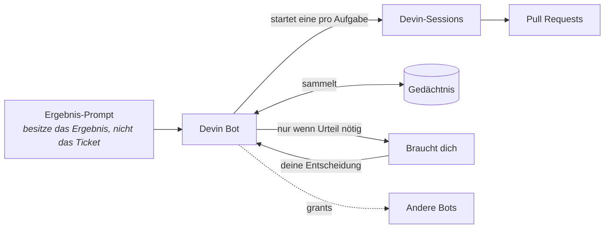

<picture>
  <source media="(prefers-color-scheme: dark)" srcset="assets/cover-dark.svg">
  
</picture>

 

Kuratiert von [@darega0mae](https://x.com/darega0mae) · Schwester-Tutorials: [build-with-devin](https://github.com/Till3005/build-with-devin) · [Projekt einreichen](CONTRIBUTING.md)

**12** dokumentierte Bot-Deployments · **34** Enterprise-Fallstudien · **4** veröffentlichte Produkte · **28** Tools & Integrationen · **19** Praxisberichte

[English](README.md) · [简体中文](README.zh.md) · [日本語](README.ja.md) · [Português](README.pt.md) · [Español](README.es.md) · Deutsch

> *Inoffizielles Community-Projekt — nicht mit Cognition AI verbunden, nicht von Cognition AI unterstützt oder gesponsert. „Devin" ist eine Marke von Cognition AI. Marken-Assets werden gemäß dem offiziellen Kit unter [devin.ai/brand](https://devin.ai/brand) verwendet. Offizielle Doku: [docs.devin.ai](https://docs.devin.ai).*

**Built with Devin** ist ein Register *verifizierter* Arbeit: Jeder Eintrag verlinkt auf ein namentlich bekanntes Deployment, ein echtes Repository oder einen veröffentlichten Bericht — kein Vaporware, keine Marketing-Umschreibungen. Die Aufnahmekriterien stehen in [CONTRIBUTING.md](CONTRIBUTING.md).

## Inhalt

- [Devin Bots — offizielles Produkt](#devin-bots----offizielles-produkt) — Deployments, wiederverwendbare Muster, Ergebnisse, der Marktplatz mit 16 Vorlagen
- [Mit Devin gebaute Produkte](#mit-devin-gebaute-produkte) — veröffentlichte Software, deren Code Devin geschrieben hat
- [Enterprise-Deployments](#enterprise-deployments) — veröffentlichte Kundenfälle mit harten Zahlen
- [Bots & Oberflächen](#bots--oberflächen) — Devin in Discord, Telegram, Slack und anderen Produkten
- [SDKs & API-Tooling](#sdks--api-tooling)
- [Werkzeuge rund um Devin](#werkzeuge-rund-um-devin) — was die Community *für* Devin baut
- [Muster & Erfahrungsberichte](#muster--erfahrungsberichte) — dokumentierte reale Nutzung
- [Community-Medien](#community-medien)
- [Offizielle Ressourcen](#offizielle-ressourcen)

## Devin Bots — offizielles Produkt

Veröffentlicht am **17. November 2026** ([Ankündigung](https://devin.ai/blog/introducing-devin-bots) · [Docs](https://docs.devin.ai/work-with-devin/bots) · [Fortune-Exklusiv](https://fortune.com/2026/11/17/exclusive-cognition-bets-on-devin-bots-coding-agents-in-challenge-to-anthropics-duet-and-openais-dots/)). Ein Bot ist ein persistenter Agent, der ein Ergebnis besitzt: Er plant die Arbeit, führt für jeden Teil eine Devin-Session aus, behält sein Gedächtnis über Wochen und bringt dir nur die Entscheidungen, die dein Urteil brauchen. Bots leben in Slack und iMessage, laufen nach Zeitplan oder Event-Triggern und geben Arbeit über Grants aneinander weiter. Bots enthalten Technologie der Interaction Company (Poke), die Cognition im Juli 2026 übernommen hat.

### Dokumentierte Deployments

| Bot | Eigentümer | Wofür verantwortlich | Gemeldete Ergebnisse |
| --- | --- | --- | --- |
| **Android Bot** | Cognition | Devins Android-App, Ende-zu-Ende | Am 28.09.2026 mit *"your job is to product manage the android app"* beauftragt — stellte eigene Tickets, führte pro Ticket eine Devin-Session aus, erreichte in **44 Tagen** die offene Beta bei Google Play: 1.134 gemergte PRs, 344.651 Zeilen Kotlin, 2.841 Screenshot-Tests. Der Mensch schrieb **insgesamt 183 Nachrichten** — 22 Tage völliger Stille — und **88% der PRs wurden selbst gemergt**. Verantwortet jetzt die Android/iOS-Feature-Parität. |
| **Layout Bot** | Cognition | Layout-Shift-Regressionen der Devin-Web-App | Baut alle 3 Stunden den Produktions-`main`, simuliert erste/wiederholte/verzögerte Besuche, verfolgt Regressionen bis zum einführenden PR und öffnet Fixes mit Vorher/Nachher-Videos. **159 PRs in 3 Wochen; Ruckeln −70%.** |
| **Super Jenny** | Jenny Xu (Community) | Ein ganzes Mobile-Game-Studio | ~20 Bots (Dev, Unity, Releases, UI, iOS, Android, Gerätetests) unter einem Orchestrierungs-Bot; der einzige Mensch beantwortet 4×/Tag einen konsolidierten Slack-Thread **mit Emoji**. ~50 → **1.900 PRs/Woche**, Studio-Umsatz ×6, wöchentliche Releases. Als Community-Template **SuperJennyStack** veröffentlicht. Sie baute dann **BotSpeak** — ein token-sparendes Bot-zu-Bot-Kürzel (ASD-STE100, ACK-Codes, Emoji-Quittungen; vollständige Prosa nur für den Menschen): Bot-Entscheidungen **12×** in 6 Tagen. ([Jennys Thread](https://x.com/xujennyc), [BotSpeak-Post](https://x.com/xujennyc/status/2123111543105868166)) |
| **dabit3s Flotte** | Nader Dabit (Cognition DevRel) | Eine persönliche 5-Bot-Org + ein Game-Studio | **CTO**-Bot: alle Sessions/Repos, VIP-iMessage-Kanal, um jeden Bot per SMS zu erreichen. **Auto(mation)Bot**: führt seine persönlichen Automatisierungen aus, meldet Latenz- und Effizienz-Empfehlungen. **DevCommunityBot**: betreibt das Ambassador-Programm über Sheets/Notion, baut Mini-Data-Viz-Apps. **DevRelBot**: Docs + Tutorial-Videos — *er hat einen eigenen Computer, eigene Devin/GitHub/Linear-Accounts und einen ElevenLabs-Stimmklon*, bootet einen Browser und zeichnet die echte UI auf. Plus **Windfable**, ein Unity-iOS-RPG für iPhone Duo, bei dem ~10 SuperJennyStack-Bots je eigenes macOS+Xcode+Unity bekommen und Duo-Modi (gefaltet/entfaltet) mit Vorher/Nachher-Screenshots + Gameplay-Video testen. ([Primer](https://x.com/dabit3/status/2122755275182469515)) |
| **Onboarding QA Bot** | Cognition (Walden Yan) | QA für 30+ Onboarding-Flows, 24/7 | Pflegt selbstaktualisierende Playwright-Skripte, eine Agenten-Job-Queue und ein selbstgebautes Live-Board — „fand weit mehr Bugs, als ich Geduld zum Entdecken gehabt hätte". ([@walden_yan](https://x.com/walden_yan)) |
| **„Phil"** | Harvey | Kollaborative Word-kompatible Editor-Engine | ~30 Agenten schrieben 1M+ Zeilen Rust + TypeScript in **3 Wochen, ohne menschliche Engineers** — kontinuierlich gegen echtes Microsoft-Word-Verhalten und simulierte Anwaltsverhandlungen verifiziert; Menschen steuern über Gedächtnis + Entscheidungs-Logs. ([Gabe Pereyra](https://x.com/gabepereyra)) |
| **Geteilte Bot-Flotte** | Decagon | On-Call, DevEx-Optimierung, Thread-Routing | 50+ geteilte Bots in Slack während der Beta; ein Chief-of-Staff-Bot entscheidet, wann und wie Threads gestartet werden. ([@tylerxdevs Thread](https://x.com/tylerxdev/status/2122743518712287400)) |
| **AutoResearch-Schleife** | Decagon | Ein Inferenz-Forschungslabor | Ein Devin orchestriert; Subagenten verfolgen konkurrierende Hypothesen parallel; jede Idee wird gegen wiedergegebenen Produktions-Traffic auf Modal-GPUs verifiziert — **bis zu 2,5× mehr Durchsatz pro GPU** ([vollständiger Artikel](https://x.com/DecagonAI/article/2115511110120120437), [@devindevelopers](https://x.com/devindevelopers/status/2115601107581821172)). |
| **Frankies Organisation** | Mark Fenner (Community) | Persönliche Agenten-Flotte | Vier Bots mit unterschiedlichen Aufgaben, koordiniert von „Frankie, my Chief Agent", der konsolidierte Updates zurückbringt ([Walkthrough](https://x.com/markfenner/status/2122740244328145211)). |
| **tigsbot** | @0xtigs (Community) | Persönliche Multi-Projekt-Flotte | Jedes Projekt lebt in einem Slack-Kanal, den ein Bot betreibt; ein Chief-of-Staff-Bot beantwortet „was ist der neueste Stand von allem?" und pingt ihn, wenn *er* der Engpass ist; Spezial-Bots verwalten Software mit Einzellizenz oder komplexem Setup ([Setup](https://x.com/0xtigs/status/2122742784176034056)). |
| **Electra** | Basis | Interne Tools + Code, selbstgesteuert | Ein namhafter Devin-Teamkollege (vor Bots): entscheidet selbst, was getan werden muss, schreibt und testet Code, liefert Updates an interne Tools und treibt das Team an — Basis führt pro Steuer-Agent einen 20-Tage-Thread ([Post](https://x.com/trybasis/status/2113307030203089189), [20-Tage-Thread](https://x.com/trybasis/status/2120658137766100992)). |
| **Persönliche Daten-Bots** | Bryan Johnson | Gesundheitssynthese + Familien-Updates | Ein Bot verdichtet Jahre an Biometrie- und Hirnscan-Daten zu einer Auswertung; ein anderer schickt seiner Mutter täglich eine SMS mit seinem Befinden. ([Post](https://x.com/bryan_johnson/status/2122814114976383406), [Launch-Video](https://vimeo.com/1247688199)) |

### Dokumentierte Muster

- **Ergebnis-Prompts** — *"You own the Android app now. Keep it at feature parity with iOS."* Gib dem Bot ein Ziel, kein Backlog.
- **Bot-zu-Bot-Übergaben** — Grants lassen einen QA-Bot einen Bug finden, einen Developer-Bot zum Fixen holen, auf Staging nachtesten und einen PM-Bot dem Channel Status melden.
- **Geplante Checks** — ein Bot, der per Cron einen Alert-Channel überwacht, den Check besitzt und bei Regression Fixes öffnet (Layout-Bot-Muster).
- **Roll-up-Reporting** — ein Aufsichts-Bot sammelt die offenen Entscheidungen aller untergeordneten Bots in einem einzigen Thread (SuperJennyStack-Muster).
- **Bots × Apps** — Bots pflegen Devin Apps: sie bauen neue Seiten/Features und passen sich automatisch an Änderungen an; Bots und Apps pinnen an derselben Navigationsleiste ([@dabit3](https://x.com/dabit3)).
- **Living Evals** — ein geplanter Devin liest Produktions-Traces, gruppiert sie nach Verhalten, spielt Fehler in einer vollständigen Systemkopie (nie Mocks) nach und friert jeden als Eval-PR ein — die Skill-Datei ist das Asset, nicht die Evals (Rox: 72% Coverage vs. 43–57% handgeschrieben).
- **Bots, die Devin selbst tunen** — Waldens Bot beobachtet User-Feedback, spielt Prompts nach, führt Experimente durch, baut Eval-Sets und justiert Devins eigene Proaktivitäts-/Autonomie-Parameter — Bots bauten Bots ([Thread](https://x.com/walden_yan/status/2122740852091216274)).
- **Referenz-verankerte Swarms** — Harveys Lektion: Wenn Arbeit gegen eine zuverlässige Referenz geprüft werden kann (echtes Word-Verhalten), kann ein kleines Team einen großen Swarm sicher dirigieren.

### Gemeldete Ergebnisse

**Über 1.000 Beta-Tester** in den Wochen vor dem Launch. Tester mergen **4,5× mehr PRs pro Nachricht**; Cognition mergt 2.000+ PRs/Woche, vervierzigfachte den Merge-Durchsatz und lieferte **1.000+ PRs aus einem einzigen autonomen Ziel**. Zu den Early-Access-Kunden gehören **Decagon, Fireworks AI und Reducto**, mit 10× Nutzungswachstum in den ersten zwei Wochen ([Fortune](https://fortune.com/2026/11/17/exclusive-cognition-bets-on-devin-bots-coding-agents-in-challenge-to-anthropics-duet-and-openais-dots/)).

Weitere dokumentierte Nutzung: vorbeugendes Issue-Triage bei **Manim**, Firmware-Arbeit, ein bot-geführtes Team, das eine **Frontier-Inference-Engine** baute, Tennis-Analysen, Buchhaltungsautomatisierung (trybasis: 20h → 30 Min.), swyx' einwöchiger Test (AEO, QA, Cross-Plattform-Portierung, persönliche Verwaltung, Videoschnitt — [sein Fazit](https://x.com/swyx/status/2122746401482592549)) und Cognitions Forschungsteam, das „Wochen in Tage" komprimierte ([@silasalberti](https://x.com/silasalberti)). Vollständige Berichte im [Reproduktions-Guide](docs/reproducing-devin-bots.md#reported-usage-beyond-cognition).

### Offizielle Template-Bibliothek

Sechzehn fertige Bots auf dem [öffentlichen Marktplatz](https://devin.ai/bots/templates), plus Community-Templates wie **SuperJennyStack**:

| Template | Aufgabe |
| --- | --- |
| Software Factory | Findet Bugs, Verbesserungen, Performance- und Refactoring-Arbeit in einem benannten Produktbereich; öffnet je einen kleinen PR mit Funktionsnachweis |
| Product Engineer | Bringt ein Ticket oder eine Anfrage zu einem getesteten PR und durchs Review |
| QA Engineer | Testet jeden PR in einem echten Browser und postet das Video des Ergebnisses |
| Anomaly Watcher | Scannt 2× täglich Produkt- und Geschäftsdaten nach Problemen, die kein Monitor überwacht |
| Code Reaper | Entfernt wöchentlich toten Code, ein sicherer PR pro Runde |
| Chief of Staff | Überwacht Kanäle, postet Updates, verteilt Arbeit ans Team und verfolgt sie bis zum Abschluss |
| Migration Engineer | Führt eine große Migration als kleine, getrackte PRs mit Fortschrittsanzeige |
| Latency Optimizer | Findet die langsamsten Endpunkte/Jobs/Queries; wöchentlicher Fix-PR mit Vorher/Nachher-Tempo |
| iOS Engineer | SwiftUI-Features bis PR + TestFlight-Build |
| Android Engineer | Kotlin-Features bis PR + interner Test-Build |
| Internal Tools Engineer | Admin-Panels und interne Tools auf deinem Stack |
| Data Analyst | Beantwortet Datenfragen mit Diagramm und dahinterliegender Query |
| Devin Coach | Bringt deinem Team aus euren eigenen Nutzungsdaten bei, Devin gut zu nutzen |
| Code Health Engineer | Alte Flags, veraltete Abhängigkeiten, CVEs → kleine sichere PRs |
| Technical Writer | Hält Repo-Wikis und Diagramme nach Merges mit `main` synchron |
| Compliance Engineer | Sammelt Kontrollnachweise aus dem Code und warnt, wenn eine Kontrolle ausläuft |

**[→ Reproduktions-Guide: wie man jeden dokumentierten Bot nachbaut](docs/reproducing-devin-bots.md)** — und die erweiterte Tutorial-Form im Schwester-Repo **[build-with-devin](https://github.com/Till3005/build-with-devin)**

Site: **[till3005.github.io/built-with-devin](https://till3005.github.io/built-with-devin/)** (Devin-gestylte Registry-Seite) · Deep Dives: **[Anatomie eines Devin Bots](docs/devin-bots-anatomy.md)** (die sechs dokumentierten Mechanismen + was die Zahlen wirklich zeigen) · **[Die Ökonomie von Devin](docs/economics.md)** (jede veröffentlichte Kosten-/Ertragszahl in einem Ledger — auch als [filterbare Seite](docs/economics.html))

<a href="#readme">back to top</a>

---

## Mit Devin gebaute Produkte

Echte Software, bei der Devin den Code geschrieben hat — keine Demos, ausgelieferte Arbeit.

- **[Era von Eon](https://devin.ai/customers/eon)** — Simulierte Unternehmen (74 herstellergetreue Systeme: Salesforce, Slack, Zendesk, Jira…) zum Trainieren und Evaluieren von KI-Agenten. **98% der gemergten PRs von Devin geschrieben**, 300+ tagelange Sessions, 2.720 von anderen Sessions gestartete Sessions.
- **[Courtyards Quick](https://courtyard.io/blog/post/from-a-slack-link-to-production-in-under-48-hours-cloning-shopifys-quick-with-devin)** — Courtyard klonte Shopifys internen Static-Site-Deployer „Quick": von einem Slack-Link zu einem Produktiv-Service (Go, Cloud Run, Bazel, Terraform, SSO, git-basiert) in **~21 Stunden**, komplett von Devin geschrieben.
- **[Frontierfood](https://samyok.com/frontierfood)** — Cognition-Engineer Samyok Nepal ließ Devin Voice Google-Bewertungen scrapen und die Pareto-Front von Essen nach Standort mappen ([Post](https://x.com/samyok/status/2098155977199743367)).
- **Flappy Asher** — Russell Kaplan (Cognition-Präsident) ließ Devin auf einer Mac-VM Babyfotos in Game-Sprites verwandeln und das Ergebnis veröffentlichen — live in TestFlight ([Post](https://x.com/russelljkaplan/status/2100280085999919555)).

*Kennst du ein veröffentlichtes Produkt, das mit Devin gebaut wurde? [Reich es ein](CONTRIBUTING.md).*

### Side Quests

Kleine, reizvolle Builds — der Beweis, dass dieselbe Maschinerie auch Spaß kann.

- **[Mobile Games auf dem iPhone Duo](https://x.com/xujennyc/status/2121625134029209929)** — Jenny Xu und Nader Dabit basteln an Devin-gebauten Mobile Games auf Foldables; Devin [baut und testet Duo-Apps selbst](https://x.com/DevinAI/status/2111161066403123653), auch im Maßstab ([dabit3](https://x.com/dabit3/status/2112939574133760190)).
- **Devins Selbstporträt** — Bryan Johnson bat Devin, darzustellen, wie es ihn sieht ([Post](https://x.com/bryan_johnson/status/2122818486800191842)).
- **Der CoS, dessen Job ein Bot übernahm** — Die erste Woche eines Cognition-Chief-of-Staff: Er wachte auf und der neue Chief-of-Staff-Bot machte bereits seinen Job ([Post](https://x.com/arirbrown/status/2122789909731872882)).

<a href="#readme">back to top</a>

---

## Enterprise-Deployments

Veröffentlichte Kundenfälle mit harten Zahlen ([vollständiger Index](https://devin.ai/customers)):

| Unternehmen | Deployment | Gemeldetes Ergebnis |
| --- | --- | --- |
| [Nubank](https://devin.ai/customers/nubank) | Millionen Zeilen, 8 Jahre alter ETL-Monolith → Submodule | 8–12× Engineering-Effizienz, 20× Kosteneinsparung; fine-getuntes Devin senkte ~40 Min./Task auf ~10 |
| [Wayfair](https://devin.ai/customers/wayfair) | Cloud-Agenten in der gesamten Organisation | 1.600+ Engineers voll dabei |
| [The Access Group](https://devin.ai/customers/access-group) | Devin auf 250 Produkten, 2.000+ Engineers | 5× Engineering-Output |
| [EBANX](https://devin.ai/customers/ebanx) | Devin als Hauptautor | **92% der gemergten PRs stammen von Devin** |
| [Gumroad](https://devin.ai/customers/gumroad) | Devin auf dem Core-Repo | Devin ist der **Top-Contributor** des Repos: 1.500+ gemergte PRs |
| [Finch](https://devin.ai/customers/finch) | Feature- + Wartungsarbeit | 3.000 gemergte PRs, ~20 Engineer-Monate eingespart |
| [Comarch](https://devin.ai/customers/comarch) | Neuaufbau eines 20 Jahre alten, 10M-Zeilen-ERP | Komplette Systemmodernisierung läuft |
| [AngelList](https://devin.ai/customers/angellist) | Incident-Triage + Datenmigration | Devin findet die Ursache von 70% der Incidents vor dem Engineer; Redshift→Snowflake 5,2× schneller |
| [Modal](https://devin.ai/customers/modal) | Incident Response | 80% der Incidents untersucht, bevor ein Engineer den Thread öffnet |
| [Reducto](https://devin.ai/customers/reducto) | Devin Oncall als Ersthelfer | Engineers werden kaum noch gepagt |
| [Eight Sleep](https://devin.ai/customers/eight-sleep) | Devin im ganzen Unternehmen | 8× mehr ausgeliefert |
| [Exa](https://devin.ai/customers/exa) | End-to-End-Auslieferung | Produktion, ohne dass Engineers Code lokal ziehen |
| [RV Tech](https://devin.ai/customers/rvtech) | Rivian-×-VW-JV, softwaredefinierte Fahrzeuge | 10× Testgeschwindigkeit |
| [Melius](https://devin.ai/customers/melius) | Kleines Team mit hohem Durchsatz | ~100 PRs/Tag |
| [Hamming](https://devin.ai/customers/hamming) | Devin auf der Codebase | 25% des gesamten Code-Volumens |
| [Airbyte](https://devin.ai/customers/airbyte) | Connector-Wartung | Hält 700+ Connectoren am Laufen |
| [Litera](https://devin.ai/customers/litera) | Regressionstests | Regressionszyklen um 90% verkürzt |
| [Ramp](https://devin.ai/customers/ramp) | Abbau technischer Schulden | **80 gemergte PRs/Woche, 10.000+ gesparte Engineer-Stunden**; ein kleines Devin-erfahrenes Team betreibt es |
| [Linktree](https://devin.ai/customers/linktree) | Feature- + Kundenbug-Pipeline | ~300 geschriebene / ~100 gemergte PRs im letzten Monat; der Reflex des Teams ist jetzt „kann ich das einfach Deven lassen?" |
| [Bilt](https://devin.ai/customers/bilt) | organisationsweiter Rollout | 800+ gemergte PRs seit Februar, Ø ~117/Woche |
| [Rohlik Group](https://devin.ai/customers/rohlikgroup) | agentengetriebene Lebensmittel-Operations | 2× Engineering-Durchsatz; 4× schnellerer Automations-Rollout inkl. Lagerrobotik; 50+ MCP-Integrationen |
| [Crosby](https://devin.ai/customers/crosby) | KI-native Kanzlei | 20–40 Bug-Reports/Alerts erhalten täglich einen First Pass, je ~5 Min.; 12 Engineers betreuen 50+ Anwälte |
| [Endava](https://devin.ai/customers/endava) | unternehmensweite Bereitstellung | 2.000+ Mitarbeiter auf der Plattform; 3× in vier Monaten; 78% PR-Merge-Rate |
| [Tavrn](https://devin.ai/customers/tavrn) | HIPAA-beschränkte Flotte | 8er-Team liefert wie 50; **1.800+ PRs in 6 Wochen**, 6× Output |
| **Rox** | Living Evals — wöchentlicher Devin liest Produktions-Traces, spielt Fehler in einer vollständigen Kopie nach, öffnet Eval-PRs | Eval-Suite deckt **72% der realen Nutzung** ab vs. 43–57% handgeschrieben ([Artikel](https://www.rox.com/articles/living-evals-an-eval-suite-that-grows-from-production), [Thread](https://x.com/rox_ai/status/2110779380666617997)) |
| [Evinova](https://devin.ai/customers/evinova) | GxP-regulierte Auslieferung | GxP-Dokumentation 8× schneller; Migrationen 3×; 66% der klaren Bugs autonom behoben |
| [Compiled Health](https://devin.ai/customers/compiledhealth) | Aufbau eines klinischen Benchmarks | 2 Forscher/2 Monate = Arbeit von 5–6 Engineers; ~430 Engineer-Stunden zu ~$17/h ≈ +4 Engineers in einem 4er-Team |
| [Común](https://devin.ai/customers/comun) | 13-köpfiges Fintech-Team | 3× Output; wöchentliche Backend-PRs 50 → 170 in vier Wochen |
| [AHEAD](https://devin.ai/customers/ahead) | 8 Produktions-Workloads | **8–40× Zeitersparnis** gegenüber manuellen Baselines; in 2 Werktagen voll produktiv |
| [The Citation Group](https://devin.ai/customers/thecitationgroup) | ROI-gemessener Rollout | 271 gemergte PRs mit 80% in 3 Monaten; 50% Engineering-Effizienzgewinn; 85% Einsparung bei Legacy-App-Auffrischung |
| [Latent Health](https://devin.ai/customers/latent) | Apotheken-Operations | 30% mehr PRs/Engineer vs. Claude Code allein; 50 laufende Automations |
| [Crossmint](https://devin.ai/customers/crossmint) | Skalierung des Open-Source-GOAT | Devin wurde während des Trials zum Top-Contributor des Repos |
| [FE fundinfo](https://devin.ai/customers/fefundinfo) | Automatisierung von 1.800 Repos | Sofort 10% mehr Kapazität durch Testgenerierung + Security-Fixes |
| [GE Aerospace](https://devin.ai/customers/geaerospace) | Story-Durchsatz eines begrenzten Teams | ~2× User-Story-Output in drei Monaten |

Ebenfalls dokumentiert: Citi (Rollout für 40.000 Entwickler, 30% Kürzung bei Tech-Vendor-Ausgaben), Itaú, Mercor, Hippo, Mercedes-Benz, Partnerschaften mit Cognizant und Infosys — siehe den [Kunden-Index](https://devin.ai/customers).

<a href="#readme">back to top</a>

---

## Bots & Oberflächen

Devin in anderen Produkten und Kanälen.

- **[devin-discord-bot](https://github.com/wgtechlabs/devin-discord-bot)** — Selbst gehosteter TypeScript-Bot, der Devin in Discord bringt: Sessions per Mention starten, Fortschritt zurück in den Channel streamen.
- **[devin-telegram-bot](https://github.com/wgtechlabs/devin-telegram-bot)** — Telegram-Bridge desselben Autors zur Devin-API.
- **[Buzz for Devin](https://github.com/fenner888/BuzzforDevin)** — Community-Fork von Blocks Buzz, der das offizielle Devin CLI (`devin acp`) als native Runtime hinzufügt — so bringt jede Person ihr eigenes authentifiziertes Devin in geteilte agent-native Communities mit.
- **[devin-sse-proxy](https://github.com/sotayamashita/devin-sse-proxy)** — Minimaler MCP-Server, der Claude Desktop mit Devins SSE-Transport sprechen lässt und einen Personal API Key durchreicht.
- **[devin-flow](https://github.com/xlm/devin-flow)** — Visueller Editor für ereignisgesteuerte Devin-Workflows auf der Automations-API, mit Session-Tracking (FastAPI + Vue 3).

<a href="#readme">back to top</a>

---

## SDKs & API-Tooling

- **[go-devin](https://github.com/gassara-kys/go-devin)** — Go-SDK für die Devin-API.
- **[llm-devin](https://github.com/ftnext/llm-devin)** — Plugin für Simon Willisons `llm`-CLI zum Aufruf der Devin-API.

<a href="#readme">back to top</a>

---

## Werkzeuge rund um Devin

Was die Community *für* Devin baut statt *mit* Devin.

- **[DevinX / Devinmaxxing](https://x.com/markfenner)** — Mark Fenners lokaler Modell-Picker für Devin-Desktop-Sessions: lokale Gewichte via ACP, adaptives Kosten-Balancing, Reasoning-Effort-Steuerung.
- **[awesome-devin](https://github.com/Icaro0310/awesome-devin)** — Das `devin-*`-Open-Source-Ökosystem: Session-Suche, History-Export, Knowledge Graphs, Eval-Harnesses, Backup, Fan-out-Planer.
- **[devin-judge](https://github.com/Icaro0310/devin-judge)** — Kalibrierte local-first Entscheidungsschicht mit Devin-ACP-Backend; kein API-Key nötig.
- **[devin-fusion-byok](https://github.com/kuobibulaien/devin-fusion-byok)** — Devin-Erweiterung (VSIX), die eigene Modell-APIs in Devins Modell-Picker bringt und zu Fusion-Lead+Sidekick-Presets zusammensetzt — ohne die App selbst zu verändern.
- **[devin.cursorrules](https://github.com/grapeot/devin.cursorrules)** — Das 5k★-Ruleset, das Cursor/Windsurf zu „90% von Devin" macht — der Referenzpunkt für Devin-würdiges Agentenverhalten.
- **[nix-devin-cli](https://github.com/broady/nix-devin-cli)** — Devin CLI als Nix-Paket mit nächtlichen Auto-Updates für macOS und Linux.
- **[QuotaView](https://github.com/Duoasa/QuotaView)** — macOS-„Dynamic Island" für KI-Agenten: verfolgt Devin-Desktop- und Devin-CLI-Sessions, Freigaben und Kontingente neben Claude/Codex/Grok.
- **[Mako](https://github.com/Verbiflow/mako)** — Lokaler Workspace für jeden Coding-Agenten; übernimmt Devin-Unterhaltungen per ACP — ausführen, verfolgen, fortsetzen und zwischen Maschinen verschieben.
- **[ax](https://zenn.dev/kuwashima/articles/ax-cross-agent-session-picker)** — fzf-Session-Picker, der Devin neben 18 anderen Agent-CLIs fortsetzt (JP).
- **[Kiro-Crew-Patch für Devin CLI](https://zenn.dev/dario_okazaki/articles/e5eda2aca4fdd2)** — Inoffizieller Patch, der Devin CLI in Kiro Crews verwaltete Bot-Flotte einbindet, mit Berechtigungsbehandlung pro Bot (JP).
- **[Devin for VS Code](https://github.com/shayanline/devin-vscode)** — Vollständiges Devin-CLI-Chat-Panel in VS Code ([Marketplace](https://marketplace.visualstudio.com/items?itemName=shayanline.devin-vscode)): Workspace-Kontext via `@`, Keep/Undo-Diff-Review, pro Workspace fortsetzbare Chats und ein Einstellungs-Editor für Instructions, Skills, Plugins, MCP-Server und Hooks des CLI.
- **[Devin Switch](https://github.com/ansuman-shukla/devin-switch)** — Natives macOS-App + CLI für mehrere Devin-CLI-Logins: isolierte Kontoprofile, geteilte lokale Gesprächshistorie, Anzeige von Nutzung/Reset und parallele Starts.
- **[Devin Token Monitor](https://github.com/TH-Chou/devin-usage-monitor)** — Natives macOS-Menüleisten-App (und VSIX), das die lokalen SQLite-Metriken des CLI in Live-Kosten-Dashboards verwandelt — Token-Trends, Modell-Donut, TTFT/Tokens-pro-Sekunde pro Anfrage, Budget-Alerts, CSV-Export, sechs Sprachen.
- **[devin-desktop-zh](https://github.com/cby122/devin-desktop-zh)** — Handgefertigte vereinfacht-chinesische Lokalisierung von Devin Desktop: 33.457-String-Wörterbuch + Injektions-/Neusignierungs-Pipeline, die ein eigenständiges `Devin 中文版.app` erzeugt — als Agent Skill veröffentlicht, der gesamte Workflow reproduzierbar.
- **[devin-tui](https://github.com/fenner888/devin-tui)** — Mark Fenners Vollbild-Terminal-UI für Devin über `devin acp`: React + Ink, Tool-Calls, Inline-Diffs, Plan-Ansicht, Ausgaben pro Session.
- **[Devin Remote](https://github.com/zouhall/devin-remote)** — Browser-Konsole für Devin-CLI-Sessions — steuere dein lokales Devin von jedem Browser, inkl. Smartphone: Streaming-Chat, Berechtigungen, Modi, Modelle, Nutzungsstatistiken.
- **[Devin Pocket](https://github.com/BOTOOM/devin-pocket)** — Mobile-first Devin-CLI-Client über ACP; läuft auf Android/Termux, Linux und macOS.
- **[devin-control](https://github.com/Icaro0310/devin-control)** — Policy-gated ACP-Client: isolierte Devin-Sessions hinter allow/deny/ask-Regeln.
- **[devin-subagents](https://github.com/Duro02/devin-subagents)** — Stellt `devin-acp`-Sessions als lebenszyklus-verwaltete Subagenten über MCP bereit: paralleles Dispatching, blockierendes `wait`, Steuerung während des Laufs, Berechtigungsentscheidungen.
- **[Devin Session Exporter](https://github.com/marktwainme/devin-session-exporter)** — Devin-Desktop-Erweiterung, die lokale ACP-Sessionsdatenbanken mit Filtern und Batch-Export nach Markdown/JSON/HTML exportiert.
- **[devin-acp-shim](https://github.com/wibus-wee/devin-acp-shim)** — Transparenter stdio-Proxy, der Devin CLIs Session-Level-MCP-Capability-Verhandlung repariert — klein, aber er entsperrt MCP-Server für jeden ACP-Host.

<a href="#readme">back to top</a>

---

## Muster & Erfahrungsberichte

Dokumentierte reale Nutzung.

- **[SAST-Auto-Remediation-Pipeline](https://github.com/Cognition-Partner-Workshops/uc-cve-remediation-regulatory-compliance/pull/16)** — GitHub-Actions-Workflow, der PRs mit OWASP Dependency-Check scannt und eine Devin-Session zur Behebung von CVEs ≥ 7.0 entsendet, mit Verifikations-Scans und einem Eskalations-Circuit-Breaker.
- **[Devin-PRs ihren Auftraggebern zuordnen](https://tech.enechange.co.jp/entry/2025/06/22/165504)** — ENECHANGEs GitHub-Actions-Setup, um festzuhalten, welcher Engineer Devin angewiesen hat — löst die Produktivitäts-Messlücke, wenn alle PRs als `devin-ai-integration[bot]` erscheinen (Japanisch).
- **[Veraltete Mailbox-Alarme beheben](https://agentsinuse.com/use-cases/devin-to-clear-mailbox-alarm/)** — Devin verfolgt einen Cloudflare-Workers-Test-Flake bis zu einem veralteten Continuation-Alarm und ergänzt Regressionsabdeckung (via Agents In Use).
- **[Die Spraycash-UI in Devin gestalten](https://dev.to/ibrahimpima/designing-the-spraycash-ui-with-kimi-k3-in-devin-4l2f)** — Eine Fintech-Landingpage, deren Art Direction komplett über den Devin-Chat lief: generierte Bilder, geschichtete Wolkenanimation, SVG-Draw-on-Ring und ein Drei-Font-System — alle Prompts veröffentlicht.
- **[Devin-Auto-Code-Review bei rakko_inc](https://zenn.dev/rakko_inc/articles/00cc5a5a679971)** — Playbooks + GitHub Actions + Devin-API verdauen jeden PR vor; monatlich geprüfte PRs stiegen von 65 auf 184 (JP).
- **[QA-Testdesign-Automatisierung bei Skillnote](https://zenn.dev/skillnote/articles/5ba429ca249801)** — PR löst Devin aus, Testfälle mit Begründung zu entwerfen; ~35 Min. gespart pro 10 Fällen (JP).
- **[Ereignisgesteuerte Devin-Automatisierung](https://zenn.dev/arufian/articles/f80a62f5217cee)** — Serverless GitHub-Actions-Pipeline mit Priorität×Komplexität-Policy-Tabelle und Plan-first-Freigabe (JP).
- **[Organisations-Rollout bei Leverages](https://zenn.dev/levtech/articles/9c869303820844)** — 14 Teams, 177 gemergte PRs und eine ehrliche ACU-vs.-Gehälter-ROI-Formel (JP).
- **[Schnelle Entwicklung mit Devin](https://blog.scottlogic.com/2025/10/20/rapid-development-with-devin.html)** — Scott Logics Praxisbericht, inklusive Prompt-Iterations-Lektionen.
- **[Scott Wu über Cognitions interne Nutzung](https://www.lennysnewsletter.com/p/how-devin-replaces-your-junior-engineers)** — wie Cognition selbst delegiert: asynchroner Junior-Engineer-Workflow, Top-5-Aufgabentypen, Crash-Analyse als erste Verteidigungslinie.
- **[Devins Änderungen End-to-End mit Signadot testen](https://dev.to/signadot/test-devins-changes-end-to-end-with-signadot-a0)** — Devin + Signadot MCP: Es führt den geänderten Microservice in seiner VM aus, sandboxt ihn gegen echten Cluster-Traffic und lässt die Playwright-Suite laufen — schließt die Schleife, die Devin in einem Multi-Service-System allein nicht schließt.
- **[Schwachstellen-Folgenabschätzung via Devin Automations](https://zenn.dev/rescuenow/articles/2ee1c4b66ecec8)** — rescuenows geplante Automation untersucht den Blast Radius, sobald ein CVE erscheint (JP).
- **[700 Support-Anfragen klassifizieren](https://zenn.dev/canly/articles/9c19bb123e208c)** — canly richtete Devin auf die Ticket-Historie, um herauszufinden, was „Ursache unbestimmt" wirklich war — Devin als Datenanalyst, nicht Coder (JP).
- **[Datadog CCM × wöchentliche Kosten-Ops mit Devin](https://zenn.dev/hubble/articles/091e29a0c86ec3)** und **[Dependabot-PRs zuerst von Devin triagiert](https://zenn.dev/hubble/articles/88429bd24db476)** — hubbles zwei Dauerschleifen: wöchentliche Cloud-Kostensenkung und Untersuchung jedes Dependency-Bumps, bevor ein Mensch ihn sieht (JP).
- **[Devin als Performance-Analyse-Agent mit Dynatrace MCP](https://medium.com/lets-code-future/how-i-turned-devin-into-a-performance-analysis-agent-with-dynatrace-mcp-753d3f4790a2)** — Devin an Live-Observability-Daten anschließen, damit es Latenz selbst diagnostiziert, nicht nur den Code (Medium).
- **[Devin: vom Bug-Report zum Pull Request](https://medium.com/@winter.inc/devin-from-bug-report-to-pull-request-25-days-of-ai-day-18-b158daa20f23)** — Tag 18 einer 25-Tage-KI-Serie: der komplette Ticket→PR-Loop auf einer echten Codebase (Medium).
- **[Rollenbasiertes Bot-Dev-Team + Auto-Merge leichter PRs](https://zenn.dev/kyto64/articles/ai-bot-dev-env)** — kyto64s persönliches Dev-Setup: spezialisierte KI-Bots plus Devin, risikoarme PRs mergen sich selbst (JP).
- **[Devin CLIs Kontextlimits in der Praxis](https://qiita.com/ishizakahiroshi/items/cee2a8ea2be18f2ccee3)** — Arbeitsnotizen, um AGENTS.md und Freigaberegeln in die 16KB/32KB-Limits zu bekommen (JP).
- **[Multi-KI-Orchestrierung auf dem kostenlosen SWE-2](https://qiita.com/ishizakahiroshi/items/72ab801a5f2a8c941b61)** — Ein Design, das Arbeit zwischen Agenten über Devin CLIs dauerhaft kostenloses SWE-2-Tier routet (JP).

<a href="#readme">back to top</a>

---

## Community-Medien

- **[Devin Central](https://devincentral.com)** — Trevor Lowings inoffizielle Devin-News- und Tutorial-Seite.
- **[Voices — Botschafter-Verzeichnis](https://devincentral.com/voices)** — Inoffizielle Karte der ~190 Devin-Botschafter weltweit.
- **[devin-cli.github.io](https://devin-cli.github.io)** — Community-Doku darüber, was Devins API-, Slack- und Linear-Oberflächen abdecken und wie man sie automatisiert.
- **[Agents In Use](https://agentsinuse.com)** — Verzeichnis realer Agenten-Anwendungsfälle, einschließlich Devin-Einträgen.
- **[BitsExplorer — Built with Devin](https://bitsexplorer.com/built-with/devin)** — 340+ öffentliche Projekte, durch Devins Commit-Trailer verifiziert (Beweis statt Selbstauskunft).
- **[Vibe Coded Projects](https://vibedprojects.com/ai-tools/devin)** — 373 mit Devin vibe-gecodete Apps, Tools und Sites.
- **[Devin 2. Jubiläums-Meetup Japan](https://aid.connpass.com/event/412875/)** — Von einem Botschafter organisiertes Community-Event zum zweiten Jahr öffentlichem Devin ([Ankündigung](https://x.com/kinopee_ai/status/2123019189325848847)).
- **[Devin's Dinner](https://x.com/MattSchrage/status/2121016484155548124)** — Matt Schrages einladungspflichtige NYC-Dinner-Reihe für Gründer und Engineers, die mit Devin arbeiten.

<a href="#readme">back to top</a>

---

## Offizielle Ressourcen

- [Devin Community](https://devin.ai/community) — Events, Botschafter-Bewerbungen, Event-Unterstützung
- [docs.devin.ai](https://docs.devin.ai) — Dokumentation: [Bots](https://docs.devin.ai/work-with-devin/bots), [Automations](https://docs.devin.ai/product-guides/automations), [Devin CLI](https://docs.devin.ai/cli/index.md)
- [Use-Case-Galerie](https://docs.devin.ai/use-cases/gallery/index.md) — 40+ dokumentierte Workflows mit Kopier-Prompts; [Best Practices zum Zerteilen von Arbeit](https://docs.devin.ai/use-cases/best-practices.md)
- [devin.ai/brand](https://devin.ai/brand) — offizielles Marken-Kit
- [Devin Discord](https://devin.ai/community) und [r/DevinAI](https://www.reddit.com/r/DevinAI/) — offizielle Community-Bereiche
- [CognitionAI/qa-devin](https://github.com/CognitionAI/qa-devin) — Cognitions eigenes Referenz-Repo für „Devin macht QA"
- [CognitionAI/devin-vuln-fixes](https://github.com/cognitionai/devin-vuln-fixes) — offizielle Agent-Skills, die echte CVEs patchen (GitLab CVSS 10.0, PHP-/Node-RCEs): Read-only-Inventur → Freigabe-Gate → bestätigter Ziel-Patch → Vorher/Nachher-Tests → ein fokussierter PR pro Repo
- [Custom Models auf Modal mit Devin trainieren & deployen](https://gist.github.com/dabit3/866caaab49a4a5371ae01655fecad34b) — funktionierendes Template von Cognition-Engineer Nader Dabit
- [Devin for Startups](https://devin.ai/startups) — bis zu $65k Credits für berechtigte Teams; [Devin for Gaming](https://talofagames.com/devin-for-gaming/) — Talofa-×-Cognition-3-Wochen-Studio-Cohort mit Präsenz-Workshops und Credit-Preisen
- [Devin Automations QuickStart](https://www.youtube.com/watch?v=6xxKtIpgOyE) — offizielles Video zu event-/zeitplangesteuerten Agenten-Setups, dem Substrat der Bots
- [SWE-2 Flash](https://cognition.com/blog/swe-2-flash) — Cognitions schnelles Coding-Modell: übertrifft alle amerikanischen Open-Weight-Modelle auf führenden Evals, 3× SWE-2-Geschwindigkeit zu 1/5 des Preises
- [Devin Apps](https://devin.ai/blog/devin-apps) — Live-Web-Apps, die Devin auf eigener Maschine baut und unter stabiler URL bereitstellt (interne Tools, Dashboards, Staging-Kopien)

<a href="#readme">back to top</a>

---

## Mitwirken

Hast du etwas mit Devin gebaut oder kennst ein Deployment, das uns fehlt? Siehe [CONTRIBUTING.md](CONTRIBUTING.md) — eine Zeile, Link zuerst, kein Marketing-Text.

## Lizenz

[CC0-1.0](LICENSE) — der Public Domain gewidmet. Die Einträge gehören ihren jeweiligen Eigentümern.
