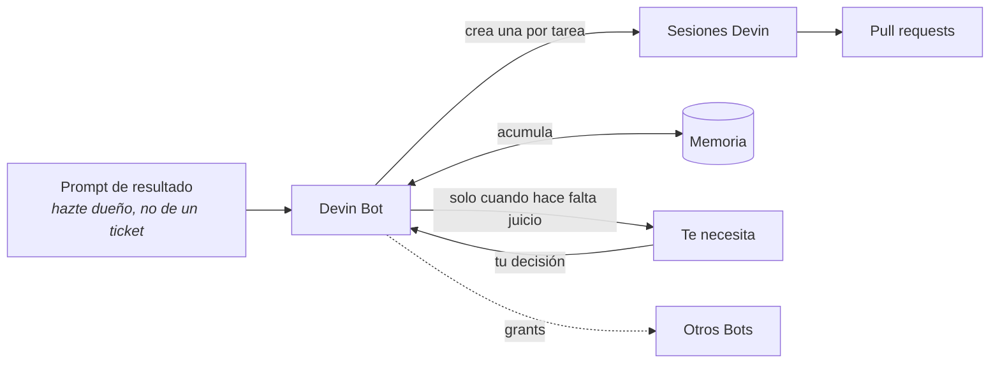

<picture>
  <source media="(prefers-color-scheme: dark)" srcset="assets/cover-dark.svg">
  
</picture>

 

Curado por [@darega0mae](https://x.com/darega0mae) · Tutoriales hermanos: [build-with-devin](https://github.com/Till3005/build-with-devin) · [Añade tu proyecto](CONTRIBUTING.md)

**12** despliegues de Bot documentados · **35** casos empresariales · **6** productos lanzados · **29** herramientas e integraciones · **21** informes de campo

[English](README.md) · [简体中文](README.zh.md) · [日本語](README.ja.md) · [Português](README.pt.md) · Español · [Deutsch](README.de.md)

> *Proyecto comunitario no oficial — sin afiliación, respaldo ni patrocinio de Cognition AI. "Devin" es marca registrada de Cognition AI. Los recursos de marca se usan según el kit oficial en [devin.ai/brand](https://devin.ai/brand). Documentación oficial: [docs.devin.ai](https://docs.devin.ai).*

**Built with Devin** es un registro de trabajo *verificado*: cada entrada enlaza a un despliegue con nombre, un repositorio real o un relato publicado — nada de vaporware ni paráfrasis de marketing. El criterio de inclusión está en [CONTRIBUTING.md](CONTRIBUTING.md).

## Índice

- [Devin Bots — producto oficial](#devin-bots----producto-oficial) — despliegues, patrones reutilizables, resultados, el marketplace de 16 plantillas
- [Productos construidos con Devin](#productos-construidos-con-devin) — software lanzado cuyo código escribió Devin
- [Despliegues empresariales](#despliegues-empresariales) — casos de clientes publicados con cifras concretas
- [Bots y superficies](#bots-y-superficies) — Devin dentro de Discord, Telegram, Slack y otros productos
- [SDKs y herramientas de API](#sdks-y-herramientas-de-api)
- [Herramientas alrededor de Devin](#herramientas-alrededor-de-devin) — lo que la comunidad construye *para* Devin
- [Patrones y artículos](#patrones-y-artículos) — uso real documentado
- [Medios de la comunidad](#medios-de-la-comunidad)
- [Recursos oficiales](#recursos-oficiales)

## Devin Bots — producto oficial

Lanzado el **17 de noviembre de 2026** ([anuncio](https://devin.ai/blog/introducing-devin-bots) · [docs](https://docs.devin.ai/work-with-devin/bots) · [exclusiva de Fortune](https://fortune.com/2026/11/17/exclusive-cognition-bets-on-devin-bots-coding-agents-in-challenge-to-anthropics-duet-and-openais-dots/)). Un Bot es un agente persistente dueño de un resultado: planifica el trabajo, ejecuta una sesión de Devin por cada pieza, mantiene memoria durante semanas y solo te trae las decisiones que necesitan tu juicio. Los Bots viven en Slack e iMessage, se ejecutan por horarios o disparadores de eventos y se pasan trabajo entre sí mediante grants. Los Bots incorporan tecnología de The Interaction Company (Poke), adquirida por Cognition en julio de 2026.

### Despliegues documentados

| Bot | Dueño | De qué se encarga | Resultados reportados |
| --- | --- | --- | --- |
| **Android Bot** | Cognition | La app Android de Devin, de extremo a extremo | Recibió el 28/09/2026 el prompt *"your job is to product manage the android app"* — creó sus propios tickets, ejecutó una sesión Devin por ticket, llegó a beta abierta en Google Play en **44 días**: 1.134 PRs fusionados, 344.651 líneas de Kotlin, 2.841 tests de capturas. Su humano envió **183 mensajes en total** — 22 días de silencio absoluto — y **el 88% de los PRs se auto-fusionaron**. Ahora mantiene la paridad de funciones Android/iOS. |
| **Layout Bot** | Cognition | Regresiones de layout shift en la web app de Devin | Cada 3 horas compila el `main` de producción, simula visitas de primera/repetida/tardía petición, rastrea regresiones hasta el PR que las introdujo y abre correcciones con vídeos antes/después. **159 PRs en 3 semanas; lag −70%.** |
| **Super Jenny** | Jenny Xu (comunidad) | Un estudio entero de juegos móviles | ~20 Bots (dev, Unity, releases, UI, iOS, Android, pruebas en dispositivo) bajo un Bot orquestador; el único humano responde a un hilo consolidado de Slack 4×/día **con emojis**. ~50 → **1.900 PRs/semana**, ingresos del estudio ×6, lanzamientos semanales. Publicado como plantilla comunitaria **SuperJennyStack**. Luego construyó **BotSpeak** — una taquigrafía bot-a-bot que ahorra tokens (ASD-STE100, códigos ACK, recibos emoji; prosa completa solo para el humano): decisiones de bots **12×** en 6 días. ([hilo de Jenny](https://x.com/xujennyc), [post de BotSpeak](https://x.com/xujennyc/status/2123111543105868166)) |
| **La flota de dabit3** | Nader Dabit (DevRel de Cognition) | Una org personal de 5 bots + un estudio de videojuegos | Bot **CTO**: todas las sesiones/repos, canal VIP de iMessage para llegar a cada bot por SMS. **Auto(mation)Bot**: ejecuta sus automatizaciones personales, reporta latencia y consejos de eficiencia. **DevCommunityBot**: gestiona el programa de embajadores en Sheets/Notion, construye mini-apps de visualización. **DevRelBot**: docs + videos tutoriales — *tiene su propia computadora, sus propias cuentas de Devin/GitHub/Linear y un clon de voz en ElevenLabs*, arranca un navegador y graba la UI real. Además **Windfable**, un RPG de Unity para iOS en iPhone Duo donde ~10 bots SuperJennyStack reciben cada uno su propio macOS+Xcode+Unity y prueban los modos Duo plegado/desplegado con capturas antes/después + video de gameplay. ([primer](https://x.com/dabit3/status/2122755275182469515)) |
| **Onboarding QA Bot** | Cognition (Walden Yan) | QA de 30+ flujos de onboarding, 24/7 | Mantiene scripts Playwright auto-actualizados, una cola de trabajos de agente y un tablero en vivo que él mismo construyó — "encontró muchos más bugs de los que yo habría tenido paciencia para descubrir". ([@walden_yan](https://x.com/walden_yan)) |
| **"Phil"** | Harvey | Motor de editor colaborativo compatible con Word | ~30 agentes escribieron más de 1M líneas de Rust + TypeScript en **3 semanas, sin ingenieros humanos** — verificados continuamente contra el comportamiento real de Microsoft Word y negociaciones de abogados simuladas; los humanos dirigen mediante memoria + registros de decisión. ([Gabe Pereyra](https://x.com/gabepereyra)) |
| **Flota de bots compartida** | Decagon | On-call, optimización de DevEx, enrutado de hilos | 50+ Bots compartidos en Slack durante la beta; un Chief of Staff Bot decide cuándo y cómo abrir hilos. ([hilo de @tylerxdev](https://x.com/tylerxdev/status/2122743518712287400)) |
| **Bucle AutoResearch** | Decagon | Un laboratorio de investigación en inferencia | Un Devin orquesta; subagentes persiguen hipótesis rivales en paralelo; cada idea se verifica contra tráfico de producción reproducido en GPUs de Modal — **hasta 2,5× más throughput por GPU** ([artículo completo](https://x.com/DecagonAI/article/2115511110120120437), [@devindevelopers](https://x.com/devindevelopers/status/2115601107581821172)). |
| **La org de Frankie** | Mark Fenner (comunidad) | Flota personal de agentes | Cuatro Bots con funciones distintas coordinados por "Frankie, my Chief Agent", que le devuelve actualizaciones consolidadas ([walkthrough](https://x.com/markfenner/status/2122740244328145211)). |
| **tigsbot** | @0xtigs (comunidad) | Flota personal multiproyecto | Cada proyecto vive en un canal de Slack operado por un Bot; un Chief-of-Staff Bot responde "¿qué hay de nuevo en todo?" y le avisa cuando *él* es el cuello de botella; Bots especialistas gestionan software de licencia única o instalación compleja ([setup](https://x.com/0xtigs/status/2122742784176034056)). |
| **Electra** | Basis | Herramientas internas + código, autodirigida | Una compañera Devin con nombre (pre-Bots): decide qué hay que hacer, escribe y prueba código, lanza actualizaciones de herramientas internas y empuja al equipo — Basis ejecuta un hilo de 20 días por agente fiscal ([post](https://x.com/trybasis/status/2113307030203089189), [hilo de 20 días](https://x.com/trybasis/status/2120658137766100992)). |
| **Bots de datos personales** | Bryan Johnson | Síntesis de salud + avisos a la familia | Un Bot sintetiza años de datos biométricos y escáneres cerebrales en una sola lectura; otro le manda a su madre un mensaje diario con su estado. ([post](https://x.com/bryan_johnson/status/2122814114976383406), [vídeo de lanzamiento](https://vimeo.com/1247688199)) |

### Patrones documentados

- **Prompts de resultado** — *"You own the Android app now. Keep it at feature parity with iOS."* Dale al Bot un objetivo, no un backlog.
- **Handoffs entre bots** — los grants permiten que un QA Bot encuentre un bug, llame a un Developer Bot a corregirlo, re-pruebe en staging y que un PM Bot reporte el estado al canal.
- **Comprobaciones programadas** — un Bot que vigila un canal de alertas por cron, es dueño de la comprobación y abre correcciones cuando hay regresión (patrón Layout Bot).
- **Informes consolidados** — un Bot supervisor recoge las decisiones pendientes de todos los Bots subordinados en un solo hilo (patrón SuperJennyStack).
- **Bots × Apps** — los Bots mantienen Devin Apps: construyen nuevas páginas/funciones y se adaptan a cambios automáticamente; Bots y Apps se fijan en el mismo rail de navegación ([@dabit3](https://x.com/dabit3)).
- **Living evals** — un Devin programado lee trazas de producción, las agrupa en comportamientos, reproduce fallos en una copia completa del sistema (nunca mocks) y congela cada uno como PR de eval — el archivo skill es el activo, no los evals (Rox: 72% de cobertura vs 43–57% escrito a mano).
- **Bots que afinan al propio Devin** — el bot de Walden observa el feedback de usuarios, repite prompts, ejecuta experimentos, construye sets de eval y ajusta los parámetros de proactividad/autonomía de Devin — Bots construyeron Bots ([hilo](https://x.com/walden_yan/status/2122740852091216274)).
- **Swarms anclados a referencia** — la lección de Harvey: cuando el trabajo puede verificarse contra una referencia fiable (el comportamiento real de Word), un equipo pequeño puede dirigir un swarm grande con seguridad.

### Resultados reportados

**Más de 1.000 beta testers** en las semanas previas al lanzamiento. Los testers fusionan **4,5× más PRs por mensaje**; Cognition fusiona 2.000+ PRs/semana, multiplicó por 40 su throughput de PRs fusionados y entregó **1.000+ PRs desde un único objetivo autónomo**. Clientes de acceso anticipado: **Decagon, Fireworks AI y Reducto**, con uso ×10 en las dos primeras semanas ([Fortune](https://fortune.com/2026/11/17/exclusive-cognition-bets-on-devin-bots-coding-agents-in-challenge-to-anthropics-duet-and-openais-dots/)).

Otros usos documentados: triaje preventivo de issues en **Manim**, trabajo en firmware, un equipo liderado por bots construyendo un **motor de inferencia de frontera**, analítica de tenis, automatización contable (trybasis: 20h → 30 min), la prueba de una semana de swyx (AEO, QA, portabilidad multiplataforma, gestión personal, edición de vídeo — [su resumen](https://x.com/swyx/status/2122746401482592549)) y el equipo de investigación de Cognition comprimiendo "semanas en días" ([@silasalberti](https://x.com/silasalberti)). Relatos completos en la [guía de reproducción](docs/reproducing-devin-bots.md#reported-usage-beyond-cognition).

### Biblioteca oficial de plantillas

Dieciséis Bots listos en el [marketplace público](https://devin.ai/bots/templates), más plantillas comunitarias como **SuperJennyStack**:

| Plantilla | Qué hace |
| --- | --- |
| Software Factory | Encuentra bugs, mejoras, rendimiento y refactors en un área de producto concreta; abre un PR pequeño por vez con prueba de que funciona |
| Product Engineer | Lleva un ticket o petición hasta un PR probado y aprobado en revisión |
| QA Engineer | Prueba cada PR en un navegador real y publica el vídeo del pass/fail |
| Anomaly Watcher | Dos veces al día explora datos de producto + negocio en busca de problemas que ningún monitor vigila |
| Code Reaper | Elimina código muerto cada semana, un PR seguro por vez |
| Chief of Staff | Vigila canales, publica actualizaciones, reparte trabajo al equipo y lo sigue hasta el final |
| Migration Engineer | Gestiona una gran migración como PRs pequeños y trazados, con una superficie de progreso |
| Latency Optimizer | Encuentra los endpoints/jobs/queries más lentos; PR semanal con velocidad antes/después |
| iOS Engineer | Funciones SwiftUI hasta PR + build en TestFlight |
| Android Engineer | Funciones Kotlin hasta PR + build de prueba interna |
| Internal Tools Engineer | Paneles de administración y herramientas internas en tu stack |
| Data Analyst | Responde preguntas de datos con el gráfico y la consulta detrás |
| Devin Coach | Enseña a tu equipo a usar bien Devin a partir de tus propios datos de uso |
| Code Health Engineer | Flags viejos, dependencias antiguas, CVEs → PRs pequeños y seguros |
| Technical Writer | Mantiene wikis y diagramas del repo al día con `main` tras cada merge |
| Compliance Engineer | Recopila evidencia de controles desde el código y avisa cuando un control caduca |

**[→ Guía de reproducción: cómo reconstruir cada Bot documentado](docs/reproducing-devin-bots.md)** — y su versión tutorial ampliada en el repo hermano **[build-with-devin](https://github.com/Till3005/build-with-devin)**

Sitio: **[till3005.github.io/built-with-devin](https://till3005.github.io/built-with-devin/)** (página de registro con estilo Devin) · Deep dives: **[Anatomía de un Devin Bot](docs/devin-bots-anatomy.md)** (los seis mecanismos documentados + lo que las cifras realmente muestran) · **[La economía de Devin](docs/economics.md)** (cada cifra de costo/retorno publicada en un solo registro — también como [página filtrable](docs/economics.html))

<a href="#readme">back to top</a>

---

## Productos construidos con Devin

Software real donde Devin escribió el código — no demos, trabajo entregado.

- **[Era, de Eon](https://devin.ai/customers/eon)** — Empresas simuladas (74 sistemas fieles a los proveedores: Salesforce, Slack, Zendesk, Jira…) para entrenar y evaluar agentes de IA. **El 98% de los PRs fusionados los escribió Devin**, 300+ sesiones de día completo, 2.720 sesiones lanzadas por otras sesiones.
- **[Quick, de Courtyard](https://courtyard.io/blog/post/from-a-slack-link-to-production-in-under-48-hours-cloning-shopifys-quick-with-devin)** — Courtyard clonó el desplegador interno de sitios estáticos "Quick" de Shopify: de un enlace en Slack a un servicio en producción (Go, Cloud Run, Bazel, Terraform, SSO, git-backed) en **~21 horas**, todo escrito por Devin.
- **[Frontierfood](https://samyok.com/frontierfood)** — El ingeniero de Cognition Samyok Nepal usó Devin Voice para extraer reseñas de Google y mapear la frontera de Pareto de comida por ubicación ([post](https://x.com/samyok/status/2098155977199743367)).
- **Flappy Asher** — Russell Kaplan (presidente de Cognition) hizo que Devin, en una VM Mac, convirtiera fotos de bebé en sprites de juego y lanzara el resultado — en vivo en TestFlight ([post](https://x.com/russelljkaplan/status/2100280085999919555)).
- **[Try Devin vending machine](https://github.com/dabit3/vending-machine)** — Dispensador de créditos para eventos de dabit3 (Next.js + Convex + Clerk): los asistentes escriben su email en la URL del evento y reciben un código único de crédito Devin. `devin-ai-integration[bot]` es el mayor contribuidor del repo (266 commits); en vivo en [trydevin.ai](https://www.trydevin.ai/).
- **[GymClass](https://seed.horacioh.com/writing/how-i-built-a-full-booking-system-as-a-side-project-with-devin-as-my-engineering-partner)** — Sistema de reservas y gestión de clases de Horacio Herrera para una academia de artes marciales real (TS/Bun/React/Hono/tRPC, Cloudflare): un mes de features dirigidas desde el móvil entre reuniones — incluida la reescritura de la arquitectura de reservas y la migración Vitest→Bun.

*¿Conoces un producto lanzado hecho con Devin? [Añádelo](CONTRIBUTING.md).*

### Side quests

Builds pequeños y encantadores — prueba de que la misma maquinaria también hace cosas divertidas.

- **[Juegos móviles en iPhone Duo](https://x.com/xujennyc/status/2121625134029209929)** — Jenny Xu y Nader Dabit experimentando con juegos hechos por Devin en plegables; Devin [construye y prueba apps Duo por sí mismo](https://x.com/DevinAI/status/2111161066403123653), incluso a escala ([dabit3](https://x.com/dabit3/status/2112939574133760190)).
- **Autorretrato de Devin** — Bryan Johnson pidió a Devin que representara cómo lo ve ([post](https://x.com/bryan_johnson/status/2122818486800191842)).
- **El CoS cuyo trabajo le quitó un bot** — La primera semana de un chief-of-staff de Cognition: despertó con el nuevo Chief of Staff Bot ya haciendo su trabajo ([post](https://x.com/arirbrown/status/2122789909731872882)).

<a href="#readme">back to top</a>

---

## Despliegues empresariales

Casos de clientes publicados con cifras concretas ([índice completo](https://devin.ai/customers)):

| Empresa | Despliegue | Resultado reportado |
| --- | --- | --- |
| [Nubank](https://devin.ai/customers/nubank) | Monolito ETL de millones de líneas y 8 años → submódulos | Eficiencia de ingeniería 8–12×, ahorro de coste 20×; Devin ajustado redujo ~40 min/tarea a ~10 |
| [Wayfair](https://devin.ai/customers/wayfair) | Agentes en la nube en toda la organización | 1.600+ ingenieros a fondo |
| [The Access Group](https://devin.ai/customers/access-group) | Devin en 250 productos, 2.000+ ingenieros | Producción de ingeniería 5× |
| [EBANX](https://devin.ai/customers/ebanx) | Devin como autor principal | **El 92% de los PRs fusionados son de Devin** |
| [Gumroad](https://devin.ai/customers/gumroad) | Devin en el repo central | Devin es el **contribuidor nº 1** del repo: 1.500+ PRs fusionados |
| [Finch](https://devin.ai/customers/finch) | Trabajo de funciones + mantenimiento | 3.000 PRs fusionados, ~20 meses-ingeniero ahorrados |
| [Comarch](https://devin.ai/customers/comarch) | Reconstrucción de un ERP de 20 años y 10M líneas | Modernización completa en curso |
| [AngelList](https://devin.ai/customers/angellist) | Triaje de incidentes + migración de datos | Devin halla la causa raíz del 70% de los incidentes antes que el ingeniero; Redshift→Snowflake 5,2× más rápido |
| [Modal](https://devin.ai/customers/modal) | Respuesta a incidentes | 80% de los incidentes investigados antes de que un ingeniero abra el hilo |
| [Reducto](https://devin.ai/customers/reducto) | Devin Oncall como primer respondedor | Los ingenieros casi nunca reciben un page |
| [Eight Sleep](https://devin.ai/customers/eight-sleep) | Devin en toda la empresa | 8× más entregas |
| [Exa](https://devin.ai/customers/exa) | Entrega de extremo a extremo | Producción sin que los ingenieros descarguen código localmente |
| [RV Tech](https://devin.ai/customers/rvtech) | JV Rivian × VW, vehículos definidos por software | Velocidad de pruebas 10× |
| [Melius](https://devin.ai/customers/melius) | Equipo pequeño de alto throughput | ~100 PRs/día |
| [Hamming](https://devin.ai/customers/hamming) | Devin en la codebase | 25% del volumen total de código |
| [Airbyte](https://devin.ai/customers/airbyte) | Mantenimiento de conectores | Mantiene 700+ conectores en marcha |
| [Litera](https://devin.ai/customers/litera) | Pruebas de regresión | Ciclos de regresión reducidos un 90% |
| [Ramp](https://devin.ai/customers/ramp) | Limpieza de deuda técnica | **80 PRs fusionados/semana, 10.000+ horas de ingeniería ahorradas**; lo opera un equipo pequeño experto en Devin |
| [Linktree](https://devin.ai/customers/linktree) | Pipeline de funciones + bugs de clientes | ~300 PRs escritos / ~100 fusionados el mes pasado; el reflejo del equipo es ahora "¿puedo simplemente pedírselo a Devin?" |
| [Bilt](https://devin.ai/customers/bilt) | Despliegue en toda la organización | 800+ PRs fusionados desde febrero, media ~117/semana |
| [Rohlik Group](https://devin.ai/customers/rohlikgroup) | Operaciones de supermercado dirigidas por agentes | Throughput de ingeniería 2×; despliegue de automatización 4× más rápido incl. robótica de almacén; 50+ integraciones MCP |
| [Crosby](https://devin.ai/customers/crosby) | Bufete AI-nativo | 20–40 informes de bugs/alertas reciben primera revisión al día, ~5 min cada uno; 12 ingenieros atienden a 50+ abogados |
| [Endava](https://devin.ai/customers/endava) | Provisión empresarial | 2.000+ empleados en la plataforma; 3× en cuatro meses; tasa de fusión de PRs del 78% |
| [Tavrn](https://devin.ai/customers/tavrn) | Flota bajo restricción HIPAA | Un equipo de 8 entrega como 50; **1.800+ PRs en 6 semanas**, producción 6× |
| [Itaú](https://medium.com/itautech/devin-no-ita%C3%BA-como-escalamos-o-uso-de-agentes-na-engenharia-de-software-b636bedebc5a) | Despliegue con gobernanza en el mayor banco de Brasil | Escaló de pilotos a una organización de ingeniería de 17.000 personas cumpliendo requisitos de seguridad (PT-BR) |
| **Rox** | Living Evals — Devin semanal lee trazas de producción, reproduce fallos en una copia completa, abre PRs de eval | La suite cubre **72% del uso real** vs 43–57% escrito a mano ([artículo](https://www.rox.com/articles/living-evals-an-eval-suite-that-grows-from-production), [hilo](https://x.com/rox_ai/status/2110779380666617997)) |
| [Evinova](https://devin.ai/customers/evinova) | Entrega regulada por GxP | Documentación GxP 8× más rápida; migraciones 3×; 66% de los bugs claros corregidos autónomamente |
| [Compiled Health](https://devin.ai/customers/compiledhealth) | Construcción de benchmark clínico | 2 investigadores/2 meses = trabajo de 5–6 ingenieros; ~430 horas-ingeniero a ~$17/h ≈ +4 ingenieros en un equipo de 4 |
| [Común](https://devin.ai/customers/comun) | Equipo fintech de 13 personas | Producción 3×; PRs semanales de backend 50 → 170 en cuatro semanas |
| [AHEAD](https://devin.ai/customers/ahead) | 8 cargas de trabajo en producción | **Ahorro de tiempo 8–40×** frente a baselines manuales; productivo en 2 días laborables |
| [The Citation Group](https://devin.ai/customers/thecitationgroup) | Despliegue con ROI medido | 271 PRs fusionados al 80% en 3 meses; ganancia de eficiencia de ingeniería del 50%; recorte del 85% en actualización de apps legacy |
| [Latent Health](https://devin.ai/customers/latent) | Operaciones de farmacia | 30% más PRs/ingeniero que solo con Claude Code; 50 automatizaciones en marcha |
| [Crossmint](https://devin.ai/customers/crossmint) | Escalado del open source GOAT | Devin se convirtió en el contribuidor nº 1 del repo durante el trial |
| [FE fundinfo](https://devin.ai/customers/fefundinfo) | Automatización de 1.800 repositorios | Aumento inmediato del 10% de capacidad vía generación de tests + correcciones de seguridad |
| [GE Aerospace](https://devin.ai/customers/geaerospace) | Throughput de stories de un equipo limitado | Producción de user stories ~2× en tres meses |

También consta: Citi (despliegue de 40.000 desarrolladores, recorte del 30% en gasto de proveedores tecnológicos), Mercor, Hippo, Mercedes-Benz, asociaciones con Cognizant e Infosys — véase el [índice de clientes](https://devin.ai/customers).

<a href="#readme">back to top</a>

---

## Bots y superficies

Devin dentro de otros productos y canales.

- **[devin-discord-bot](https://github.com/wgtechlabs/devin-discord-bot)** — Bot TypeScript autoalojado que lleva Devin a Discord: inicia sesiones con una mención y devuelve el progreso al canal.
- **[devin-telegram-bot](https://github.com/wgtechlabs/devin-telegram-bot)** — Puente a Telegram del mismo autor sobre la API de Devin.
- **[Buzz for Devin](https://github.com/fenner888/BuzzforDevin)** — Fork comunitario de Buzz de Block que añade el Devin CLI oficial (`devin acp`) como runtime nativo, para que cada quien traiga su propio Devin autenticado a comunidades agent-native.
- **[devin-sse-proxy](https://github.com/sotayamashita/devin-sse-proxy)** — Servidor MCP mínimo que permite a Claude Desktop hablar con el transport SSE de Devin pasando una Personal API Key.
- **[devin-flow](https://github.com/xlm/devin-flow)** — Editor visual de workflows Devin dirigidos por eventos sobre la API de Automations, con seguimiento de sesiones (FastAPI + Vue 3).

<a href="#readme">back to top</a>

---

## SDKs y herramientas de API

- **[go-devin](https://github.com/gassara-kys/go-devin)** — SDK de Go para la API de Devin.
- **[llm-devin](https://github.com/ftnext/llm-devin)** — Plugin del `llm` CLI de Simon Willison para llamar a la API de Devin.

<a href="#readme">back to top</a>

---

## Herramientas alrededor de Devin

Lo que la comunidad construye *para* Devin, no *con* él.

- **[DevinX / Devinmaxxing](https://x.com/markfenner)** — Selector de modelo local de Mark Fenner para sesiones de Devin Desktop: pesos locales vía ACP, balance de coste adaptativo, control de esfuerzo de razonamiento.
- **[awesome-devin](https://github.com/Icaro0310/awesome-devin)** — El ecosistema open source `devin-*`: búsqueda de sesiones, exportación de historial, knowledge graphs, harnesses de eval, backup, planificadores de fan-out.
- **[devin-judge](https://github.com/Icaro0310/devin-judge)** — Capa de decisión local-first calibrada con backend Devin ACP; sin API key.
- **[devin-fusion-byok](https://github.com/kuobibulaien/devin-fusion-byok)** — Extensión de Devin (VSIX) que trae tus propias APIs de modelo al selector de modelos de Devin y las compone en presets Fusion Lead+Sidekick — sin modificar la app.
- **[devin.cursorrules](https://github.com/grapeot/devin.cursorrules)** — El ruleset de 5k★ que convierte Cursor/Windsurf en "el 90% de Devin" — el punto de referencia de lo que cuenta como comportamiento de agente nivel Devin.
- **[nix-devin-cli](https://github.com/broady/nix-devin-cli)** — Devin CLI empaquetado para Nix con actualizaciones nocturnas en macOS y Linux.
- **[QuotaView](https://github.com/Duoasa/QuotaView)** — "Dynamic Island" de macOS para agentes de IA: sigue sesiones, aprobaciones y cuotas de Devin Desktop y Devin CLI junto a Claude/Codex/Grok.
- **[Mako](https://github.com/Verbiflow/mako)** — Workspace local para todo agente de código; porta conversaciones de Devin por ACP — ejecutar, seguir, reanudar y mover entre máquinas.
- **[ax](https://zenn.dev/kuwashima/articles/ax-cross-agent-session-picker)** — Selector de sesiones fzf que reanuda Devin junto a otros 18 CLIs de agentes (JP).
- **[Parche de Kiro Crew para Devin CLI](https://zenn.dev/dario_okazaki/articles/e5eda2aca4fdd2)** — Parche no oficial que añade Devin CLI a la flota de bots gestionada de Kiro Crew, con manejo de permisos por bot (JP).
- **[Devin for VS Code](https://github.com/shayanline/devin-vscode)** — Panel de chat completo de Devin CLI dentro de VS Code: contexto de workspace vía `@`, revisión de diffs Keep/Undo, chats reanudables por workspace y un editor de configuración para instructions, skills, plugins, servidores MCP y hooks del CLI.
- **[Devin Switch](https://github.com/ansuman-shukla/devin-switch)** — App macOS nativa + CLI para múltiples logins de Devin CLI: perfiles de cuenta aislados, historial local de conversaciones compartido, vista de uso/reset y lanzamientos concurrentes.
- **[Devin Token Monitor](https://github.com/TH-Chou/devin-usage-monitor)** — App nativa de menu-bar para macOS (y VSIX) que convierte las métricas SQLite locales del CLI en dashboards de coste en vivo — tendencias de tokens, donut de modelos, TTFT/tokens-por-segundo por petición, alertas de presupuesto, exportación CSV, seis idiomas.
- **[devin-desktop-zh](https://github.com/cby122/devin-desktop-zh)** — Localización artesanal de Devin Desktop a chino simplificado: diccionario de 33.457 cadenas + pipeline de inyección/re-firma que produce un `Devin 中文版.app` independiente — publicado como Agent Skill, con todo el flujo reproducible.
- **[devin-tui](https://github.com/fenner888/devin-tui)** — TUI de pantalla completa de Mark Fenner para Devin sobre `devin acp`: React + Ink, llamadas de herramientas, diffs inline, vista de plan, gasto por sesión.
- **[Devin Remote](https://github.com/zouhall/devin-remote)** — Consola de navegador para sesiones de Devin CLI — dirige tu Devin local desde cualquier navegador, incluido el móvil: chat en streaming, permisos, modos, modelos, estadísticas de uso.
- **[Devin Pocket](https://github.com/BOTOOM/devin-pocket)** — Cliente Devin CLI mobile-first vía ACP; funciona en Android/Termux, Linux y macOS.
- **[devin-control](https://github.com/Icaro0310/devin-control)** — Cliente ACP con puerta de políticas: sesiones Devin aisladas bajo reglas allow/deny/ask.
- **[devin-subagents](https://github.com/Duro02/devin-subagents)** — Expone sesiones `devin acp` como subagentes con ciclo de vida gestionado sobre MCP: despacho paralelo, `wait` bloqueante, dirección en vuelo, adjudicación de permisos.
- **[Devin Session Exporter](https://github.com/marktwainme/devin-session-exporter)** — Extensión de Devin Desktop que exporta bases de sesiones ACP locales a Markdown/JSON/HTML con filtros y exportación por lotes.
- **[devin-acp-shim](https://github.com/wibus-wee/devin-acp-shim)** — Proxy stdio transparente que corrige la negociación de capacidades MCP a nivel de sesión del Devin CLI — pequeño, pero desbloquea servidores MCP para todo host ACP.
- **[hindsight-devin-desktop](https://pypi.org/project/hindsight-devin-desktop/)** — Puente MCP de Vectorize que da a Devin Desktop memoria persistente a largo plazo: un comando conecta el servidor Hindsight y las reglas recall/retain siempre activas.

<a href="#readme">back to top</a>

---

## Patrones y artículos

Uso real documentado.

- **[Pipeline de auto-remediación SAST](https://github.com/Cognition-Partner-Workshops/uc-cve-remediation-regulatory-compliance/pull/16)** — Workflow de GitHub Actions que escanea PRs con OWASP Dependency-Check y despacha una sesión Devin para remediar CVEs ≥ 7.0, con escaneos de verificación y un circuit breaker de escalado.
- **[Atribuir los PRs de Devin a quien los pidió](https://tech.enechange.co.jp/entry/2025/06/22/165504)** — Setup de GitHub Actions de ENECHANGE para registrar qué ingeniero instruyó a Devin, resolviendo el vacío de medición de productividad cuando todos los PRs aparecen como `devin-ai-integration[bot]` (japonés).
- **[Arreglando alarmas de buzón obsoletas](https://agentsinuse.com/use-cases/devin-to-clear-mailbox-alarm/)** — Devin rastrea un test inestable de Cloudflare Workers hasta un continuation alarm obsoleto y añade cobertura de regresión (vía Agents In Use).
- **[Diseñando la UI de Spraycash en Devin](https://dev.to/ibrahimpima/designing-the-spraycash-ui-with-kimi-k3-in-devin-4l2f)** — Una landing page fintech con dirección de arte íntegra por el chat de Devin: imágenes generadas, animación de nubes por capas, anillo SVG draw-on y un sistema tipográfico de tres fuentes — todos los prompts publicados.
- **[Revisión automática de código con Devin en rakko_inc](https://zenn.dev/rakko_inc/articles/00cc5a5a679971)** — Playbooks + GitHub Actions + API de Devin pre-digieren cada PR; PRs revisados/mes pasaron de 65 → 184 (JP).
- **[Automatización de diseño de tests QA en Skillnote](https://zenn.dev/skillnote/articles/5ba429ca249801)** — El PR dispara a Devin para redactar casos de prueba con justificación; ~35 min ahorrados por cada 10 casos (JP).
- **[Automatización Devin dirigida por eventos](https://zenn.dev/arufian/articles/f80a62f5217cee)** — Pipeline serverless de GitHub Actions con tabla de políticas prioridad×complejidad y flujo de aprobación plan-first (JP).
- **[Despliegue organizacional en Leverages](https://zenn.dev/levtech/articles/9c869303820844)** — 14 equipos, 177 PRs fusionados y una fórmula honesta de ROI ACU-vs-salarios (JP).
- **[Desarrollo rápido con Devin](https://blog.scottlogic.com/2025/10/20/rapid-development-with-devin.html)** — Relato de un profesional de Scott Logic, incluidas las lecciones de iteración de prompts.
- **[Scott Wu sobre el uso interno de Cognition](https://www.lennysnewsletter.com/p/how-devin-replaces-your-junior-engineers)** — cómo delega la propia Cognition: workflow asíncrono de ingeniero junior, top-5 tipos de tarea, análisis de crashes como primera línea de defensa.
- **[Probando los cambios de Devin end-to-end con Signadot](https://dev.to/signadot/test-devins-changes-end-to-end-with-signadot-a0)** — Devin + Signadot MCP: ejecuta el microservicio modificado en su VM, lo aísla contra tráfico real del clúster y corre la suite Playwright — cerrando el ciclo que Devin no puede cerrar solo en un sistema multi-servicio.
- **[Análisis de impacto de vulnerabilidades vía Devin Automations](https://zenn.dev/rescuenow/articles/2ee1c4b66ecec8)** — La Automation programada de rescuenow investiga el radio de explosión cuando se publica un CVE (JP).
- **[Clasificando 700 consultas de soporte](https://zenn.dev/canly/articles/9c19bb123e208c)** — canly apuntó Devin a su historial de tickets para averiguar qué era realmente "causa no identificada" — Devin como analista de datos, no programador (JP).
- **[Datadog CCM × operación semanal de costes con Devin](https://zenn.dev/hubble/articles/091e29a0c86ec3)** y **[PRs de Dependabot triados primero por Devin](https://zenn.dev/hubble/articles/88429bd24db476)** — los dos bucles permanentes de hubble: reducción semanal de coste de nube e investigación de cada bump de dependencia antes de que un humano lo vea (JP).
- **[Devin como agente de análisis de rendimiento con Dynatrace MCP](https://medium.com/lets-code-future/how-i-turned-devin-into-a-performance-analysis-agent-with-dynatrace-mcp-753d3f4790a2)** — Conectar Devin a datos de observabilidad en vivo para que diagnostique la latencia por sí mismo, no solo el código (Medium).
- **[Devin: de bug report a pull request](https://medium.com/@winter.inc/devin-from-bug-report-to-pull-request-25-days-of-ai-day-18-b158daa20f23)** — Día 18 de una serie de 25 días de IA: el ciclo completo ticket→PR en una codebase real (Medium).
- **[Equipo dev de bots por rol + auto-merge de PRs ligeros](https://zenn.dev/kyto64/articles/ai-bot-dev-env)** — Setup dev personal de kyto64: bots de IA especializados más Devin, con PRs de bajo riesgo auto-fusionándose (JP).
- **[Los límites de contexto de Devin CLI en la práctica](https://qiita.com/ishizakahiroshi/items/cee2a8ea2be18f2ccee3)** — Notas de trabajo para encajar AGENTS.md y reglas de aprobación en los límites de 16KB/32KB (JP).
- **[La primera sesión Devin de NOT A HOTEL](https://zenn.dev/notahotel/articles/d401a1046d6076)** — Relato de un taller mob desde la configuración hasta el primer PR fusionado en menos de una hora — incluye las categorías de onboarding que Devin solicita (JP).
- **[Hello World… Meet Devin](https://jamesin.substack.com/p/hello-world-meet-devin)** — Relato de Jamesin Seidel de la era del lanzamiento: ver código commitado en su propio repo por Devin por primera vez, construyendo un asistente de triage de email (Substack).
- **[Orquestación multi-IA sobre SWE-2 gratis](https://qiita.com/ishizakahiroshi/items/72ab801a5f2a8c941b61)** — Un diseño para enrutar trabajo entre agentes usando el tier permanentemente gratuito SWE-2 de Devin CLI (JP).

<a href="#readme">back to top</a>

---

## Medios de la comunidad

- **[Devin Central](https://devincentral.com)** — El sitio no oficial de noticias y tutoriales de Devin de Trevor Lowing.
- **[Voices — directorio de embajadores](https://devincentral.com/voices)** — Mapa no oficial de ~190 Devin Ambassadors en el mundo.
- **[devin-cli.github.io](https://devin-cli.github.io)** — Documentación comunitaria sobre lo que cubren las superficies de API, Slack y Linear de Devin y cómo automatizarlas.
- **[Agents In Use](https://agentsinuse.com)** — Directorio de casos reales de agentes, incluidas entradas de Devin.
- **[BitsExplorer — Built with Devin](https://bitsexplorer.com/built-with/devin)** — 340+ proyectos públicos verificados por el commit trailer de Devin (evidencia, no autodeclaración).
- **[Vibe Coded Projects](https://vibedprojects.com/ai-tools/devin)** — 373 apps, herramientas y sitios vibe-codeados con Devin.
- **[Meetup del 2.º aniversario de Devin en Japón](https://aid.connpass.com/event/412875/)** — Evento comunitario organizado por un embajador que celebra dos años de Devin público ([anuncio](https://x.com/kinopee_ai/status/2123019189325848847)).
- **[Devin's Dinner](https://x.com/MattSchrage/status/2121016484155548124)** — Serie de cenas en NYC de Matt Schrage, solo con invitación, para founders e ingenieros que trabajan con Devin.

<a href="#readme">back to top</a>

---

## Recursos oficiales

- [Devin Community](https://devin.ai/community) — eventos, solicitudes de embajador, apoyo a eventos
- [docs.devin.ai](https://docs.devin.ai) — documentación: [Bots](https://docs.devin.ai/work-with-devin/bots), [Automations](https://docs.devin.ai/product-guides/automations), [Devin CLI](https://docs.devin.ai/cli/index.md)
- [Galería de casos de uso](https://docs.devin.ai/use-cases/gallery/index.md) — 40+ workflows documentados con prompts listos para copiar; [buenas prácticas para dividir trabajo](https://docs.devin.ai/use-cases/best-practices.md)
- [devin.ai/brand](https://devin.ai/brand) — kit oficial de marca
- [Devin Discord](https://devin.ai/community) y [r/DevinAI](https://www.reddit.com/r/DevinAI/) — espacios oficiales de la comunidad
- [CognitionAI/qa-devin](https://github.com/CognitionAI/qa-devin) — el repo de referencia de la propia Cognition de "Devin haciendo QA"
- [CognitionAI/devin-vuln-fixes](https://github.com/cognitionai/devin-vuln-fixes) — skills de agente oficiales que corrigen CVEs reales (GitLab CVSS 10.0, RCEs de PHP/Node): inventario de solo lectura → puerta de aprobación → parche de objetivo confirmado → tests antes/después → un PR centrado por repo
- [Entrena y despliega modelos custom en Modal con Devin](https://gist.github.com/dabit3/866caaab49a4a5371ae01655fecad34b) — plantilla funcional del ingeniero de Cognition Nader Dabit
- [Devin for Startups](https://devin.ai/startups) — hasta $65k en créditos para equipos elegibles; [Devin for Gaming](https://talofagames.com/devin-for-gaming/) — cohorte de estudio de 3 semanas Talofa × Cognition con workshops presenciales y premios en créditos
- [Devin Automations QuickStart](https://www.youtube.com/watch?v=6xxKtIpgOyE) — vídeo oficial de configuraciones de agente disparadas por evento/agenda, el sustrato sobre el que se construyen los Bots
- [SWE-2 Flash](https://cognition.com/blog/swe-2-flash) — el modelo de código rápido de Cognition: supera a todos los modelos open-weight americanos en evals líderes, 3× la velocidad de SWE-2 a 1/5 del precio
- [Devin Apps](https://devin.ai/blog/devin-apps) — web apps en vivo que Devin construye y sirve desde su propia máquina en una URL estable (herramientas internas, dashboards, copias de staging)

<a href="#readme">back to top</a>

---

## Contribuir

¿Construiste algo con Devin o conoces un despliegue que nos falta? Ver [CONTRIBUTING.md](CONTRIBUTING.md) — una línea, el enlace primero, sin texto de marketing.

## Licencia

[CC0-1.0](LICENSE) — dedicado al dominio público. Los listados pertenecen a sus dueños.
