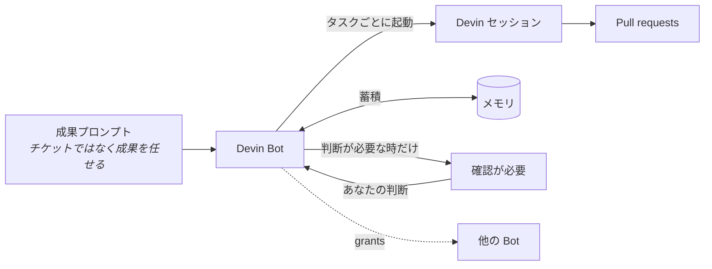

<picture>
  <source media="(prefers-color-scheme: dark)" srcset="assets/cover-dark.svg">
  
</picture>

 

Curated by [@darega0mae](https://x.com/darega0mae) · 姉妹チュートリアル：[build-with-devin](https://github.com/Till3005/build-with-devin) · [プロジェクトを追加](CONTRIBUTING.md)

**14** 件の実証済み Bot 導入 · **43** 件のエンタープライズ事例 · **8** 件の公開プロダクト · **47** 件のツール・統合 · **30** 件の実践レポート

[English](README.md) · [简体中文](README.zh.md) · 日本語 · [Português](README.pt.md)

> *非公式コミュニティプロジェクト —— Cognition AI との提携・承認・後援はありません。"Devin" は Cognition AI の商標です。ブランド素材は公式キット [devin.ai/brand](https://devin.ai/brand) に基づき使用。公式ドキュメント：[docs.devin.ai](https://docs.devin.ai)。*

**Built with Devin** は*検証済み*の実績レジストリです。すべてのエントリは、実名の導入・実在のリポジトリ・公開された記録にリンクされています。架空のものも、マーケティングの言い換えもありません。掲載基準は [CONTRIBUTING.md](CONTRIBUTING.md) に記載しています。

## 目次

- [Devin Bots —— 公式プロダクト](#devin-bots----公式プロダクト) —— 導入実績、再利用可能なパターン、公式データ、16 テンプレートのマーケットプレイス
- [Devin で作られたプロダクト](#devin-で作られたプロダクト) —— Devin がコードを書いた出荷済みソフトウェア
- [エンタープライズ導入](#エンタープライズ導入) —— 具体的な数字つきの公開顧客事例
- [Bots と接続面](#bots-と接続面) —— Discord、Telegram、Slack 等への Devin 組み込み
- [SDK・API ツール](#sdkapi-ツール)
- [Devin を支えるツール群](#devin-を支えるツール群) —— Devin で作るのではなく、Devin の*ために*作られたもの
- [パターンと実践記事](#パターンと実践記事) —— 記録された実際の使用例
- [コミュニティメディア](#コミュニティメディア)
- [公式リソース](#公式リソース)

## Devin Bots —— 公式プロダクト

**2026年11月17日** リリース（[発表](https://devin.ai/blog/introducing-devin-bots) · [ドキュメント](https://docs.devin.ai/work-with-devin/bots) · [Fortune 独占記事](https://fortune.com/2026/11/17/exclusive-cognition-bets-on-devin-bots-coding-agents-in-challenge-to-anthropics-duet-and-openais-dots/)）。Bot は成果に責任を持つ永続的なエージェントです。作業を計画し、各タスクに Devin セッションを実行し、週をまたいで記憶を保持し、判断が必要な決定だけを持ってきます。Bot は Slack と iMessage に常駐し、スケジュールやイベントトリガーで動き、grants を通じて他の Bot に作業を引き継ぎます。Bots には Cognition が 2026 年 7 月に買収した Interaction Company（Poke）の技術が使われています。

### 実証済みの導入

| Bot | オーナー | 担当領域 | 公開された結果 |
| --- | --- | --- | --- |
| **Android Bot** | Cognition | Devin の Android アプリをエンドツーエンドで | 2026 年 9 月 28 日に *"your job is to product manage the android app"* と指示 —— 自分でチケットを起票し、チケットごとに Devin セッションを実行。Google Play オープンベータまで **44 日**：1,134 PR マージ、Kotlin 344,651 行、2,841 のスクリーンショットテスト。人間が送ったのは**合計 183 通のみ** —— 22 日間完全な無干渉 —— **88% の PR は自己マージ**。現在は Android/iOS の機能パリティを担当。 |
| **Layout Bot** | Cognition | Devin Web アプリのレイアウトシフト回帰 | 3 時間ごとに本番 `main` をビルドし、初回/リピート/遅延リクエストをシミュレート。回帰を起因 PR まで追跡し、before/after 動画つきで修正 PR を作成。**3 週間で 159 PR、カクつき −70%。** |
| **Super Jenny** | Jenny Xu（コミュニティ） | モバイルゲームスタジオ全体 | ~20 の Bot（dev、Unity、リリース、UI、iOS、Android、実機テスト）を 1 つのオーケストレータ Bot が統括。唯一の人間は集約 Slack スレッドに 1 日 4 回**絵文字で**返答。週 50 → **1,900 PR**、スタジオ収益 6 倍、毎週リリース。コミュニティテンプレート **SuperJennyStack** として公開。その後 **BotSpeak** を構築 —— トークン節約型の bot 間速記（ASD-STE100、ACK コード、絵文字レシート；完全な文章は人間のみ）：6 日間で bot の自律判断が **12 倍**に。（[Jenny のスレッド](https://x.com/xujennyc)、[BotSpeak ポスト](https://x.com/xujennyc/status/2123111543105868166)） |
| **dabit3 のフリート** | Nader Dabit（Cognition DevRel） | 個人 5-Bot 組織 + ゲームスタジオ | **CTO** bot：全セッション/リポジトリを管理、VIP iMessage チャネルで SMS 経由ですべての bot に到達。**Auto(mation)Bot**：個人自動化を実行し、レイテンシ/効率改善を報告。**DevCommunityBot**：Sheets/Notion でアンバサダープログラムを運営、ミニデータ可視化アプリを構築。**DevRelBot**：ドキュメント + チュートリアル動画 —— *専用コンピュータ、専用 Devin/GitHub/Linear アカウント、ElevenLabs 音声クローンを持ち*、ブラウザを起動して実際の UI を録画。さらに **Windfable**：iPhone Duo 向け Unity iOS RPG、~10 の SuperJennyStack Bot がそれぞれ専用 macOS+Xcode+Unity を持ち、Duo の折りたたみ/展開モードを前後スクリーンショット + 実機映像でテスト。（[入門](https://x.com/dabit3/status/2122755275182469515)） |
| **Onboarding QA Bot** | Cognition（Walden Yan） | 30 以上のオンボーディングフローの 24/7 QA | 自己更新する Playwright スクリプト、エージェントジョブキュー、自作のライブボードビューを維持 —— 「自分が発掘する忍耐力よりはるかに多くのバグを見つけた」。（[@walden_yan](https://x.com/walden_yan)） |
| **"Phil"** | Harvey | 協調型 Word 互換エディタエンジン | ~30 のエージェントが **3 週間・人間エンジニアゼロ** で Rust + TypeScript 100 万行超を執筆 —— 実際の Microsoft Word の挙動と模擬弁護士交渉で継続検証。人間はメモリ + 決定ログで舵取り。（[Gabe Pereyra](https://x.com/gabepereyra)） |
| **共有 Bot フリート** | Decagon | オンコール、DevEx 最適化、スレッドルーティング | ベータ期間中に Slack で 50+ の共有 Bot を運用。Chief of Staff Bot がスレッドの起動タイミングと方法を決定。（[@tylerxdev のスレッド](https://x.com/tylerxdev/status/2122743518712287400)） |
| **AutoResearch ループ** | Decagon | 推論研究ラボ | 1 つの Devin がオーケストレート。サブエージェントが競合仮説を並列で追求。すべてのアイデアを Modal GPU 上の再生済み本番トラフィックで検証 —— **GPU あたりスループット最大 2.5 倍**（[詳細](https://x.com/DecagonAI/article/2115511110120120437)、[@devindevelopers](https://x.com/devindevelopers/status/2115601107581821172)）。 |
| **Frankie の組織** | Mark Fenner（コミュニティ） | 個人エージェントフリート | 異なる役割を持つ 4 つの Bot を "Frankie, my Chief Agent" が調整し、集約レポートを持ち帰る（[解説](https://x.com/markfenner/status/2122740244328145211)）。 |
| **tigsbot** | @0xtigs（コミュニティ） | 個人マルチプロジェクトフリート | 各プロジェクトは 1 つの Slack チャンネル = 1 Bot。Chief-of-Staff Bot が「全体の最新状況は？」に答え、*彼自身*がブロッカーになった時は本人に ping。専門 Bot が単一ライセンスや複雑なセットアップのソフトウェアを管理（[セットアップ](https://x.com/0xtigs/status/2122742784176034056)）。 |
| **報酬制 Chief-of-Staff** | Avinash（Cognition、MENA） | 個人 Bot フリートのデイリースタンドアップ + 報酬 | SuperJennyStack のロールアップパターンを応用：1 つの Bot が毎日他の全 Bot をレビューし、良い仕事に「報酬」を与えてフリートを自己改善させる——新規ユーザーへの最初のデプロイとして本人が推奨。（[報道](https://news.sulat.com/2026/11/18/devin-bots/)） |
| **Electra** | Basis | 内部ツール + コード、自律型 | 名前つきの Devin チームメイト（Bots 以前）：やるべきことを自分で決め、コードを書いてテストし、内部ツールの更新を出荷し、チームを動かす —— Basis は税務エージェントごとに 20 日間のスレッドを運用（[投稿](https://x.com/trybasis/status/2113307030203089189)、[20 日スレッド](https://x.com/trybasis/status/2120658137766100992)）。 |
| **パーソナルデータ Bot** | Bryan Johnson | 健康データ統合 + 家族への報告 | 1 つの Bot が数年分のバイオメトリクスと脳スキャンデータを 1 つの読み物に統合。もう 1 つが母親に毎日の近況をテキスト送信。（[投稿](https://x.com/bryan_johnson/status/2122814114976383406)） |
| **テニスデータ Bot** | Venus Williams | プロテニスの準備 + 試合データ分析 | グランドスラムシングルス 7 度の優勝者が Devin Bots でプロテニスの準備を分析——対戦相手の戦法、湿度・温度に応じたラケット調整、試合データ分析、食事と休息の管理。（[Cognition 動画](https://x.com/cognition/status/2123093354196140285)、[@walden_yan](https://x.com/walden_yan/status/2123105884125671605)） |

### 実証済みのパターン

- **成果プロンプト** —— *"You own the Android app now. Keep it at feature parity with iOS."* Bot にはバックログではなく目標を与える。
- **Bot 間ハンドオフ** —— grants で QA Bot がバグを発見 → Developer Bot に修正を依頼 → staging で再テスト → PM Bot がチャンネルに報告。
- **スケジュール監視** —— cron でアラートチャンネルを監視し、そのチェックを所有し、回帰時に修正を開く Bot（Layout Bot パターン）。
- **ロールアップ報告** —— 1 つの監督 Bot が、すべての下位 Bot の未決定事項を 1 つのスレッドに集約（SuperJennyStack パターン）。
- **Bots × Apps** —— Bot が Devin Apps を維持：新しいページ/機能を構築し、変化に自動適応。Bots と Apps は同じナビゲーションレールにピン留め（[@dabit3](https://x.com/dabit3)）。
- **Living evals** —— スケジュールされた Devin が本番トレースを読み、行動ごとにグループ化し、システムの完全なコピー（モック不可）で障害を再生し、各障害を eval PR として凍結 —— 資産は eval ではなく skill ファイル（Rox：カバレッジ 72% vs 手書き 43–57%）。
- **Devin 自身をチューニングする Bot** —— Walden の bot はユーザーフィードバックを監視し、プロンプトを再生、実験を実行、eval セットを構築し、Devin 自身のプロアクティブ性/自律性パラメータを調整 —— Bots が Bots を作った（[スレッド](https://x.com/walden_yan/status/2122740852091216274)）。
- **自分のアカウントを持つ Bot** —— DevRelBot が一人でチュートリアル動画を出荷できるのは、従業員同様にプロビジョニングされているから：専用コンピュータ、専用 Devin/GitHub/Linear アカウント、専用 ElevenLabs キー —— Devin にログインして実際の UI を録画する。
- **Bot 間プロトコル（BotSpeak）** —— 20+ の Bot が 1 日 700+ 件のメッセージを生成。Jenny は bot 間速記（ACK コード、簡易英語、絵文字レシート）で受信トレイ崩壊を解決し、完全な文章は人間のみに —— 6 日間で bot の自律判断が 12 倍に。
- **参照グラウンデッド・スウォーム** —— Harvey の教訓：信頼できる参照（実際の Word 挙動）で検証できる仕事なら、小さなチームでも大きな swarm を安全に指揮できる。

### 公開された結果

ローンチ前の数週間で **1,000 人以上のベータテスター**。テスターはメッセージあたり **4.5 倍**多くの PR をマージ。Cognition は週 2,000 以上の PR をマージし、マージ済み PR スループットを 40 倍に拡大、**単一の自律目標から 1,000 以上の PR** を達成。初期アクセス顧客には **Decagon、Fireworks AI、Reducto** が名を連ね、最初の 2 週間で使用量が 10 倍に（[Fortune](https://fortune.com/2026/11/17/exclusive-cognition-bets-on-devin-bots-coding-agents-in-challenge-to-anthropics-duet-and-openais-dots/)）。

その他の実証済み用途：**Manim** の issue 事前トリアージ、ファームウェア作業、Bot 主導チームによる**フロンティア推論エンジン**構築、テニス分析、経理自動化（trybasis：20 時間 → 30 分）、swyx の 1 週間トライアル（AEO、QA、クロスプラットフォーム移植、個人管理、動画編集 —— [彼のまとめ](https://x.com/swyx/status/2122746401482592549)）、アンバサダーの **Chris Wozniczek** が Slack から Web スタジオを運営（コールドアウトリーチ、顧客プレビュー）、**Nick White**（Helionova）の初期 Bots フリート試行、Cognition リサーチチームの「数週間を数日に短縮」（[@silasalberti](https://x.com/silasalberti)）。詳細は[再現ガイド](docs/reproducing-devin-bots.md#reported-usage-beyond-cognition)へ。

### 公式テンプレートライブラリ

[公開マーケットプレイス](https://devin.ai/bots/templates)にある 16 の既製 Bot（[テンプレートドキュメント](https://docs.devin.ai/work-with-devin/bots/templates)——テンプレートから作った Bot は接続・シークレット・メモリを一切持たない；「Share as template」で自分のものを公開できる）に加え、**SuperJennyStack** などのコミュニティテンプレート：

| テンプレート | 役割 |
| --- | --- |
| Software Factory | 指定プロダクト領域のバグ・改善・性能・リファクタ案件を発見。動作証明つきの小さな PR を 1 件ずつ作成 |
| Product Engineer | チケットやリクエストをテスト済み PR にし、レビューまで通す |
| QA Engineer | 実ブラウザで各 PR をテストし、合格/不合格の動画を投稿 |
| Anomaly Watcher | 1 日 2 回、プロダクト + ビジネスデータを走査し、監視が見ていない問題を検出 |
| Code Reaper | 毎週デッドコードを除去。一度に安全な PR 1 件 |
| Chief of Staff | チャンネルを監視し、進捗を投稿し、チームに作業を渡して完了まで追跡 |
| Migration Engineer | 大規模移行を小さな追跡可能な PR に分割し、進捗ダッシュボードを維持 |
| Latency Optimizer | 最も遅いエンドポイント/ジョブ/クエリを発見。毎週 before/after の速度改善 PR |
| iOS Engineer | SwiftUI 機能を PR + TestFlight ビルドへ |
| Android Engineer | Kotlin 機能を PR + 内部テストビルドへ |
| Internal Tools Engineer | あなたのスタックで管理画面と内部ツールを構築 |
| Data Analyst | チャートとクエリをつけてデータの質問に回答 |
| Devin Coach | あなたの利用データからチームに Devin の上手な使い方を教える |
| Code Health Engineer | 古いフラグ、古い依存、CVE → 小さな安全な PR |
| Technical Writer | マージ後に `main` と同期したリポジトリ wiki と図を維持 |
| Compliance Engineer | コードから統制証跡を収集し、統制が失効したら警告 |

**[→ 再現ガイド：実証済みのすべての Bot を再構築する方法](docs/reproducing-devin-bots.md)** —— 姉妹リポジトリ **[build-with-devin](https://github.com/Till3005/build-with-devin)** の拡張チュートリアル版も

サイト：**[till3005.github.io/built-with-devin](https://till3005.github.io/built-with-devin/)**（Devin スタイルのレジストリページ）· 深掘り：**[Devin Bot の解剖](docs/devin-bots-anatomy.md)**（実証済み 6 つの機構 + 数字が実際に示すこと）· **[Devin の経済学](docs/economics.md)**（公開済みのコスト/リターン数値を一冊に —— [フィルタ可能なページ](docs/economics.html)版も）

<a href="#readme">back to top</a>

---

## Devin で作られたプロダクト

実際のソフトウェア —— デモではなく、出荷された仕事。

- **[Eon の Era](https://devin.ai/customers/eon)** —— AI エージェントの訓練・評価用シミュレート企業（74 のベンダー忠実なシステム：Salesforce、Slack、Zendesk、Jira……）。**マージ PR の 98% が Devin 作**。300 以上の終日セッション、2,720 のセッションが他のセッションから起動。
- **[Courtyard の Quick](https://courtyard.io/blog/post/from-a-slack-link-to-production-in-under-48-hours-cloning-shopifys-quick-with-devin)** —— Shopify 内部の静的サイトデプロイヤー "Quick" をクローン：Slack リンク 1 つから本番サービス（Go、Cloud Run、Bazel、Terraform、SSO、git バックド）まで **約 21 時間**。すべて Devin が執筆。
- **[Frontierfood](https://samyok.com/frontierfood)** —— Cognition エンジニア Samyok Nepal が Devin Voice で Google レビューをスクレイプし、地域別グルメのパレートフロンティアをマッピング（[投稿](https://x.com/samyok/status/2098155977199743367)）。
- **Flappy Asher** —— Russell Kaplan（Cognition 社長）が Mac VM 上の Devin に赤ちゃんの写真をゲームスプライトにさせて出荷 —— TestFlight で公開中（[投稿](https://x.com/russelljkaplan/status/2100280085999919555)）。
- **[Try Devin vending machine](https://github.com/dabit3/vending-machine)** —— dabit3 のイベント用クレジット配布機（Next.js + Convex + Clerk）：参加者がイベント URL でメールを入力すると Devin クレジットコードを受け取る。`devin-ai-integration[bot]` がリポジトリのトップ貢献者（266 commits）。本番: [trydevin.ai](https://www.trydevin.ai/)。
- **[GymClass](https://seed.horacioh.com/writing/how-i-built-a-full-booking-system-as-a-side-project-with-devin-as-my-engineering-partner)** —— Horacio Herrera が実在の武術アカデミー向けに作った予約・クラス管理システム（TS/Bun/React/Hono/tRPC、Cloudflare）：会議の合間にスマホから Devin を指揮して 1 ヶ月分の機能を出荷——予約アーキテクチャの全面書き換えと Vitest→Bun 移行を含む。

- **[Spraycash](https://spraycash.onrender.com)** —— ライブ中の決済エクスプローラーサイト。UI 全体が Devin チャット内でアートディレクト（Kimi K3）：全プロンプトは[ビルドログ](https://dev.to/ibrahimpima/designing-the-spraycash-ui-with-kimi-k3-in-devin-4l2f)に公開、コードは [fozagtx/spraycash](https://github.com/fozagtx/spraycash)。
- **CosmosOS + NEXI** —— 高2の学生が Max で1ヶ月間に出した3点セット：CosmosOS——授業の合間に Devin が組み上げた自作 Linux ディストロ；NEXI——ローカルモデル群；そしてマルチエージェント IDE（[全記録](https://ravtheman.medium.com/im-17-and-for-one-month-devin-was-my-entire-engineering-team-here-s-everything-i-learned-183d59099384)）。

*Devin で作った出荷済みプロダクトを知っていますか？[追加してください](CONTRIBUTING.md)。**

### サイドクエスト

小さくて楽しいビルド —— 同じ仕組みが遊びにも使える証拠。

- **[iPhone Duo のモバイルゲーム](https://x.com/xujennyc/status/2121625134029209929)** —— Jenny Xu と Nader Dabit がフォルダブル端末で Devin 製モバイルゲームを開発。Devin は [Duo アプリを自分でビルド・テスト](https://x.com/DevinAI/status/2111161066403123653)し、規模化も可能（[dabit3](https://x.com/dabit3/status/2112939574133760190)）。
- **Devin の自画像** —— Bryan Johnson が Devin に自分をどう見ているか描かせた（[投稿](https://x.com/bryan_johnson/status/2122818486800191842)）。
- **Bot に仕事を取られた CoS** —— Cognition の新しい chief-of-staff の初週：目覚めると新しい Chief of Staff Bot がすでに彼の仕事をしていた（[投稿](https://x.com/arirbrown/status/2122789909731872882)）。

<a href="#readme">back to top</a>

---

## エンタープライズ導入

具体的な数字つきの公開顧客事例（[全索引](https://devin.ai/customers)）：

| 企業 | 導入内容 | 公開された結果 |
| --- | --- | --- |
| [Nubank](https://devin.ai/customers/nubank) | 数百万行・8 年物の ETL モノリス → サブモジュール化 | エンジニアリング効率 8–12 倍、コスト 20 倍削減。ファインチューン済み Devin は ~40 分/タスクを ~10 に短縮 |
| [Wayfair](https://devin.ai/customers/wayfair) | 組織全体のクラウドエージェント | 1,600 人以上のエンジニアが全投入 |
| [The Access Group](https://devin.ai/customers/access-group) | 250 製品・2,000 人超のエンジニアに Devin | エンジニアリング成果 5 倍 |
| [EBANX](https://devin.ai/customers/ebanx) | 主要著者としての Devin | **マージ PR の 92% が Devin 作** |
| [Gumroad](https://devin.ai/customers/gumroad) | コアリポジトリの Devin | Devin はリポジトリの**第 1 位コントリビューター**：1,500 以上のマージ PR |
| [Finch](https://devin.ai/customers/finch) | Slack→Linear 受付 → ログ/トレース調査 → ブラウザ検証 → 当日 PR | **3,000 PR マージ、約 20 エンジニア月節約**；導入前は 1 日 20 件の依頼に 3–4 件しか対応できず——「最大の解放は並列化能力」|
| [Comarch](https://devin.ai/customers/comarch) | 20 年物・1,000 万行 ERP の再構築 | 全システム近代化が進行中 |
| [AngelList](https://devin.ai/customers/angellist) | インシデントトリアージ + データ移行 | インシデントの 70% をエンジニアの前に Devin が原因特定。Redshift→Snowflake が 5.2 倍速 |
| [Modal](https://devin.ai/customers/modal) | インシデント対応 | 80% のインシデントがエンジニアがスレッドを開く前に調査済み |
| [Reducto](https://devin.ai/customers/reducto) | Devin Oncall が一次対応 | エンジニアがページされることはほぼない |
| [Eight Sleep](https://devin.ai/customers/eight-sleep) | 非エンジニア含む全社的な Devin | **出荷量 8 倍**；サポートマネージャーが 1 時間未満で E2E パイプライン+ダッシュボードを構築；利益予測モデルは約 1 週間の反復で月次バックテスト誤差 10% 以内 |
| [Exa](https://devin.ai/customers/exa) | エンドツーエンド出荷；リポジトリは完全にクラウドでブート可能 | エンジニアがローカルにコードを引かず本番へ；複数週のセッションがテストシステム契約を **~30–40 PR** に展開；新しいエンジニアはローカル環境を一度も構築していない |
| [RV Tech](https://devin.ai/customers/rvtech) | Rivian × VW JV、ソフトウェア定義車両 | テスト速度 10 倍 |
| [Melius](https://devin.ai/customers/melius) | クラウドセッションが主インターフェース；朝の automation が 7 日以上停滞の PR を掃除・テスト修正・人にメンション | **1 日 ~100 PR**；8 人のチームが「100 人規模として機能」|
| [Hamming](https://devin.ai/customers/hamming) | 「Devinable」タスクフレームワーク——有界+明確な仕様+客観評価；エージェント向けにコードベース最適化（OOP より関数型、eval 駆動） | **総コード量の 25%**、人間エンジニア 2 人と並ぶトップ貢献者 |
| [Airbyte](https://devin.ai/customers/airbyte) | コネクタ保守 | 700 以上のコネクタを稼働維持 |
| [Litera](https://devin.ai/customers/litera) | QE Evolution——専門 Devin エージェントを各スクラムチームに埋め込み；「AI コンポーザー」役職 | **リグレッションサイクル 90% 削減**；ILTACON 前 3 週間で 5 製品出荷；30 日で 90+ アクティブエンジニア；~250 人が「1,000 人の速度」|
| [Ramp](https://devin.ai/customers/ramp) | 技術的負債の解消 | **週 80 PR マージ、10,000 時間超のエンジニア工数削減**。Devin に精通した小チームが運用 |
| [Linktree](https://devin.ai/customers/linktree) | 機能 + 顧客バグパイプライン | 先月 ~300 PR 執筆 / ~100 マージ。チームの反射は「Devin でやれるか？」に |
| [Bilt](https://devin.ai/customers/bilt) | 組織全体への展開 | 2 月以降 800 以上のマージ PR、週平均 ~117；リリース後**Devin Bots が 1 週間で ~1,600 PR をマージ**——VP Engineering Will Laughlin（[Bots の声](https://devin.ai/bots)）|
| [Rohlik Group](https://devin.ai/customers/rohlikgroup) | エージェント駆動の食料品オペレーション | エンジニアリングスループット 2 倍。倉庫ロボットを含む自動化展開 4 倍速。50 以上の MCP 統合 |
| [Crosby](https://devin.ai/customers/crosby) | AI ネイティブ法律事務所；automation が Slack バグ報告+Sentry アラート毎にセッション起動；弁護士のレビュー FB を Devin が分類 | 毎日 20–40 件を各 ~5 分で初動調査；**Sentry アラートノイズ −50%**；法務要員 ~5 倍化でもオンコールは 1 人のまま |
| [Endava](https://devin.ai/customers/endava) | 企業全体への提供 | 2,000 人以上の従業員がプラットフォーム利用。4 ヶ月で 3 倍。PR マージ率 78% |
| [Tavrn](https://devin.ai/customers/tavrn) | HIPAA テナント内（SSO/スコープ権限/監査ログ）で Slack からフリート派遣——eng/ops/CS/sales 横断；日次 automation が品質判定落ちを再調査 | 8 人が 50 人分；**6 週間で 1,800+ PR**（決定済み ~80% マージ）；**先月マージコードの 93% が Devin 発**；アラート→調査中央値 **35 秒** |
| [Itaú](https://devin.ai/customers/itau) | ブラジル最大銀行で SDLC 全体に展開 | 59 サービスの .NET→Java 移行が**6 倍速・1/5 コスト**、800 オブジェクトの SQL Server 移行 **5 倍速**、SonarQube/Fortify/Veracode 指摘の ~70% を自動修正、**30 万以上のリポジトリ**のドキュメントを継続更新、テストカバレッジ ~50%→~90+%、約 1,000 人のウェイトリスト形成後に **17,000 人技術組織の 75%** が利用 |
| [Ripple Treasury](https://devin.ai/customers/ripple) | 自動バグトリアージ（"Guardians 2.0"）+ 非エンジニア向けコードベース QA | 未トリアージのバックログ **−75%**、修正数 0.5→1.5 件/日（**3 倍**）、週 2 回のトリアージ会議を廃止、エンジニア以外の 70 人が利用 —— 4,600+ 件の質問 ≈ **2,300 エンジニア時間を節約** |
| [WPP Enterprise Solutions](https://devin.ai/customers/wpp-enterprise-solutions) | 固定価格のクライアント案件のデリバリー基盤 | 実案件で **SDLC 効率 30–40% 向上**を実測、Halfords リビルドは**25% 短縮でスコープ 110%**・稼働率 99.97%、テストフレームワーク移行 80 人日→8（**10 倍**）、週次アクティブエンジニアが 9 ヶ月で **4 倍** |
| [Basis](https://devin.ai/customers/basis) | 会計 AI スタートアップの長時間タスク向けクラウドエージェント | Slack でメンションした依頼が ~15 分で出荷、エンジニアは寝る前に ~10 件の Devin ジョブを投入 —— 「群を抜いて最高のクラウドエージェント基盤」（共同創業者） |
| [Mercor](https://devin.ai/customers/mercor) | 24 時間稼働するエンジニア組織 | 評価額 100 億ドルのヒューマンインテリジェンス・ネットワークが Devin を 24/7 運用（公開事例ページ） |
| [Hippo](https://devin.ai/customers/hippo) | 保険エンジニア組織への全面展開 | Cognition と提携：全米 50 州の保険ルールに耐えるプロダクトをエージェント的に構築・テスト（公開事例ページ） |
| [Zeb](https://devin.ai/blog/devin-for-databricks-migrations) | NetSuite→Databricks のデリバリーパートナー | 世界的投資アドバイザリー企業の 4 週間案件を **2.5 週間で納品**、Fortune 500 エネルギー企業が 142 オブジェクトのプラットフォームを **8 日**で Unity Catalog へ移行 |
| **Rox** | Living Evals —— 週次 Devin が本番トレースを読み、完全コピーで障害を再生、eval PR をオープン | eval スイートが**実使用量の 72%**をカバー（手書きは 43–57%）（[記事](https://www.rox.com/articles/living-evals-an-eval-suite-that-grows-from-production)、[スレッド](https://x.com/rox_ai/status/2110779380666617997)） |
| [Philips](https://devin.ai/blog/introducing-code-scans) | Code Scans 早期テスター——デジタル計算病理学、Enterprise Informatics | 複数リポジトリで **~96% の PR マージ率**；テスト期間中に **700+ エンジニア時間**削減と推計（launch 記事中の顧客証言） |
| **Cognition**（自社） | ソフトウェアファクトリー：自己駆動 PR ループ（バグ報告→マージ→監視→保守）、小ポッド + 毎時再構築の使い捨て VM + Docker Compose モック；エージェントに測定可能な目標 | **1 年でマージ PR スループット 40 倍、エンジニア 2.7 倍**——1 人あたり生産性 >10 倍（[Walden Yan、AI Engineer](https://aietalks.com/talks/40x-more-merged-prs-with-2-7x-the-engineers)）|
| [Evinova](https://devin.ai/customers/evinova) | GxP 規制下のデリバリー | GxP 文書化 8 倍速。マイグレーション 3 倍速。明確なバグの 66% を自律修正 |
| [Compiled Health](https://devin.ai/customers/compiledhealth) | 臨床ベンチマーク構築 | 2 人の研究者・2 ヶ月 = 5–6 人のエンジニアの仕事。~430 エンジニア時間・時給 ~$17 ≈ 4 人チームに +4 名分 |
| [Común](https://devin.ai/customers/comun) | 13 人のフィンテックチーム | 生産量 3 倍。週間バックエンド PR が 4 週間で 50 → 170 |
| [AHEAD](https://devin.ai/customers/ahead) | 8 つの本番ワークロード | 手作業比較で**時間削減 8–40 倍**。2 営業日で完全稼働 |
| [The Citation Group](https://devin.ai/customers/thecitationgroup) | ROI 測定型の展開 | 3 ヶ月で 271 PR マージ（80%）。エンジニアリング効率 +50%。レガシーアプリ刷新 85% 削減 |
| [Latent Health](https://devin.ai/customers/latent) | 薬局オペレーション | エンジニアあたり PR 数が Claude Code 単独比 +30%。50 の自動化が稼働中 |
| [Crossmint](https://devin.ai/customers/crossmint) | GOAT オープンソースの拡大 | トライアル期間中に Devin がリポジトリ第 1 位コントリビューターに |
| [FE fundinfo](https://devin.ai/customers/fefundinfo) | 1,800 リポジトリ自動化 | テスト生成 + セキュリティ修正で即座に 10% のキャパシティ増 |
| [GE Aerospace](https://devin.ai/customers/geaerospace) | 制約チームのストーリー処理量 | 3 ヶ月でユーザーストーリー出力 ~2 倍 |

その他の公開記録：Citi（40,000 人の開発者展開、技術ベンダー支出 30% 削減）、Mercedes-Benz、Cognizant、Infosys との提携、そして **McKinsey × Cognition アライアンス**（11/16——McKinsey がプロジェクト選定とベースラインを助言、Devin が実装。Cognition は米 G-SIB 8 行中 6 行、米大手医療保険 6 社中 3 社が顧客と主張、[発表](https://devin.ai/blog/cognition-mckinsey-alliance)）—— [顧客索引](https://devin.ai/customers)を参照。

<a href="#readme">back to top</a>

---

## Bots と接続面

他のプロダクトやチャンネルへの Devin 組み込み。

- **[devin-discord-bot](https://github.com/wgtechlabs/devin-discord-bot)** —— セルフホストの TypeScript bot。Discord で Devin にメンションするだけでセッション開始、進捗をチャンネルにストリーミング。
- **[devin-telegram-bot](https://github.com/wgtechlabs/devin-telegram-bot)** —— 同じ作者の Telegram ブリッジ。Devin API へ接続。
- **[Buzz for Devin](https://github.com/fenner888/BuzzforDevin)** —— Block の Buzz のコミュニティフォーク。公式 Devin CLI（`devin acp`）をネイティブランタイムとして追加し、各自が認証済み Devin を持ち寄れるエージェントネイティブなコミュニティを実現。
- **[devin-sse-proxy](https://github.com/sotayamashita/devin-sse-proxy)** —— Claude Desktop が Personal API Key を渡しつつ Devin の SSE transport と会話できる最小 MCP サーバー。
- **[devin-flow](https://github.com/xlm/devin-flow)** —— Automations API 上のイベント駆動 Devin ワークフローのビジュアルエディタ。セッション追跡つき（FastAPI + Vue 3）。
- **[OpenAB](https://github.com/openabdev/openab)** —— Open Agent Broker：軽量 Rust ACP ハーネス。Discord/Slack（+ Telegram、LINE、Feishu/Lark、Google Chat、WeCom、MS Teams のゲートウェイアダプタ）を任意の ACP CLI に橋渡し——`devin acp` が第一級バックエンド。
- **[Devin Orchestrator](https://github.com/huydx/devin)** —— Go バックエンド：GitHub webhook を受けて Devin セッションや PR レビューを起動し、オブザーバビリティダッシュボードで監視。開発用ローカル Devin API スタブ付き。
- **[eventflow-devin-integration](https://github.com/Cognition-Partner-Workshops/eventflow-devin-integration)** —— パートナーワークショップの参照構成：Azure Monitor アラート → Azure Function webhook → Devin 調査セッション（MCP 経由で Log Analytics）→ 修正 PR。

<a href="#readme">back to top</a>

---

## SDK・API ツール

- **[go-devin](https://github.com/gassara-kys/go-devin)** —— Devin API の Go SDK。
- **[llm-devin](https://github.com/ftnext/llm-devin)** —— Simon Willison の `llm` CLI から Devin API を呼ぶプラグイン。
- **[@cognition-ai/sdk](https://docs.devin.ai/sdk)** —— 公式 TypeScript SDK（beta）：1 つの `createDevin` セッション API がクラウドとローカル CLI の両方を駆動、`devin.api` 型付き REST クライアント付き；関連パッケージ `@cognition-ai/ai-sdk`、`@cognition-ai/cloudflare-agents`、`@cognition-ai/harness-devin`。[サンプルリポジトリ](https://github.com/COG-GTM/devin-sdk-examples)。
- **[devinai](https://pypi.org/project/devinai/)** —— 公式 Python SDK（`usacognition/devin-sdk-python`）。
- **[devin-api-mcp](https://github.com/jsklan/devin-api-mcp)** —— Devin API フルカバーの MCP サーバー：sessions、knowledge、playbooks、secrets、schedules、attachments——v1 API+個人キーでセッションが*自分*のダッシュボードに出る、読み取り専用 DeepWiki ツール付き。
- **[terraform-provider-devin](https://github.com/CognitionAI/terraform-provider-devin)** —— 公式 Terraform provider：v3 API で org、git 権限、playbook、knowledge ノート、secrets、schedules、IP アクセスリスト、IdP グループロールマッピングを管理。
- **[devin_api（Ruby）](https://github.com/smasato/devin_api_client_rb)** —— 非公式 Ruby クライアント。gem として公開済み。
- **[widevin](https://docs.rs/crate/widevin)** —— 軽量 Rust provider ライブラリ。Devin 内部（認証/セッション定数、拡張の配管）を扱う。

<a href="#readme">back to top</a>

---

## Devin を支えるツール群

Devin *で*作られたものではなく、Devin の*ために*コミュニティが作ったもの。

- **[DevinX / Devinmaxxing](https://x.com/markfenner)** —— Mark Fenner の Devin Desktop セッション向けローカルモデルピッカー：ACP 経由のローカル重み付け、適応コストバランシング、推論強度制御。
- **[awesome-devin](https://github.com/Icaro0310/awesome-devin)** —— `devin-*` オープンソースツールエコシステム：セッション検索、履歴エクスポート、ナレッジグラフ、eval ハーネス、バックアップ、fan-out プランナー。
- **[devin-judge](https://github.com/Icaro0310/devin-judge)** —— Devin ACP バックエンドのキャリブレート済みローカルファースト判断レイヤー。API キー不要。
- **[devin-fusion-byok](https://github.com/kuobibulaien/devin-fusion-byok)** —— Devin 拡張（VSIX）。独自モデル API を Devin のモデルピッカーに追加し、Fusion Lead+Sidekick プリセットを構成 —— アプリ本体は不変更。
- **[devin.cursorrules](https://github.com/grapeot/devin.cursorrules)** —— Cursor/Windsurf を「Devin の 90%」に変える 5k★ ルールセット —— Devin 級のエージェント挙動の基準点。
- **[nix-devin-cli](https://github.com/broady/nix-devin-cli)** —— Devin CLI の Nix パッケージ。macOS/Linux で夜間自動更新。
- **[QuotaView](https://github.com/Duoasa/QuotaView)** —— macOS「Dynamic Island」風のエージェントモニター。Claude/Codex/Grok と並んで Devin Desktop・Devin CLI のセッション、承認、クォータを追跡。
- **[Mako](https://github.com/Verbiflow/mako)** —— すべてのコーディングエージェント向けローカルワークスペース。Devin の会話を ACP 経由で引き継ぎ —— 実行、フォロー、再開、マシン間移動。
- **[ax](https://zenn.dev/kuwashima/articles/ax-cross-agent-session-picker)** —— fzf セッションピッカー。Devin を他の 18 のエージェント CLI と一緒に再開（日本語）。
- **[Kiro Crew の Devin CLI パッチ](https://zenn.dev/dario_okazaki/articles/e5eda2aca4fdd2)** —— Kiro Crew の管理 bot フリートに Devin CLI を追加する非公式パッチ。bot ごとの権限処理つき（日本語）。
- **[Devin for VS Code](https://github.com/shayanline/devin-vscode)** —— VS Code 内の完全な Devin CLI チャットパネル：`@` でワークスペースコンテキスト、Keep/Undo の差分レビュー、ワークスペース別の再開可能チャット、CLI の instructions/skills/plugins/MCP/hooks の設定エディタ内蔵。
- **[Devin Switch](https://github.com/ansuman-shukla/devin-switch)** —— 複数 Devin CLI ログインを管理するネイティブ macOS アプリ + CLI：分離されたアカウントプロファイル、共有ローカル会話履歴、使用量/リセット表示、並行起動。
- **[Devin Token Monitor](https://github.com/TH-Chou/devin-usage-monitor)** —— ネイティブ macOS メニューバーアプリ（VSIX 付き）。CLI のローカル SQLite メトリクスをライブコストダッシュボードに —— トークン推移、モデルドーナツ、リクエスト別 TTFT/トークン速度、予算アラート、CSV エクスポート、6 言語対応。
- **[devin-desktop-zh](https://github.com/cby122/devin-desktop-zh)** —— 手作りの Devin Desktop 簡体字中国語ローカライズ：33,457 文字列の辞書 + 注入/再署名パイプラインで独立した `Devin 中文版.app` を生成 —— Agent Skill として公開されワークフロー全体が再現可能。
- **[devin-desktop-zh (Till3005)](https://github.com/Till3005/devin-desktop-zh)** —— 同名・別アプローチ：簡体字＋繁体字（台湾/香港）言語パックを macOS/Windows/Linux ワンコマンドのパッチャーで適用——再ビルド不要、インストール済みアプリに直接パッチ。
- **[devin-pstack](https://github.com/Till3005/devin-pstack)** —— poteto の pstack エンジニアリングスキルを Devin Desktop に移植：一度インストールすれば、すべてのエージェントが彼女の流儀で働く——モード・原則・TDD・検証を内蔵。
- **[devin-tui](https://github.com/fenner888/devin-tui)** —— `devin acp` 駆動の Mark Fenner 製フルスクリーン端末 UI：React + Ink、ツール呼び出し、インライン diff、プランビュー、セッション別コスト。
- **[Devin Remote](https://github.com/zouhall/devin-remote)** —— Devin CLI セッション用ブラウザコンソール —— スマホを含む任意のブラウザからローカル Devin を操作：ストリーミングチャット、権限、モード、モデル、使用統計。
- **[Devin Pocket](https://github.com/BOTOOM/devin-pocket)** —— モバイルファーストの Devin CLI クライアント。ACP 経由で Android/Termux、Linux、macOS 上で動作。
- **[devin-control](https://github.com/Icaro0310/devin-control)** —— ポリシーゲート付き ACP クライアント。allow/deny/ask ルールで分離された Devin セッション。
- **[devin-subagents](https://github.com/Duro02/devin-subagents)** —— `devin acp` セッションを MCP 上のライフサイクル管理サブエージェントとして公開：並列ディスパッチ、ブロッキング `wait`、途中介入、権限裁定。
- **[Devin Session Exporter](https://github.com/marktwainme/devin-session-exporter)** —— ローカル ACP セッションデータベースをフィルタ・一括エクスポートできる Devin Desktop 拡張（Markdown/JSON/HTML）。
- **[devin-acp-shim](https://github.com/wibus-wee/devin-acp-shim)** —— Devin CLI のセッションレベル MCP 能力ネゴシエーションを修正する透過 stdio プロキシ —— 小さいが、すべての ACP ホストで MCP サーバーを解放する。
- **[hindsight-devin-desktop](https://pypi.org/project/hindsight-devin-desktop/)** —— Vectorize の MCP ブリッジ：1 コマンドで Devin Desktop に永続的な長期記憶と常時 recall/retain ルールを配線。
- **[devin-memory](https://github.com/Sassine/devin-memory)** —— Devin CLI 用ゼロ依存の永続メモリ：フックがコンテキスト使用量を推定して上限前に警告、`/memory-save` + `/memory-resume` で `/clear` を跨いでセッションを保存・復元。
- **[devin-explore](https://github.com/Icaro0310/devin-explore)** —— `devin-*` 艦隊の旗艦：ローカルインストールを診断（store/schema/lock/config、修正提案つき）、セッション履歴のエクスポート、FTS5 全文検索とセッション/プロジェクト/ファイルのナレッジグラフ、リポジトリ別ステータスレポートに集約。完全ローカル、テレメトリなし。
- **[devin-assure](https://github.com/Icaro0310/devin-assure)** —— 検証モノレポ：`devin-qa-pack` がセッションの主張を監査、`devin-evals` が記録済みセッションをルーブリックで再生採点（`dream` サブグループは判定既知の合成セッションを生成）、`devin-metrics` がコンテキスト/トークン山をローカル追跡。
- **[hermes-devin-acp](https://github.com/raffr85/hermes-devin-acp)** —— Devin サブスクを Hermes Agent のモデルプロバイダーに：Hermes 配下で `devin acp` を駆動、認証は公式 CLI のまま。
- **[@yuiseki/devin-gyazo](https://github.com/yuiseki/devin-gyazo)** —— スクリーンショット→Gyazo 自動化スクリプト：Devin セッションがタスク途中でブラウザ/ターミナルの画面を撮って視覚的証拠を投稿（JP）。
- **[nvim-devin](https://github.com/wstewarttennes/nvim-devin)** —— Devin API 用 Neovim プラグイン：セッション作成、ビジュアル選択やファイル全体のメッセージ送信、バッファで応答表示。
- **[ACP クライアントエコシステム](https://agentclientprotocol.com/get-started/clients)** —— `devin acp` は全 ACP 対応エディタで動く：JetBrains と Zed はネイティブ、Neovim（CodeCompanion/agentic/avante/hermes）、Emacs（agent-shell.el）、Sublime Text、Qt Creator、Obsidian。

<a href="#readme">back to top</a>

---

## パターンと実践記事

記録された実際の使用例。

- **[SAST 自動修復パイプライン](https://github.com/Cognition-Partner-Workshops/uc-cve-remediation-regulatory-compliance/pull/16)** —— OWASP Dependency-Check で PR をスキャンし、CVE ≥ 7.0 で Devin セッションをディスパッチする GitHub Actions ワークフロー。検証スキャンとサーキットブレーカー付き。
- **[Devin PR の指示者への帰属](https://tech.enechange.co.jp/entry/2025/06/22/165504)** —— ENECHANGE の GitHub Actions 設定。すべての PR が `devin-ai-integration[bot]` 表示になる中で、どのエンジニアが Devin に指示したかを記録し、生産性測定の穴を解決。
- **[古いメールボックスアラームの修正](https://agentsinuse.com/use-cases/devin-to-clear-mailbox-alarm/)** —— Cloudflare Workers のテストフレイクを古い continuation alarm まで追跡し、回帰カバレッジを追加（Agents In Use 経由）。
- **[Devin 内での Spraycash UI デザイン](https://dev.to/ibrahimpima/designing-the-spraycash-ui-with-kimi-k3-in-devin-4l2f)** —— フィンテックランディングページの全アートディレクションを Devin チャットで実施：生成画像、レイヤー化された雲のアニメーション、SVG 描画リング、3 フォント体系 —— 全プロンプト公開。
- **[rakko_inc の Devin 自動コードレビュー](https://zenn.dev/rakko_inc/articles/00cc5a5a679971)** —— Playbooks + GitHub Actions + Devin API がすべての PR を事前消化。月間レビュー PR が 65 → 184。
- **[Skillnote の QA テスト設計自動化](https://zenn.dev/skillnote/articles/5ba429ca249801)** —— PR がトリガーとなり Devin が根拠つきテストケースを起草。10 ケースあたり ~35 分節約。
- **[イベント駆動 Devin 自動化](https://zenn.dev/arufian/articles/f80a62f5217cee)** —— 優先度×複雑度ポリシーテーブルと plan-first 承認フローを持つサーバーレス GitHub Actions パイプライン。
- **[Leverages の組織展開](https://zenn.dev/levtech/articles/9c869303820844)** —— 14 チーム、177 マージ PR、誠実な ACU vs 人件費 ROI 式。
- **[Devin による高速開発](https://blog.scottlogic.com/2025/10/20/rapid-development-with-devin.html)** —— Scott Logic の実践記。プロンプト反復の教訓を含む。
- **[Cognition 内部利用について Scott Wu が語る](https://www.lennysnewsletter.com/p/how-devin-replaces-your-junior-engineers)** —— Cognition 自身がどう委任するか：非同期ジュニアエンジニアワークフロー、トップ 5 タスクタイプ、クラッシュ分析の一次防衛線。
- **[Signadot で Devin の変更を E2E テスト](https://dev.to/signadot/test-devins-changes-end-to-end-with-signadot-a0)** —— Devin + Signadot MCP：変更したマイクロサービスを VM で実行し、実際のクラスタトラフィックに対してサンドボックス化、Playwright スイートを実行 —— マルチサービスシステムで Devin 単独では閉じられないループを閉じる。
- **[Devin Automations による脆弱性影響分析](https://zenn.dev/rescuenow/articles/2ee1c4b66ecec8)** —— rescuenow のスケジュール Automation が CVE 公開時にブラスト半径を調査。
- **[700 件のサポート問い合わせを分類](https://zenn.dev/canly/articles/9c19bb123e208c)** —— canly がチケット履歴に Devin を向け、「原因未特定」の実態を調査 —— コーダーではなくデータアナリストとしての Devin。
- **[Datadog CCM × Devin 週次コスト運用](https://zenn.dev/hubble/articles/091e29a0c86ec3)** と **[Devin が先に調査する Dependabot PR](https://zenn.dev/hubble/articles/88429bd24db476)** —— hubble の 2 つの常設ループ：週次クラウドコスト削減と、人が見る前の全依存バンプの調査。
- **[Dynatrace MCP で Devin を性能分析エージェントに](https://medium.com/lets-code-future/how-i-turned-devin-into-a-performance-analysis-agent-with-dynatrace-mcp-753d3f4790a2)** —— Devin をライブの可観測データに接続し、コードだけでなくレイテンシを自己診断させる（Medium）。
- **[Devin：バグレポートから PR まで](https://medium.com/@winter.inc/devin-from-bug-report-to-pull-request-25-days-of-ai-day-18-b158daa20f23)** —— 25 日 AI シリーズ 18 日目：実コードベースでの ticket→PR 完全ループ（Medium）。
- **[役割別 bot 開発チーム + 軽量 PR 自動マージ](https://zenn.dev/kyto64/articles/ai-bot-dev-env)** —— kyto64 の個人開発環境：専門 AI bot + Devin、低リスク PR の自動マージ。
- **[Devin CLI のコンテキスト上限の実践](https://qiita.com/ishizakahiroshi/items/cee2a8ea2be18f2ccee3)** —— AGENTS.md と承認ルールを 16KB/32KB 上限に収める作業ノート。
- **[NOT A HOTEL の初めての Devin 導入](https://zenn.dev/notahotel/articles/d401a1046d6076)** —— セットアップから初マージ PR まで 1 時間未満のモブワーク記録——Devin が求めるリポジトリ接続設定の分類項目も紹介。
- **[Hello World… Meet Devin](https://jamesin.substack.com/p/hello-world-meet-devin)** —— Jamesin Seidel のローンチ期記録：初めて Devin が自分のリポジトリにコードをコミットするのを見た、メール振り分けアシスタント開発（Substack）。
- **[Devin でウェブサイトをデプロイする方法](https://www.hostinger.com/tutorials/how-to-deploy-a-website-with-devin/)** —— Hostinger のステップバイステップ：3 つのデプロイルート（プレビュー向け App Deploys beta、本番向け GitHub→ホスト、手動アップロード）、加えて MCP Connector で Devin Desktop が 100+ のホスティングツールに直接アクセス。
- **[Devin Apps チュートリアル：プロンプトでプライベート内部アプリを作る](https://lightmind24.blogspot.com/2026/11/devin-apps-tutorial-build-private.html)** —— ローンチ記事以外で最も完全な Apps 実践ガイド：最初のプロンプトに書くべきこと（ユーザー、データソース、画面、スタック）、Apps がデザインシステムを拾う仕組み、Apps が適さなくなる境界。
- **[Devin Bots が目指すのは AI 社員ではなくエージェントのマネージャー](https://daily.dev/posts/devin-bots-want-to-be-your-agent-manager-not-your-ai-employee-hhpjo94uh)** —— daily.dev のローンチ分析とリプライ感情内訳（好意的 55% / 中立 30% / 懐疑的 15%）：実質的な批判は 3 点に集中——自己レビューする Bot を誰がレビューするのか、クレデンシャルセキュリティ、フリート管理は本当に人間管理より楽なのか。
- **[発表記事が言わなかったこと](https://aiholics.com/devin-bots-cognition-persistent-agents-goals/)** —— 最も鋭い批判的考察：公開された価格/プラン詳細なし、未検証の数字、そして誰も答えていない 2 つの疑問——Bot が数週間で目標からドリフトしない仕組み、調整中の 2 つの Bot が対立したらどうなるか。
- **[Grok Bots 組織を Devin Bots に移植](https://www.rickblalock.dev/scratch-notes/learnings-from-moving-my-grok-bots-to-devin-bots/)** —— 初の独立系ベータ実測レポート：既存の Grok-bot 組織の移植に約 $300 の一時利用料と一晩。エンジニアリングのオーケストレーションは「痛快」だがビジネス業務は Grok に戻し、Grok Bot ↔ Devin Bot のハイブリッド構成に。正直な摩擦ログ：Bot が持ってくる判断が多すぎ、必ずしも適切ではない——「インターンではなく VP のように扱ってくれ」。
- **[無料 SWE-2 上のマルチ AI オーケストレーション](https://qiita.com/ishizakahiroshi/items/72ab801a5f2a8c941b61)** —— Devin CLI の永久無料 SWE-2 枠でエージェント間のワークルーティングを設計。
- **[SMARTCAMP の Trivy スキャン → Devin 修復](https://zenn.dev/smartcamp/articles/97ac804043530e)** —— 定期 GitHub Actions が ECS イメージを pull して Trivy スキャン、HIGH/CRITICAL を issue 化して Devin が対応。AWS 認証ジョブとスキャンジョブを分離し artifact のみで連携。
- **[Devin が1か月間、私のエンジニアチームだった記録](https://ravtheman.medium.com/im-17-and-for-one-month-devin-was-my-entire-engineering-team-here-s-everything-i-learned-183d59099384)** —— メルボルンの高校生による Max 枠1か月の実測：一晩で 67 PR 処理・44 マージ。授業の合間に Linux ディストロ、ローカルモデル群、マルチエージェント IDE を構築 — 実測の CLI/クラウド運用解説つき（Medium）。
- **[Devin 2025 年次パフォーマンスレビュー](https://cognition.com/blog/devin-annual-performance-review-2025)** —— Cognition 自身の 18 ヶ月通信簿、ベンダーとして異例の正直さ：強み（PR マージ率 34%→67%、問題解決 4 倍速、脆弱性修正 20 倍、ETL 移行 10 倍、カバレッジ 50–60%→80–90%、自社 webapp コミットの約 1/3）と名指しの弱点（曖昧な要件、途中スコープ変更、ソフトスキル）。
- **[月 $20k を Devin に使うソロファウンダーのオペレーション](https://www.lennysnewsletter.com/p/i-spent-20000-on-devin-in-a-month)** —— Ryan Carson（Untangle）は ~15 台の Devin エージェントを同時稼働。ダッシュボードではなくフォルダシステム + 紙の P0 リストで統制；「Watchdog」playbook が全法律事務所アカウントの CS を一手に担い、「LAN PR」スキルが QA レビュアーなしで ~40 PR/日を締める（Lenny's ポッドキャスト）。

<a href="#readme">back to top</a>

---

## コミュニティメディア

- **[Devin Central](https://devincentral.com)** —— Trevor Lowing の非公式 Devin ニュース・チュートリアルサイト。
- **[Devin Central Learn](https://devincentral.com/learn)** —— 体系化された学習コンテンツ：無料8レッスンの "Devin Fundamentals" コース（各レッスンに動画+テキスト+確認クイズ）と実践ガイド（タスク切り分け、プラン/ACU、各サーフェス、Windsurf からの移行）。
- **[Voices —— アンバサダー名簿](https://devincentral.com/voices)** —— 世界 ~190 人の Devin アンバサダーの非公式マップ。
- **[devin-cli.github.io](https://devin-cli.github.io)** —— Devin API・Slack・Linear 接続面のカバー範囲と自動化方法に関するコミュニティドキュメント。
- **[Agents In Use](https://agentsinuse.com)** —— Devin エントリを含む実際のエージェント使用例ディレクトリ。
- **[BitsExplorer —— Built with Devin](https://bitsexplorer.com/built-with/devin)** —— Devin の commit trailer で検証された 480 以上の公開プロジェクト（自己申告ではなく証拠）。
- **[The New Stack](https://thenewstack.io/cognition-devin-bots-management/)** ——「エンジニアは 44 日中 22 日、自分の AI にメッセージを送らなかった。それでも Android アプリは作られた。」Android Bot デプロイの報道（11/19）。
- **[I Tested SWE-2 in Devin on 24 Coding Prompts](https://www.youtube.com/watch?v=RfWpWWR5YHk)** —— Devin Desktop 内の SWE-2 を 24 題で独立ベンチ：max/high 推論ティア、「無料だから遅い」というトレードオフ、リーダーボードでの順位。
- **[Vibe Coded Projects —— Devin インデックス](https://vibedprojects.com/ai-tools/devin)** —— コミット trailer と作者クレジットで裏付けされた 373 件の Devin 製アプリ/ツール/サイト——「実際の Devin 産物」閲覧プール。
- **[Wes Roth —— Devin リリース再考](https://exa.ai/library/podcast/05zhn6b2hzs/episode/m7fz71g9mk6)** —— 2024 年の「Debunking Devin」騒動と実際に出荷されたものを対比するポッドキャスト（11/13）。
- **[Dataconomy 中文](https://cn.dataconomy.com/2026/11/18/cognition-%e6%8e%a8%e5%87%ba-devin-bots-%e6%9d%a5%e7%ae%a1%e7%90%86-ai-%e7%bc%96%e7%a8%8b%e5%9b%a2%e9%98%9f/)** —— Devin Bots ローンチの中国語報道（11/18）。
- **[Fortune —— Devin Bots ローンチ独占](https://fortune.com/2026/11/17/exclusive-cognition-bets-on-devin-bots-coding-agents-in-challenge-to-anthropics-duet-and-openais-dots/)** —— Scott Wu インタビュー：OpenAI Dots・Anthropic Duet と対抗する Bots；Poke 買収技術を内包（11/17）。
- **[AlphaSignal —— Bots の数値](https://alphasignal.ai/news/cognition-s-devin-bots-now-run-parallel-coding-sessions-hitting-2-000-pull)** —— メッセージあたり 4.5 倍のマージ PR、ピーク 50→~2,000 PR/週。「ベータの数字には分母が必要」と冷静な注意書きつき。
- **[Digg —— 4.5 倍の主張が測るもの](https://digg.com/ai/l3h088z7)** —— PR/メッセージ ≠ 開発速度。ベースライン・サンプル数・手法は未公開。SuperJenny の運用詳細も（~20 の AI チームメイト、1 日 4 回のスマホ確認）。
- **[Snowman Labs —— Devin は価値があるか](https://snowmanlabs.com/insights/is-devin-worth-it)** —— 公開事例全体を読み抜いた正直な枠組み：勝ちはすべて範囲限定・反復・検証可能な大量の仕事——「Devin がシステムを設計した」と言うものは一つもない。
- **[HN —— エージェントはボトルネックをコードレビューへ移した](https://news.ycombinator.com/item?id=50538303)** —— ハーバード研究、459 コメント（11/17）：生成は解決済み、レビュー容量が新しい制約。
- **[Metarix —— Code Scans への懐疑的な読み](https://metarix.io/devin-scans-the-whole-repo)** —— ベンダー公表値（Dioxus コンパイル 64% 短縮、Philips 96%）と再現可能な数字を分ける：「引用する前に自分のリポジトリで再現せよ」。
- **[Vibe Coded Projects](https://vibedprojects.com/ai-tools/devin)** —— Devin で vibe-code された 373 のアプリ・ツール・サイト。
- **[Devin 日本 2 周年ミートアップ](https://aid.connpass.com/event/412875/)** —— アンバサダー主催のコミュニティイベント（[発表](https://x.com/kinopee_ai/status/2123019189325848847)）。
- **[Devin's Dinner](https://x.com/MattSchrage/status/2121016484155548124)** —— Matt Schrage の招待制ニューヨークディナーシリーズ。Devin を使うファウンダーとエンジニア向け。

<a href="#readme">back to top</a>

---

## 公式リソース

- [Devin Community](https://devin.ai/community) —— イベント、アンバサダー申請、イベント支援
- [docs.devin.ai](https://docs.devin.ai) —— ドキュメント：[Bots](https://docs.devin.ai/work-with-devin/bots)、[Automations](https://docs.devin.ai/product-guides/automations)、[Devin CLI](https://docs.devin.ai/cli/index.md)
- [Release notes](https://docs.devin.ai/release-notes/overview) · [Devin Desktop changelog](https://docs.devin.ai/desktop/changelog) · [Devin CLI changelog](https://docs.devin.ai/cli/changelog/stable) —— stable 各リリースの新機能と修正
- [Use-case ギャラリー](https://docs.devin.ai/use-cases/gallery/index.md) —— コピペ可能なプロンプトつきの 40 以上の文書化ワークフロー。[作業分割のベストプラクティス](https://docs.devin.ai/use-cases/best-practices.md)
- [devin.ai/brand](https://devin.ai/brand) —— 公式ブランドキット
- [Devin Discord](https://devin.ai/community) と [r/DevinAI](https://www.reddit.com/r/DevinAI/) —— 公式コミュニティスペース
- [CognitionAI/qa-devin](https://github.com/CognitionAI/qa-devin) —— Cognition 自身の「Devin が QA をする」参照リポジトリ
- [CognitionAI/devin-vuln-fixes](https://github.com/cognitionai/devin-vuln-fixes) —— 実 CVE を修正する公式エージェントスキル（GitLab CVSS 10.0、PHP/Node RCE）：読み取り専用棚卸 → 承認ゲート → 確認済みターゲットパッチ → before/after テスト → リポジトリごとに 1 つの焦点 PR
- [CognitionAI/team-marketplace-template](https://github.com/CognitionAI/team-marketplace-template) —— 組織管理型プラグインエコシステムの公式テンプレート：1 つのリポジトリでチーム共有プラグインを管理し、Devin Web アプリから全員に配布。必須/任意プラグインのパターン付き
- [Devin for Databricks Migrations](https://devin.ai/blog/devin-for-databricks-migrations) —— Databricks と共同構築した公式移行サービス（11 月 19 日）：レガシー DWH コードを変換し、顧客ワークスペースでテスト、カットオーバー前に全ソースを照合 —— Databricks Marketplace 提供
- [Devin で Modal 上のカスタムモデルを学習・デプロイ](https://gist.github.com/dabit3/866caaab49a4a5371ae01655fecad34b) —— Cognition エンジニア Nader Dabit の実働テンプレート
- [Devin for Startups](https://devin.ai/startups) —— 適格チーム向け最大 $65k クレジット。[Devin for Gaming](https://talofagames.com/devin-for-gaming/) —— Talofa × Cognition の 3 週間スタジオコホート。対面ワークショップとクレジット賞。**[poke.com/bots](https://poke.com/bots)** —— 期間限定実験（11/18 開始）：Poke にテキストでアイデアを送り、クレジットに値する理由を説得すれば無料の Devin Bot を獲得 —— 10,000 アカウント、各最大 $10,000（Nader Dabit によると総額 ~$1 億）、$200/月の Max 要件を回避可能。これまでに報告された最高の交渉額は $1,887（[walden_yan](https://x.com/walden_yan/status/2123326058644828366)、[報道](https://news.sulat.com/2026/11/19/devin-bots-giveaway/)）
- [Devin Automations クイックスタート](https://www.youtube.com/watch?v=6xxKtIpgOyE) —— Bots が土台とする、イベント/スケジュールトリガー型エージェント設定の公式ビデオ
- [SWE-2 Flash](https://cognition.com/blog/swe-2-flash) —— Cognition の高速コーディングモデル：主要評価で全米オープンウェイトモデルを上回り、SWE-2 の 3 倍速・1/5 の価格
- [Devin Apps](https://devin.ai/blog/devin-apps) —— Devin が自マシンで構築し安定 URL で提供するライブ Web アプリ（内部ツール、ダッシュボード、ステージングコピー）

<a href="#readme">back to top</a>

---

## コントリビュート

Devin で何かを作った、または見落としている導入を知っている？[CONTRIBUTING.md](CONTRIBUTING.md) へ —— 一行、リンク優先、マーケティングコピー不可。

## ライセンス

[CC0-1.0](LICENSE) —— パブリックドメインに捧げます。掲載物は各所有者に帰属します。
