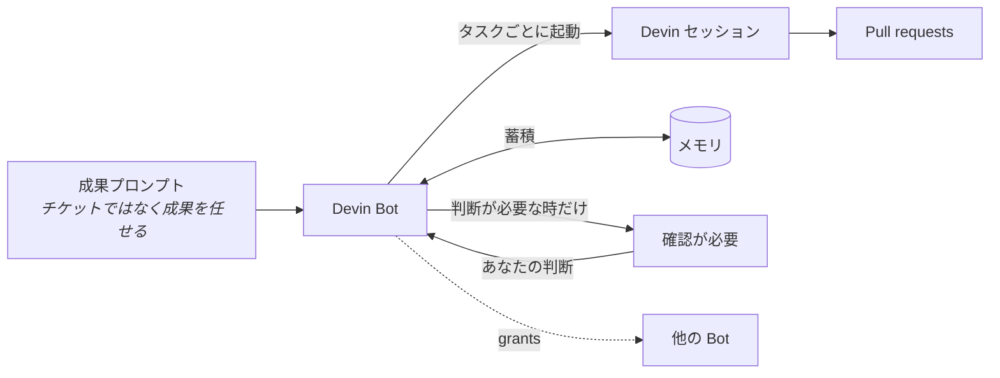

<picture>
  <source media="(prefers-color-scheme: dark)" srcset="assets/cover-dark.svg">
  
</picture>

 

Curated by [@darega0mae](https://x.com/darega0mae) · 姉妹チュートリアル：[build-with-devin](https://github.com/Till3005/build-with-devin) · [プロジェクトを追加](CONTRIBUTING.md)

**11** 件の実証済み Bot 導入 · **33** 件のエンタープライズ事例 · **4** 件の公開プロダクト · **28** 件のツール・統合 · **19** 件の実践レポート

[English](README.md) · [简体中文](README.zh.md) · 日本語 · [Português](README.pt.md) · [Español](README.es.md) · [Deutsch](README.de.md)

> *非公式コミュニティプロジェクト —— Cognition AI との提携・承認・後援はありません。"Devin" は Cognition AI の商標です。ブランド素材は公式キット [devin.ai/brand](https://devin.ai/brand) に基づき使用。公式ドキュメント：[docs.devin.ai](https://docs.devin.ai)。*

**Built with Devin** は*検証済み*の実績レジストリです。すべてのエントリは、実名の導入・実在のリポジトリ・公開された記録にリンクされています。架空のものも、マーケティングの言い換えもありません。掲載基準は [CONTRIBUTING.md](CONTRIBUTING.md) に記載しています。

## 目次

- [Devin Bots —— 公式プロダクト](#devin-bots----公式プロダクト) —— 導入実績、再利用可能なパターン、公式データ、16 テンプレートのマーケットプレイス
- [Devin で作られたプロダクト](#devin-で作られたプロダクト) —— Devin がコードを書いた出荷済みソフトウェア
- [エンタープライズ導入](#エンタープライズ導入) —— 具体的な数字つきの公開顧客事例
- [Bots と接続面](#bots-と接続面) —— Discord、Telegram、Slack 等への Devin 組み込み
- [SDK・API ツール](#sdkapi-ツール)
- [Devin を支えるツール群](#devin-を支えるツール群) —— Devin で作るのではなく、Devin の*ために*作られたもの
- [パターンと実践記事](#パターンと実践記事) —— 記録された実際の使用例
- [コミュニティメディア](#コミュニティメディア)
- [公式リソース](#公式リソース)

## Devin Bots —— 公式プロダクト

**2026年11月17日** リリース（[発表](https://devin.ai/blog/introducing-devin-bots) · [ドキュメント](https://docs.devin.ai/work-with-devin/bots) · [Fortune 独占記事](https://fortune.com/2026/11/17/exclusive-cognition-bets-on-devin-bots-coding-agents-in-challenge-to-anthropics-duet-and-openais-dots/)）。Bot は成果に責任を持つ永続的なエージェントです。作業を計画し、各タスクに Devin セッションを実行し、週をまたいで記憶を保持し、判断が必要な決定だけを持ってきます。Bot は Slack と iMessage に常駐し、スケジュールやイベントトリガーで動き、grants を通じて他の Bot に作業を引き継ぎます。Bots には Cognition が 2026 年 7 月に買収した Interaction Company（Poke）の技術が使われています。

### 実証済みの導入

| Bot | オーナー | 担当領域 | 公開された結果 |
| --- | --- | --- | --- |
| **Android Bot** | Cognition | Devin の Android アプリをエンドツーエンドで | 2026 年 9 月 28 日に *"your job is to product manage the android app"* と指示 —— 自分でチケットを起票し、チケットごとに Devin セッションを実行。Google Play オープンベータまで **44 日**：1,134 PR マージ、Kotlin 344,651 行、2,841 のスクリーンショットテスト。人間が送ったのは**合計 183 通のみ** —— 22 日間完全な無干渉 —— **88% の PR は自己マージ**。現在は Android/iOS の機能パリティを担当。 |
| **Layout Bot** | Cognition | Devin Web アプリのレイアウトシフト回帰 | 3 時間ごとに本番 `main` をビルドし、初回/リピート/遅延リクエストをシミュレート。回帰を起因 PR まで追跡し、before/after 動画つきで修正 PR を作成。**3 週間で 159 PR、カクつき −70%。** |
| **Super Jenny** | Jenny Xu（コミュニティ） | モバイルゲームスタジオ全体 | ~20 の Bot（dev、Unity、リリース、UI、iOS、Android、実機テスト）を 1 つのオーケストレータ Bot が統括。唯一の人間は集約 Slack スレッドに 1 日 4 回**絵文字で**返答。週 50 → **1,900 PR**、スタジオ収益 6 倍、毎週リリース。コミュニティテンプレート **SuperJennyStack** として公開。（[Jenny のスレッド](https://x.com/xujennyc)） |
| **Onboarding QA Bot** | Cognition（Walden Yan） | 30 以上のオンボーディングフローの 24/7 QA | 自己更新する Playwright スクリプト、エージェントジョブキュー、自作のライブボードビューを維持 —— 「自分が発掘する忍耐力よりはるかに多くのバグを見つけた」。（[@walden_yan](https://x.com/walden_yan)） |
| **"Phil"** | Harvey | 協調型 Word 互換エディタエンジン | ~30 のエージェントが **3 週間・人間エンジニアゼロ** で Rust + TypeScript 100 万行超を執筆 —— 実際の Microsoft Word の挙動と模擬弁護士交渉で継続検証。人間はメモリ + 決定ログで舵取り。（[Gabe Pereyra](https://x.com/gabepereyra)） |
| **共有 Bot フリート** | Decagon | オンコール、DevEx 最適化、スレッドルーティング | ベータ期間中に Slack で 50+ の共有 Bot を運用。Chief of Staff Bot がスレッドの起動タイミングと方法を決定。（[@tylerxdev のスレッド](https://x.com/tylerxdev/status/2122743518712287400)） |
| **AutoResearch ループ** | Decagon | 推論研究ラボ | 1 つの Devin がオーケストレート。サブエージェントが競合仮説を並列で追求。すべてのアイデアを Modal GPU 上の再生済み本番トラフィックで検証 —— **GPU あたりスループット最大 2.5 倍**（[詳細](https://x.com/DecagonAI/article/2115511110120120437)、[@devindevelopers](https://x.com/devindevelopers/status/2115601107581821172)）。 |
| **Frankie の組織** | Mark Fenner（コミュニティ） | 個人エージェントフリート | 異なる役割を持つ 4 つの Bot を "Frankie, my Chief Agent" が調整し、集約レポートを持ち帰る（[解説](https://x.com/markfenner/status/2122740244328145211)）。 |
| **tigsbot** | @0xtigs（コミュニティ） | 個人マルチプロジェクトフリート | 各プロジェクトは 1 つの Slack チャンネル = 1 Bot。Chief-of-Staff Bot が「全体の最新状況は？」に答え、*彼自身*がブロッカーになった時は本人に ping。専門 Bot が単一ライセンスや複雑なセットアップのソフトウェアを管理（[セットアップ](https://x.com/0xtigs/status/2122742784176034056)）。 |
| **Electra** | Basis | 内部ツール + コード、自律型 | 名前つきの Devin チームメイト（Bots 以前）：やるべきことを自分で決め、コードを書いてテストし、内部ツールの更新を出荷し、チームを動かす —— Basis は税務エージェントごとに 20 日間のスレッドを運用（[投稿](https://x.com/trybasis/status/2113307030203089189)、[20 日スレッド](https://x.com/trybasis/status/2120658137766100992)）。 |
| **パーソナルデータ Bot** | Bryan Johnson | 健康データ統合 + 家族への報告 | 1 つの Bot が数年分のバイオメトリクスと脳スキャンデータを 1 つの読み物に統合。もう 1 つが母親に毎日の近況をテキスト送信。（[投稿](https://x.com/bryan_johnson/status/2122814114976383406)、[発表動画](https://vimeo.com/1247688199)） |

### 実証済みのパターン

- **成果プロンプト** —— *"You own the Android app now. Keep it at feature parity with iOS."* Bot にはバックログではなく目標を与える。
- **Bot 間ハンドオフ** —— grants で QA Bot がバグを発見 → Developer Bot に修正を依頼 → staging で再テスト → PM Bot がチャンネルに報告。
- **スケジュール監視** —— cron でアラートチャンネルを監視し、そのチェックを所有し、回帰時に修正を開く Bot（Layout Bot パターン）。
- **ロールアップ報告** —— 1 つの監督 Bot が、すべての下位 Bot の未決定事項を 1 つのスレッドに集約（SuperJennyStack パターン）。
- **Bots × Apps** —— Bot が Devin Apps を維持：新しいページ/機能を構築し、変化に自動適応。Bots と Apps は同じナビゲーションレールにピン留め（[@dabit3](https://x.com/dabit3)）。
- **参照グラウンデッド・スウォーム** —— Harvey の教訓：信頼できる参照（実際の Word 挙動）で検証できる仕事なら、小さなチームでも大きな swarm を安全に指揮できる。

### 公開された結果

ローンチ前の数週間で **1,000 人以上のベータテスター**。テスターはメッセージあたり **4.5 倍**多くの PR をマージ。Cognition は週 2,000 以上の PR をマージし、マージ済み PR スループットを 40 倍に拡大、**単一の自律目標から 1,000 以上の PR** を達成。初期アクセス顧客には **Decagon、Fireworks AI、Reducto** が名を連ね、最初の 2 週間で使用量が 10 倍に（[Fortune](https://fortune.com/2026/11/17/exclusive-cognition-bets-on-devin-bots-coding-agents-in-challenge-to-anthropics-duet-and-openais-dots/)）。

その他の実証済み用途：**Manim** の issue 事前トリアージ、ファームウェア作業、Bot 主導チームによる**フロンティア推論エンジン**構築、テニス分析、経理自動化（trybasis：20 時間 → 30 分）、swyx の 1 週間トライアル（AEO、QA、クロスプラットフォーム移植、個人管理、動画編集 —— [彼のまとめ](https://x.com/swyx/status/2122746401482592549)）、Cognition リサーチチームの「数週間を数日に短縮」（[@silasalberti](https://x.com/silasalberti)）。詳細は[再現ガイド](docs/reproducing-devin-bots.md#reported-usage-beyond-cognition)へ。

### 公式テンプレートライブラリ

[公開マーケットプレイス](https://devin.ai/bots/templates)にある 16 の既製 Bot に加え、**SuperJennyStack** などのコミュニティテンプレート：

| テンプレート | 役割 |
| --- | --- |
| Software Factory | 指定プロダクト領域のバグ・改善・性能・リファクタ案件を発見。動作証明つきの小さな PR を 1 件ずつ作成 |
| Product Engineer | チケットやリクエストをテスト済み PR にし、レビューまで通す |
| QA Engineer | 実ブラウザで各 PR をテストし、合格/不合格の動画を投稿 |
| Anomaly Watcher | 1 日 2 回、プロダクト + ビジネスデータを走査し、監視が見ていない問題を検出 |
| Code Reaper | 毎週デッドコードを除去。一度に安全な PR 1 件 |
| Chief of Staff | チャンネルを監視し、進捗を投稿し、チームに作業を渡して完了まで追跡 |
| Migration Engineer | 大規模移行を小さな追跡可能な PR に分割し、進捗ダッシュボードを維持 |
| Latency Optimizer | 最も遅いエンドポイント/ジョブ/クエリを発見。毎週 before/after の速度改善 PR |
| iOS Engineer | SwiftUI 機能を PR + TestFlight ビルドへ |
| Android Engineer | Kotlin 機能を PR + 内部テストビルドへ |
| Internal Tools Engineer | あなたのスタックで管理画面と内部ツールを構築 |
| Data Analyst | チャートとクエリをつけてデータの質問に回答 |
| Devin Coach | あなたの利用データからチームに Devin の上手な使い方を教える |
| Code Health Engineer | 古いフラグ、古い依存、CVE → 小さな安全な PR |
| Technical Writer | マージ後に `main` と同期したリポジトリ wiki と図を維持 |
| Compliance Engineer | コードから統制証跡を収集し、統制が失効したら警告 |

**[→ 再現ガイド：実証済みのすべての Bot を再構築する方法](docs/reproducing-devin-bots.md)** —— 姉妹リポジトリ **[build-with-devin](https://github.com/Till3005/build-with-devin)** の拡張チュートリアル版も

---

## Devin で作られたプロダクト

実際のソフトウェア —— デモではなく、出荷された仕事。

- **[Eon の Era](https://devin.ai/customers/eon)** —— AI エージェントの訓練・評価用シミュレート企業（74 のベンダー忠実なシステム：Salesforce、Slack、Zendesk、Jira……）。**マージ PR の 98% が Devin 作**。300 以上の終日セッション、2,720 のセッションが他のセッションから起動。
- **[Courtyard の Quick](https://courtyard.io/blog/post/from-a-slack-link-to-production-in-under-48-hours-cloning-shopifys-quick-with-devin)** —— Shopify 内部の静的サイトデプロイヤー "Quick" をクローン：Slack リンク 1 つから本番サービス（Go、Cloud Run、Bazel、Terraform、SSO、git バックド）まで **約 21 時間**。すべて Devin が執筆。
- **[Frontierfood](https://samyok.com/frontierfood)** —— Cognition エンジニア Samyok Nepal が Devin Voice で Google レビューをスクレイプし、地域別グルメのパレートフロンティアをマッピング（[投稿](https://x.com/samyok/status/2098155977199743367)）。
- **Flappy Asher** —— Russell Kaplan（Cognition 社長）が Mac VM 上の Devin に赤ちゃんの写真をゲームスプライトにさせて出荷 —— TestFlight で公開中（[投稿](https://x.com/russelljkaplan/status/2100280085999919555)）。

*Devin で作った出荷済みプロダクトを知っていますか？[追加してください](CONTRIBUTING.md)。*

### サイドクエスト

小さくて楽しいビルド —— 同じ仕組みが遊びにも使える証拠。

- **[iPhone Duo のモバイルゲーム](https://x.com/xujennyc/status/2121625134029209929)** —— Jenny Xu と Nader Dabit がフォルダブル端末で Devin 製モバイルゲームを開発。Devin は [Duo アプリを自分でビルド・テスト](https://x.com/DevinAI/status/2111161066403123653)し、規模化も可能（[dabit3](https://x.com/dabit3/status/2112939574133760190)）。
- **Devin の自画像** —— Bryan Johnson が Devin に自分をどう見ているか描かせた（[投稿](https://x.com/bryan_johnson/status/2122818486800191842)）。
- **Bot に仕事を取られた CoS** —— Cognition の新しい chief-of-staff の初週：目覚めると新しい Chief of Staff Bot がすでに彼の仕事をしていた（[投稿](https://x.com/arirbrown/status/2122789909731872882)）。

---

## エンタープライズ導入

具体的な数字つきの公開顧客事例（[全索引](https://devin.ai/customers)）：

| 企業 | 導入内容 | 公開された結果 |
| --- | --- | --- |
| [Nubank](https://devin.ai/customers/nubank) | 数百万行・8 年物の ETL モノリス → サブモジュール化 | エンジニアリング効率 8–12 倍、コスト 20 倍削減。ファインチューン済み Devin は ~40 分/タスクを ~10 に短縮 |
| [Wayfair](https://devin.ai/customers/wayfair) | 組織全体のクラウドエージェント | 1,600 人以上のエンジニアが全投入 |
| [The Access Group](https://devin.ai/customers/access-group) | 250 製品・2,000 人超のエンジニアに Devin | エンジニアリング成果 5 倍 |
| [EBANX](https://devin.ai/customers/ebanx) | 主要著者としての Devin | **マージ PR の 92% が Devin 作** |
| [Gumroad](https://devin.ai/customers/gumroad) | コアリポジトリの Devin | Devin はリポジトリの**第 1 位コントリビューター**：1,500 以上のマージ PR |
| [Finch](https://devin.ai/customers/finch) | 機能 + 保守作業 | 3,000 PR マージ、約 20 エンジニア月を節約 |
| [Comarch](https://devin.ai/customers/comarch) | 20 年物・1,000 万行 ERP の再構築 | 全システム近代化が進行中 |
| [AngelList](https://devin.ai/customers/angellist) | インシデントトリアージ + データ移行 | インシデントの 70% をエンジニアの前に Devin が原因特定。Redshift→Snowflake が 5.2 倍速 |
| [Modal](https://devin.ai/customers/modal) | インシデント対応 | 80% のインシデントがエンジニアがスレッドを開く前に調査済み |
| [Reducto](https://devin.ai/customers/reducto) | Devin Oncall が一次対応 | エンジニアがページされることはほぼない |
| [Eight Sleep](https://devin.ai/customers/eight-sleep) | 全社的な Devin | 出荷量 8 倍 |
| [Exa](https://devin.ai/customers/exa) | エンドツーエンドの出荷 | エンジニアがローカルでコードを引かなくても本番へ |
| [RV Tech](https://devin.ai/customers/rvtech) | Rivian × VW JV、ソフトウェア定義車両 | テスト速度 10 倍 |
| [Melius](https://devin.ai/customers/melius) | 高スループットの小チーム | 1 日 ~100 PR |
| [Hamming](https://devin.ai/customers/hamming) | コードベース上の Devin | 総コード量の 25% |
| [Airbyte](https://devin.ai/customers/airbyte) | コネクタ保守 | 700 以上のコネクタを稼働維持 |
| [Litera](https://devin.ai/customers/litera) | リグレッションテスト | リグレッションサイクル 90% 削減 |
| [Ramp](https://devin.ai/customers/ramp) | 技術的負債の解消 | **週 80 PR マージ、10,000 時間超のエンジニア工数削減**。Devin に精通した小チームが運用 |
| [Linktree](https://devin.ai/customers/linktree) | 機能 + 顧客バグパイプライン | 先月 ~300 PR 執筆 / ~100 マージ。チームの反射は「Devin でやれるか？」に |
| [Bilt](https://devin.ai/customers/bilt) | 組織全体への展開 | 2 月以降 800 以上のマージ PR、週平均 ~117 |
| [Rohlik Group](https://devin.ai/customers/rohlikgroup) | エージェント駆動の食料品オペレーション | エンジニアリングスループット 2 倍。倉庫ロボットを含む自動化展開 4 倍速。50 以上の MCP 統合 |
| [Crosby](https://devin.ai/customers/crosby) | AI ネイティブ法律事務所 | 毎日 20–40 件のバグレポート/アラートに初回対応、各 ~5 分。12 人のエンジニアが 50 人以上の弁護士に対応 |
| [Endava](https://devin.ai/customers/endava) | 企業全体への提供 | 2,000 人以上の従業員がプラットフォーム利用。4 ヶ月で 3 倍。PR マージ率 78% |
| [Tavrn](https://devin.ai/customers/tavrn) | HIPAA 制約下のフリート | 8 人のチームが 50 人のように出荷。**6 週間で 1,800 以上の PR**、生産量 6 倍 |
| [Evinova](https://devin.ai/customers/evinova) | GxP 規制下のデリバリー | GxP 文書化 8 倍速。マイグレーション 3 倍速。明確なバグの 66% を自律修正 |
| [Compiled Health](https://devin.ai/customers/compiledhealth) | 臨床ベンチマーク構築 | 2 人の研究者・2 ヶ月 = 5–6 人のエンジニアの仕事。~430 エンジニア時間・時給 ~$17 ≈ 4 人チームに +4 名分 |
| [Común](https://devin.ai/customers/comun) | 13 人のフィンテックチーム | 生産量 3 倍。週間バックエンド PR が 4 週間で 50 → 170 |
| [AHEAD](https://devin.ai/customers/ahead) | 8 つの本番ワークロード | 手作業比較で**時間削減 8–40 倍**。2 営業日で完全稼働 |
| [The Citation Group](https://devin.ai/customers/thecitationgroup) | ROI 測定型の展開 | 3 ヶ月で 271 PR マージ（80%）。エンジニアリング効率 +50%。レガシーアプリ刷新 85% 削減 |
| [Latent Health](https://devin.ai/customers/latent) | 薬局オペレーション | エンジニアあたり PR 数が Claude Code 単独比 +30%。50 の自動化が稼働中 |
| [Crossmint](https://devin.ai/customers/crossmint) | GOAT オープンソースの拡大 | トライアル期間中に Devin がリポジトリ第 1 位コントリビューターに |
| [FE fundinfo](https://devin.ai/customers/fefundinfo) | 1,800 リポジトリ自動化 | テスト生成 + セキュリティ修正で即座に 10% のキャパシティ増 |
| [GE Aerospace](https://devin.ai/customers/geaerospace) | 制約チームのストーリー処理量 | 3 ヶ月でユーザーストーリー出力 ~2 倍 |

その他の公開記録：Citi（40,000 人の開発者展開、技術ベンダー支出 30% 削減）、Itaú、Mercor、Hippo、Mercedes-Benz、Cognizant、Infosys との提携 —— [顧客索引](https://devin.ai/customers)を参照。

---

## Bots と接続面

他のプロダクトやチャンネルへの Devin 組み込み。

- **[devin-discord-bot](https://github.com/wgtechlabs/devin-discord-bot)** —— セルフホストの TypeScript bot。Discord で Devin にメンションするだけでセッション開始、進捗をチャンネルにストリーミング。
- **[devin-telegram-bot](https://github.com/wgtechlabs/devin-telegram-bot)** —— 同じ作者の Telegram ブリッジ。Devin API へ接続。
- **[Buzz for Devin](https://github.com/fenner888/BuzzforDevin)** —— Block の Buzz のコミュニティフォーク。公式 Devin CLI（`devin acp`）をネイティブランタイムとして追加し、各自が認証済み Devin を持ち寄れるエージェントネイティブなコミュニティを実現。
- **[devin-sse-proxy](https://github.com/sotayamashita/devin-sse-proxy)** —— Claude Desktop が Personal API Key を渡しつつ Devin の SSE transport と会話できる最小 MCP サーバー。
- **[devin-flow](https://github.com/xlm/devin-flow)** —— Automations API 上のイベント駆動 Devin ワークフローのビジュアルエディタ。セッション追跡つき（FastAPI + Vue 3）。

---

## SDK・API ツール

- **[go-devin](https://github.com/gassara-kys/go-devin)** —— Devin API の Go SDK。
- **[llm-devin](https://github.com/ftnext/llm-devin)** —— Simon Willison の `llm` CLI から Devin API を呼ぶプラグイン。

---

## Devin を支えるツール群

Devin *で*作られたものではなく、Devin の*ために*コミュニティが作ったもの。

- **[DevinX / Devinmaxxing](https://x.com/markfenner)** —— Mark Fenner の Devin Desktop セッション向けローカルモデルピッカー：ACP 経由のローカル重み付け、適応コストバランシング、推論強度制御。
- **[awesome-devin](https://github.com/Icaro0310/awesome-devin)** —— `devin-*` オープンソースツールエコシステム：セッション検索、履歴エクスポート、ナレッジグラフ、eval ハーネス、バックアップ、fan-out プランナー。
- **[devin-judge](https://github.com/Icaro0310/devin-judge)** —— Devin ACP バックエンドのキャリブレート済みローカルファースト判断レイヤー。API キー不要。
- **[devin-fusion-byok](https://github.com/kuobibulaien/devin-fusion-byok)** —— Devin 拡張（VSIX）。独自モデル API を Devin のモデルピッカーに追加し、Fusion Lead+Sidekick プリセットを構成 —— アプリ本体は不変更。
- **[devin.cursorrules](https://github.com/grapeot/devin.cursorrules)** —— Cursor/Windsurf を「Devin の 90%」に変える 5k★ ルールセット —— Devin 級のエージェント挙動の基準点。
- **[nix-devin-cli](https://github.com/broady/nix-devin-cli)** —— Devin CLI の Nix パッケージ。macOS/Linux で夜間自動更新。
- **[QuotaView](https://github.com/Duoasa/QuotaView)** —— macOS「Dynamic Island」風のエージェントモニター。Claude/Codex/Grok と並んで Devin Desktop・Devin CLI のセッション、承認、クォータを追跡。
- **[Mako](https://github.com/Verbiflow/mako)** —— すべてのコーディングエージェント向けローカルワークスペース。Devin の会話を ACP 経由で引き継ぎ —— 実行、フォロー、再開、マシン間移動。
- **[ax](https://zenn.dev/kuwashima/articles/ax-cross-agent-session-picker)** —— fzf セッションピッカー。Devin を他の 18 のエージェント CLI と一緒に再開（日本語）。
- **[Kiro Crew の Devin CLI パッチ](https://zenn.dev/dario_okazaki/articles/e5eda2aca4fdd2)** —— Kiro Crew の管理 bot フリートに Devin CLI を追加する非公式パッチ。bot ごとの権限処理つき（日本語）。
- **[Devin for VS Code](https://github.com/shayanline/devin-vscode)** —— VS Code 内の完全な Devin CLI チャットパネル（[Marketplace](https://marketplace.visualstudio.com/items?itemName=shayanline.devin-vscode)）：`@` でワークスペースコンテキスト、Keep/Undo の差分レビュー、ワークスペース別の再開可能チャット、CLI の instructions/skills/plugins/MCP/hooks の設定エディタ内蔵。
- **[Devin Switch](https://github.com/ansuman-shukla/devin-switch)** —— 複数 Devin CLI ログインを管理するネイティブ macOS アプリ + CLI：分離されたアカウントプロファイル、共有ローカル会話履歴、使用量/リセット表示、並行起動。
- **[Devin Token Monitor](https://github.com/TH-Chou/devin-usage-monitor)** —— ネイティブ macOS メニューバーアプリ（VSIX 付き）。CLI のローカル SQLite メトリクスをライブコストダッシュボードに —— トークン推移、モデルドーナツ、リクエスト別 TTFT/トークン速度、予算アラート、CSV エクスポート、6 言語対応。
- **[devin-desktop-zh](https://github.com/cby122/devin-desktop-zh)** —— 手作りの Devin Desktop 簡体字中国語ローカライズ：33,457 文字列の辞書 + 注入/再署名パイプラインで独立した `Devin 中文版.app` を生成 —— Agent Skill として公開されワークフロー全体が再現可能。
- **[devin-tui](https://github.com/fenner888/devin-tui)** —— `devin acp` 駆動の Mark Fenner 製フルスクリーン端末 UI：React + Ink、ツール呼び出し、インライン diff、プランビュー、セッション別コスト。
- **[Devin Remote](https://github.com/zouhall/devin-remote)** —— Devin CLI セッション用ブラウザコンソール —— スマホを含む任意のブラウザからローカル Devin を操作：ストリーミングチャット、権限、モード、モデル、使用統計。
- **[Devin Pocket](https://github.com/BOTOOM/devin-pocket)** —— モバイルファーストの Devin CLI クライアント。ACP 経由で Android/Termux、Linux、macOS 上で動作。
- **[devin-control](https://github.com/Icaro0310/devin-control)** —— ポリシーゲート付き ACP クライアント。allow/deny/ask ルールで分離された Devin セッション。
- **[devin-subagents](https://github.com/Duro02/devin-subagents)** —— `devin acp` セッションを MCP 上のライフサイクル管理サブエージェントとして公開：並列ディスパッチ、ブロッキング `wait`、途中介入、権限裁定。
- **[Devin Session Exporter](https://github.com/marktwainme/devin-session-exporter)** —— ローカル ACP セッションデータベースをフィルタ・一括エクスポートできる Devin Desktop 拡張（Markdown/JSON/HTML）。
- **[devin-acp-shim](https://github.com/wibus-wee/devin-acp-shim)** —— Devin CLI のセッションレベル MCP 能力ネゴシエーションを修正する透過 stdio プロキシ —— 小さいが、すべての ACP ホストで MCP サーバーを解放する。

---

## パターンと実践記事

記録された実際の使用例。

- **[SAST 自動修復パイプライン](https://github.com/Cognition-Partner-Workshops/uc-cve-remediation-regulatory-compliance/pull/16)** —— OWASP Dependency-Check で PR をスキャンし、CVE ≥ 7.0 で Devin セッションをディスパッチする GitHub Actions ワークフロー。検証スキャンとサーキットブレーカー付き。
- **[Devin PR の指示者への帰属](https://tech.enechange.co.jp/entry/2025/06/22/165504)** —— ENECHANGE の GitHub Actions 設定。すべての PR が `devin-ai-integration[bot]` 表示になる中で、どのエンジニアが Devin に指示したかを記録し、生産性測定の穴を解決。
- **[古いメールボックスアラームの修正](https://agentsinuse.com/use-cases/devin-to-clear-mailbox-alarm/)** —— Cloudflare Workers のテストフレイクを古い continuation alarm まで追跡し、回帰カバレッジを追加（Agents In Use 経由）。
- **[Devin 内での Spraycash UI デザイン](https://dev.to/ibrahimpima/designing-the-spraycash-ui-with-kimi-k3-in-devin-4l2f)** —— フィンテックランディングページの全アートディレクションを Devin チャットで実施：生成画像、レイヤー化された雲のアニメーション、SVG 描画リング、3 フォント体系 —— 全プロンプト公開。
- **[rakko_inc の Devin 自動コードレビュー](https://zenn.dev/rakko_inc/articles/00cc5a5a679971)** —— Playbooks + GitHub Actions + Devin API がすべての PR を事前消化。月間レビュー PR が 65 → 184。
- **[Skillnote の QA テスト設計自動化](https://zenn.dev/skillnote/articles/5ba429ca249801)** —— PR がトリガーとなり Devin が根拠つきテストケースを起草。10 ケースあたり ~35 分節約。
- **[イベント駆動 Devin 自動化](https://zenn.dev/arufian/articles/f80a62f5217cee)** —— 優先度×複雑度ポリシーテーブルと plan-first 承認フローを持つサーバーレス GitHub Actions パイプライン。
- **[Leverages の組織展開](https://zenn.dev/levtech/articles/9c869303820844)** —— 14 チーム、177 マージ PR、誠実な ACU vs 人件費 ROI 式。
- **[Devin による高速開発](https://blog.scottlogic.com/2025/10/20/rapid-development-with-devin.html)** —— Scott Logic の実践記。プロンプト反復の教訓を含む。
- **[Cognition 内部利用について Scott Wu が語る](https://www.lennysnewsletter.com/p/how-devin-replaces-your-junior-engineers)** —— Cognition 自身がどう委任するか：非同期ジュニアエンジニアワークフロー、トップ 5 タスクタイプ、クラッシュ分析の一次防衛線。
- **[Signadot で Devin の変更を E2E テスト](https://dev.to/signadot/test-devins-changes-end-to-end-with-signadot-a0)** —— Devin + Signadot MCP：変更したマイクロサービスを VM で実行し、実際のクラスタトラフィックに対してサンドボックス化、Playwright スイートを実行 —— マルチサービスシステムで Devin 単独では閉じられないループを閉じる。
- **[Devin Automations による脆弱性影響分析](https://zenn.dev/rescuenow/articles/2ee1c4b66ecec8)** —— rescuenow のスケジュール Automation が CVE 公開時にブラスト半径を調査。
- **[700 件のサポート問い合わせを分類](https://zenn.dev/canly/articles/9c19bb123e208c)** —— canly がチケット履歴に Devin を向け、「原因未特定」の実態を調査 —— コーダーではなくデータアナリストとしての Devin。
- **[Datadog CCM × Devin 週次コスト運用](https://zenn.dev/hubble/articles/091e29a0c86ec3)** と **[Devin が先に調査する Dependabot PR](https://zenn.dev/hubble/articles/88429bd24db476)** —— hubble の 2 つの常設ループ：週次クラウドコスト削減と、人が見る前の全依存バンプの調査。
- **[Dynatrace MCP で Devin を性能分析エージェントに](https://medium.com/lets-code-future/how-i-turned-devin-into-a-performance-analysis-agent-with-dynatrace-mcp-753d3f4790a2)** —— Devin をライブの可観測データに接続し、コードだけでなくレイテンシを自己診断させる（Medium）。
- **[Devin：バグレポートから PR まで](https://medium.com/@winter.inc/devin-from-bug-report-to-pull-request-25-days-of-ai-day-18-b158daa20f23)** —— 25 日 AI シリーズ 18 日目：実コードベースでの ticket→PR 完全ループ（Medium）。
- **[役割別 bot 開発チーム + 軽量 PR 自動マージ](https://zenn.dev/kyto64/articles/ai-bot-dev-env)** —— kyto64 の個人開発環境：専門 AI bot + Devin、低リスク PR の自動マージ。
- **[Devin CLI のコンテキスト上限の実践](https://qiita.com/ishizakahiroshi/items/cee2a8ea2be18f2ccee3)** —— AGENTS.md と承認ルールを 16KB/32KB 上限に収める作業ノート。
- **[無料 SWE-2 上のマルチ AI オーケストレーション](https://qiita.com/ishizakahiroshi/items/72ab801a5f2a8c941b61)** —— Devin CLI の永久無料 SWE-2 枠でエージェント間のワークルーティングを設計。

---

## コミュニティメディア

- **[Devin Central](https://devincentral.com)** —— Trevor Lowing の非公式 Devin ニュース・チュートリアルサイト。
- **[Voices —— アンバサダー名簿](https://devincentral.com/voices)** —— 世界 ~190 人の Devin アンバサダーの非公式マップ。
- **[devin-cli.github.io](https://devin-cli.github.io)** —— Devin API・Slack・Linear 接続面のカバー範囲と自動化方法に関するコミュニティドキュメント。
- **[Agents In Use](https://agentsinuse.com)** —— Devin エントリを含む実際のエージェント使用例ディレクトリ。
- **[BitsExplorer —— Built with Devin](https://bitsexplorer.com/built-with/devin)** —— Devin の commit trailer で検証された 340 以上の公開プロジェクト（自己申告ではなく証拠）。
- **[Vibe Coded Projects](https://vibedprojects.com/ai-tools/devin)** —— Devin で vibe-code された 373 のアプリ・ツール・サイト。
- **[Devin 日本 2 周年ミートアップ](https://aid.connpass.com/event/412875/)** —— アンバサダー主催のコミュニティイベント（[発表](https://x.com/kinopee_ai/status/2123019189325848847)）。
- **[Devin's Dinner](https://x.com/MattSchrage/status/2121016484155548124)** —— Matt Schrage の招待制ニューヨークディナーシリーズ。Devin を使うファウンダーとエンジニア向け。

---

## 公式リソース

- [Devin Community](https://devin.ai/community) —— イベント、アンバサダー申請、イベント支援
- [docs.devin.ai](https://docs.devin.ai) —— ドキュメント：[Bots](https://docs.devin.ai/work-with-devin/bots)、[Automations](https://docs.devin.ai/product-guides/automations)、[Devin CLI](https://docs.devin.ai/cli/index.md)
- [Use-case ギャラリー](https://docs.devin.ai/use-cases/gallery/index.md) —— コピペ可能なプロンプトつきの 40 以上の文書化ワークフロー。[作業分割のベストプラクティス](https://docs.devin.ai/use-cases/best-practices.md)
- [devin.ai/brand](https://devin.ai/brand) —— 公式ブランドキット
- [Devin Discord](https://devin.ai/community) と [r/DevinAI](https://www.reddit.com/r/DevinAI/) —— 公式コミュニティスペース
- [CognitionAI/qa-devin](https://github.com/CognitionAI/qa-devin) —— Cognition 自身の「Devin が QA をする」参照リポジトリ
- [CognitionAI/devin-vuln-fixes](https://github.com/cognitionai/devin-vuln-fixes) —— 実 CVE を修正する公式エージェントスキル（GitLab CVSS 10.0、PHP/Node RCE）：読み取り専用棚卸 → 承認ゲート → 確認済みターゲットパッチ → before/after テスト → リポジトリごとに 1 つの焦点 PR
- [Devin で Modal 上のカスタムモデルを学習・デプロイ](https://gist.github.com/dabit3/866caaab49a4a5371ae01655fecad34b) —— Cognition エンジニア Nader Dabit の実働テンプレート
- [Devin for Startups](https://devin.ai/startups) —— 適格チーム向け最大 $65k クレジット。[Devin for Gaming](https://talofagames.com/devin-for-gaming/) —— Talofa × Cognition の 3 週間スタジオコホート。対面ワークショップとクレジット賞
- [Devin Automations クイックスタート](https://www.youtube.com/watch?v=6xxKtIpgOyE) —— Bots が土台とする、イベント/スケジュールトリガー型エージェント設定の公式ビデオ
- [SWE-2 Flash](https://cognition.com/blog/swe-2-flash) —— Cognition の高速コーディングモデル：主要評価で全米オープンウェイトモデルを上回り、SWE-2 の 3 倍速・1/5 の価格
- [Devin Apps](https://devin.ai/blog/devin-apps) —— Devin が自マシンで構築し安定 URL で提供するライブ Web アプリ（内部ツール、ダッシュボード、ステージングコピー）

---

## コントリビュート

Devin で何かを作った、または見落としている導入を知っている？[CONTRIBUTING.md](CONTRIBUTING.md) へ —— 一行、リンク優先、マーケティングコピー不可。

## ライセンス

[CC0-1.0](LICENSE) —— パブリックドメインに捧げます。掲載物は各所有者に帰属します。
