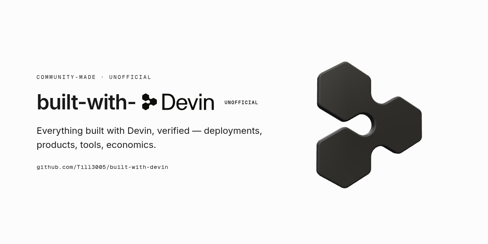
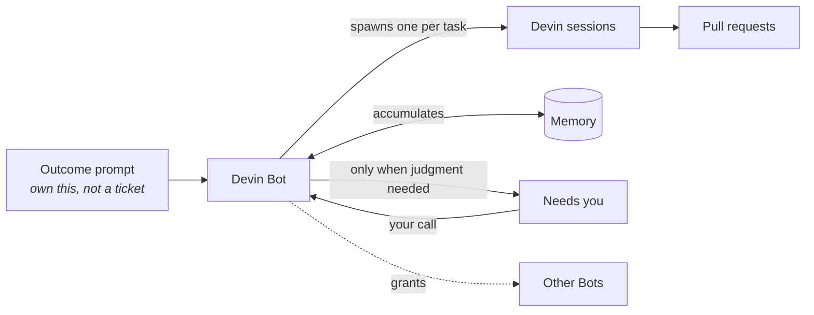

<picture>
  <source media="(prefers-color-scheme: dark)" srcset="assets/cover-dark.png">
  
</picture>

 

Curated by [@darega0mae](https://x.com/darega0mae) · Sister tutorials: [build-with-devin](https://github.com/Till3005/build-with-devin) · [Add your project](CONTRIBUTING.md)

**14** documented Bot deployments · **45** enterprise case studies · **8** shipped products · **47** tools & integrations · **34** field reports

English · [简体中文](README.zh.md) · [日本語](README.ja.md) · [Português](README.pt.md)

> *Unofficial community project — not affiliated with, endorsed by, or sponsored by Cognition AI. "Devin" is a trademark of Cognition AI. Brand assets are used under the official kit at [devin.ai/brand](https://devin.ai/brand) — "ready for whatever you're making." Official docs: [docs.devin.ai](https://docs.devin.ai).*

**Built with Devin** is a registry of *verified* work: every entry links to a named deployment, a real repository, or a published account — no vaporware, no marketing paraphrases. The bar for inclusion is in [CONTRIBUTING.md](CONTRIBUTING.md).

## Contents

- [Devin Bots — official product](#devin-bots--official-product) — deployments, reusable patterns, results, the 16-template marketplace
- [Products built with Devin](#products-built-with-devin) — shipped software where Devin wrote the code
- [Enterprise deployments](#enterprise-deployments) — published customer cases with hard numbers
- [Bots & surfaces](#bots--surfaces) — Devin inside Discord, Telegram, Slack and other products
- [SDKs & API tooling](#sdks--api-tooling)
- [Tooling around Devin](#tooling-around-devin) — what the community builds *for* Devin
- [Patterns & write-ups](#patterns--write-ups) — documented real-world usage
- [Community media](#community-media)
- [Official resources](#official-resources)

## Devin Bots — official product

Launched **November 17, 2026** ([announcement](https://devin.ai/blog/introducing-devin-bots) · [docs](https://docs.devin.ai/work-with-devin/bots) · [Fortune exclusive](https://fortune.com/2026/11/17/exclusive-cognition-bets-on-devin-bots-coding-agents-in-challenge-to-anthropics-duet-and-openais-dots/)). A Bot is a persistent agent that owns an outcome: it plans the work, runs a Devin session for each piece, keeps memory across weeks, and brings you only the decisions that need your judgment. Bots live in Slack and iMessage, run on schedules or event triggers, and hand work between each other through grants. Bots incorporate technology from the Interaction Company (Poke), which Cognition acquired in July 2026.

### Documented deployments

| Bot | Owner | What it owns | Reported results |
| --- | --- | --- | --- |
| **Android Bot** | Cognition | Devin's Android app, end to end | Prompted *"your job is to product manage the android app"* on Sep 28, 2026 — filed its own tickets, ran a Devin session per ticket, shipped to Google Play open beta in **44 days**: 1,134 PRs merged, 344,651 lines of Kotlin, 2,841 screenshot tests. Its human sent **183 messages total** — 22 days of complete silence — and **88% of PRs were self-merged**. Now owns Android/iOS feature parity. |
| **Layout Bot** | Cognition | Layout-shift regression on the Devin web app | Every 3 hours it builds production `main`, simulates first/repeat/delayed-request visits, traces regressions to the introducing PR, opens fixes with before/after videos. **159 PRs in 3 weeks; lag −70%.** |
| **Super Jenny** | Jenny Xu (community) | An entire mobile game studio | ~20 Bots (dev, Unity, releases, UI, iOS, Android, device testing) under one orchestrating Bot; the only human answers a consolidated Slack thread 4×/day **with emoji**. ~50 → **1,900 PRs/week**, studio revenue 6×'d, shipping weekly. Published as community template **SuperJennyStack**. She then built **BotSpeak** — a token-saving bot-to-bot shorthand (ASD-STE100, ACK codes, emoji receipts; full prose only for the human): bot-made decisions **12×'d** in 6 days. ([Jenny's thread](https://x.com/xujennyc), [BotSpeak post](https://x.com/xujennyc/status/2123111543105868166)) |
| **dabit3's fleet** | Nader Dabit (Cognition DevRel) | A personal 5-bot org + a game studio | **CTO** bot: all sessions/repos, VIP iMessage channel to reach every bot via SMS. **Auto(mation)Bot**: runs his personal automations, reports latency/efficiency advice. **DevCommunityBot**: runs the ambassador program across Sheets/Notion, builds mini data-viz apps. **DevRelBot**: docs + tutorial videos — *it has its own computer, its own Devin/GitHub/Linear accounts and an ElevenLabs voice clone*, boots a browser and records the real UI. Plus **Windfable**, a Unity iOS RPG for iPhone Duo where ~10 SuperJennyStack Bots each get their own macOS+Xcode+Unity and test folded/unfolded Duo modes with before/after screenshots + gameplay video. ([primer](https://x.com/dabit3/status/2122755275182469515)) |
| **Onboarding QA Bot** | Cognition (Walden Yan) | QA of 30+ onboarding flows, 24/7 | Maintains self-updating Playwright scripts, an agent job queue, and a live board view it built itself — "found way more bugs than I would have had patience to discover." ([@walden_yan](https://x.com/walden_yan)) |
| **"Phil"** | Harvey | Collaborative Word-compatible editor engine | ~30 agents wrote 1M+ lines of Rust + TypeScript in **3 weeks, no human engineers** — verified continuously against real Microsoft Word behavior and simulated lawyer negotiations; humans steer through memory + decision logs. ([Gabe Pereyra](https://x.com/gabepereyra)) |
| **Shared bot fleet** | Decagon | On-call, DevEx optimization, thread routing | 50+ shared Bots in Slack during beta; a Chief of Staff Bot decides when and how to spawn threads. ([@tylerxdev's thread](https://x.com/tylerxdev/status/2122743518712287400)) |
| **AutoResearch loop** | Decagon | An inference research lab | One Devin orchestrates; subagents chase competing hypotheses in parallel; every idea verified against replayed production traffic on Modal GPUs — **up to 2.5× more throughput per GPU** ([full writeup](https://x.com/DecagonAI/article/2115511110120120437), [@devindevelopers](https://x.com/devindevelopers/status/2115601107581821172)). |
| **Frankie's org** | Mark Fenner (community) | Personal agent fleet | Four Bots with distinct jobs coordinated by "Frankie, my Chief Agent", which brings consolidated updates back ([walkthrough](https://x.com/markfenner/status/2122740244328145211)). |
| **tigsbot** | @0xtigs (community) | Personal multi-project fleet | Each project lives in a Slack channel run by one Bot; a Chief-of-Staff Bot answers "what's the latest on everything?" and pings him when *he's* the blocker; specialist Bots manage single-license or complex-setup software ([setup](https://x.com/0xtigs/status/2122742784176034056)). |
| **Rewards Chief-of-Staff** | Avinash (Cognition, MENA) | Daily standup + rewards for a personal bot fleet | Adapts SuperJennyStack's roll-up pattern: one Bot reviews every other Bot each day and "rewards" good work so the fleet self-improves — his suggested first deployment for new Bots users. ([coverage](https://news.sulat.com/2026/11/18/devin-bots/)) |
| **Electra** | Basis | Internal tools + code, self-directed | A named Devin teammate (pre-Bots): decides what needs doing, writes and tests code, ships updates to internal tools, and pushes the team — Basis runs one 20-day thread per tax agent ([post](https://x.com/trybasis/status/2113307030203089189), [20-day thread](https://x.com/trybasis/status/2120658137766100992)). |
| **Personal data Bots** | Bryan Johnson | Health synthesis + family updates | One Bot synthesizes years of biometric and brain-scan data into a single readout; another texts his mother a daily update on how he's doing. ([post](https://x.com/bryan_johnson/status/2122814114976383406)) |
| **Tennis data Bots** | Venus Williams | Pro-tennis preparation and match data | The seven-time Grand Slam singles champion uses Devin Bots to make sense of pro-tennis prep — opponent plays, racket tuning for humidity and temperature, match analysis, meals and rest. ([Cognition video](https://x.com/cognition/status/2123093354196140285), [@walden_yan](https://x.com/walden_yan/status/2123105884125671605)) |

### Documented patterns

- **Outcome prompts** — *"You own the Android app now. Keep it at feature parity with iOS."* Give the Bot a goal, not a backlog.
- **Bot-to-bot handoffs** — grants let a QA Bot find a bug, pull in a Developer Bot to fix it, retest on staging, and have a PM Bot report status to the channel.
- **Scheduled checks** — a Bot that watches an alerts channel on a cron, owns the check, and opens fixes when it regresses (Layout Bot pattern).
- **Roll-up reporting** — one supervising Bot collects every subordinate Bot's pending decisions into a single thread (SuperJennyStack pattern).
- **Bots × Apps** — Bots maintain Devin Apps: build new pages/features and adapt to changes automatically; Bots and Apps pin to the same nav rail ([@dabit3](https://x.com/dabit3)).
- **Living evals** — a scheduled Devin reads production traces, groups them into behaviors, replays failures in a full copy of your system (never mocks), and freezes each as an eval PR — the skill file is the asset, not the evals (Rox: 72% coverage vs 43–57%).
- **Bots that tune Devin itself** — Walden's bot watches user feedback, replays prompts, runs experiments, builds eval sets, and tunes Devin's own proactivity/autonomy parameters — Bots built Bots ([thread](https://x.com/walden_yan/status/2122740852091216274)).
- **Bots with their own accounts** — DevRelBot ships tutorial videos by itself because it was provisioned like an employee: own computer, own Devin/GitHub/Linear accounts, own ElevenLabs key — it signs into Devin and records the real UI.
- **Inter-bot protocol (BotSpeak)** — 20+ Bots generate 700+ messages/day; Jenny solved inbox collapse with a bot-to-bot shorthand (ACK codes, Simplified English, emoji receipts) and full prose only for the human — bot-made decisions 12×'d in 6 days.
- **Reference-grounded swarms** — Harvey's lesson: when work can be checked against a reliable reference (real Word behavior), a small team can direct a large swarm safely.

### Reported results

**1,000+ beta testers** in the weeks before launch. Testers merge **4.5× more PRs per message**; Cognition merges 2,000+ PRs/week, 40×'d its merged-PR throughput, and landed **1,000+ PRs from a single autonomous goal**. Named early-access customers include **Decagon, Fireworks AI, and Reducto**, with usage up 10× in the first two weeks ([Fortune](https://fortune.com/2026/11/17/exclusive-cognition-bets-on-devin-bots-coding-agents-in-challenge-to-anthropics-duet-and-openais-dots/)).

Other documented usage: preemptive issue triage on **Manim**, firmware work, a bot-led team building a **frontier inference engine**, tennis analytics, accounting automation (trybasis: 20h → 30 min), swyx's week-long trial (AEO, QA, cross-platform porting, personal admin, video editing — [his summary](https://x.com/swyx/status/2122746401482592549)), ambassador **Chris Wozniczek** running his web studio from Slack (cold outreach, customer previews), **Nick White** (Helionova) testing early Bots fleets, and Cognition's research team compressing "weeks into days" ([@silasalberti](https://x.com/silasalberti)). Full write-ups in the [reproduction guide](docs/reproducing-devin-bots.md#reported-usage-beyond-cognition).

### Official template library

Sixteen ready-made Bots on the [public marketplace](https://devin.ai/bots/templates) ([templates docs](https://docs.devin.ai/work-with-devin/bots/templates) — a template-created Bot starts with no connections, secrets or memory; "Share as template" publishes your own), plus community templates like **SuperJennyStack**:

| Template | What it does |
| --- | --- |
| Software Factory | Finds bugs, polish, performance and refactoring work in a named product area; opens one small PR each with proof it works |
| Product Engineer | Takes a ticket or request to a tested PR and through review |
| QA Engineer | Tests each PR in a real browser and posts the video of pass/fail |
| Anomaly Watcher | Twice daily scans product + business data for problems no monitor watches |
| Code Reaper | Removes dead code weekly, one safe PR at a time |
| Chief of Staff | Watches channels, posts updates, hands work to the team and follows it to done |
| Migration Engineer | Owns one big migration as small, tracked PRs with a progress surface |
| Latency Optimizer | Finds the slowest endpoints/jobs/queries; weekly fix PR with before/after speed |
| iOS Engineer | SwiftUI features to PR + TestFlight build |
| Android Engineer | Kotlin features to PR + internal-test build |
| Internal Tools Engineer | Admin panels and internal tools on your stack |
| Data Analyst | Answers data questions with the chart and the query behind it |
| Devin Coach | Teaches your team to use Devin well from your own usage data |
| Code Health Engineer | Stale flags, old dependencies, CVEs → small safe PRs |
| Technical Writer | Keeps repo wikis and diagrams in step with `main` after merges |
| Compliance Engineer | Collects control evidence from code, warns when a control lapses |

**[→ Reproduction guide: how to rebuild every documented Bot](docs/reproducing-devin-bots.md)** — and its expanded tutorial form in the sister repo **[build-with-devin](https://github.com/Till3005/build-with-devin)**

Site: **[till3005.github.io/built-with-devin](https://till3005.github.io/built-with-devin/)** (Devin-styled registry page) · Deep dives: **[Anatomy of a Devin Bot](docs/devin-bots-anatomy.md)** (the six documented mechanisms + what the numbers actually show) · **[The economics of Devin](docs/economics.md)** (every published cost/return figure in one ledger — also [on the site](https://till3005.github.io/built-with-devin/economics))

<a href="#readme">back to top</a>

---

## Products built with Devin

Real software where Devin wrote the code — not demos, shipped work.

- **[Era by Eon](https://devin.ai/customers/eon)** — Simulated companies (74 vendor-faithful systems: Salesforce, Slack, Zendesk, Jira…) for training and evaluating AI agents. **98% of merged PRs written by Devin**, 300+ day-long sessions, 2,720 sessions launched by other sessions.
- **[Courtyard's Quick](https://courtyard.io/blog/post/from-a-slack-link-to-production-in-under-48-hours-cloning-shopifys-quick-with-devin)** — Courtyard cloned Shopify's internal "Quick" static-site deployer: from a Slack link to a production service (Go, Cloud Run, Bazel, Terraform, SSO, git-backed) in **~21 hours**, all written by Devin.
- **[Frontierfood](https://samyok.com/frontierfood/)** — Cognition engineer Samyok Nepal used Devin Voice to scrape Google reviews and map the Pareto frontier of food by location ([post](https://x.com/samyok/status/2098155977199743367)).
- **Flappy Asher** — Russell Kaplan (Cognition president) had Devin on a Mac VM turn baby photos into game sprites and ship the result — live in TestFlight ([post](https://x.com/russelljkaplan/status/2100280085999919555)).
- **[Try Devin vending machine](https://github.com/dabit3/vending-machine)** — dabit3's event credit dispenser (Next.js + Convex + Clerk): attendees enter their email at an event URL and get a unique Devin credit code. `devin-ai-integration[bot]` is the repo's top contributor (266 commits); live at [trydevin.ai](https://www.trydevin.ai/).
- **[GymClass](https://seed.horacioh.com/writing/how-i-built-a-full-booking-system-as-a-side-project-with-devin-as-my-engineering-partner)** — Horacio Herrera's booking and class-management system for a real martial-arts academy (TS/Bun/React/Hono/tRPC on Cloudflare): a month of features directed from his phone between meetings — including a full booking-architecture rewrite and a Vitest→Bun migration.

- **[Spraycash](https://spraycash.onrender.com)** — A live payments-explorer site whose entire UI was art-directed inside Devin chat (Kimi K3): every prompt published in the [build log](https://dev.to/ibrahimpima/designing-the-spraycash-ui-with-kimi-k3-in-devin-4l2f), code at [fozagtx/spraycash](https://github.com/fozagtx/spraycash).
- **CosmosOS + NEXI** — A year-11 student's shipped trio from a month on Max: CosmosOS, his own Linux distribution built by Devin between classes; NEXI, a family of local models; and a multi-agent IDE ([full account](https://ravtheman.medium.com/im-17-and-for-one-month-devin-was-my-entire-engineering-team-here-s-everything-i-learned-183d59099384)).

*Know a shipped product built with Devin? [Add it](CONTRIBUTING.md).*

### Side quests

Small, delightful builds — proof the same machinery does fun work too.

- **[Mobile games on iPhone Duo](https://x.com/xujennyc/status/2121625134029209929)** — Jenny Xu and Nader Dabit jamming on Devin-built mobile games on foldables; Devin [builds and tests Duo apps itself](https://x.com/DevinAI/status/2111161066403123653), including at scale ([dabit3](https://x.com/dabit3/status/2112939574133760190)).
- **Devin's self-portrait** — Bryan Johnson asked Devin to render how it sees him ([post](https://x.com/bryan_johnson/status/2122818486800191842)).
- **The CoS whose job a bot took** — A Cognition chief-of-staff's first week: woke up to the new Chief of Staff Bot already doing his job ([post](https://x.com/arirbrown/status/2122789909731872882)).

<a href="#readme">back to top</a>

---

## Enterprise deployments

Published customer cases with hard numbers ([full index](https://devin.ai/customers)):

| Company | Deployment | Reported result |
| --- | --- | --- |
| [Nubank](https://devin.ai/customers/nubank) | Multi-million-line, 8-year-old ETL monolith → sub-modules | 8–12× engineering efficiency, 20× cost savings; fine-tuned Devin cut ~40 min/task to ~10 |
| [Wayfair](https://devin.ai/customers/wayfair) | Cloud agents across the org | 1,600+ engineers all-in |
| [The Access Group](https://devin.ai/customers/access-group) | Devin across 250 products, 2,000+ engineers | 5× engineering output |
| [EBANX](https://devin.ai/customers/ebanx) | Devin as primary author | **92% of merged PRs are Devin-authored** |
| [Gumroad](https://devin.ai/customers/gumroad) | Devin on the core repo | Devin is the repo's **#1 contributor**: 1,500+ merged PRs |
| [Finch](https://devin.ai/customers/finch) | Slack→Linear intake → log/trace investigation → browser test → same-day PR | **3,000 PRs merged, ~20 engineer-months saved**; before Devin, 20 requests/day meant 3–4 addressed — "biggest unlock is capacity to parallelize" |
| [Comarch](https://devin.ai/customers/comarch) | 20-year-old, 10M-line ERP rebuild | Full system modernization in progress |
| [AngelList](https://devin.ai/customers/angellist) | Incident triage + data migration | Devin Oncall root-causes **70% of incidents** first-pass vs **20%** for Sky, their homegrown Claude SDK agent — ~20 incidents/week, 50% handled end-to-end ([Oncall case](https://devin.ai/customers/angellist-oncall)); Redshift→Snowflake 5.2× faster |
| [Modal](https://devin.ai/customers/modal) | Incident response | 80% of incidents investigated before an engineer opens the thread |
| [Reducto](https://devin.ai/customers/reducto) | Devin Oncall as first responder | Engineers rarely get paged |
| [Eight Sleep](https://devin.ai/customers/eight-sleep) | Devin across the company incl. non-engineers | **8× more shipped**; a support manager built an end-to-end pipeline+dashboard in <1h; profit-forecast model within 10% on monthly backtest after ~1 week of iterating |
| [Exa](https://devin.ai/customers/exa) | End-to-end shipping; repos made fully cloud-bootstrappable | Production ships without engineers ever pulling code locally; a multi-week session rolled a test-system contract across **~30–40 PRs**; newer engineers have never configured a local env |
| [RV Tech](https://devin.ai/customers/rvtech) | Rivian × VW JV, software-defined vehicles | 10× testing velocity |
| [Melius](https://devin.ai/customers/melius) | Primary cloud-session interface; morning automation sweeps PRs stale >7d, fixes tests, tags a human | **~100 PRs/day**; 8-person team "functions like a team of 100" |
| [Hamming](https://devin.ai/customers/hamming) | "Devinable" task framework — bounded tasks + clear specs + objective evals; codebase optimized for agents (functional > OOP, eval-driven) | **25% of total code volume**, tied as top contributor with two human engineers |
| [Airbyte](https://devin.ai/customers/airbyte) | Connector maintenance | Keeps 700+ connectors running |
| [Litera](https://devin.ai/customers/litera) | QE Evolution — specialized Devin agents embedded in scrum teams; "AI composers" role | **Regression cycles cut 90%**; 5 products shipped in 3 weeks pre-ILTACON; 90+ active engineers in 30 days; ~250 engineers "at the speed of a thousand" |
| [Ramp](https://devin.ai/customers/ramp) | Technical-debt clearance | **80 merged PRs/week, 10,000+ engineer-hours saved**; a small Devin-savvy team runs it |
| [Linktree](https://devin.ai/customers/linktree) | Feature + customer-bug pipeline | ~300 PRs authored / ~100 merged last month; the team's reflex is now "can I just Devin it?" |
| [Bilt](https://devin.ai/customers/bilt) | Org-wide rollout | 800+ merged PRs since Feb, ~117/week average; **their Devin Bots merged ~1,600 PRs in a single week** post-launch — VP Engineering Will Laughlin ([Bots testimonials](https://devin.ai/bots)) |
| [Rohlik Group](https://devin.ai/customers/rohlikgroup) | Agent-driven grocery ops | 2× engineering throughput; 4× faster automation rollout incl. warehouse robotics; 50+ MCP integrations |
| [Crosby](https://devin.ai/customers/crosby) | AI-native law firm; automation starts a session per Slack bug report + Sentry alert; lawyers' review feedback triaged/grouped by Devin | 20–40 bugs/alerts get first-pass investigation daily in ~5 min each; **Sentry alert noise −50%**; on-call stayed at 1 engineer while legal workforce ~5×'ed |
| [Endava](https://devin.ai/customers/endava) | Enterprise-wide provision | 2,000+ employees on platform; 3× in four months; 78% PR merge rate |
| [Tavrn](https://devin.ai/customers/tavrn) | Fleet dispatched from Slack across eng/ops/CS/sales inside a HIPAA tenant (SSO, scoped access); daily automation investigates failed quality-judge cases | 8-person team ships like 50; **1,800+ PRs in 6 weeks** (~80% merge of decided); **93% of merged code Devin-originated** last month; alert→investigation median **35s**; ~90% of alerts get full in-thread investigation |
| [Evinova](https://devin.ai/customers/evinova) | GxP-regulated delivery | 8× faster GxP documentation; 3× faster migrations; 66% of clear-cut bugs fixed autonomously |
| [Compiled Health](https://devin.ai/customers/compiledhealth) | Clinical benchmark build | 2 researchers/2 months = 5–6 engineers' work; ~430 eng-hours at ~$17/hr ≈ +4 engineers on a 4-person team |
| [Común](https://devin.ai/customers/comun) | 13-person fintech team | 3× output; weekly backend PRs 50 → 170 in four weeks |
| [AHEAD](https://devin.ai/customers/ahead) | 8 production workloads | **8–40× time savings** vs manual baselines; fully productive in 2 business days |
| [The Citation Group](https://devin.ai/customers/thecitationgroup) | Measured-ROI rollout | 271 PRs merged at 80% in 3 months; 50% engineering-efficiency gain; 85% cut in legacy-app refresh |
| [Latent Health](https://devin.ai/customers/latent) | Pharmacy ops | 30% more PRs/engineer vs Claude Code alone; 50 running automations |
| [Crossmint](https://devin.ai/customers/crossmint) | GOAT open-source scaling | Devin became the repo's #1 contributor during trial |
| [FE fundinfo](https://devin.ai/customers/fefundinfo) | 1,800-repo automation | 10% immediate capacity increase via test-gen + security fixes |
| [GE Aerospace](https://devin.ai/customers/geaerospace) | Constrained team story throughput | ~2× user-story output in three months |
| [Itaú](https://devin.ai/customers/itau) | Devin across the full SDLC at Brazil's largest bank | .NET→Java migration of 59 services **6× faster at 5× lower cost**; SQL Server migration of 800 objects **5× faster**; ~70% of SonarQube/Fortify/Veracode findings auto-remediated; continuously updated docs across **300,000+ repos**; test coverage ~50%→~90+%; **75% of a 17,000-person tech org** uses it after a ~1,000-developer waitlist formed |
| [Ripple Treasury](https://devin.ai/customers/ripple) | Automated bug triage ("Guardians 2.0") + codebase Q&A for non-engineers | Untriaged backlog **−75%**, 0.5→1.5 bugs fixed/day (**3×**), twice-weekly triage meetings eliminated; 70 teammates outside engineering use it — 4,600+ questions ≈ **2,300 engineer-hours saved** |
| [WPP Enterprise Solutions](https://devin.ai/customers/wpp-enterprise-solutions) | Devin as the delivery layer for fixed-price client engagements | **30–40% SDLC efficiency gains** proven on live engagements; Halfords rebuild delivered **110% of scope in 25% less time** at 99.97% uptime; a test-framework migration went 80 person-days → 8 (**10×**); weekly active engineers **4×'d in 9 months** |
| [Basis](https://devin.ai/customers/basis) | Cloud agents for long-running tasks at an accounting-AI startup | Slack-tagged requests come back shipped ~15 minutes later; engineers queue ~10 Devin jobs before bed — "by far the best infrastructure for cloud agents" (co-founder) |
| [Mercor](https://devin.ai/customers/mercor) | Engineers building around the clock | The $10B human-intelligence network runs 24/7 Devin workflows (published case page) |
| [Hippo](https://devin.ai/customers/hippo) | Devin across the insurance engineering org | Cognition partnership: agentic build/test for products that must hold up across 50 states' insurance rules (published case page) |
| [Zeb](https://devin.ai/blog/devin-for-databricks-migrations) | NetSuite→Databricks delivery partner | A global investment-advisory client's 4-week migration delivered in **2.5 weeks**; a Fortune 500 energy company migrated a 142-object platform to Unity Catalog in **8 days** |
| [Gamma](https://research.gamma.app/2026/11/template-factory) | The design-template factory + PowerPoint import | Every ticket opens a Devin session running Gamma's own agent harness (build → render → critic rounds); thousands of templates at 2–4h each, human interventions fell 10–15/deck → **full autonomy by October**. PPT import rebuilt by 3 engineers + a Devin fleet of ~10 fixers — **3,500+ merges** on a job sized at 5–10 engineers × a year, done in weeks ([import write-up](https://research.gamma.app/2026/11/pptx-import)) |
| [Odyssey Logistics](https://news.cognizant.com/2026-09-23-Cognizant-and-Cognition-put-autonomous-AI-engineering-into-production-at-Odyssey-Logistics,-with-a-37-percent-net-cost-saving) | Legacy Microsoft Access/VBA forms → cloud-native OdysseyONE TMS, delivered by a 7-person Cognizant team with human sign-off per change | **37% net cost saving** vs a conventional rebuild, inside a fixed budget and accelerated timeline; delivery throughput up ~⅓; the current phase is live (Sep 2026 press release) |
| **Rox** | Living Evals — weekly Devin reads production traces, replays failures in a full copy, opens eval PRs | Eval suite covers **72% of real usage** vs 43–57% hand-written ([write-up](https://www.rox.com/articles/living-evals-an-eval-suite-that-grows-from-production), [thread](https://x.com/rox_ai/status/2110779380666617997)) |
| [Philips](https://devin.ai/blog/introducing-code-scans) | Code Scans early tester — Digital Computational Pathology, Enterprise Informatics | **~96% PR merge rate** across several repos; **700+ engineering hours** estimated saved in the test window (customer quote in the launch post) |
| **Cognition** (internal) | Software factory: self-driving PR loop (bug report→merge→monitoring→maintenance), pods + disposable hourly-rebuilt VMs w/ Docker-Compose mocks; agents given measurable jobs | **40× merged-PR throughput in a year on 2.7× headcount** — >10× per-engineer productivity ([Walden Yan, AI Engineer](https://aietalks.com/talks/40x-more-merged-prs-with-2-7x-the-engineers)) |

Also on the record: Citi (40,000-developer rollout, 30% tech-vendor spend cut), Mercedes-Benz, Cognizant and Infosys partnerships, and the **McKinsey × Cognition alliance** (Nov 16 — McKinsey advises on project selection and baselines, Devin does the work; Cognition claims 6 of 8 US G-SIBs and 3 of 6 top US health insurers as customers, [announcement](https://devin.ai/blog/cognition-mckinsey-alliance)) — see the [customer index](https://devin.ai/customers).

<a href="#readme">back to top</a>

---

## Bots & surfaces

Putting Devin inside other products and channels.

- **[devin-discord-bot](https://github.com/wgtechlabs/devin-discord-bot)** — Self-hosted TypeScript bot bringing Devin into Discord: start sessions with a mention, stream progress back into the channel.
- **[devin-telegram-bot](https://github.com/wgtechlabs/devin-telegram-bot)** — Same author's Telegram bridge to the Devin API.
- **[Buzz for Devin](https://github.com/fenner888/BuzzforDevin)** — Community fork of Block's Buzz adding the official Devin CLI (`devin acp`) as a native runtime, so each person brings their own authenticated Devin into shared agent-native communities.
- **[devin-sse-proxy](https://github.com/sotayamashita/devin-sse-proxy)** — Minimal MCP server letting Claude Desktop talk to Devin's SSE transport while passing a Personal API Key.
- **[devin-flow](https://github.com/xlm/devin-flow)** — Visual editor for event-driven Devin workflows on the Automations API, with session tracking (FastAPI + Vue 3).
- **[OpenAB](https://github.com/openabdev/openab)** — Open Agent Broker: a lightweight Rust ACP harness bridging Discord/Slack (plus gateway adapters for Telegram, LINE, Feishu/Lark, Google Chat, WeCom, MS Teams) to any ACP CLI — `devin acp` is a first-class backend.
- **[Devin Orchestrator](https://github.com/huydx/devin)** — Go backend that receives GitHub webhooks, starts Devin sessions or PR reviews, monitors results on an observability dashboard; ships a local Devin API stub for development.
- **[eventflow-devin-integration](https://github.com/Cognition-Partner-Workshops/eventflow-devin-integration)** — Partner-workshop reference: Azure Monitor alert → Azure Function webhook → Devin investigation session (Log Analytics via MCP) → fix PR.

<a href="#readme">back to top</a>

---

## SDKs & API tooling

- **[go-devin](https://github.com/gassara-kys/go-devin)** — Go SDK for the Devin API.
- **[llm-devin](https://github.com/ftnext/llm-devin)** — Plugin for Simon Willison's `llm` CLI to call the Devin API.
- **[@cognition-ai/sdk](https://docs.devin.ai/sdk)** — The official TypeScript SDK (beta): one `createDevin` session API drives cloud *and* local CLI sessions, plus `devin.api` typed REST client; companion packages `@cognition-ai/ai-sdk`, `@cognition-ai/cloudflare-agents`, `@cognition-ai/harness-devin`. [Examples repo](https://github.com/COG-GTM/devin-sdk-examples).
- **[devinai](https://pypi.org/project/devinai/)** — The official Python SDK (`usacognition/devin-sdk-python`).
- **[devin-api-mcp](https://github.com/jsklan/devin-api-mcp)** — Full-coverage Devin API MCP server: sessions, knowledge, playbooks, secrets, schedules, attachments — backed by v1 + your personal key so sessions show up under *you*, plus read-only DeepWiki tools.
- **[terraform-provider-devin](https://github.com/CognitionAI/terraform-provider-devin)** — Official Terraform provider: manage orgs, git permissions, playbooks, knowledge notes, secrets, schedules, IP access lists and IdP group-role mappings over the v3 API.
- **[devin_api (Ruby)](https://github.com/smasato/devin_api_client_rb)** — Unofficial Ruby client for the Devin API, published as a gem.
- **[widevin](https://docs.rs/crate/widevin)** — Lightweight Rust provider library for Devin internals (auth/session constants, extension plumbing).

<a href="#readme">back to top</a>

---

## Tooling around Devin

Things the community builds *for* Devin rather than *with* it.

- **[DevinX / Devinmaxxing](https://x.com/markfenner)** — Mark Fenner's local model picker for Devin Desktop sessions: local weights via ACP, adaptive cost balancing, reasoning-effort control.
- **[awesome-devin](https://github.com/Icaro0310/awesome-devin)** — The `devin-*` open-source tooling ecosystem: session search, history export, knowledge graphs, eval harnesses, backup, fan-out planners.
- **[devin-judge](https://github.com/Icaro0310/devin-judge)** — Calibrated local-first decision layer with a Devin ACP backend; no API key needed.
- **[devin-fusion-byok](https://github.com/kuobibulaien/devin-fusion-byok)** — A Devin extension (VSIX) that brings your own model APIs into Devin's model picker and composes them into Fusion Lead+Sidekick presets — without modifying the app itself.
- **[devin.cursorrules](https://github.com/grapeot/devin.cursorrules)** — The 5k★ ruleset that turns Cursor/Windsurf into "90% of Devin" — the reference point for what counts as Devin-grade agent behavior.
- **[nix-devin-cli](https://github.com/broady/nix-devin-cli)** — Devin CLI packaged for Nix with nightly auto-updates across macOS and Linux.
- **[QuotaView](https://github.com/Duoasa/QuotaView)** — macOS "Dynamic Island" for AI agents: tracks Devin Desktop and Devin CLI sessions, approvals and quota alongside Claude/Codex/Grok.
- **[Mako](https://github.com/Verbiflow/mako)** — Local workspace for every coding agent; carries Devin conversations over ACP — run, follow, resume, and move them across machines.
- **[ax](https://zenn.dev/kuwashima/articles/ax-cross-agent-session-picker)** — fzf session picker that resumes Devin alongside 18 other agent CLIs (JP).
- **[Kiro Crew patch for Devin CLI](https://zenn.dev/dario_okazaki/articles/e5eda2aca4fdd2)** — Unofficial patch adding Devin CLI to Kiro Crew's managed bot fleet, with per-bot permission handling (JP).
- **[Devin for VS Code](https://github.com/shayanline/devin-vscode)** — A full chat panel for Devin CLI inside VS Code: workspace context via `@`, Keep/Undo diff review, per-workspace resumable chats, and a settings editor for the CLI's instructions, skills, plugins, MCP servers and hooks.
- **[Devin Switch](https://github.com/ansuman-shukla/devin-switch)** — Native macOS app + CLI for multiple Devin CLI logins: isolated account profiles, shared local conversation history, usage/reset display, and concurrent launches.
- **[Devin Token Monitor](https://github.com/TH-Chou/devin-usage-monitor)** — Native macOS menu-bar app (and VSIX) that turns the CLI's local SQLite metrics into live cost dashboards — token trends, model donut, per-request TTFT/tokens-per-second, budget alerts, CSV export, six languages.
- **[devin-desktop-zh](https://github.com/cby122/devin-desktop-zh)** — A hand-built Simplified-Chinese localization of Devin Desktop: a 33,457-string dictionary plus the injection/re-signing pipeline that produces a separate `Devin 中文版.app` — shipped as an Agent Skill so the whole workflow is repeatable.
- **[devin-desktop-zh (Till3005)](https://github.com/Till3005/devin-desktop-zh)** — Same name, different take: Simplified + Traditional (TW/HK) language packs with a one-command patcher across macOS/Windows/Linux — no rebuild, patches the installed app in place.
- **[devin-pstack](https://github.com/Till3005/devin-pstack)** — poteto's pstack engineering skills ported to Devin Desktop: install once and every agent works in her style — modes, principles, TDD and verification baked in.
- **[devin-tui](https://github.com/fenner888/devin-tui)** — Mark Fenner's full-screen terminal UI for Devin over `devin acp`: React + Ink, tool calls, inline diffs, plan view, per-session spend.
- **[Devin Remote](https://github.com/zouhall/devin-remote)** — A browser console for Devin CLI sessions — drive local Devin from any browser, including a phone: streaming chat, permissions, modes, models, usage stats.
- **[Devin Pocket](https://github.com/BOTOOM/devin-pocket)** — Mobile-first Devin CLI client over ACP; runs on Android/Termux, Linux and macOS.
- **[devin-control](https://github.com/Icaro0310/devin-control)** — Policy-gated ACP client: isolated Devin sessions behind allow/deny/ask rules.
- **[devin-subagents](https://github.com/Duro02/devin-subagents)** — Exposes `devin acp` sessions as lifecycle-managed subagents over MCP: parallel dispatch, blocking `wait`, mid-flight steering, permission adjudication.
- **[Devin Session Exporter](https://github.com/marktwainme/devin-session-exporter)** — Devin Desktop extension that exports local ACP session databases to Markdown/JSON/HTML with filtering and batch export.
- **[devin-acp-shim](https://github.com/wibus-wee/devin-acp-shim)** — A transparent stdio proxy that fixes Devin CLI's session-level MCP capability negotiation — small, but it unblocks MCP servers for every ACP host.
- **[hindsight-devin-desktop](https://pypi.org/project/hindsight-devin-desktop/)** — Vectorize's MCP bridge giving Devin Desktop persistent long-term memory: one command wires the Hindsight server plus always-on recall/retain rules.
- **[devin-memory](https://github.com/Sassine/devin-memory)** — Zero-dependency persistent memory for Devin CLI: hooks estimate context usage, warn before the window fills, and `/memory-save` + `/memory-resume` snapshot and restore sessions across `/clear`.
- **[devin-explore](https://github.com/Icaro0310/devin-explore)** — The flagship of the `devin-*` fleet: diagnoses the local install (stores, schema, locks, config — with fix suggestions), exports session history, runs FTS5 search and a session/project/file knowledge graph, and rolls sessions into per-repo status reports. All local, zero telemetry.
- **[devin-assure](https://github.com/Icaro0310/devin-assure)** — Verification monorepo: `devin-qa-pack` audits session claims, `devin-evals` replays recorded sessions against rubric graders (the `dream` subgroup synthesizes sessions with known verdicts), `devin-metrics` tracks context/token peaks locally.
- **[hermes-devin-acp](https://github.com/raffr85/hermes-devin-acp)** — Use your Devin subscription as a Hermes Agent model provider: drives `devin acp` under Hermes while keeping auth in the official CLI.
- **[@yuiseki/devin-gyazo](https://github.com/yuiseki/devin-gyazo)** — Screenshot→Gyazo automation scripts so a Devin session can capture browser/terminal state and post visual proof mid-task (JP).
- **[nvim-devin](https://github.com/wstewarttennes/nvim-devin)** — Neovim plugin for the Devin API: create sessions, send visual selections or whole files as messages, per-buffer replies.
- **[ACP client ecosystem](https://agentclientprotocol.com/get-started/clients)** — `devin acp` runs inside every ACP-compatible editor: JetBrains and Zed natively, Neovim (CodeCompanion/agentic/avante/hermes), Emacs (agent-shell.el), Sublime Text, Qt Creator, Obsidian.

<a href="#readme">back to top</a>

---

## Patterns & write-ups

Documented real-world usage.

- **[SAST auto-remediation pipeline](https://github.com/Cognition-Partner-Workshops/uc-cve-remediation-regulatory-compliance/pull/16)** — GitHub Actions workflow that scans PRs with OWASP Dependency-Check and dispatches a Devin session to remediate CVEs ≥ 7.0, with verification scans and an escalation circuit breaker.
- **[Attributing Devin PRs to their requesters](https://tech.enechange.co.jp/entry/2025/06/22/165504)** — ENECHANGE's GitHub Actions setup for recording which engineer instructed Devin, solving productivity-measurement gaps when all PRs show `devin-ai-integration[bot]` (Japanese).
- **[Fixing stale mailbox alarms](https://agentsinuse.com/use-cases/devin-to-clear-mailbox-alarm/)** — Devin tracing a Cloudflare Workers test flake to a stale continuation alarm and adding regression coverage (via Agents In Use).
- **[Designing the Spraycash UI in Devin](https://dev.to/ibrahimpima/designing-the-spraycash-ui-with-kimi-k3-in-devin-4l2f)** — A fintech landing page art-directed entirely through Devin chat: generated imagery, layered cloud animation, SVG draw-on ring, and a three-font type system — every prompt published.
- **[Devin auto code-review at rakko_inc](https://zenn.dev/rakko_inc/articles/00cc5a5a679971)** — Playbooks + GitHub Actions + Devin API pre-digest every PR; monthly reviewed PRs went 65 → 184 (JP).
- **[QA test-design automation at Skillnote](https://zenn.dev/skillnote/articles/5ba429ca249801)** — PR triggers Devin to draft test cases with rationale; ~35 min saved per 10 cases (JP).
- **[Event-driven Devin automation](https://zenn.dev/arufian/articles/f80a62f5217cee)** — Serverless GitHub-Actions pipeline with a priority×complexity policy table and plan-first approval flow (JP).
- **[Org rollout at Leverages](https://zenn.dev/levtech/articles/9c869303820844)** — 14 teams, 177 merged PRs, and an honest ACU-vs-wages ROI formula (JP).
- **[Rapid development with Devin](https://blog.scottlogic.com/2025/10/20/rapid-development-with-devin.html)** — Scott Logic's practitioner account, including the prompt-iteration lessons.
- **[Scott Wu on Cognition's internal usage](https://www.lennysnewsletter.com/p/how-devin-replaces-your-junior-engineers)** — how Cognition itself delegates: async junior-engineer workflow, top-5 task types, first-line-of-defense crash analysis.
- **[E2E testing Devin's changes with Signadot](https://dev.to/signadot/test-devins-changes-end-to-end-with-signadot-a0)** — Devin + Signadot MCP: it runs the changed microservice in its VM, sandboxes it against real cluster traffic, and runs the Playwright suite — closing the loop Devin can't close alone in a multi-service system.
- **[Vulnerability impact analysis via Devin Automations](https://zenn.dev/rescuenow/articles/2ee1c4b66ecec8)** — rescuenow's scheduled Automation investigates blast radius when a CVE drops (JP).
- **[Classifying 700 support inquiries](https://zenn.dev/canly/articles/9c19bb123e208c)** — canly pointed Devin at their ticket history to find what "cause unidentified" actually was — Devin as a data analyst, not a coder (JP).
- **[Datadog CCM × Devin weekly cost ops](https://zenn.dev/hubble/articles/091e29a0c86ec3)** and **[Dependabot PRs triaged by Devin first](https://zenn.dev/hubble/articles/88429bd24db476)** — hubble's two standing loops: weekly cloud-cost reduction, and Devin investigating every dependency bump before a human sees it (JP).
- **[Devin as a performance-analysis agent with Dynatrace MCP](https://medium.com/lets-code-future/how-i-turned-devin-into-a-performance-analysis-agent-with-dynatrace-mcp-753d3f4790a2)** — Wiring Devin to live observability data so it diagnoses latency itself, not just the code (Medium).
- **[Devin: from bug report to pull request](https://medium.com/@winter.inc/devin-from-bug-report-to-pull-request-25-days-of-ai-day-18-b158daa20f23)** — Day 18 of a 25-day AI series: the full ticket-to-PR loop on a real codebase (Medium).
- **[Role-based bot dev team + light-PR auto-merge](https://zenn.dev/kyto64/articles/ai-bot-dev-env)** — kyto64's personal-dev setup: specialized AI bots plus Devin, with low-risk PRs merging themselves (JP).
- **[Devin CLI's context limits in practice](https://qiita.com/ishizakahiroshi/items/cee2a8ea2be18f2ccee3)** — Working notes on fitting AGENTS.md and approval rules inside the 16KB/32KB caps (JP).
- **[NOT A HOTEL's first Devin session](https://zenn.dev/notahotel/articles/d401a1046d6076)** — A mob-workshop report from setup to first merged PR in under an hour — including what repo onboarding categories Devin asks for (JP).
- **[Hello World… Meet Devin](https://jamesin.substack.com/p/hello-world-meet-devin)** — Jamesin Seidel's launch-era account: watching code get committed into his own repo by Devin for the first time, building an email-triage assistant (Substack).
- **[How to deploy a website with Devin](https://www.hostinger.com/tutorials/how-to-deploy-a-website-with-devin/)** — Hostinger's step-by-step: the three deployment routes (App Deploys beta for previews, GitHub→host for production, manual upload), plus their MCP Connector giving Devin Desktop direct access to 100+ hosting tools.
- **[Devin Apps tutorial: build a private internal app by prompt](https://lightmind24.blogspot.com/2026/11/devin-apps-tutorial-build-private.html)** — The most complete Apps walkthrough outside the launch post: what to put in the first prompt (users, data source, screens, stack), how Apps pick up your design system, and where Apps stops being the right tool.
- **[Devin Bots want to be your agent manager](https://daily.dev/posts/devin-bots-want-to-be-your-agent-manager-not-your-ai-employee-hhpjo94uh)** — daily.dev's launch analysis and reply-sentiment breakdown (55% positive / 30% mixed / 15% skeptical): the substantive criticism cluster is self-review (who checks a Bot that checks itself), credential security, and whether managing a fleet is actually less work than managing people.
- **[What the launch post leaves unsaid](https://aiholics.com/devin-bots-cognition-persistent-agents-goals/)** — the sharpest critical read: no public pricing/plan detail, unverified figures, and two open questions nobody has answered — how a Bot avoids drifting from its goal over weeks, and what happens when two coordinating Bots disagree.
- **[Moving a Grok Bots org onto Devin Bots](https://www.rickblalock.dev/scratch-notes/learnings-from-moving-my-grok-bots-to-devin-bots/)** — the first independent beta field report: porting an existing Grok-bot org cost ~$300 of one-time usage and an evening; engineering orchestration "delightful" but business work moved back to Grok, leaving a hybrid Grok Bot ↔ Devin Bot setup. Honest friction log: bots brought him *too many* decisions, not always the right ones — "treat me like a VP, not an intern."
- **[Multi-AI orchestration on free SWE-2](https://qiita.com/ishizakahiroshi/items/72ab801a5f2a8c941b61)** — A design for routing work between agents using Devin CLI's permanently-free SWE-2 tier (JP).
- **[Trivy scan → Devin remediation at SMARTCAMP](https://zenn.dev/smartcamp/articles/97ac804043530e)** — Scheduled GitHub Actions pipeline pulls ECS images, scans with Trivy, files HIGH/CRITICAL findings as issues that Devin remediates — with AWS-credentialed and scanner jobs split so only artifacts cross (JP).
- **[Devin as my entire engineering team for a month](https://ravtheman.medium.com/im-17-and-for-one-month-devin-was-my-entire-engineering-team-here-s-everything-i-learned-183d59099384)** — A year-11 student's month on a Max giveaway: 67 PRs touched and 44 merged in one night, a Linux distro, a local-model family, and a multi-agent IDE built between classes — plus a measured CLI/cloud workflow rundown (Medium).
- **[Devin's 2025 Performance Review](https://cognition.com/blog/devin-annual-performance-review-2025)** — Cognition's own 18-month report card, rare in its honesty: strengths (PR merge rate 34%→67%, 4× faster problem-solving, vuln fixes 20× faster than humans, ETL migrations 10×, coverage typically 50–60→80–90%, ~⅓ of its own webapp commits) and named weaknesses (ambiguous requirements, mid-task scope changes, soft skills).
- **[100 Days of Devin — a factory owner's build-log](https://www.raijuna.com/blog/devin-100-day-challenge-day-1)** — Someone who already ships hundreds of PRs/day from his own agent factory ports it to Devin Bots for 100 days. Day 1: ~15 bots, honest friction (session tracking doesn't scale to a fleet — "which one produced a PR? which one needs me?"), video QA that beats screenshots, 18% of weekly quota spent on setup. [Day 2](https://www.raijuna.com/blog/devin-100-day-challenge-day-2): Bots lost context within minutes and didn't pick up tasks on a GPT model (his caveat: maybe the model), the bot/local/VPS/cloud session view stayed unreadable, 33% of the week gone — "doesn't compete with open source and what you can build on your own machines" yet. Ongoing — watch this one.
- **[swyx's week with Devin Bots](https://x.com/swyx/status/2122746401482592549)** — He handed over AEO, QA, cross-platform app porting, personal admin and video editing, and moved off local worktrees: "multi-agent teams done right… you don't want 'AI Employees', you want agent managers that own outcomes." Caveat he's stated himself: Cognition-affiliated, no quality metrics — a practitioner report, not a benchmark.
- **[linux.do — the poke.com/bots promo, from inside](https://linux.do/t/topic/3206201)** (zh) — A 20-post community log of the free-Bot experiment's failure modes: Poke negotiates grants down ($45→$20→$5), then the backend rejects the agreed number anyway; iMessage-only eligibility learned only after registering on Android; "玩不起可以不出这个活动". The missing fine print, crowd-sourced.
- **[掘金 — Devin 估值 470 亿，但我的踩坑史](https://juejin.cn/post/7680768670986092544)** (zh) — A skeptical real-user account: hand Devin a Go microservice + Redis cache task that takes 30 min by hand, and read where the autonomy leaks. Useful ballast next to the case-study numbers.
- **[A solo founder's $20k/month Devin operation](https://www.lennysnewsletter.com/p/i-spent-20000-on-devin-in-a-month)** — Ryan Carson (Untangle) runs ~15 concurrent Devin agents coordinated by a folder system + paper P0 list, not a dashboard; a "Watchdog" playbook covers customer success across every law-firm account, and a "LAN PR" skill closes ~40 PRs/day without a QA reviewer (Lenny's podcast).

<a href="#readme">back to top</a>

---

## Community media

- **[Devin Central](https://devincentral.com)** — Fan-run news desk and tutorials covering what Cognition ships and why it matters. Run by Devin Ambassador Trevor Lowing.
- **[Devin Central Learn](https://devincentral.com/learn)** — Its structured half: the free 8-lesson "Devin Fundamentals" course (video + written + knowledge check per lesson) and practical guides on scoping tasks, plans/ACUs, surfaces, and the Windsurf migration path.
- **[Voices — ambassador directory](https://devincentral.com/voices)** — Unofficial map of ~190 Devin Ambassadors worldwide.
- **[devin-cli.github.io](https://devin-cli.github.io)** — Community docs on what Devin's API, Slack, and Linear surfaces cover and how to automate them.
- **[Agents In Use](https://agentsinuse.com)** — Directory of real agent use cases, including Devin entries.
- **[BitsExplorer — Built with Devin](https://bitsexplorer.com/built-with/devin)** — 480+ public projects verified by Devin's commit trailer (evidence, not self-report).
- **[The New Stack](https://thenewstack.io/cognition-devin-bots-management/)** — "An engineer didn't message his AI for 22 of 44 days. It built an Android app anyway." Reported coverage of the Android Bot deployment (Nov 19).
- **[I Tested SWE-2 in Devin on 24 Coding Prompts](https://www.youtube.com/watch?v=RfWpWWR5YHk)** — Independent 24-prompt bench of SWE-2 inside Devin Desktop: notes the max/high reasoning tiers, the "slow because it's free" tradeoff, and where it lands on his leaderboard.
- **[Vibe Coded Projects — Devin index](https://vibedprojects.com/ai-tools/devin)** — 373 shipped apps/tools/sites attributed to Devin via commit trailers and builder credits — a browsing pool for "what does a real Devin-built product look like."
- **[Wes Roth — Devin's release, revisited](https://exa.ai/library/podcast/05zhn6b2hzs/episode/m7fz71g9mk6)** — Podcast revisit of the 2024 "Debunking Devin" arc against what actually shipped (Nov 13).
- **[Dataconomy 中文](https://cn.dataconomy.com/2026/11/18/cognition-%e6%8e%a8%e5%87%ba-devin-bots-%e6%9d%a5%e7%ae%a1%e7%90%86-ai-%e7%bc%96%e7%a8%8b%e5%9b%a2%e9%98%9f/)** — Chinese-language coverage of the Devin Bots launch (Nov 18).
- **[Fortune — Devin Bots launch exclusive](https://fortune.com/2026/11/17/exclusive-cognition-bets-on-devin-bots-coding-agents-in-challenge-to-anthropics-duet-and-openais-dots/)** — Scott Wu interview framing Bots against OpenAI's Dots and Anthropic's Duet; the Poke acquisition tech inside (Nov 17).
- **[AlphaSignal — the Bots numbers](https://alphasignal.ai/news/cognition-s-devin-bots-now-run-parallel-coding-sessions-hitting-2-000-pull)** — 4.5× merged PRs per message and 50→~2,000 PRs/week peak, with a sober "beta numbers need denominators" caveat.
- **[Digg — what the 4.5× claim measures](https://digg.com/ai/l3h088z7)** — PRs-per-message ≠ faster development; no baseline, sample size or methodology disclosed; plus SuperJenny operating details (~20 AI teammates, 4×/day phone check-ins).
- **[Snowman Labs — Is Devin worth it](https://snowmanlabs.com/insights/is-devin-worth-it)** — reads the whole published case library and lands on the honest frame: every win is scoped, repetitive, verifiable work at volume — none says "Devin architected our system."
- **[HN — agents shifted the bottleneck to code review](https://news.ycombinator.com/item?id=50538303)** — Harvard study, 459 comments (Nov 17): generation is solved, review capacity is the new constraint.
- **[Metarix — a skeptical read on Code Scans](https://metarix.io/devin-scans-the-whole-repo)** — separates vendor-published numbers (Dioxus 64% compile drop, Philips 96%) from reproducible ones: "reproduce it on yours before you quote it."
- **[Vibe Coded Projects](https://vibedprojects.com/ai-tools/devin)** — 373 apps, tools and sites vibe-coded with Devin.
- **[Devin 2nd Anniversary Meetup Japan](https://aid.connpass.com/event/412875/)** — Ambassador-run community event marking two years of public Devin ([announcement](https://x.com/kinopee_ai/status/2123019189325848847)).
- **[The Inference — Bots launch analysis](https://theinference.org/article/cognition-launches-devin-bots-ai-managers-that-built-an-android-app-in-44-days)** — The one launch write-up that also does the math: Bots as the first product evidence for a $48B mark (~48× run-rate), with $70–80B offers reported and TechCrunch's ~$800M burn estimate for context (Nov 18).
- **[Devin Apps — a Thai analysis](https://dev.to/sarantoon/devin-apps-ekhruuengmuuephaayainbnekhruuengkhlaawdkhngedwin-4j8h)** — First Thai-language deep read (Nov 18): what hosting on Devin's own machine actually means — session-priced billing, machines sleep 5 min after last request, single-VM scope (internal tools, not high-traffic), and the secrets/token caveats the launch post compresses (TH).
- **[AI Native Operators — Devin Bots guide](https://ainativeoperators.ai/blog/devin-bots-guide)** — Docs-grounded setup guide (Nov 17) whose value is the example outcome-prompt: names input, environment, evidence, the decisions that stay yours, and the explicit no-go list — a template worth stealing for your first Bot.
- **[Devin's Dinner](https://x.com/MattSchrage/status/2121016484155548124)** — Matt Schrage's invite-only NYC dinner series for founders and engineers working with Devin.

<a href="#readme">back to top</a>

---

## Official resources

- [Devin Community](https://devin.ai/community) — events, ambassador applications, event support
- [docs.devin.ai](https://docs.devin.ai) — documentation: [Bots](https://docs.devin.ai/work-with-devin/bots) (incl. [access & security](https://docs.devin.ai/work-with-devin/bots/access-and-security) — grants, sharing, who pays), [Automations](https://docs.devin.ai/product-guides/automations), [Devin CLI](https://docs.devin.ai/cli/index.md), [Session Insights](https://docs.devin.ai/product-guides/session-insights) (XS–XL session sizing), [Skills & Plugins](https://docs.devin.ai/product-guides/skills) — the new home of the deprecated Knowledge feature; also localized: [中文文档](https://docs.devin.ai/zh/work-with-devin/bots) · [日本語ドキュメント](https://docs.devin.ai/ja/work-with-devin/bots)
- [Release notes](https://docs.devin.ai/release-notes/overview) · [Devin Desktop changelog](https://docs.devin.ai/desktop/changelog) · [Devin CLI changelog](https://docs.devin.ai/cli/changelog/stable) — what shipped, per stable release
- [Use-case gallery](https://docs.devin.ai/use-cases/gallery/index.md) — 40+ documented workflows with copy-paste prompts; [best practices for slicing work](https://docs.devin.ai/use-cases/best-practices.md)
- [devin.ai/brand](https://devin.ai/brand) — official brand kit
- [Devin Discord](https://devin.ai/community) and [r/DevinAI](https://www.reddit.com/r/DevinAI/) — official community spaces
- [CognitionAI/qa-devin](https://github.com/CognitionAI/qa-devin) — Cognition's own "Devin doing QA" reference repo
- [CognitionAI/devin-vuln-fixes](https://github.com/cognitionai/devin-vuln-fixes) — official agent skills that patch real CVEs (GitLab CVSS 10.0, PHP/Node RCEs): read-only inventory → approval gate → confirmed-target patch → before/after tests → one focused PR per repo
- [CognitionAI/team-marketplace-template](https://github.com/CognitionAI/team-marketplace-template) — official template for a governed org plugin ecosystem: one repo of shared plugins distributed to everyone from the Devin web app, with required/optional plugin patterns
- [Devin for Databricks Migrations](https://devin.ai/blog/devin-for-databricks-migrations) — official offering built with Databricks (Nov 19): converts legacy warehouse code, tests in the customer workspace, reconciles every source pre-cutover — on the Databricks Marketplace
- [Train & deploy custom models on Modal with Devin](https://gist.github.com/dabit3/866caaab49a4a5371ae01655fecad34b) — Cognition engineer Nader Dabit's working template
- [Devin for Startups](https://devin.ai/startups) — up to $65k in credits for eligible teams; [Devin for Gaming](https://talofagames.com/devin-for-gaming/) — Talofa × Cognition 3-week studio cohort with in-person workshops and credit prizes; **[poke.com/bots](https://poke.com/bots)** — limited-time experiment (launched Nov 18): text Poke your idea, pitch how many credits it deserves, get a free Devin Bot — 10,000 accounts at up to $10,000 each (~$100M total per Nader Dabit), bypassing the $200/mo Max requirement; the top negotiated grant reported so far is $1,887 ([walden_yan](https://x.com/walden_yan/status/2123326058644828366), [coverage](https://news.sulat.com/2026/11/19/devin-bots-giveaway/)). Fine print the landing page skips: **iMessage/Apple Messages only** (Android sign-ups bounce after registering), Poke's negotiated number is often rejected by the backend, and the experiment briefly paused to fight spam before invite links returned ([community log](https://linux.do/t/topic/3206201), zh)
- [Devin Automations QuickStart](https://www.youtube.com/watch?v=6xxKtIpgOyE) — official video walkthrough of event/schedule-triggered agent setups, the substrate Bots build on
- [SWE-2 Flash](https://cognition.com/blog/swe-2-flash) — Cognition's fast coding model: outperforms all American open-weight models on leading evals, 3× SWE-2 speed at 1/5 the price
- [Devin Apps](https://devin.ai/blog/devin-apps) — live web apps Devin builds and serves from its own machine at a stable URL (internal tools, dashboards, staging copies)

<a href="#readme">back to top</a>

---

## Contributing

Built something with Devin, or know a deployment we missed? See [CONTRIBUTING.md](CONTRIBUTING.md) — one line, link first, no marketing copy.

## License

[CC0-1.0](LICENSE) — dedicated to the public domain. Listings belong to their owners.
