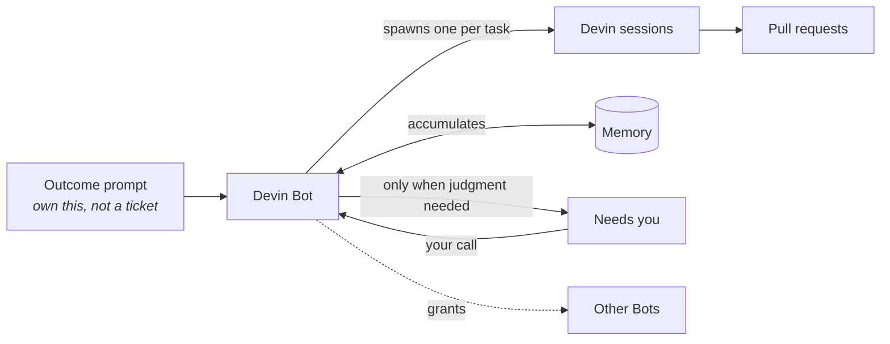

<picture>
  <source media="(prefers-color-scheme: dark)" srcset="assets/cover-dark.svg">
  
</picture>

 

Curated by [@darega0mae](https://x.com/darega0mae) · Sister tutorials: [build-with-devin](https://github.com/Till3005/build-with-devin) · [Add your project](CONTRIBUTING.md)

**11** documented Bot deployments · **33** enterprise case studies · **4** shipped products · **28** tools & integrations · **19** field reports

English · [简体中文](README.zh.md) · [日本語](README.ja.md) · [Português](README.pt.md) · [Español](README.es.md) · [Deutsch](README.de.md)

> *Unofficial community project — not affiliated with, endorsed by, or sponsored by Cognition AI. "Devin" is a trademark of Cognition AI. Brand assets are used under the official kit at [devin.ai/brand](https://devin.ai/brand). Official docs: [docs.devin.ai](https://docs.devin.ai).*

**Built with Devin** is a registry of *verified* work: every entry links to a named deployment, a real repository, or a published account — no vaporware, no marketing paraphrases. The bar for inclusion is in [CONTRIBUTING.md](CONTRIBUTING.md).

## Contents

- [Devin Bots — official product](#devin-bots--official-product) — deployments, reusable patterns, results, the 16-template marketplace
- [Products built with Devin](#products-built-with-devin) — shipped software where Devin wrote the code
- [Enterprise deployments](#enterprise-deployments) — published customer cases with hard numbers
- [Bots & surfaces](#bots--surfaces) — Devin inside Discord, Telegram, Slack and other products
- [SDKs & API tooling](#sdks--api-tooling)
- [Tooling around Devin](#tooling-around-devin) — what the community builds *for* Devin
- [Patterns & write-ups](#patterns--write-ups) — documented real-world usage
- [Community media](#community-media)
- [Official resources](#official-resources)

## Devin Bots — official product

Launched **November 17, 2026** ([announcement](https://devin.ai/blog/introducing-devin-bots) · [docs](https://docs.devin.ai/work-with-devin/bots) · [Fortune exclusive](https://fortune.com/2026/11/17/exclusive-cognition-bets-on-devin-bots-coding-agents-in-challenge-to-anthropics-duet-and-openais-dots/)). A Bot is a persistent agent that owns an outcome: it plans the work, runs a Devin session for each piece, keeps memory across weeks, and brings you only the decisions that need your judgment. Bots live in Slack and iMessage, run on schedules or event triggers, and hand work between each other through grants. Bots incorporate technology from the Interaction Company (Poke), which Cognition acquired in July 2026.

### Documented deployments

| Bot | Owner | What it owns | Reported results |
| --- | --- | --- | --- |
| **Android Bot** | Cognition | Devin's Android app, end to end | Prompted *"your job is to product manage the android app"* on Sep 28, 2026 — filed its own tickets, ran a Devin session per ticket, shipped to Google Play open beta in **44 days**: 1,134 PRs merged, 344,651 lines of Kotlin, 2,841 screenshot tests. Its human sent **183 messages total** — 22 days of complete silence — and **88% of PRs were self-merged**. Now owns Android/iOS feature parity. |
| **Layout Bot** | Cognition | Layout-shift regression on the Devin web app | Every 3 hours it builds production `main`, simulates first/repeat/delayed-request visits, traces regressions to the introducing PR, opens fixes with before/after videos. **159 PRs in 3 weeks; lag −70%.** |
| **Super Jenny** | Jenny Xu (community) | An entire mobile game studio | ~20 Bots (dev, Unity, releases, UI, iOS, Android, device testing) under one orchestrating Bot; the only human answers a consolidated Slack thread 4×/day **with emoji**. ~50 → **1,900 PRs/week**, studio revenue 6×'d, shipping weekly. Published as community template **SuperJennyStack**. ([Jenny's thread](https://x.com/xujennyc)) |
| **Onboarding QA Bot** | Cognition (Walden Yan) | QA of 30+ onboarding flows, 24/7 | Maintains self-updating Playwright scripts, an agent job queue, and a live board view it built itself — "found way more bugs than I would have had patience to discover." ([@walden_yan](https://x.com/walden_yan)) |
| **"Phil"** | Harvey | Collaborative Word-compatible editor engine | ~30 agents wrote 1M+ lines of Rust + TypeScript in **3 weeks, no human engineers** — verified continuously against real Microsoft Word behavior and simulated lawyer negotiations; humans steer through memory + decision logs. ([Gabe Pereyra](https://x.com/gabepereyra)) |
| **Shared bot fleet** | Decagon | On-call, DevEx optimization, thread routing | 50+ shared Bots in Slack during beta; a Chief of Staff Bot decides when and how to spawn threads. ([@tylerxdev's thread](https://x.com/tylerxdev/status/2122743518712287400)) |
| **AutoResearch loop** | Decagon | An inference research lab | One Devin orchestrates; subagents chase competing hypotheses in parallel; every idea verified against replayed production traffic on Modal GPUs — **up to 2.5× more throughput per GPU** ([full writeup](https://x.com/DecagonAI/article/2115511110120120437), [@devindevelopers](https://x.com/devindevelopers/status/2115601107581821172)). |
| **Frankie's org** | Mark Fenner (community) | Personal agent fleet | Four Bots with distinct jobs coordinated by "Frankie, my Chief Agent", which brings consolidated updates back ([walkthrough](https://x.com/markfenner/status/2122740244328145211)). |
| **tigsbot** | @0xtigs (community) | Personal multi-project fleet | Each project lives in a Slack channel run by one Bot; a Chief-of-Staff Bot answers "what's the latest on everything?" and pings him when *he's* the blocker; specialist Bots manage single-license or complex-setup software ([setup](https://x.com/0xtigs/status/2122742784176034056)). |
| **Electra** | Basis | Internal tools + code, self-directed | A named Devin teammate (pre-Bots): decides what needs doing, writes and tests code, ships updates to internal tools, and pushes the team — Basis runs one 20-day thread per tax agent ([post](https://x.com/trybasis/status/2113307030203089189), [20-day thread](https://x.com/trybasis/status/2120658137766100992)). |
| **Personal data Bots** | Bryan Johnson | Health synthesis + family updates | One Bot synthesizes years of biometric and brain-scan data into a single readout; another texts his mother a daily update on how he's doing. ([post](https://x.com/bryan_johnson/status/2122814114976383406), [launch video](https://vimeo.com/1247688199)) |

### Documented patterns

- **Outcome prompts** — *"You own the Android app now. Keep it at feature parity with iOS."* Give the Bot a goal, not a backlog.
- **Bot-to-bot handoffs** — grants let a QA Bot find a bug, pull in a Developer Bot to fix it, retest on staging, and have a PM Bot report status to the channel.
- **Scheduled checks** — a Bot that watches an alerts channel on a cron, owns the check, and opens fixes when it regresses (Layout Bot pattern).
- **Roll-up reporting** — one supervising Bot collects every subordinate Bot's pending decisions into a single thread (SuperJennyStack pattern).
- **Bots × Apps** — Bots maintain Devin Apps: build new pages/features and adapt to changes automatically; Bots and Apps pin to the same nav rail ([@dabit3](https://x.com/dabit3)).
- **Reference-grounded swarms** — Harvey's lesson: when work can be checked against a reliable reference (real Word behavior), a small team can direct a large swarm safely.

### Reported results

**1,000+ beta testers** in the weeks before launch. Testers merge **4.5× more PRs per message**; Cognition merges 2,000+ PRs/week, 40×'d its merged-PR throughput, and landed **1,000+ PRs from a single autonomous goal**. Named early-access customers include **Decagon, Fireworks AI, and Reducto**, with usage up 10× in the first two weeks ([Fortune](https://fortune.com/2026/11/17/exclusive-cognition-bets-on-devin-bots-coding-agents-in-challenge-to-anthropics-duet-and-openais-dots/)).

Other documented usage: preemptive issue triage on **Manim**, firmware work, a bot-led team building a **frontier inference engine**, tennis analytics, accounting automation (trybasis: 20h → 30 min), swyx's week-long trial (AEO, QA, cross-platform porting, personal admin, video editing — [his summary](https://x.com/swyx/status/2122746401482592549)), and Cognition's research team compressing "weeks into days" ([@silasalberti](https://x.com/silasalberti)). Full write-ups in the [reproduction guide](docs/reproducing-devin-bots.md#reported-usage-beyond-cognition).

### Official template library

Sixteen ready-made Bots on the [public marketplace](https://devin.ai/bots/templates), plus community templates like **SuperJennyStack**:

| Template | What it does |
| --- | --- |
| Software Factory | Finds bugs, polish, performance and refactoring work in a named product area; opens one small PR each with proof it works |
| Product Engineer | Takes a ticket or request to a tested PR and through review |
| QA Engineer | Tests each PR in a real browser and posts the video of pass/fail |
| Anomaly Watcher | Twice daily scans product + business data for problems no monitor watches |
| Code Reaper | Removes dead code weekly, one safe PR at a time |
| Chief of Staff | Watches channels, posts updates, hands work to the team and follows it to done |
| Migration Engineer | Owns one big migration as small, tracked PRs with a progress surface |
| Latency Optimizer | Finds the slowest endpoints/jobs/queries; weekly fix PR with before/after speed |
| iOS Engineer | SwiftUI features to PR + TestFlight build |
| Android Engineer | Kotlin features to PR + internal-test build |
| Internal Tools Engineer | Admin panels and internal tools on your stack |
| Data Analyst | Answers data questions with the chart and the query behind it |
| Devin Coach | Teaches your team to use Devin well from your own usage data |
| Code Health Engineer | Stale flags, old dependencies, CVEs → small safe PRs |
| Technical Writer | Keeps repo wikis and diagrams in step with `main` after merges |
| Compliance Engineer | Collects control evidence from code, warns when a control lapses |

**[→ Reproduction guide: how to rebuild every documented Bot](docs/reproducing-devin-bots.md)** — and its expanded tutorial form in the sister repo **[build-with-devin](https://github.com/Till3005/build-with-devin)**

Site: **[till3005.github.io/built-with-devin](https://till3005.github.io/built-with-devin/)** (Devin-styled registry page) · Deep dives: **[Anatomy of a Devin Bot](docs/devin-bots-anatomy.md)** (the six documented mechanisms + what the numbers actually show) · **[The economics of Devin](docs/economics.md)** (every published cost/return figure in one ledger — also as a [filterable page](docs/economics.html))

---

## Products built with Devin

Real software where Devin wrote the code — not demos, shipped work.

- **[Era by Eon](https://devin.ai/customers/eon)** — Simulated companies (74 vendor-faithful systems: Salesforce, Slack, Zendesk, Jira…) for training and evaluating AI agents. **98% of merged PRs written by Devin**, 300+ day-long sessions, 2,720 sessions launched by other sessions.
- **[Courtyard's Quick](https://courtyard.io/blog/post/from-a-slack-link-to-production-in-under-48-hours-cloning-shopifys-quick-with-devin)** — Courtyard cloned Shopify's internal "Quick" static-site deployer: from a Slack link to a production service (Go, Cloud Run, Bazel, Terraform, SSO, git-backed) in **~21 hours**, all written by Devin.
- **[Frontierfood](https://samyok.com/frontierfood)** — Cognition engineer Samyok Nepal used Devin Voice to scrape Google reviews and map the Pareto frontier of food by location ([post](https://x.com/samyok/status/2098155977199743367)).
- **Flappy Asher** — Russell Kaplan (Cognition president) had Devin on a Mac VM turn baby photos into game sprites and ship the result — live in TestFlight ([post](https://x.com/russelljkaplan/status/2100280085999919555)).

*Know a shipped product built with Devin? [Add it](CONTRIBUTING.md).*

### Side quests

Small, delightful builds — proof the same machinery does fun work too.

- **[Mobile games on iPhone Duo](https://x.com/xujennyc/status/2121625134029209929)** — Jenny Xu and Nader Dabit jamming on Devin-built mobile games on foldables; Devin [builds and tests Duo apps itself](https://x.com/DevinAI/status/2111161066403123653), including at scale ([dabit3](https://x.com/dabit3/status/2112939574133760190)).
- **Devin's self-portrait** — Bryan Johnson asked Devin to render how it sees him ([post](https://x.com/bryan_johnson/status/2122818486800191842)).
- **The CoS whose job a bot took** — A Cognition chief-of-staff's first week: woke up to the new Chief of Staff Bot already doing his job ([post](https://x.com/arirbrown/status/2122789909731872882)).

---

## Enterprise deployments

Published customer cases with hard numbers ([full index](https://devin.ai/customers)):

| Company | Deployment | Reported result |
| --- | --- | --- |
| [Nubank](https://devin.ai/customers/nubank) | Multi-million-line, 8-year-old ETL monolith → sub-modules | 8–12× engineering efficiency, 20× cost savings; fine-tuned Devin cut ~40 min/task to ~10 |
| [Wayfair](https://devin.ai/customers/wayfair) | Cloud agents across the org | 1,600+ engineers all-in |
| [The Access Group](https://devin.ai/customers/access-group) | Devin across 250 products, 2,000+ engineers | 5× engineering output |
| [EBANX](https://devin.ai/customers/ebanx) | Devin as primary author | **92% of merged PRs are Devin-authored** |
| [Gumroad](https://devin.ai/customers/gumroad) | Devin on the core repo | Devin is the repo's **#1 contributor**: 1,500+ merged PRs |
| [Finch](https://devin.ai/customers/finch) | Feature + maintenance work | 3,000 PRs merged, ~20 engineer-months saved |
| [Comarch](https://devin.ai/customers/comarch) | 20-year-old, 10M-line ERP rebuild | Full system modernization in progress |
| [AngelList](https://devin.ai/customers/angellist) | Incident triage + data migration | Devin root-causes 70% of incidents pre-engineer; Redshift→Snowflake 5.2× faster |
| [Modal](https://devin.ai/customers/modal) | Incident response | 80% of incidents investigated before an engineer opens the thread |
| [Reducto](https://devin.ai/customers/reducto) | Devin Oncall as first responder | Engineers rarely get paged |
| [Eight Sleep](https://devin.ai/customers/eight-sleep) | Devin across the company | 8× more shipped |
| [Exa](https://devin.ai/customers/exa) | End-to-end shipping | Production ships without engineers ever pulling code locally |
| [RV Tech](https://devin.ai/customers/rvtech) | Rivian × VW JV, software-defined vehicles | 10× testing velocity |
| [Melius](https://devin.ai/customers/melius) | High-throughput small team | ~100 PRs/day |
| [Hamming](https://devin.ai/customers/hamming) | Devin on the codebase | 25% of total code volume |
| [Airbyte](https://devin.ai/customers/airbyte) | Connector maintenance | Keeps 700+ connectors running |
| [Litera](https://devin.ai/customers/litera) | Regression testing | Regression cycles cut 90% |
| [Ramp](https://devin.ai/customers/ramp) | Technical-debt clearance | **80 merged PRs/week, 10,000+ engineer-hours saved**; a small Devin-savvy team runs it |
| [Linktree](https://devin.ai/customers/linktree) | Feature + customer-bug pipeline | ~300 PRs authored / ~100 merged last month; the team's reflex is now "can I just Devin it?" |
| [Bilt](https://devin.ai/customers/bilt) | Org-wide rollout | 800+ merged PRs since Feb, ~117/week average |
| [Rohlik Group](https://devin.ai/customers/rohlikgroup) | Agent-driven grocery ops | 2× engineering throughput; 4× faster automation rollout incl. warehouse robotics; 50+ MCP integrations |
| [Crosby](https://devin.ai/customers/crosby) | AI-native law firm | 20–40 bug reports/alerts get a first pass daily, ~5 min each; 12 engineers serve 50+ attorneys |
| [Endava](https://devin.ai/customers/endava) | Enterprise-wide provision | 2,000+ employees on platform; 3× in four months; 78% PR merge rate |
| [Tavrn](https://devin.ai/customers/tavrn) | HIPAA-constrained fleet | 8-person team ships like 50; **1,800+ PRs in 6 weeks**, 6× output |
| [Evinova](https://devin.ai/customers/evinova) | GxP-regulated delivery | 8× faster GxP documentation; 3× faster migrations; 66% of clear-cut bugs fixed autonomously |
| [Compiled Health](https://devin.ai/customers/compiledhealth) | Clinical benchmark build | 2 researchers/2 months = 5–6 engineers' work; ~430 eng-hours at ~$17/hr ≈ +4 engineers on a 4-person team |
| [Común](https://devin.ai/customers/comun) | 13-person fintech team | 3× output; weekly backend PRs 50 → 170 in four weeks |
| [AHEAD](https://devin.ai/customers/ahead) | 8 production workloads | **8–40× time savings** vs manual baselines; fully productive in 2 business days |
| [The Citation Group](https://devin.ai/customers/thecitationgroup) | Measured-ROI rollout | 271 PRs merged at 80% in 3 months; 50% engineering-efficiency gain; 85% cut in legacy-app refresh |
| [Latent Health](https://devin.ai/customers/latent) | Pharmacy ops | 30% more PRs/engineer vs Claude Code alone; 50 running automations |
| [Crossmint](https://devin.ai/customers/crossmint) | GOAT open-source scaling | Devin became the repo's #1 contributor during trial |
| [FE fundinfo](https://devin.ai/customers/fefundinfo) | 1,800-repo automation | 10% immediate capacity increase via test-gen + security fixes |
| [GE Aerospace](https://devin.ai/customers/geaerospace) | Constrained team story throughput | ~2× user-story output in three months |

Also on the record: Citi (40,000-developer rollout, 30% tech-vendor spend cut), Itaú, Mercor, Hippo, Mercedes-Benz, Cognizant and Infosys partnerships — see the [customer index](https://devin.ai/customers).

---

## Bots & surfaces

Putting Devin inside other products and channels.

- **[devin-discord-bot](https://github.com/wgtechlabs/devin-discord-bot)** — Self-hosted TypeScript bot bringing Devin into Discord: start sessions with a mention, stream progress back into the channel.
- **[devin-telegram-bot](https://github.com/wgtechlabs/devin-telegram-bot)** — Same author's Telegram bridge to the Devin API.
- **[Buzz for Devin](https://github.com/fenner888/BuzzforDevin)** — Community fork of Block's Buzz adding the official Devin CLI (`devin acp`) as a native runtime, so each person brings their own authenticated Devin into shared agent-native communities.
- **[devin-sse-proxy](https://github.com/sotayamashita/devin-sse-proxy)** — Minimal MCP server letting Claude Desktop talk to Devin's SSE transport while passing a Personal API Key.
- **[devin-flow](https://github.com/xlm/devin-flow)** — Visual editor for event-driven Devin workflows on the Automations API, with session tracking (FastAPI + Vue 3).

---

## SDKs & API tooling

- **[go-devin](https://github.com/gassara-kys/go-devin)** — Go SDK for the Devin API.
- **[llm-devin](https://github.com/ftnext/llm-devin)** — Plugin for Simon Willison's `llm` CLI to call the Devin API.

---

## Tooling around Devin

Things the community builds *for* Devin rather than *with* it.

- **[DevinX / Devinmaxxing](https://x.com/markfenner)** — Mark Fenner's local model picker for Devin Desktop sessions: local weights via ACP, adaptive cost balancing, reasoning-effort control.
- **[awesome-devin](https://github.com/Icaro0310/awesome-devin)** — The `devin-*` open-source tooling ecosystem: session search, history export, knowledge graphs, eval harnesses, backup, fan-out planners.
- **[devin-judge](https://github.com/Icaro0310/devin-judge)** — Calibrated local-first decision layer with a Devin ACP backend; no API key needed.
- **[devin-fusion-byok](https://github.com/kuobibulaien/devin-fusion-byok)** — A Devin extension (VSIX) that brings your own model APIs into Devin's model picker and composes them into Fusion Lead+Sidekick presets — without modifying the app itself.
- **[devin.cursorrules](https://github.com/grapeot/devin.cursorrules)** — The 5k★ ruleset that turns Cursor/Windsurf into "90% of Devin" — the reference point for what counts as Devin-grade agent behavior.
- **[nix-devin-cli](https://github.com/broady/nix-devin-cli)** — Devin CLI packaged for Nix with nightly auto-updates across macOS and Linux.
- **[QuotaView](https://github.com/Duoasa/QuotaView)** — macOS "Dynamic Island" for AI agents: tracks Devin Desktop and Devin CLI sessions, approvals and quota alongside Claude/Codex/Grok.
- **[Mako](https://github.com/Verbiflow/mako)** — Local workspace for every coding agent; carries Devin conversations over ACP — run, follow, resume, and move them across machines.
- **[ax](https://zenn.dev/kuwashima/articles/ax-cross-agent-session-picker)** — fzf session picker that resumes Devin alongside 18 other agent CLIs (JP).
- **[Kiro Crew patch for Devin CLI](https://zenn.dev/dario_okazaki/articles/e5eda2aca4fdd2)** — Unofficial patch adding Devin CLI to Kiro Crew's managed bot fleet, with per-bot permission handling (JP).
- **[Devin for VS Code](https://github.com/shayanline/devin-vscode)** — A full chat panel for Devin CLI inside VS Code ([Marketplace](https://marketplace.visualstudio.com/items?itemName=shayanline.devin-vscode)): workspace context via `@`, Keep/Undo diff review, per-workspace resumable chats, and a settings editor for the CLI's instructions, skills, plugins, MCP servers and hooks.
- **[Devin Switch](https://github.com/ansuman-shukla/devin-switch)** — Native macOS app + CLI for multiple Devin CLI logins: isolated account profiles, shared local conversation history, usage/reset display, and concurrent launches.
- **[Devin Token Monitor](https://github.com/TH-Chou/devin-usage-monitor)** — Native macOS menu-bar app (and VSIX) that turns the CLI's local SQLite metrics into live cost dashboards — token trends, model donut, per-request TTFT/tokens-per-second, budget alerts, CSV export, six languages.
- **[devin-desktop-zh](https://github.com/cby122/devin-desktop-zh)** — A hand-built Simplified-Chinese localization of Devin Desktop: a 33,457-string dictionary plus the injection/re-signing pipeline that produces a separate `Devin 中文版.app` — shipped as an Agent Skill so the whole workflow is repeatable.
- **[devin-tui](https://github.com/fenner888/devin-tui)** — Mark Fenner's full-screen terminal UI for Devin over `devin acp`: React + Ink, tool calls, inline diffs, plan view, per-session spend.
- **[Devin Remote](https://github.com/zouhall/devin-remote)** — A browser console for Devin CLI sessions — drive local Devin from any browser, including a phone: streaming chat, permissions, modes, models, usage stats.
- **[Devin Pocket](https://github.com/BOTOOM/devin-pocket)** — Mobile-first Devin CLI client over ACP; runs on Android/Termux, Linux and macOS.
- **[devin-control](https://github.com/Icaro0310/devin-control)** — Policy-gated ACP client: isolated Devin sessions behind allow/deny/ask rules.
- **[devin-subagents](https://github.com/Duro02/devin-subagents)** — Exposes `devin acp` sessions as lifecycle-managed subagents over MCP: parallel dispatch, blocking `wait`, mid-flight steering, permission adjudication.
- **[Devin Session Exporter](https://github.com/marktwainme/devin-session-exporter)** — Devin Desktop extension that exports local ACP session databases to Markdown/JSON/HTML with filtering and batch export.
- **[devin-acp-shim](https://github.com/wibus-wee/devin-acp-shim)** — A transparent stdio proxy that fixes Devin CLI's session-level MCP capability negotiation — small, but it unblocks MCP servers for every ACP host.

---

## Patterns & write-ups

Documented real-world usage.

- **[SAST auto-remediation pipeline](https://github.com/Cognition-Partner-Workshops/uc-cve-remediation-regulatory-compliance/pull/16)** — GitHub Actions workflow that scans PRs with OWASP Dependency-Check and dispatches a Devin session to remediate CVEs ≥ 7.0, with verification scans and an escalation circuit breaker.
- **[Attributing Devin PRs to their requesters](https://tech.enechange.co.jp/entry/2025/06/22/165504)** — ENECHANGE's GitHub Actions setup for recording which engineer instructed Devin, solving productivity-measurement gaps when all PRs show `devin-ai-integration[bot]` (Japanese).
- **[Fixing stale mailbox alarms](https://agentsinuse.com/use-cases/devin-to-clear-mailbox-alarm/)** — Devin tracing a Cloudflare Workers test flake to a stale continuation alarm and adding regression coverage (via Agents In Use).
- **[Designing the Spraycash UI in Devin](https://dev.to/ibrahimpima/designing-the-spraycash-ui-with-kimi-k3-in-devin-4l2f)** — A fintech landing page art-directed entirely through Devin chat: generated imagery, layered cloud animation, SVG draw-on ring, and a three-font type system — every prompt published.
- **[Devin auto code-review at rakko_inc](https://zenn.dev/rakko_inc/articles/00cc5a5a679971)** — Playbooks + GitHub Actions + Devin API pre-digest every PR; monthly reviewed PRs went 65 → 184 (JP).
- **[QA test-design automation at Skillnote](https://zenn.dev/skillnote/articles/5ba429ca249801)** — PR triggers Devin to draft test cases with rationale; ~35 min saved per 10 cases (JP).
- **[Event-driven Devin automation](https://zenn.dev/arufian/articles/f80a62f5217cee)** — Serverless GitHub-Actions pipeline with a priority×complexity policy table and plan-first approval flow (JP).
- **[Org rollout at Leverages](https://zenn.dev/levtech/articles/9c869303820844)** — 14 teams, 177 merged PRs, and an honest ACU-vs-wages ROI formula (JP).
- **[Rapid development with Devin](https://blog.scottlogic.com/2025/10/20/rapid-development-with-devin.html)** — Scott Logic's practitioner account, including the prompt-iteration lessons.
- **[Scott Wu on Cognition's internal usage](https://www.lennysnewsletter.com/p/how-devin-replaces-your-junior-engineers)** — how Cognition itself delegates: async junior-engineer workflow, top-5 task types, first-line-of-defense crash analysis.
- **[E2E testing Devin's changes with Signadot](https://dev.to/signadot/test-devins-changes-end-to-end-with-signadot-a0)** — Devin + Signadot MCP: it runs the changed microservice in its VM, sandboxes it against real cluster traffic, and runs the Playwright suite — closing the loop Devin can't close alone in a multi-service system.
- **[Vulnerability impact analysis via Devin Automations](https://zenn.dev/rescuenow/articles/2ee1c4b66ecec8)** — rescuenow's scheduled Automation investigates blast radius when a CVE drops (JP).
- **[Classifying 700 support inquiries](https://zenn.dev/canly/articles/9c19bb123e208c)** — canly pointed Devin at their ticket history to find what "cause unidentified" actually was — Devin as a data analyst, not a coder (JP).
- **[Datadog CCM × Devin weekly cost ops](https://zenn.dev/hubble/articles/091e29a0c86ec3)** and **[Dependabot PRs triaged by Devin first](https://zenn.dev/hubble/articles/88429bd24db476)** — hubble's two standing loops: weekly cloud-cost reduction, and Devin investigating every dependency bump before a human sees it (JP).
- **[Devin as a performance-analysis agent with Dynatrace MCP](https://medium.com/lets-code-future/how-i-turned-devin-into-a-performance-analysis-agent-with-dynatrace-mcp-753d3f4790a2)** — Wiring Devin to live observability data so it diagnoses latency itself, not just the code (Medium).
- **[Devin: from bug report to pull request](https://medium.com/@winter.inc/devin-from-bug-report-to-pull-request-25-days-of-ai-day-18-b158daa20f23)** — Day 18 of a 25-day AI series: the full ticket-to-PR loop on a real codebase (Medium).
- **[Role-based bot dev team + light-PR auto-merge](https://zenn.dev/kyto64/articles/ai-bot-dev-env)** — kyto64's personal-dev setup: specialized AI bots plus Devin, with low-risk PRs merging themselves (JP).
- **[Devin CLI's context limits in practice](https://qiita.com/ishizakahiroshi/items/cee2a8ea2be18f2ccee3)** — Working notes on fitting AGENTS.md and approval rules inside the 16KB/32KB caps (JP).
- **[Multi-AI orchestration on free SWE-2](https://qiita.com/ishizakahiroshi/items/72ab801a5f2a8c941b61)** — A design for routing work between agents using Devin CLI's permanently-free SWE-2 tier (JP).

---

## Community media

- **[Devin Central](https://devincentral.com)** — Fan-run news desk and tutorials covering what Cognition ships and why it matters. Run by Devin Ambassador Trevor Lowing.
- **[Voices — ambassador directory](https://devincentral.com/voices)** — Unofficial map of ~190 Devin Ambassadors worldwide.
- **[devin-cli.github.io](https://devin-cli.github.io)** — Community docs on what Devin's API, Slack, and Linear surfaces cover and how to automate them.
- **[Agents In Use](https://agentsinuse.com)** — Directory of real agent use cases, including Devin entries.
- **[BitsExplorer — Built with Devin](https://bitsexplorer.com/built-with/devin)** — 340+ public projects verified by Devin's commit trailer (evidence, not self-report).
- **[Vibe Coded Projects](https://vibedprojects.com/ai-tools/devin)** — 373 apps, tools and sites vibe-coded with Devin.
- **[Devin 2nd Anniversary Meetup Japan](https://aid.connpass.com/event/412875/)** — Ambassador-run community event marking two years of public Devin ([announcement](https://x.com/kinopee_ai/status/2123019189325848847)).
- **[Devin's Dinner](https://x.com/MattSchrage/status/2121016484155548124)** — Matt Schrage's invite-only NYC dinner series for founders and engineers working with Devin.

---

## Official resources

- [Devin Community](https://devin.ai/community) — events, ambassador applications, event support
- [docs.devin.ai](https://docs.devin.ai) — documentation: [Bots](https://docs.devin.ai/work-with-devin/bots), [Automations](https://docs.devin.ai/product-guides/automations), [Devin CLI](https://docs.devin.ai/cli/index.md)
- [Use-case gallery](https://docs.devin.ai/use-cases/gallery/index.md) — 40+ documented workflows with copy-paste prompts; [best practices for slicing work](https://docs.devin.ai/use-cases/best-practices.md)
- [devin.ai/brand](https://devin.ai/brand) — official brand kit
- [Devin Discord](https://devin.ai/community) and [r/DevinAI](https://www.reddit.com/r/DevinAI/) — official community spaces
- [CognitionAI/qa-devin](https://github.com/CognitionAI/qa-devin) — Cognition's own "Devin doing QA" reference repo
- [CognitionAI/devin-vuln-fixes](https://github.com/cognitionai/devin-vuln-fixes) — official agent skills that patch real CVEs (GitLab CVSS 10.0, PHP/Node RCEs): read-only inventory → approval gate → confirmed-target patch → before/after tests → one focused PR per repo
- [Train & deploy custom models on Modal with Devin](https://gist.github.com/dabit3/866caaab49a4a5371ae01655fecad34b) — Cognition engineer Nader Dabit's working template
- [Devin for Startups](https://devin.ai/startups) — up to $65k in credits for eligible teams; [Devin for Gaming](https://talofagames.com/devin-for-gaming/) — Talofa × Cognition 3-week studio cohort with in-person workshops and credit prizes
- [Devin Automations QuickStart](https://www.youtube.com/watch?v=6xxKtIpgOyE) — official video walkthrough of event/schedule-triggered agent setups, the substrate Bots build on
- [SWE-2 Flash](https://cognition.com/blog/swe-2-flash) — Cognition's fast coding model: outperforms all American open-weight models on leading evals, 3× SWE-2 speed at 1/5 the price
- [Devin Apps](https://devin.ai/blog/devin-apps) — live web apps Devin builds and serves from its own machine at a stable URL (internal tools, dashboards, staging copies)

---

## Contributing

Built something with Devin, or know a deployment we missed? See [CONTRIBUTING.md](CONTRIBUTING.md) — one line, link first, no marketing copy.

## License

[CC0-1.0](LICENSE) — dedicated to the public domain. Listings belong to their owners.
