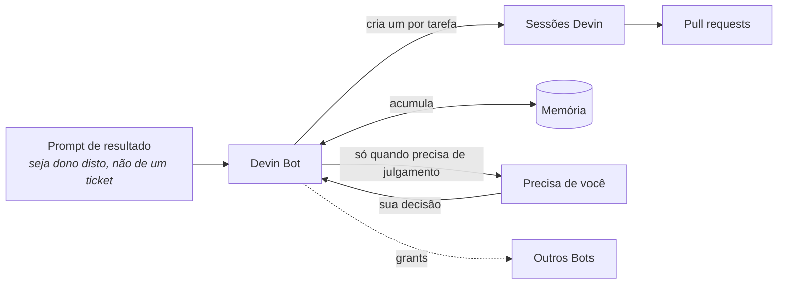

<picture>
  <source media="(prefers-color-scheme: dark)" srcset="assets/cover-dark.svg">
  
</picture>

 

Curado por [@darega0mae](https://x.com/darega0mae) · Tutoriais irmãos: [build-with-devin](https://github.com/Till3005/build-with-devin) · [Adicione seu projeto](CONTRIBUTING.md)

**11** implantações de Bot documentadas · **33** casos corporativos · **4** produtos lançados · **28** ferramentas e integrações · **19** relatos de campo

[English](README.md) · [简体中文](README.zh.md) · [日本語](README.ja.md) · Português · [Español](README.es.md) · [Deutsch](README.de.md)

> *Projeto comunitário não oficial — sem afiliação, endosso ou patrocínio da Cognition AI. "Devin" é marca registrada da Cognition AI. Recursos de marca usados conforme o kit oficial em [devin.ai/brand](https://devin.ai/brand). Documentação oficial: [docs.devin.ai](https://docs.devin.ai).*

**Built with Devin** é um registro de trabalho *verificado*: cada entrada aponta para uma implantação nomeada, um repositório real ou um relato publicado — sem vaporware, sem paráfrase de marketing. O critério de inclusão está em [CONTRIBUTING.md](CONTRIBUTING.md).

## Sumário

- [Devin Bots — produto oficial](#devin-bots----produto-oficial) — implantações, padrões reutilizáveis, resultados, o marketplace de 16 templates
- [Produtos construídos com Devin](#produtos-construídos-com-devin) — software lançado cujo código foi escrito pelo Devin
- [Implantações corporativas](#implantações-corporativas) — casos de clientes publicados com números concretos
- [Bots e superfícies](#bots-e-superfícies) — Devin dentro de Discord, Telegram, Slack e outros produtos
- [SDKs e ferramentas de API](#sdks-e-ferramentas-de-api)
- [Ferramentas em torno do Devin](#ferramentas-em-torno-do-devin) — o que a comunidade constrói *para* o Devin
- [Padrões e artigos](#padrões-e-artigos) — uso real documentado
- [Mídia da comunidade](#mídia-da-comunidade)
- [Recursos oficiais](#recursos-oficiais)

## Devin Bots — produto oficial

Lançado em **17 de novembro de 2026** ([anúncio](https://devin.ai/blog/introducing-devin-bots) · [docs](https://docs.devin.ai/work-with-devin/bots) · [exclusivo Fortune](https://fortune.com/2026/11/17/exclusive-cognition-bets-on-devin-bots-coding-agents-in-challenge-to-anthropics-duet-and-openais-dots/)). Um Bot é um agente persistente que é dono de um resultado: ele planeja o trabalho, executa uma sessão Devin para cada peça, mantém memória ao longo de semanas e traz até você apenas as decisões que precisam do seu julgamento. Bots vivem no Slack e no iMessage, rodam em agendas ou gatilhos de eventos e passam trabalho entre si por meio de grants. Os Bots incorporam tecnologia da Interaction Company (Poke), adquirida pela Cognition em julho de 2026.

### Implantações documentadas

| Bot | Dono | Do que é responsável | Resultados reportados |
| --- | --- | --- | --- |
| **Android Bot** | Cognition | O app Android do Devin, de ponta a ponta | Recebeu em 28/09/2026 o prompt *"your job is to product manage the android app"* — abriu seus próprios tickets, rodou uma sessão Devin por ticket, chegou ao beta aberto do Google Play em **44 dias**: 1.134 PRs mergeados, 344.651 linhas de Kotlin, 2.841 testes de screenshot. O humano enviou **183 mensagens no total** — 22 dias de silêncio completo — e **88% dos PRs foram auto-mergeados**. Agora mantém a paridade de recursos Android/iOS. |
| **Layout Bot** | Cognition | Regressão de layout shift no web app do Devin | A cada 3 horas compila o `main` de produção, simula visitas de primeira/repetida/atrasada requisição, rastreia regressões até o PR que as introduziu e abre correções com vídeos de antes/depois. **159 PRs em 3 semanas; lag −70%.** |
| **Super Jenny** | Jenny Xu (comunidade) | Um estúdio inteiro de jogos mobile | ~20 Bots (dev, Unity, releases, UI, iOS, Android, testes em dispositivo) sob um Bot orquestrador; o único humano responde a uma thread consolidada no Slack 4×/dia **com emoji**. ~50 → **1.900 PRs/semana**, receita do estúdio 6×, lançamentos semanais. Publicado como template comunitário **SuperJennyStack**. ([thread da Jenny](https://x.com/xujennyc)) |
| **Onboarding QA Bot** | Cognition (Walden Yan) | QA de 30+ fluxos de onboarding, 24/7 | Mantém scripts Playwright auto-atualizados, uma fila de jobs de agente e um board ao vivo que ele mesmo construiu — "encontrou muito mais bugs do que eu teria paciência de descobrir". ([@walden_yan](https://x.com/walden_yan)) |
| **"Phil"** | Harvey | Motor de editor colaborativo compatível com Word | ~30 agentes escreveram 1M+ linhas de Rust + TypeScript em **3 semanas, sem engenheiros humanos** — verificados continuamente contra o comportamento real do Microsoft Word e negociações simuladas de advogados; humanos guiam via memória + logs de decisão. ([Gabe Pereyra](https://x.com/gabepereyra)) |
| **Frota de bots compartilhada** | Decagon | On-call, otimização de DevEx, roteamento de threads | 50+ Bots compartilhados no Slack durante o beta; um Chief of Staff Bot decide quando e como abrir threads. ([thread do @tylerxdev](https://x.com/tylerxdev/status/2122743518712287400)) |
| **Loop AutoResearch** | Decagon | Um laboratório de pesquisa em inferência | Um Devin orquestra; subagentes perseguem hipóteses concorrentes em paralelo; toda ideia é verificada contra tráfego de produção reproduzido em GPUs Modal — **até 2,5× mais throughput por GPU** ([artigo completo](https://x.com/DecagonAI/article/2115511110120120437), [@devindevelopers](https://x.com/devindevelopers/status/2115601107581821172)). |
| **Org da Frankie** | Mark Fenner (comunidade) | Frota pessoal de agentes | Quatro Bots com funções distintas coordenados por "Frankie, my Chief Agent", que traz atualizações consolidadas ([walkthrough](https://x.com/markfenner/status/2122740244328145211)). |
| **tigsbot** | @0xtigs (comunidade) | Frota pessoal multi-projeto | Cada projeto vive num canal do Slack operado por um Bot; um Chief-of-Staff Bot responde "qual é a última novidade de tudo?" e o cutuca quando *ele* é o gargalo; Bots especialistas gerenciam software de licença única ou setup complexo ([setup](https://x.com/0xtigs/status/2122742784176034056)). |
| **Electra** | Basis | Ferramentas internas + código, autodirigida | Uma colega Devin com nome (pré-Bots): decide o que precisa ser feito, escreve e testa código, lança atualizações em ferramentas internas e empurra o time — a Basis roda uma thread de 20 dias por agente fiscal ([post](https://x.com/trybasis/status/2113307030203089189), [thread de 20 dias](https://x.com/trybasis/status/2120658137766100992)). |
| **Bots de dados pessoais** | Bryan Johnson | Síntese de saúde + atualizações à família | Um Bot sintetiza anos de dados biométricos e de exames cerebrais num único relatório; outro manda à mãe dele um resumo diário de como ele está. ([post](https://x.com/bryan_johnson/status/2122814114976383406), [vídeo de lançamento](https://vimeo.com/1247688199)) |

### Padrões documentados

- **Prompts de resultado** — *"You own the Android app now. Keep it at feature parity with iOS."* Dê ao Bot um objetivo, não um backlog.
- **Handoffs entre bots** — grants permitem que um QA Bot ache um bug, chame um Developer Bot para corrigir, reteste em staging e que um PM Bot reporte o status ao canal.
- **Verificações agendadas** — um Bot que vigia um canal de alertas via cron, é dono da checagem e abre correções quando há regressão (padrão Layout Bot).
- **Relatórios consolidados** — um Bot supervisor coleta as decisões pendentes de todos os Bots subordinados numa única thread (padrão SuperJennyStack).
- **Bots × Apps** — Bots mantêm Devin Apps: constroem novas páginas/recursos e se adaptam a mudanças automaticamente; Bots e Apps ficam fixados no mesmo trilho de navegação ([@dabit3](https://x.com/dabit3)).
- **Swarms ancorados em referência** — a lição da Harvey: quando o trabalho pode ser checado contra uma referência confiável (o comportamento real do Word), um time pequeno pode dirigir um swarm grande com segurança.

### Resultados reportados

**Mais de 1.000 beta testers** nas semanas antes do lançamento. Testadores mergeam **4,5× mais PRs por mensagem**; a Cognition mergeia 2.000+ PRs/semana, multiplicou por 40 o throughput de PRs mergeados e entregou **1.000+ PRs a partir de um único objetivo autônomo**. Clientes de early access incluem **Decagon, Fireworks AI e Reducto**, com uso 10× maior nas duas primeiras semanas ([Fortune](https://fortune.com/2026/11/17/exclusive-cognition-bets-on-devin-bots-coding-agents-in-challenge-to-anthropics-duet-and-openais-dots/)).

Outros usos documentados: triagem preventiva de issues no **Manim**, trabalho em firmware, um time liderado por bots construindo um **motor de inferência de fronteira**, análise de tênis, automação contábil (trybasis: 20h → 30 min), o trial de uma semana do swyx (AEO, QA, portabilidade entre plataformas, administração pessoal, edição de vídeo — [seu resumo](https://x.com/swyx/status/2122746401482592549)) e o time de pesquisa da Cognition comprimindo "semanas em dias" ([@silasalberti](https://x.com/silasalberti)). Relatos completos no [guia de reprodução](docs/reproducing-devin-bots.md#reported-usage-beyond-cognition).

### Biblioteca oficial de templates

Dezesseis Bots prontos no [marketplace público](https://devin.ai/bots/templates), além de templates comunitários como **SuperJennyStack**:

| Template | O que faz |
| --- | --- |
| Software Factory | Encontra bugs, melhorias, performance e refatorações numa área de produto nomeada; abre um PR pequeno por vez com prova de que funciona |
| Product Engineer | Leva um ticket ou pedido até um PR testado e aprovado em revisão |
| QA Engineer | Testa cada PR num navegador real e posta o vídeo do pass/fail |
| Anomaly Watcher | Duas vezes ao dia varre dados de produto + negócio à procura de problemas que nenhum monitor observa |
| Code Reaper | Remove código morto toda semana, um PR seguro por vez |
| Chief of Staff | Vigia canais, posta atualizações, distribui trabalho ao time e acompanha até o fim |
| Migration Engineer | Conduz uma grande migração como PRs pequenos e rastreados, com uma superfície de progresso |
| Latency Optimizer | Encontra os endpoints/jobs/queries mais lentos; PR semanal de melhoria com velocidade antes/depois |
| iOS Engineer | Recursos SwiftUI até PR + build no TestFlight |
| Android Engineer | Recursos Kotlin até PR + build de teste interno |
| Internal Tools Engineer | Painéis administrativos e ferramentas internas na sua stack |
| Data Analyst | Responde perguntas de dados com o gráfico e a query por trás |
| Devin Coach | Ensina seu time a usar bem o Devin a partir dos seus próprios dados de uso |
| Code Health Engineer | Flags antigos, dependências velhas, CVEs → PRs pequenos e seguros |
| Technical Writer | Mantém wikis e diagramas do repo em sincronia com a `main` após merges |
| Compliance Engineer | Coleta evidências de controles no código e avisa quando um controle expira |

**[→ Guia de reprodução: como reconstruir cada Bot documentado](docs/reproducing-devin-bots.md)** — e sua forma tutorial expandida no repositório irmão **[build-with-devin](https://github.com/Till3005/build-with-devin)**

---

## Produtos construídos com Devin

Software real em que o Devin escreveu o código — não demos, trabalho lançado.

- **[Era, da Eon](https://devin.ai/customers/eon)** — Empresas simuladas (74 sistemas fiéis aos fornecedores: Salesforce, Slack, Zendesk, Jira…) para treinar e avaliar agentes de IA. **98% dos PRs mergeados escritos pelo Devin**, 300+ sessões de dia inteiro, 2.720 sessões lançadas por outras sessões.
- **[Quick, da Courtyard](https://courtyard.io/blog/post/from-a-slack-link-to-production-in-under-48-hours-cloning-shopifys-quick-with-devin)** — A Courtyard clonou o deployer interno de sites estáticos "Quick" da Shopify: de um link no Slack a um serviço em produção (Go, Cloud Run, Bazel, Terraform, SSO, git-backed) em **~21 horas**, tudo escrito pelo Devin.
- **[Frontierfood](https://samyok.com/frontierfood)** — O engenheiro da Cognition Samyok Nepal usou o Devin Voice para raspar reviews do Google e mapear a fronteira de Pareto de comida por localização ([post](https://x.com/samyok/status/2098155977199743367)).
- **Flappy Asher** — Russell Kaplan (presidente da Cognition) fez o Devin, numa VM Mac, transformar fotos de bebê em sprites de jogo e lançar o resultado — no ar no TestFlight ([post](https://x.com/russelljkaplan/status/2100280085999919555)).

*Conhece um produto lançado feito com Devin? [Adicione-o](CONTRIBUTING.md).*

### Side quests

Builds pequenos e encantadores — prova de que a mesma máquina também faz coisas divertidas.

- **[Jogos mobile no iPhone Duo](https://x.com/xujennyc/status/2121625134029209929)** — Jenny Xu e Nader Dabit experimentando jogos feitos pelo Devin em dobráveis; o Devin [constrói e testa apps Duo sozinho](https://x.com/DevinAI/status/2111161066403123653), inclusive em escala ([dabit3](https://x.com/dabit3/status/2112939574133760190)).
- **Autorretrato do Devin** — Bryan Johnson pediu ao Devin para renderizar como ele o vê ([post](https://x.com/bryan_johnson/status/2122818486800191842)).
- **O CoS cujo emprego um bot tomou** — A primeira semana de um chief-of-staff da Cognition: acordou com o novo Chief of Staff Bot já fazendo seu trabalho ([post](https://x.com/arirbrown/status/2122789909731872882)).

---

## Implantações corporativas

Casos de clientes publicados com números concretos ([índice completo](https://devin.ai/customers)):

| Empresa | Implantação | Resultado reportado |
| --- | --- | --- |
| [Nubank](https://devin.ai/customers/nubank) | Monólito ETL de milhões de linhas e 8 anos → submódulos | Eficiência de engenharia 8–12×, economia de custo 20×; Devin fine-tunado cortou ~40 min/tarefa para ~10 |
| [Wayfair](https://devin.ai/customers/wayfair) | Agentes em nuvem em toda a organização | 1.600+ engenheiros all-in |
| [The Access Group](https://devin.ai/customers/access-group) | Devin em 250 produtos, 2.000+ engenheiros | Produção de engenharia 5× |
| [EBANX](https://devin.ai/customers/ebanx) | Devin como autor principal | **92% dos PRs mergeados são de autoria do Devin** |
| [Gumroad](https://devin.ai/customers/gumroad) | Devin no repositório central | Devin é o **contribuidor nº 1** do repo: 1.500+ PRs mergeados |
| [Finch](https://devin.ai/customers/finch) | Trabalho de features + manutenção | 3.000 PRs mergeados, ~20 engenheiros-mês economizados |
| [Comarch](https://devin.ai/customers/comarch) | Reconstrução de ERP de 20 anos e 10M linhas | Modernização completa em andamento |
| [AngelList](https://devin.ai/customers/angellist) | Triagem de incidentes + migração de dados | Devin acha a causa-raiz de 70% dos incidentes antes do engenheiro; Redshift→Snowflake 5,2× mais rápido |
| [Modal](https://devin.ai/customers/modal) | Resposta a incidentes | 80% dos incidentes investigados antes de um engenheiro abrir a thread |
| [Reducto](https://devin.ai/customers/reducto) | Devin Oncall como primeiro respondedor | Engenheiros raramente são paginados |
| [Eight Sleep](https://devin.ai/customers/eight-sleep) | Devin em toda a empresa | 8× mais entregas |
| [Exa](https://devin.ai/customers/exa) | Entrega de ponta a ponta | Produção sem engenheiros baixarem código localmente |
| [RV Tech](https://devin.ai/customers/rvtech) | JV Rivian × VW, veículos definidos por software | Velocidade de teste 10× |
| [Melius](https://devin.ai/customers/melius) | Time pequeno de alto throughput | ~100 PRs/dia |
| [Hamming](https://devin.ai/customers/hamming) | Devin na codebase | 25% do volume total de código |
| [Airbyte](https://devin.ai/customers/airbyte) | Manutenção de conectores | Mantém 700+ conectores funcionando |
| [Litera](https://devin.ai/customers/litera) | Testes de regressão | Ciclos de regressão reduzidos em 90% |
| [Ramp](https://devin.ai/customers/ramp) | Limpeza de dívida técnica | **80 PRs mergeados/semana, 10.000+ horas de engenharia economizadas**; um time pequeno e versado em Devin opera |
| [Linktree](https://devin.ai/customers/linktree) | Pipeline de features + bugs de clientes | ~300 PRs escritos / ~100 mergeados no último mês; o reflexo do time virou "dá pra só mandar pro Devin?" |
| [Bilt](https://devin.ai/customers/bilt) | Rollout em toda a organização | 800+ PRs mergeados desde fevereiro, média ~117/semana |
| [Rohlik Group](https://devin.ai/customers/rohlikgroup) | Operações de supermercado dirigidas por agentes | Throughput de engenharia 2×; rollout de automação 4× mais rápido incl. robótica de armazém; 50+ integrações MCP |
| [Crosby](https://devin.ai/customers/crosby) | Escritório de advocacia AI-nativo | 20–40 relatórios de bugs/alertas recebem primeira análise por dia, ~5 min cada; 12 engenheiros atendem 50+ advogados |
| [Endava](https://devin.ai/customers/endava) | Provisionamento corporativo | 2.000+ funcionários na plataforma; 3× em quatro meses; taxa de merge de PRs de 78% |
| [Tavrn](https://devin.ai/customers/tavrn) | Frota sob restrição HIPAA | Time de 8 entrega como 50; **1.800+ PRs em 6 semanas**, produção 6× |
| [Evinova](https://devin.ai/customers/evinova) | Entrega regulada por GxP | Documentação GxP 8× mais rápida; migrações 3×; 66% dos bugs claros corrigidos autonomamente |
| [Compiled Health](https://devin.ai/customers/compiledhealth) | Construção de benchmark clínico | 2 pesquisadores/2 meses = trabalho de 5–6 engenheiros; ~430 horas-engenheiro a ~$17/h ≈ +4 engenheiros num time de 4 |
| [Común](https://devin.ai/customers/comun) | Time fintech de 13 pessoas | Produção 3×; PRs backend semanais 50 → 170 em quatro semanas |
| [AHEAD](https://devin.ai/customers/ahead) | 8 workloads em produção | **Economia de tempo 8–40×** vs. baselines manuais; produtivo em 2 dias úteis |
| [The Citation Group](https://devin.ai/customers/thecitationgroup) | Rollout com ROI medido | 271 PRs mergeados a 80% em 3 meses; ganho de 50% em eficiência de engenharia; corte de 85% na atualização de apps legados |
| [Latent Health](https://devin.ai/customers/latent) | Operações de farmácia | 30% mais PRs/engenheiro vs. Claude Code sozinho; 50 automações em execução |
| [Crossmint](https://devin.ai/customers/crossmint) | Escala do open source GOAT | Devin virou o contribuidor nº 1 do repo durante o trial |
| [FE fundinfo](https://devin.ai/customers/fefundinfo) | Automação de 1.800 repositórios | Aumento imediato de 10% na capacidade via geração de testes + correções de segurança |
| [GE Aerospace](https://devin.ai/customers/geaerospace) | Throughput de stories de time limitado | Produção de user stories ~2× em três meses |

Também registrado: Citi (rollout para 40.000 desenvolvedores, corte de 30% no gasto com fornecedores de tecnologia), Itaú, Mercor, Hippo, Mercedes-Benz, parcerias com Cognizant e Infosys — veja o [índice de clientes](https://devin.ai/customers).

---

## Bots e superfícies

Colocando o Devin dentro de outros produtos e canais.

- **[devin-discord-bot](https://github.com/wgtechlabs/devin-discord-bot)** — Bot TypeScript self-hosted que leva o Devin ao Discord: inicie sessões com uma menção, receba o progresso de volta no canal.
- **[devin-telegram-bot](https://github.com/wgtechlabs/devin-telegram-bot)** — Ponte Telegram do mesmo autor para a API do Devin.
- **[Buzz for Devin](https://github.com/fenner888/BuzzforDevin)** — Fork comunitário do Buzz da Block que adiciona o Devin CLI oficial (`devin acp`) como runtime nativo, para que cada pessoa traga seu próprio Devin autenticado para comunidades agent-native.
- **[devin-sse-proxy](https://github.com/sotayamashita/devin-sse-proxy)** — Servidor MCP mínimo que permite ao Claude Desktop falar com o transport SSE do Devin repassando uma Personal API Key.
- **[devin-flow](https://github.com/xlm/devin-flow)** — Editor visual de workflows Devin orientados a eventos sobre a API de Automations, com rastreamento de sessões (FastAPI + Vue 3).

---

## SDKs e ferramentas de API

- **[go-devin](https://github.com/gassara-kys/go-devin)** — SDK Go para a API do Devin.
- **[llm-devin](https://github.com/ftnext/llm-devin)** — Plugin para o `llm` CLI do Simon Willison chamar a API do Devin.

---

## Ferramentas em torno do Devin

O que a comunidade constrói *para* o Devin, em vez de *com* ele.

- **[DevinX / Devinmaxxing](https://x.com/markfenner)** — Seletor de modelo local do Mark Fenner para sessões do Devin Desktop: pesos locais via ACP, balanceamento adaptativo de custo, controle de esforço de raciocínio.
- **[awesome-devin](https://github.com/Icaro0310/awesome-devin)** — O ecossistema open source `devin-*`: busca de sessões, exportação de histórico, knowledge graphs, harnesses de eval, backup, planejadores de fan-out.
- **[devin-judge](https://github.com/Icaro0310/devin-judge)** — Camada de decisão local-first calibrada com backend Devin ACP; sem API key.
- **[devin-fusion-byok](https://github.com/kuobibulaien/devin-fusion-byok)** — Extensão Devin (VSIX) que traz suas próprias APIs de modelo para o seletor de modelos do Devin e as compõe em presets Fusion Lead+Sidekick — sem modificar o app.
- **[devin.cursorrules](https://github.com/grapeot/devin.cursorrules)** — O ruleset de 5k★ que transforma Cursor/Windsurf em "90% do Devin" — o ponto de referência do que conta como comportamento de agente nível Devin.
- **[nix-devin-cli](https://github.com/broady/nix-devin-cli)** — Devin CLI empacotado para Nix com atualizações noturnas em macOS e Linux.
- **[QuotaView](https://github.com/Duoasa/QuotaView)** — "Dynamic Island" de macOS para agentes de IA: acompanha sessões, aprovações e quotas do Devin Desktop e Devin CLI junto a Claude/Codex/Grok.
- **[Mako](https://github.com/Verbiflow/mako)** — Workspace local para todo agente de código; carrega conversas do Devin via ACP — rodar, acompanhar, retomar e mover entre máquinas.
- **[ax](https://zenn.dev/kuwashima/articles/ax-cross-agent-session-picker)** — Seletor de sessões fzf que retoma o Devin junto a outros 18 agent CLIs (JP).
- **[Patch do Kiro Crew para Devin CLI](https://zenn.dev/dario_okazaki/articles/e5eda2aca4fdd2)** — Patch não oficial que adiciona o Devin CLI à frota de bots gerenciada do Kiro Crew, com tratamento de permissões por bot (JP).
- **[Devin for VS Code](https://github.com/shayanline/devin-vscode)** — Painel de chat completo do Devin CLI dentro do VS Code ([Marketplace](https://marketplace.visualstudio.com/items?itemName=shayanline.devin-vscode)): contexto de workspace via `@`, revisão de diff Keep/Undo, chats retomáveis por workspace e um editor de configurações para instructions, skills, plugins, servidores MCP e hooks do CLI.
- **[Devin Switch](https://github.com/ansuman-shukla/devin-switch)** — App macOS nativo + CLI para vários logins do Devin CLI: perfis de conta isolados, histórico local de conversas compartilhado, exibição de uso/reset e lançamentos concorrentes.
- **[Devin Token Monitor](https://github.com/TH-Chou/devin-usage-monitor)** — App nativo de menu-bar do macOS (e VSIX) que transforma as métricas SQLite locais do CLI em dashboards de custo ao vivo — tendências de tokens, rosca de modelos, TTFT/tokens-por-segundo por requisição, alertas de orçamento, exportação CSV, seis idiomas.
- **[devin-desktop-zh](https://github.com/cby122/devin-desktop-zh)** — Localização artesanal do Devin Desktop para chinês simplificado: dicionário de 33.457 strings + pipeline de injeção/re-assinatura que produz um `Devin 中文版.app` separado — distribuído como Agent Skill, com todo o fluxo reproduzível.
- **[devin-tui](https://github.com/fenner888/devin-tui)** — TUI de tela cheia do Mark Fenner para o Devin via `devin acp`: React + Ink, chamadas de ferramenta, diffs inline, visão de plano, gasto por sessão.
- **[Devin Remote](https://github.com/zouhall/devin-remote)** — Console de navegador para sessões do Devin CLI — dirija o Devin local de qualquer navegador, inclusive do celular: chat em streaming, permissões, modos, modelos, estatísticas de uso.
- **[Devin Pocket](https://github.com/BOTOOM/devin-pocket)** — Cliente Devin CLI mobile-first via ACP; roda em Android/Termux, Linux e macOS.
- **[devin-control](https://github.com/Icaro0310/devin-control)** — Cliente ACP com portão de políticas: sessões Devin isoladas sob regras allow/deny/ask.
- **[devin-subagents](https://github.com/Duro02/devin-subagents)** — Expõe sessões `devin acp` como subagentes com ciclo de vida gerenciado via MCP: despacho paralelo, `wait` bloqueante, direcionamento em voo, adjudicação de permissões.
- **[Devin Session Exporter](https://github.com/marktwainme/devin-session-exporter)** — Extensão do Devin Desktop que exporta bancos de sessões ACP locais para Markdown/JSON/HTML com filtros e exportação em lote.
- **[devin-acp-shim](https://github.com/wibus-wee/devin-acp-shim)** — Proxy stdio transparente que corrige a negociação de capacidades MCP em nível de sessão do Devin CLI — pequeno, mas desbloqueia servidores MCP para todo host ACP.

---

## Padrões e artigos

Uso real documentado.

- **[Pipeline de auto-remediação SAST](https://github.com/Cognition-Partner-Workshops/uc-cve-remediation-regulatory-compliance/pull/16)** — Workflow de GitHub Actions que escaneia PRs com OWASP Dependency-Check e despacha uma sessão Devin para remediar CVEs ≥ 7.0, com scans de verificação e circuit breaker de escalonamento.
- **[Atribuindo PRs do Devin a quem os pediu](https://tech.enechange.co.jp/entry/2025/06/22/165504)** — Setup de GitHub Actions da ENECHANGE para registrar qual engenheiro instruiu o Devin, resolvendo a lacuna de medição de produtividade quando todos os PRs aparecem como `devin-ai-integration[bot]` (japonês).
- **[Corrigindo alarmes de mailbox obsoletos](https://agentsinuse.com/use-cases/devin-to-clear-mailbox-alarm/)** — Devin rastreando um flake de teste do Cloudflare Workers até um continuation alarm obsoleto e adicionando cobertura de regressão (via Agents In Use).
- **[Projetando a UI do Spraycash no Devin](https://dev.to/ibrahimpima/designing-the-spraycash-ui-with-kimi-k3-in-devin-4l2f)** — Uma landing page fintech com direção de arte inteira pelo chat do Devin: imagens geradas, animação de nuvens em camadas, anel SVG draw-on e um sistema tipográfico de três fontes — todos os prompts publicados.
- **[Revisão automática de código com Devin na rakko_inc](https://zenn.dev/rakko_inc/articles/00cc5a5a679971)** — Playbooks + GitHub Actions + API do Devin pré-digerem cada PR; PRs revisados/mês foram de 65 → 184 (JP).
- **[Automação de design de testes QA na Skillnote](https://zenn.dev/skillnote/articles/5ba429ca249801)** — PR dispara o Devin para rascunhar casos de teste com justificativa; ~35 min economizados por 10 casos (JP).
- **[Automação Devin orientada a eventos](https://zenn.dev/arufian/articles/f80a62f5217cee)** — Pipeline serverless de GitHub Actions com tabela de política prioridade×complexidade e fluxo de aprovação plan-first (JP).
- **[Rollout organizacional na Leverages](https://zenn.dev/levtech/articles/9c869303820844)** — 14 times, 177 PRs mergeados e uma fórmula honesta de ROI ACU-vs-salários (JP).
- **[Desenvolvimento rápido com Devin](https://blog.scottlogic.com/2025/10/20/rapid-development-with-devin.html)** — Relato de praticante da Scott Logic, incluindo as lições de iteração de prompts.
- **[Scott Wu sobre o uso interno da Cognition](https://www.lennysnewsletter.com/p/how-devin-replaces-your-junior-engineers)** — como a própria Cognition delega: workflow assíncrono de engenheiro júnior, top-5 tipos de tarefa, análise de crash como primeira linha de defesa.
- **[Testando mudanças do Devin end-to-end com Signadot](https://dev.to/signadot/test-devins-changes-end-to-end-with-signadot-a0)** — Devin + Signadot MCP: ele roda o microsserviço alterado na VM, faz sandbox contra tráfego real do cluster e roda a suíte Playwright — fechando o ciclo que o Devin não fecha sozinho num sistema multi-serviço.
- **[Análise de impacto de vulnerabilidades via Devin Automations](https://zenn.dev/rescuenow/articles/2ee1c4b66ecec8)** — A Automation agendada da rescuenow investiga o raio de explosão quando um CVE é publicado (JP).
- **[Classificando 700 chamados de suporte](https://zenn.dev/canly/articles/9c19bb123e208c)** — canly apontou o Devin ao histórico de tickets para descobrir o que "causa não identificada" realmente era — Devin como analista de dados, não programador (JP).
- **[Datadog CCM × operações semanais de custo com Devin](https://zenn.dev/hubble/articles/091e29a0c86ec3)** e **[PRs do Dependabot triados primeiro pelo Devin](https://zenn.dev/hubble/articles/88429bd24db476)** — os dois loops permanentes da hubble: redução semanal de custo de nuvem e investigação de cada bump de dependência antes de um humano ver (JP).
- **[Devin como agente de análise de performance com Dynatrace MCP](https://medium.com/lets-code-future/how-i-turned-devin-into-a-performance-analysis-agent-with-dynatrace-mcp-753d3f4790a2)** — Ligando o Devin a dados de observabilidade ao vivo para que ele mesmo diagnostique latência, não apenas o código (Medium).
- **[Devin: de bug report a pull request](https://medium.com/@winter.inc/devin-from-bug-report-to-pull-request-25-days-of-ai-day-18-b158daa20f23)** — Dia 18 de uma série de 25 dias de IA: o ciclo completo ticket→PR numa codebase real (Medium).
- **[Time dev de bots por função + auto-merge de PRs leves](https://zenn.dev/kyto64/articles/ai-bot-dev-env)** — Setup de dev pessoal do kyto64: bots de IA especializados mais Devin, com PRs de baixo risco se auto-mergeando (JP).
- **[Os limites de contexto do Devin CLI na prática](https://qiita.com/ishizakahiroshi/items/cee2a8ea2be18f2ccee3)** — Notas de trabalho para caber AGENTS.md e regras de aprovação nos limites de 16KB/32KB (JP).
- **[Orquestração multi-IA no SWE-2 grátis](https://qiita.com/ishizakahiroshi/items/72ab801a5f2a8c941b61)** — Um design para rotear trabalho entre agentes usando o tier permanentemente gratuito SWE-2 do Devin CLI (JP).

---

## Mídia da comunidade

- **[Devin Central](https://devincentral.com)** — Site não oficial de notícias e tutoriais do Devin, do Trevor Lowing.
- **[Voices — diretório de embaixadores](https://devincentral.com/voices)** — Mapa não oficial de ~190 Devin Ambassadors no mundo.
- **[devin-cli.github.io](https://devin-cli.github.io)** — Documentação comunitária sobre o que as superfícies de API, Slack e Linear do Devin cobrem e como automatizá-las.
- **[Agents In Use](https://agentsinuse.com)** — Diretório de casos reais de agentes, incluindo entradas do Devin.
- **[BitsExplorer — Built with Devin](https://bitsexplorer.com/built-with/devin)** — 340+ projetos públicos verificados pelo commit trailer do Devin (evidência, não auto-relato).
- **[Vibe Coded Projects](https://vibedprojects.com/ai-tools/devin)** — 373 apps, ferramentas e sites vibe-codados com Devin.
- **[Meetup de 2º aniversário do Devin no Japão](https://aid.connpass.com/event/412875/)** — Evento comunitário organizado por embaixador marcando dois anos de Devin público ([anúncio](https://x.com/kinopee_ai/status/2123019189325848847)).
- **[Devin's Dinner](https://x.com/MattSchrage/status/2121016484155548124)** — Série de jantares em NYC do Matt Schrage, só com convite, para founders e engenheiros que trabalham com Devin.

---

## Recursos oficiais

- [Devin Community](https://devin.ai/community) — eventos, candidaturas de embaixador, apoio a eventos
- [docs.devin.ai](https://docs.devin.ai) — documentação: [Bots](https://docs.devin.ai/work-with-devin/bots), [Automations](https://docs.devin.ai/product-guides/automations), [Devin CLI](https://docs.devin.ai/cli/index.md)
- [Galeria de casos de uso](https://docs.devin.ai/use-cases/gallery/index.md) — 40+ workflows documentados com prompts prontos; [boas práticas para fatiar trabalho](https://docs.devin.ai/use-cases/best-practices.md)
- [devin.ai/brand](https://devin.ai/brand) — kit oficial de marca
- [Devin Discord](https://devin.ai/community) e [r/DevinAI](https://www.reddit.com/r/DevinAI/) — espaços oficiais da comunidade
- [CognitionAI/qa-devin](https://github.com/CognitionAI/qa-devin) — o repo de referência da própria Cognition de "Devin fazendo QA"
- [CognitionAI/devin-vuln-fixes](https://github.com/cognitionai/devin-vuln-fixes) — skills de agente oficiais que corrigem CVEs reais (GitLab CVSS 10.0, RCEs de PHP/Node): inventário somente-leitura → portão de aprovação → patch de alvo confirmado → testes antes/depois → um PR focado por repo
- [Treine e faça deploy de modelos custom na Modal com Devin](https://gist.github.com/dabit3/866caaab49a4a5371ae01655fecad34b) — template funcional do engenheiro da Cognition Nader Dabit
- [Devin for Startups](https://devin.ai/startups) — até $65k em créditos para times elegíveis; [Devin for Gaming](https://talofagames.com/devin-for-gaming/) — cohort de estúdio de 3 semanas Talofa × Cognition com workshops presenciais e prêmios em créditos
- [Devin Automations QuickStart](https://www.youtube.com/watch?v=6xxKtIpgOyE) — vídeo oficial de configurações de agente disparadas por evento/agenda, o substrato sobre o qual os Bots são construídos
- [SWE-2 Flash](https://cognition.com/blog/swe-2-flash) — modelo de código rápido da Cognition: supera todos os modelos open-weight americanos nas principais evals, 3× a velocidade do SWE-2 a 1/5 do preço
- [Devin Apps](https://devin.ai/blog/devin-apps) — web apps ao vivo que o Devin constrói e serve da própria máquina em URL estável (ferramentas internas, dashboards, cópias de staging)

---

## Contribuindo

Construiu algo com Devin, ou conhece uma implantação que perdemos? Veja [CONTRIBUTING.md](CONTRIBUTING.md) — uma linha, link primeiro, sem texto de marketing.

## Licença

[CC0-1.0](LICENSE) — dedicado ao domínio público. As listagens pertencem aos seus donos.
