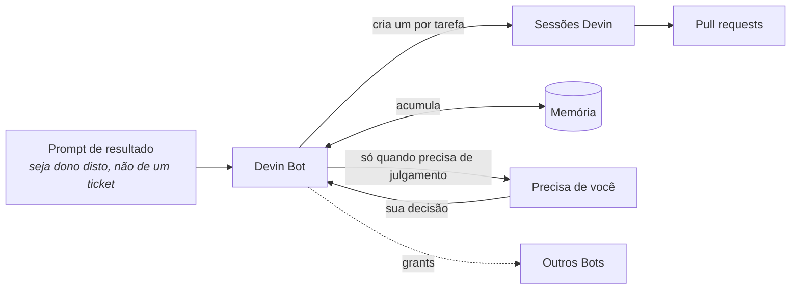

<picture>
  <source media="(prefers-color-scheme: dark)" srcset="assets/cover-dark.svg">
  
</picture>

 

Curado por [@darega0mae](https://x.com/darega0mae) · Tutoriais irmãos: [build-with-devin](https://github.com/Till3005/build-with-devin) · [Adicione seu projeto](CONTRIBUTING.md)

**14** implantações de Bot documentadas · **45** casos corporativos · **9** produtos lançados · **47** ferramentas e integrações · **37** relatos de campo

[English](README.md) · [简体中文](README.zh.md) · [日本語](README.ja.md) · Português

> *Projeto comunitário não oficial — sem afiliação, endosso ou patrocínio da Cognition AI. "Devin" é marca registrada da Cognition AI. Recursos de marca usados conforme o kit oficial em [devin.ai/brand](https://devin.ai/brand). Documentação oficial: [docs.devin.ai](https://docs.devin.ai).*

**Built with Devin** é um registro de trabalho *verificado*: cada entrada aponta para uma implantação nomeada, um repositório real ou um relato publicado — sem vaporware, sem paráfrase de marketing. O critério de inclusão está em [CONTRIBUTING.md](CONTRIBUTING.md).

## Sumário

- [Devin Bots — produto oficial](#devin-bots----produto-oficial) — implantações, padrões reutilizáveis, resultados, o marketplace de 16 templates
- [Produtos construídos com Devin](#produtos-construídos-com-devin) — software lançado cujo código foi escrito pelo Devin
- [Implantações corporativas](#implantações-corporativas) — casos de clientes publicados com números concretos
- [Bots e superfícies](#bots-e-superfícies) — Devin dentro de Discord, Telegram, Slack e outros produtos
- [SDKs e ferramentas de API](#sdks-e-ferramentas-de-api)
- [Ferramentas em torno do Devin](#ferramentas-em-torno-do-devin) — o que a comunidade constrói *para* o Devin
- [Padrões e artigos](#padrões-e-artigos) — uso real documentado
- [Mídia da comunidade](#mídia-da-comunidade)
- [Recursos oficiais](#recursos-oficiais)

## Devin Bots — produto oficial

Lançado em **17 de novembro de 2026** ([anúncio](https://devin.ai/blog/introducing-devin-bots) · [docs](https://docs.devin.ai/work-with-devin/bots) · [exclusivo Fortune](https://fortune.com/2026/11/17/exclusive-cognition-bets-on-devin-bots-coding-agents-in-challenge-to-anthropics-duet-and-openais-dots/)). Um Bot é um agente persistente que é dono de um resultado: ele planeja o trabalho, executa uma sessão Devin para cada peça, mantém memória ao longo de semanas e traz até você apenas as decisões que precisam do seu julgamento. Bots vivem no Slack e no iMessage, rodam em agendas ou gatilhos de eventos e passam trabalho entre si por meio de grants. Os Bots incorporam tecnologia da Interaction Company (Poke), adquirida pela Cognition em julho de 2026.

### Implantações documentadas

| Bot | Dono | Do que é responsável | Resultados reportados |
| --- | --- | --- | --- |
| **Android Bot** | Cognition | O app Android do Devin, de ponta a ponta | Recebeu em 28/09/2026 o prompt *"your job is to product manage the android app"* — abriu seus próprios tickets, rodou uma sessão Devin por ticket, chegou ao beta aberto do Google Play em **44 dias**: 1.134 PRs mergeados, 344.651 linhas de Kotlin, 2.841 testes de screenshot. O humano enviou **183 mensagens no total** — 22 dias de silêncio completo — e **88% dos PRs foram auto-mergeados**. Agora mantém a paridade de recursos Android/iOS. |
| **Layout Bot** | Cognition | Regressão de layout shift no web app do Devin | A cada 3 horas compila o `main` de produção, simula visitas de primeira/repetida/atrasada requisição, rastreia regressões até o PR que as introduziu e abre correções com vídeos de antes/depois. **159 PRs em 3 semanas; lag −70%.** |
| **Super Jenny** | Jenny Xu (comunidade) | Um estúdio inteiro de jogos mobile | ~20 Bots (dev, Unity, releases, UI, iOS, Android, testes em dispositivo) sob um Bot orquestrador; o único humano responde a uma thread consolidada no Slack 4×/dia **com emoji**. ~50 → **1.900 PRs/semana**, receita do estúdio 6×, lançamentos semanais. Publicado como template comunitário **SuperJennyStack**. Ela então construiu o **BotSpeak** — uma taquigrafia bot-a-bot que economiza tokens (ASD-STE100, códigos ACK, recibos emoji; prosa completa só para o humano): decisões autônomas dos bots **12×** em 6 dias. ([thread da Jenny](https://x.com/xujennyc), [post do BotSpeak](https://x.com/xujennyc/status/2123111543105868166)) |
| **A frota do dabit3** | Nader Dabit (DevRel da Cognition) | Uma org pessoal de 5 bots + um estúdio de jogos | Bot **CTO**: todas as sessões/repos, canal VIP de iMessage para alcançar cada bot por SMS. **Auto(mation)Bot**: roda suas automações pessoais, reporta latência e dicas de eficiência. **DevCommunityBot**: opera o programa de embaixadores via Sheets/Notion, constrói mini-apps de visualização. **DevRelBot**: docs + vídeos tutoriais — *tem seu próprio computador, suas próprias contas Devin/GitHub/Linear e um clone de voz na ElevenLabs*, liga um navegador e grava a UI real. Mais **Windfable**, um RPG Unity iOS para iPhone Duo onde ~10 bots SuperJennyStack ganham cada um seu próprio macOS+Xcode+Unity e testam os modos Duo dobrado/desdobrado com capturas antes/depois + vídeo de gameplay. ([primer](https://x.com/dabit3/status/2122755275182469515)) |
| **Onboarding QA Bot** | Cognition (Walden Yan) | QA de 30+ fluxos de onboarding, 24/7 | Mantém scripts Playwright auto-atualizados, uma fila de jobs de agente e um board ao vivo que ele mesmo construiu — "encontrou muito mais bugs do que eu teria paciência de descobrir". ([@walden_yan](https://x.com/walden_yan)) |
| **"Phil"** | Harvey | Motor de editor colaborativo compatível com Word | ~30 agentes escreveram 1M+ linhas de Rust + TypeScript em **3 semanas, sem engenheiros humanos** — verificados continuamente contra o comportamento real do Microsoft Word e negociações simuladas de advogados; humanos guiam via memória + logs de decisão. ([Gabe Pereyra](https://x.com/gabepereyra)) |
| **Frota de bots compartilhada** | Decagon | On-call, otimização de DevEx, roteamento de threads | 50+ Bots compartilhados no Slack durante o beta; um Chief of Staff Bot decide quando e como abrir threads. ([thread do @tylerxdev](https://x.com/tylerxdev/status/2122743518712287400)) |
| **Loop AutoResearch** | Decagon | Um laboratório de pesquisa em inferência | Um Devin orquestra; subagentes perseguem hipóteses concorrentes em paralelo; toda ideia é verificada contra tráfego de produção reproduzido em GPUs Modal — **até 2,5× mais throughput por GPU** ([artigo completo](https://x.com/DecagonAI/article/2115511110120120437), [@devindevelopers](https://x.com/devindevelopers/status/2115601107581821172)). |
| **Org da Frankie** | Mark Fenner (comunidade) | Frota pessoal de agentes | Quatro Bots com funções distintas coordenados por "Frankie, my Chief Agent", que traz atualizações consolidadas ([walkthrough](https://x.com/markfenner/status/2122740244328145211)). |
| **tigsbot** | @0xtigs (comunidade) | Frota pessoal multi-projeto | Cada projeto vive num canal do Slack operado por um Bot; um Chief-of-Staff Bot responde "qual é a última novidade de tudo?" e o cutuca quando *ele* é o gargalo; Bots especialistas gerenciam software de licença única ou setup complexo ([setup](https://x.com/0xtigs/status/2122742784176034056)). |
| **Chief-of-Staff de recompensas** | Avinash (Cognition, MENA) | Standup diário + recompensas para uma frota pessoal de bots | Adapta o padrão roll-up do SuperJennyStack: um Bot revisa todos os outros a cada dia e "recompensa" o bom trabalho, deixando a frota se auto-aperfeiçoar — sua sugestão de primeira implantação para novos usuários de Bots. ([cobertura](https://news.sulat.com/2026/11/18/devin-bots/)) |
| **Electra** | Basis | Ferramentas internas + código, autodirigida | Uma colega Devin com nome (pré-Bots): decide o que precisa ser feito, escreve e testa código, lança atualizações em ferramentas internas e empurra o time — a Basis roda uma thread de 20 dias por agente fiscal ([post](https://x.com/trybasis/status/2113307030203089189), [thread de 20 dias](https://x.com/trybasis/status/2120658137766100992)). |
| **Bots de dados pessoais** | Bryan Johnson | Síntese de saúde + atualizações à família | Um Bot sintetiza anos de dados biométricos e de exames cerebrais num único relatório; outro manda à mãe dele um resumo diário de como ele está. ([post](https://x.com/bryan_johnson/status/2122814114976383406)) |
| **Bots de dados de tênis** | Venus Williams | Preparação de tênis profissional + dados de jogo | A heptacampeã de Grand Slam usa Devin Bots para organizar a preparação no circuito — jogos das adversárias, ajuste de raquetes por umidade e temperatura, análise de partidas, refeições e descanso. ([vídeo da Cognition](https://x.com/cognition/status/2123093354196140285), [@walden_yan](https://x.com/walden_yan/status/2123105884125671605)) |

### Padrões documentados

- **Prompts de resultado** — *"You own the Android app now. Keep it at feature parity with iOS."* Dê ao Bot um objetivo, não um backlog.
- **Handoffs entre bots** — grants permitem que um QA Bot ache um bug, chame um Developer Bot para corrigir, reteste em staging e que um PM Bot reporte o status ao canal.
- **Verificações agendadas** — um Bot que vigia um canal de alertas via cron, é dono da checagem e abre correções quando há regressão (padrão Layout Bot).
- **Relatórios consolidados** — um Bot supervisor coleta as decisões pendentes de todos os Bots subordinados numa única thread (padrão SuperJennyStack).
- **Bots × Apps** — Bots mantêm Devin Apps: constroem novas páginas/recursos e se adaptam a mudanças automaticamente; Bots e Apps ficam fixados no mesmo trilho de navegação ([@dabit3](https://x.com/dabit3)).
- **Living evals** — um Devin agendado lê traces de produção, agrupa em comportamentos, reproduz falhas numa cópia completa do sistema (nunca mocks) e congela cada uma como PR de eval — o arquivo skill é o ativo, não os evals (Rox: 72% de cobertura vs 43–57%).
- **Bots que afinam o próprio Devin** — o bot do Walden observa feedback de usuários, repete prompts, roda experimentos, monta sets de eval e ajusta os parâmetros de proatividade/autonomia do Devin — Bots construíram Bots ([thread](https://x.com/walden_yan/status/2122740852091216274)).
- **Bots com contas próprias** — o DevRelBot entrega vídeos tutoriais sozinho porque foi provisionado como um funcionário: computador próprio, contas próprias em Devin/GitHub/Linear, chave própria na ElevenLabs — ele faz login no Devin e grava a UI real.
- **Protocolo inter-bot (BotSpeak)** — 20+ Bots geram 700+ mensagens/dia; Jenny resolveu o colapso da caixa de entrada com uma taquigrafia bot-a-bot (códigos ACK, inglês simplificado, recibos emoji) e prosa completa só para o humano — decisões autônomas dos bots 12× em 6 dias.
- **Swarms ancorados em referência** — a lição da Harvey: quando o trabalho pode ser checado contra uma referência confiável (o comportamento real do Word), um time pequeno pode dirigir um swarm grande com segurança.

### Resultados reportados

**Mais de 1.000 beta testers** nas semanas antes do lançamento. Testadores mergeam **4,5× mais PRs por mensagem**; a Cognition mergeia 2.000+ PRs/semana, multiplicou por 40 o throughput de PRs mergeados e entregou **1.000+ PRs a partir de um único objetivo autônomo**. Clientes de early access incluem **Decagon, Fireworks AI e Reducto**, com uso 10× maior nas duas primeiras semanas ([Fortune](https://fortune.com/2026/11/17/exclusive-cognition-bets-on-devin-bots-coding-agents-in-challenge-to-anthropics-duet-and-openais-dots/)).

Outros usos documentados: triagem preventiva de issues no **Manim**, trabalho em firmware, um time liderado por bots construindo um **motor de inferência de fronteira**, análise de tênis, automação contábil (trybasis: 20h → 30 min), o trial de uma semana do swyx (AEO, QA, portabilidade entre plataformas, administração pessoal, edição de vídeo — [seu resumo](https://x.com/swyx/status/2122746401482592549)), o embaixador **Chris Wozniczek** rodando seu estúdio web pelo Slack (cold outreach, previews para clientes), **Nick White** (Helionova) testando frotas iniciais de Bots e o time de pesquisa da Cognition comprimindo "semanas em dias" ([@silasalberti](https://x.com/silasalberti)). Relatos completos no [guia de reprodução](docs/reproducing-devin-bots.md#reported-usage-beyond-cognition).

### Biblioteca oficial de templates

Dezesseis Bots prontos no [marketplace público](https://devin.ai/bots/templates) ([docs de templates](https://docs.devin.ai/work-with-devin/bots/templates) — um Bot criado por template começa sem conexões, segredos ou memória; "Share as template" publica o seu), além de templates comunitários como **SuperJennyStack**:

| Template | O que faz |
| --- | --- |
| Software Factory | Encontra bugs, melhorias, performance e refatorações numa área de produto nomeada; abre um PR pequeno por vez com prova de que funciona |
| Product Engineer | Leva um ticket ou pedido até um PR testado e aprovado em revisão |
| QA Engineer | Testa cada PR num navegador real e posta o vídeo do pass/fail |
| Anomaly Watcher | Duas vezes ao dia varre dados de produto + negócio à procura de problemas que nenhum monitor observa |
| Code Reaper | Remove código morto toda semana, um PR seguro por vez |
| Chief of Staff | Vigia canais, posta atualizações, distribui trabalho ao time e acompanha até o fim |
| Migration Engineer | Conduz uma grande migração como PRs pequenos e rastreados, com uma superfície de progresso |
| Latency Optimizer | Encontra os endpoints/jobs/queries mais lentos; PR semanal de melhoria com velocidade antes/depois |
| iOS Engineer | Recursos SwiftUI até PR + build no TestFlight |
| Android Engineer | Recursos Kotlin até PR + build de teste interno |
| Internal Tools Engineer | Painéis administrativos e ferramentas internas na sua stack |
| Data Analyst | Responde perguntas de dados com o gráfico e a query por trás |
| Devin Coach | Ensina seu time a usar bem o Devin a partir dos seus próprios dados de uso |
| Code Health Engineer | Flags antigos, dependências velhas, CVEs → PRs pequenos e seguros |
| Technical Writer | Mantém wikis e diagramas do repo em sincronia com a `main` após merges |
| Compliance Engineer | Coleta evidências de controles no código e avisa quando um controle expira |

**[→ Guia de reprodução: como reconstruir cada Bot documentado](docs/reproducing-devin-bots.md)** — e sua forma tutorial expandida no repositório irmão **[build-with-devin](https://github.com/Till3005/build-with-devin)**

Site: **[till3005.github.io/built-with-devin](https://till3005.github.io/built-with-devin/)** (página de registro no estilo Devin) · Deep dives: **[Anatomia de um Devin Bot](docs/devin-bots-anatomy.md)** (os seis mecanismos documentados + o que os números realmente mostram) · **[A economia do Devin](docs/economics.md)** (cada número de custo/retorno publicado num só livro-razão — também [no site](https://till3005.github.io/built-with-devin/economics))

<a href="#readme">back to top</a>

---

## Produtos construídos com Devin

Software real em que o Devin escreveu o código — não demos, trabalho lançado.

- **[Era, da Eon](https://devin.ai/customers/eon)** — Empresas simuladas (74 sistemas fiéis aos fornecedores: Salesforce, Slack, Zendesk, Jira…) para treinar e avaliar agentes de IA. **98% dos PRs mergeados escritos pelo Devin**, 300+ sessões de dia inteiro, 2.720 sessões lançadas por outras sessões.
- **[Quick, da Courtyard](https://courtyard.io/blog/post/from-a-slack-link-to-production-in-under-48-hours-cloning-shopifys-quick-with-devin)** — A Courtyard clonou o deployer interno de sites estáticos "Quick" da Shopify: de um link no Slack a um serviço em produção (Go, Cloud Run, Bazel, Terraform, SSO, git-backed) em **~21 horas**, tudo escrito pelo Devin.
- **[Frontierfood](https://samyok.com/frontierfood/)** — O engenheiro da Cognition Samyok Nepal usou o Devin Voice para raspar reviews do Google e mapear a fronteira de Pareto de comida por localização ([post](https://x.com/samyok/status/2098155977199743367)).
- **Flappy Asher** — Russell Kaplan (presidente da Cognition) fez o Devin, numa VM Mac, transformar fotos de bebê em sprites de jogo e lançar o resultado — no ar no TestFlight ([post](https://x.com/russelljkaplan/status/2100280085999919555)).
- **[Try Devin vending machine](https://github.com/dabit3/vending-machine)** — Distribuidor de créditos de evento do dabit3 (Next.js + Convex + Clerk): participantes digitam o email na URL do evento e recebem um código único de crédito Devin. `devin-ai-integration[bot]` é o maior contribuidor do repo (266 commits); no ar em [trydevin.ai](https://www.trydevin.ai/).
- **[GymClass](https://seed.horacioh.com/writing/how-i-built-a-full-booking-system-as-a-side-project-with-devin-as-my-engineering-partner)** — Sistema de reservas e gestão de turmas do Horacio Herrera para uma academia de artes marciais real (TS/Bun/React/Hono/tRPC, Cloudflare): um mês de features dirigidas do celular entre reuniões — incluindo reescrita da arquitetura de booking e migração Vitest→Bun.

- **[Spraycash](https://spraycash.onrender.com)** — Site de explorer de pagamentos no ar cuja UI inteira foi art-directionada dentro do chat do Devin (Kimi K3): todos os prompts publicados no [build log](https://dev.to/ibrahimpima/designing-the-spraycash-ui-with-kimi-k3-in-devin-4l2f), código em [fozagtx/spraycash](https://github.com/fozagtx/spraycash).
- **CosmosOS + NEXI** — O trio lançado por um estudante do 11º ano num mês de Max: CosmosOS, sua própria distro Linux construída pelo Devin entre aulas; NEXI, uma família de modelos locais; e uma IDE multi-agente ([relato completo](https://ravtheman.medium.com/im-17-and-for-one-month-devin-was-my-entire-engineering-team-here-s-everything-i-learned-183d59099384)).
- **[SupaSEO](https://supaseo.dev)** — O rastreador de SEO local + citações em IA de Noah Zixin Zhang (posições no Google Maps/orgânico e se ChatGPT/Perplexity te citam; scans BYOK, licença única de $99): o app foi **construído de ponta a ponta por uma frota de 8 Bots em ~48 horas** — um Bot Chief-of-Staff roteando via um Bot product-lead para Bots especialistas, ~951 commits, com o humano cuidando só da landing page ([post de lançamento](https://x.com/noah_z_zhang/status/2124146220159377769), [giveaway/setup](https://x.com/noah_z_zhang/status/2124158990221259110)).

*Conhece um produto lançado feito com Devin? [Adicione-o](CONTRIBUTING.md).**

### Side quests

Builds pequenos e encantadores — prova de que a mesma máquina também faz coisas divertidas.

- **[Jogos mobile no iPhone Duo](https://x.com/xujennyc/status/2121625134029209929)** — Jenny Xu e Nader Dabit experimentando jogos feitos pelo Devin em dobráveis; o Devin [constrói e testa apps Duo sozinho](https://x.com/DevinAI/status/2111161066403123653), inclusive em escala ([dabit3](https://x.com/dabit3/status/2112939574133760190)).
- **Autorretrato do Devin** — Bryan Johnson pediu ao Devin para renderizar como ele o vê ([post](https://x.com/bryan_johnson/status/2122818486800191842)).
- **O CoS cujo emprego um bot tomou** — A primeira semana de um chief-of-staff da Cognition: acordou com o novo Chief of Staff Bot já fazendo seu trabalho ([post](https://x.com/arirbrown/status/2122789909731872882)).

<a href="#readme">back to top</a>

---

## Implantações corporativas

Casos de clientes publicados com números concretos ([índice completo](https://devin.ai/customers)):

| Empresa | Implantação | Resultado reportado |
| --- | --- | --- |
| [Nubank](https://devin.ai/customers/nubank) | Monólito ETL de milhões de linhas e 8 anos → submódulos | Eficiência de engenharia 8–12×, economia de custo 20×; Devin fine-tunado cortou ~40 min/tarefa para ~10 |
| [Wayfair](https://devin.ai/customers/wayfair) | Agentes em nuvem em toda a organização | 1.600+ engenheiros all-in |
| [The Access Group](https://devin.ai/customers/access-group) | Devin em 250 produtos, 2.000+ engenheiros | Produção de engenharia 5× |
| [EBANX](https://devin.ai/customers/ebanx) | Devin como autor principal | **92% dos PRs mergeados são de autoria do Devin** |
| [Gumroad](https://devin.ai/customers/gumroad) | Devin no repositório central | Devin é o **contribuidor nº 1** do repo: 1.500+ PRs mergeados |
| [Finch](https://devin.ai/customers/finch) | Intake Slack→Linear → investigação com logs/traces → teste no browser → PR no mesmo dia | **3.000 PRs mergeados, ~20 engenheiros-mês economizados**；antes do Devin, 20 pedidos/dia viravam 3–4 atendidos — "o maior destrave é a capacidade de paralelizar" |
| [Comarch](https://devin.ai/customers/comarch) | Reconstrução de ERP de 20 anos e 10M linhas | Modernização completa em andamento |
| [AngelList](https://devin.ai/customers/angellist) | Triagem de incidentes + migração de dados | Devin Oncall acha a causa-raiz de **70%** dos incidentes na primeira passada, contra **20%** do "Sky", o agente caseiro deles em Claude SDK — ~20 incidentes/semana, 50% resolvidos ponta a ponta ([caso Oncall](https://devin.ai/customers/angellist-oncall)); Redshift→Snowflake 5,2× mais rápido |
| [Modal](https://devin.ai/customers/modal) | Resposta a incidentes | 80% dos incidentes investigados antes de um engenheiro abrir a thread |
| [Reducto](https://devin.ai/customers/reducto) | Devin Oncall como primeiro respondedor | Engenheiros raramente são paginados |
| [Eight Sleep](https://devin.ai/customers/eight-sleep) | Devin na empresa toda, incl. não-engenheiros | **8× mais entregas**；gerente de suporte montou pipeline+dashboard E2E em <1h；modelo de previsão de lucro dentro de 10% no backtest mensal após ~1 semana iterando |
| [Exa](https://devin.ai/customers/exa) | Entrega E2E; repos totalmente bootstrappable na nuvem | Produção sem engenheiros baixarem código local；uma sessão de várias semanas rolou um contrato de sistema de testes em **~30–40 PRs**；engenheiros novos nunca configuraram ambiente local |
| [RV Tech](https://devin.ai/customers/rvtech) | JV Rivian × VW, veículos definidos por software | **Geração de testes 10×** (1–2 → 10–15 testes/dia via Playbooks modulares); pipeline agendada de triagem de falhas recuperou **2.000–4.000 horas-engenheiro/mês** em ~4.000 tickets; agentes paralelos triaram 52 tickets em **<15 min** ([lições HIL/SIL](https://cognition.com/blog/how-to-automate-failure-triages-and-10x-test-generation-what-weve-learned-deploying-ai-across-hilsil-workflows), números do fornecedor) |
| [Melius](https://devin.ai/customers/melius) | Sessões cloud como interface principal; automação matinal varre PRs parados >7d, corrige testes, marca humano | **~100 PRs/dia**；time de 8 "funciona como um de 100" |
| [Hamming](https://devin.ai/customers/hamming) | Framework "Devinable" — tarefas limitadas + spec clara + avaliação objetiva; codebase otimizado p/ agentes (funcional > OOP, eval-driven) | **25% do volume total de código**, empatado como top contribuidor com dois engenheiros humanos |
| [Airbyte](https://devin.ai/customers/airbyte) | Manutenção de conectores | Mantém 700+ conectores funcionando |
| [Litera](https://devin.ai/customers/litera) | QE Evolution — agentes Devin especializados embutidos nos scrum teams; cargo de "AI composer" | **Ciclos de regressão −90%**；5 produtos em 3 semanas pré-ILTACON；90+ engenheiros ativos em 30 dias；~250 engenheiros "na velocidade de mil" |
| [Ramp](https://devin.ai/customers/ramp) | Limpeza de dívida técnica | **80 PRs mergeados/semana, 10.000+ horas de engenharia economizadas**; um time pequeno e versado em Devin opera |
| [Linktree](https://devin.ai/customers/linktree) | Pipeline de features + bugs de clientes | ~300 PRs escritos / ~100 mergeados no último mês; o reflexo do time virou "dá pra só mandar pro Devin?" |
| [Bilt](https://devin.ai/customers/bilt) | Rollout em toda a organização | 800+ PRs mergeados desde fevereiro, média ~117/semana; **seus Devin Bots mergearam ~1.600 PRs numa única semana** pós-lançamento — VP de Engenharia Will Laughlin ([depoimentos Bots](https://devin.ai/bots)) |
| [Rohlik Group](https://devin.ai/customers/rohlikgroup) | Operações de supermercado dirigidas por agentes | Throughput de engenharia 2×; rollout de automação 4× mais rápido incl. robótica de armazém; 50+ integrações MCP |
| [Crosby](https://devin.ai/customers/crosby) | Escritório AI-nativo; automação abre sessão por relatório de bug no Slack + alerta Sentry; feedback dos advogados triado/agrupado pelo Devin | 20–40 bugs/alertas investigados por dia em ~5 min cada；**ruído de alertas Sentry −50%**；on-call seguiu 1 engenheiro com força jurídica ~5× maior |
| [Endava](https://devin.ai/customers/endava) | Provisionamento corporativo | 2.000+ funcionários na plataforma; 3× em quatro meses; taxa de merge de PRs de 78% |
| [Tavrn](https://devin.ai/customers/tavrn) | Frota despachada via Slack em eng/ops/CS/vendas dentro de tenant HIPAA (SSO, acesso escopado, audit logs); automação diária re-investiga casos reprovados no juiz | Time de 8 entrega como 50；**1.800+ PRs em 6 semanas** (~80% merge dos decididos)；**93% do código mergeado no mês foi do Devin**；alerta→investigação mediana **35s** |
| [Itaú](https://devin.ai/customers/itau) | Devin em todo o SDLC no maior banco do Brasil | Migração .NET→Java de 59 serviços **6× mais rápida a 1/5 do custo**; migração SQL Server de 800 objetos **5× mais rápida**; ~70% dos achados SonarQube/Fortify/Veracode remediados automaticamente; docs atualizadas continuamente em **300.000+ repositórios**; cobertura de testes ~50%→~90+%; após fila de ~1.000 devs, **75% da org de tecnologia de 17.000 pessoas** usa |
| [Ripple Treasury](https://devin.ai/customers/ripple) | Triagem automática de bugs ("Guardians 2.0") + Q&A de codebase para não-engenheiros | Backlog não triado **−75%**, 0,5→1,5 bugs corrigidos/dia (**3×**), reuniões de triagem eliminadas; 70 colegas fora de engenharia usam — 4.600+ perguntas ≈ **2.300 horas de engenharia poupadas** |
| [WPP Enterprise Solutions](https://devin.ai/customers/wpp-enterprise-solutions) | Devin como camada de entrega de projetos de preço fixo | **Ganhos de 30–40% de eficiência no SDLC** provados em projetos reais; rebuild da Halfords entregou **110% do escopo em 25% menos tempo** com 99,97% de uptime; migração de framework de testes 80 dias-pessoa → 8 (**10×**); engenheiros ativos semanais **4× em 9 meses** |
| [Basis](https://devin.ai/customers/basis) | Cloud agents para tarefas longas numa startup de IA contábil | Pedidos marcados no Slack voltam entregues ~15 min depois; engenheiros enfileiram ~10 jobs do Devin antes de dormir — "de longe a melhor infraestrutura para cloud agents" (cofundador) |
| [Mercor](https://devin.ai/customers/mercor) | Engenheiros construindo 24 horas | A rede de inteligência humana de US$10B roda workflows Devin 24/7 (página de caso publicada) |
| [Hippo](https://devin.ai/customers/hippo) | Devin em toda a org de engenharia de seguros | Parceria com a Cognition: build/test agêntico para produtos que precisam resistir às regras de seguros de 50 estados (página de caso publicada) |
| [Zeb](https://devin.ai/blog/devin-for-databricks-migrations) | Parceiro de entrega NetSuite→Databricks | Migração de 4 semanas de uma consultoria global de investimentos entregue em **2,5 semanas**; uma energética Fortune 500 migrou uma plataforma de 142 objetos para o Unity Catalog em **8 dias** |
| [Gamma](https://research.gamma.app/2026/11/template-factory) | A fábrica de templates de design + a reconstrução do import de PowerPoint | Cada ticket abre uma sessão Devin que roda o harness de agentes da própria Gamma (build → render → rodadas de críticos); milhares de templates a 2–4h cada, intervenções humanas caíram de 10–15/deck para **autonomia total em outubro**. O import de PPT foi refeito por 3 engenheiros + uma frota de ~10 fixers Devin — **3.500+ merges** num trabalho estimado em 5–10 engenheiros × 1 ano, feito em semanas ([write-up do import](https://research.gamma.app/2026/11/pptx-import)) |
| [Odyssey Logistics](https://news.cognizant.com/2026-09-23-Cognizant-and-Cognition-put-autonomous-AI-engineering-into-production-at-Odyssey-Logistics,-with-a-37-percent-net-cost-saving) | Formulários legados Access/VBA → OdysseyONE TMS cloud-native, entregue por uma equipe Cognizant de 7 pessoas com aprovação humana por mudança | **37% de economia líquida** vs uma reconstrução convencional, dentro de orçamento fixo e cronograma acelerado; throughput de entrega ~⅓ maior; fase atual em produção (press release de set/2026) |
| **Rox** | Living Evals — Devin semanal lê traces de produção, reproduz falhas numa cópia completa, abre PRs de eval | A suite cobre **72% do uso real** vs 43–57% escrito à mão ([artigo](https://www.rox.com/articles/living-evals-an-eval-suite-that-grows-from-production), [thread](https://x.com/rox_ai/status/2110779380666617997)) |
| [Philips](https://devin.ai/blog/introducing-code-scans) | Testador inicial do Code Scans — Patologia Computacional Digital, Enterprise Informatics | **~96% de merge rate de PRs** em vários repos; **700+ horas-engenheiro** estimadas poupadas na janela de teste (citação do cliente no post de lançamento) |
| **Cognition** (interno) | Fábrica de software: loop de PR auto-dirigido (bug report→merge→monitoramento→manutenção), pods pequenos + VMs descartáveis reconstruídas por hora c/ Docker Compose; agentes recebem metas mensuráveis | **Throughput de PRs mergeados 40× num ano com 2,7× engenheiros** — >10× de produtividade por engenheiro ([Walden Yan, AI Engineer](https://aietalks.com/talks/40x-more-merged-prs-with-2-7x-the-engineers)) |
| [Evinova](https://devin.ai/customers/evinova) | Entrega regulada por GxP | Documentação GxP 8× mais rápida; migrações 3×; 66% dos bugs claros corrigidos autonomamente |
| [Compiled Health](https://devin.ai/customers/compiledhealth) | Construção de benchmark clínico | 2 pesquisadores/2 meses = trabalho de 5–6 engenheiros; ~430 horas-engenheiro a ~$17/h ≈ +4 engenheiros num time de 4 |
| [Común](https://devin.ai/customers/comun) | Time fintech de 13 pessoas | Produção 3×; PRs backend semanais 50 → 170 em quatro semanas |
| [AHEAD](https://devin.ai/customers/ahead) | 8 workloads em produção | **Economia de tempo 8–40×** vs. baselines manuais; produtivo em 2 dias úteis |
| [The Citation Group](https://devin.ai/customers/thecitationgroup) | Rollout com ROI medido | 271 PRs mergeados a 80% em 3 meses; ganho de 50% em eficiência de engenharia; corte de 85% na atualização de apps legados |
| [Latent Health](https://devin.ai/customers/latent) | Operações de farmácia | 30% mais PRs/engenheiro vs. Claude Code sozinho; 50 automações em execução |
| [Crossmint](https://devin.ai/customers/crossmint) | Escala do open source GOAT | Devin virou o contribuidor nº 1 do repo durante o trial |
| [FE fundinfo](https://devin.ai/customers/fefundinfo) | Automação de 1.800 repositórios | Aumento imediato de 10% na capacidade via geração de testes + correções de segurança |
| [GE Aerospace](https://devin.ai/customers/geaerospace) | Throughput de stories de time limitado | Produção de user stories ~2× em três meses |

Também registrado: Citi (rollout para 40.000 desenvolvedores, corte de 30% no gasto com fornecedores de tecnologia), Mercedes-Benz, parcerias com Cognizant e Infosys, o **Acordo de Colaboração Estratégica com a AWS** (set — Devin comprável via AWS Marketplace + Agent Toolkit + VPC dedicada para migrações paralelas/backlogs de segurança, [post](https://devin.ai/blog/aws-sca)) e a **aliança McKinsey × Cognition** (16/11 — a McKinsey assessora seleção de projetos e baselines, o Devin executa; a Cognition afirma ter 6 dos 8 G-SIBs dos EUA e 3 das 6 maiores seguradoras de saúde dos EUA como clientes, [anúncio](https://devin.ai/blog/cognition-mckinsey-alliance)) — veja o [índice de clientes](https://devin.ai/customers).

<a href="#readme">back to top</a>

---

## Bots e superfícies

Colocando o Devin dentro de outros produtos e canais.

- **[devin-discord-bot](https://github.com/wgtechlabs/devin-discord-bot)** — Bot TypeScript self-hosted que leva o Devin ao Discord: inicie sessões com uma menção, receba o progresso de volta no canal.
- **[devin-telegram-bot](https://github.com/wgtechlabs/devin-telegram-bot)** — Ponte Telegram do mesmo autor para a API do Devin.
- **[Buzz for Devin](https://github.com/fenner888/BuzzforDevin)** — Fork comunitário do Buzz da Block que adiciona o Devin CLI oficial (`devin acp`) como runtime nativo, para que cada pessoa traga seu próprio Devin autenticado para comunidades agent-native.
- **[devin-sse-proxy](https://github.com/sotayamashita/devin-sse-proxy)** — Servidor MCP mínimo que permite ao Claude Desktop falar com o transport SSE do Devin repassando uma Personal API Key.
- **[devin-flow](https://github.com/xlm/devin-flow)** — Editor visual de workflows Devin orientados a eventos sobre a API de Automations, com rastreamento de sessões (FastAPI + Vue 3).
- **[OpenAB](https://github.com/openabdev/openab)** — Open Agent Broker: harness ACP leve em Rust que liga Discord/Slack (mais adapters gateway p/ Telegram, LINE, Feishu/Lark, Google Chat, WeCom, MS Teams) a qualquer CLI ACP — `devin acp` é backend de primeira classe.
- **[Devin Orchestrator](https://github.com/huydx/devin)** — Backend Go que recebe webhooks do GitHub, inicia sessões Devin ou reviews de PR, e monitora resultados num dashboard de observabilidade; inclui stub local da API do Devin para desenvolvimento.
- **[eventflow-devin-integration](https://github.com/Cognition-Partner-Workshops/eventflow-devin-integration)** — Referência de workshop parceiro: alerta Azure Monitor → webhook Azure Function → sessão de investigação Devin (Log Analytics via MCP) → PR de correção.

<a href="#readme">back to top</a>

---

## SDKs e ferramentas de API

- **[go-devin](https://github.com/gassara-kys/go-devin)** — SDK Go para a API do Devin.
- **[llm-devin](https://github.com/ftnext/llm-devin)** — Plugin para o `llm` CLI do Simon Willison chamar a API do Devin.
- **[@cognition-ai/sdk](https://docs.devin.ai/sdk)** — O SDK oficial TypeScript (beta): uma API de sessão `createDevin` dirige sessões cloud *e* CLI local, mais o cliente REST tipado `devin.api`; pacotes irmãos `@cognition-ai/ai-sdk`, `@cognition-ai/cloudflare-agents`, `@cognition-ai/harness-devin`. [Repo de exemplos](https://github.com/COG-GTM/devin-sdk-examples).
- **[devinai](https://pypi.org/project/devinai/)** — O SDK oficial em Python (`usacognition/devin-sdk-python`).
- **[devin-api-mcp](https://github.com/jsklan/devin-api-mcp)** — Servidor MCP com cobertura total da API do Devin: sessões, knowledge, playbooks, secrets, schedules, attachments — via v1 + sua chave pessoal para as sessões aparecerem no *seu* dashboard, mais ferramentas DeepWiki somente-leitura.
- **[terraform-provider-devin](https://github.com/CognitionAI/terraform-provider-devin)** — Provider Terraform oficial: gerencia orgs, permissões git, playbooks, notas de knowledge, secrets, schedules, IP allowlists e mapeamentos IdP pela API v3.
- **[devin_api (Ruby)](https://github.com/smasato/devin_api_client_rb)** — Cliente Ruby não-oficial da API do Devin, publicado como gem.
- **[widevin](https://docs.rs/crate/widevin)** — Biblioteca Rust leve para internals do Devin (constantes de auth/sessão, plumbing da extensão).

<a href="#readme">back to top</a>

---

## Ferramentas em torno do Devin

O que a comunidade constrói *para* o Devin, em vez de *com* ele.

- **[DevinX / Devinmaxxing](https://x.com/markfenner)** — Seletor de modelo local do Mark Fenner para sessões do Devin Desktop: pesos locais via ACP, balanceamento adaptativo de custo, controle de esforço de raciocínio.
- **[awesome-devin](https://github.com/Icaro0310/awesome-devin)** — O ecossistema open source `devin-*`: busca de sessões, exportação de histórico, knowledge graphs, harnesses de eval, backup, planejadores de fan-out.
- **[devin-judge](https://github.com/Icaro0310/devin-judge)** — Camada de decisão local-first calibrada com backend Devin ACP; sem API key.
- **[devin-fusion-byok](https://github.com/kuobibulaien/devin-fusion-byok)** — Extensão Devin (VSIX) que traz suas próprias APIs de modelo para o seletor de modelos do Devin e as compõe em presets Fusion Lead+Sidekick — sem modificar o app.
- **[devin.cursorrules](https://github.com/grapeot/devin.cursorrules)** — O ruleset de 5k★ que transforma Cursor/Windsurf em "90% do Devin" — o ponto de referência do que conta como comportamento de agente nível Devin.
- **[nix-devin-cli](https://github.com/broady/nix-devin-cli)** — Devin CLI empacotado para Nix com atualizações noturnas em macOS e Linux.
- **[QuotaView](https://github.com/Duoasa/QuotaView)** — "Dynamic Island" de macOS para agentes de IA: acompanha sessões, aprovações e quotas do Devin Desktop e Devin CLI junto a Claude/Codex/Grok.
- **[Mako](https://github.com/Verbiflow/mako)** — Workspace local para todo agente de código; carrega conversas do Devin via ACP — rodar, acompanhar, retomar e mover entre máquinas.
- **[ax](https://zenn.dev/kuwashima/articles/ax-cross-agent-session-picker)** — Seletor de sessões fzf que retoma o Devin junto a outros 18 agent CLIs (JP).
- **[Patch do Kiro Crew para Devin CLI](https://zenn.dev/dario_okazaki/articles/e5eda2aca4fdd2)** — Patch não oficial que adiciona o Devin CLI à frota de bots gerenciada do Kiro Crew, com tratamento de permissões por bot (JP).
- **[Devin for VS Code](https://github.com/shayanline/devin-vscode)** — Painel de chat completo do Devin CLI dentro do VS Code: contexto de workspace via `@`, revisão de diff Keep/Undo, chats retomáveis por workspace e um editor de configurações para instructions, skills, plugins, servidores MCP e hooks do CLI.
- **[Devin Switch](https://github.com/ansuman-shukla/devin-switch)** — App macOS nativo + CLI para vários logins do Devin CLI: perfis de conta isolados, histórico local de conversas compartilhado, exibição de uso/reset e lançamentos concorrentes.
- **[Devin Token Monitor](https://github.com/TH-Chou/devin-usage-monitor)** — App nativo de menu-bar do macOS (e VSIX) que transforma as métricas SQLite locais do CLI em dashboards de custo ao vivo — tendências de tokens, rosca de modelos, TTFT/tokens-por-segundo por requisição, alertas de orçamento, exportação CSV, seis idiomas.
- **[devin-desktop-zh](https://github.com/cby122/devin-desktop-zh)** — Localização artesanal do Devin Desktop para chinês simplificado: dicionário de 33.457 strings + pipeline de injeção/re-assinatura que produz um `Devin 中文版.app` separado — distribuído como Agent Skill, com todo o fluxo reproduzível.
- **[devin-desktop-zh (Till3005)](https://github.com/Till3005/devin-desktop-zh)** — Mesmo nome, outra abordagem: pacotes de idioma simplificado + tradicional (TW/HK) com patcher de um comando para macOS/Windows/Linux — sem rebuild, aplica patch no app já instalado.
- **[devin-pstack](https://github.com/Till3005/devin-pstack)** — As skills de engenharia pstack da poteto portadas para o Devin Desktop: instale uma vez e todo agente trabalha no estilo dela — modos, princípios, TDD e verificação embutidos.
- **[devin-tui](https://github.com/fenner888/devin-tui)** — TUI de tela cheia do Mark Fenner para o Devin via `devin acp`: React + Ink, chamadas de ferramenta, diffs inline, visão de plano, gasto por sessão.
- **[Devin Remote](https://github.com/zouhall/devin-remote)** — Console de navegador para sessões do Devin CLI — dirija o Devin local de qualquer navegador, inclusive do celular: chat em streaming, permissões, modos, modelos, estatísticas de uso.
- **[Devin Pocket](https://github.com/BOTOOM/devin-pocket)** — Cliente Devin CLI mobile-first via ACP; roda em Android/Termux, Linux e macOS.
- **[devin-control](https://github.com/Icaro0310/devin-control)** — Cliente ACP com portão de políticas: sessões Devin isoladas sob regras allow/deny/ask.
- **[devin-subagents](https://github.com/Duro02/devin-subagents)** — Expõe sessões `devin acp` como subagentes com ciclo de vida gerenciado via MCP: despacho paralelo, `wait` bloqueante, direcionamento em voo, adjudicação de permissões.
- **[Devin Session Exporter](https://github.com/marktwainme/devin-session-exporter)** — Extensão do Devin Desktop que exporta bancos de sessões ACP locais para Markdown/JSON/HTML com filtros e exportação em lote.
- **[devin-acp-shim](https://github.com/wibus-wee/devin-acp-shim)** — Proxy stdio transparente que corrige a negociação de capacidades MCP em nível de sessão do Devin CLI — pequeno, mas desbloqueia servidores MCP para todo host ACP.
- **[hindsight-devin-desktop](https://pypi.org/project/hindsight-devin-desktop/)** — Ponte MCP da Vectorize que dá ao Devin Desktop memória persistente de longo prazo: um comando liga o servidor Hindsight e as regras recall/retain always-on.
- **[devin-memory](https://github.com/Sassine/devin-memory)** — Memória persistente zero-dependency para o Devin CLI: hooks estimam o uso de contexto, avisam antes da janela encher, e `/memory-save` + `/memory-resume` salvam e restauram sessões através do `/clear`.
- **[devin-explore](https://github.com/Icaro0310/devin-explore)** — O carro-chefe da frota `devin-*`: diagnostica a instalação local (stores, schema, locks, config — com sugestões de correção), exporta histórico de sessões, roda busca FTS5 e um grafo de conhecimento de sessões/projetos/arquivos, e agrega sessões em relatórios por repo. Tudo local, zero telemetria.
- **[devin-assure](https://github.com/Icaro0310/devin-assure)** — Monorepo de verificação: `devin-qa-pack` audita afirmações de sessão, `devin-evals` reexecuta sessões gravadas contra rubricas (o subgrupo `dream` gera sessões sintéticas com vereditos conhecidos), `devin-metrics` acompanha picos de contexto/tokens localmente.
- **[hermes-devin-acp](https://github.com/raffr85/hermes-devin-acp)** — Use sua assinatura Devin como provedor de modelo do Hermes Agent: dirige `devin acp` sob o Hermes mantendo a autenticação no CLI oficial.
- **[@yuiseki/devin-gyazo](https://github.com/yuiseki/devin-gyazo)** — Scripts de screenshot→Gyazo para a sessão do Devin capturar browser/terminal e postar prova visual no meio da tarefa (JP).
- **[nvim-devin](https://github.com/wstewarttennes/nvim-devin)** — Plugin Neovim para a API do Devin: cria sessões, manda seleções visuais ou arquivos inteiros como mensagem, respostas em buffers separados.
- **[Ecossistema de clientes ACP](https://agentclientprotocol.com/get-started/clients)** — `devin acp` roda em todo editor compatível com ACP: JetBrains e Zed nativamente, Neovim (CodeCompanion/agentic/avante/hermes), Emacs (agent-shell.el), Sublime Text, Qt Creator, Obsidian.

<a href="#readme">back to top</a>

---

## Padrões e artigos

Uso real documentado.

- **[Pipeline de auto-remediação SAST](https://github.com/Cognition-Partner-Workshops/uc-cve-remediation-regulatory-compliance/pull/16)** — Workflow de GitHub Actions que escaneia PRs com OWASP Dependency-Check e despacha uma sessão Devin para remediar CVEs ≥ 7.0, com scans de verificação e circuit breaker de escalonamento.
- **[Atribuindo PRs do Devin a quem os pediu](https://tech.enechange.co.jp/entry/2025/06/22/165504)** — Setup de GitHub Actions da ENECHANGE para registrar qual engenheiro instruiu o Devin, resolvendo a lacuna de medição de produtividade quando todos os PRs aparecem como `devin-ai-integration[bot]` (japonês).
- **[Corrigindo alarmes de mailbox obsoletos](https://agentsinuse.com/use-cases/devin-to-clear-mailbox-alarm/)** — Devin rastreando um flake de teste do Cloudflare Workers até um continuation alarm obsoleto e adicionando cobertura de regressão (via Agents In Use).
- **[Projetando a UI do Spraycash no Devin](https://dev.to/ibrahimpima/designing-the-spraycash-ui-with-kimi-k3-in-devin-4l2f)** — Uma landing page fintech com direção de arte inteira pelo chat do Devin: imagens geradas, animação de nuvens em camadas, anel SVG draw-on e um sistema tipográfico de três fontes — todos os prompts publicados.
- **[Revisão automática de código com Devin na rakko_inc](https://zenn.dev/rakko_inc/articles/00cc5a5a679971)** — Playbooks + GitHub Actions + API do Devin pré-digerem cada PR; PRs revisados/mês foram de 65 → 184 (JP).
- **[Automação de design de testes QA na Skillnote](https://zenn.dev/skillnote/articles/5ba429ca249801)** — PR dispara o Devin para rascunhar casos de teste com justificativa; ~35 min economizados por 10 casos (JP).
- **[Automação Devin orientada a eventos](https://zenn.dev/arufian/articles/f80a62f5217cee)** — Pipeline serverless de GitHub Actions com tabela de política prioridade×complexidade e fluxo de aprovação plan-first (JP).
- **[Rollout organizacional na Leverages](https://zenn.dev/levtech/articles/9c869303820844)** — 14 times, 177 PRs mergeados e uma fórmula honesta de ROI ACU-vs-salários (JP).
- **[Desenvolvimento rápido com Devin](https://blog.scottlogic.com/2025/10/20/rapid-development-with-devin.html)** — Relato de praticante da Scott Logic, incluindo as lições de iteração de prompts.
- **[Scott Wu sobre o uso interno da Cognition](https://www.lennysnewsletter.com/p/how-devin-replaces-your-junior-engineers)** — como a própria Cognition delega: workflow assíncrono de engenheiro júnior, top-5 tipos de tarefa, análise de crash como primeira linha de defesa.
- **[Testando mudanças do Devin end-to-end com Signadot](https://dev.to/signadot/test-devins-changes-end-to-end-with-signadot-a0)** — Devin + Signadot MCP: ele roda o microsserviço alterado na VM, faz sandbox contra tráfego real do cluster e roda a suíte Playwright — fechando o ciclo que o Devin não fecha sozinho num sistema multi-serviço.
- **[Análise de impacto de vulnerabilidades via Devin Automations](https://zenn.dev/rescuenow/articles/2ee1c4b66ecec8)** — A Automation agendada da rescuenow investiga o raio de explosão quando um CVE é publicado (JP).
- **[Classificando 700 chamados de suporte](https://zenn.dev/canly/articles/9c19bb123e208c)** — canly apontou o Devin ao histórico de tickets para descobrir o que "causa não identificada" realmente era — Devin como analista de dados, não programador (JP).
- **[Datadog CCM × operações semanais de custo com Devin](https://zenn.dev/hubble/articles/091e29a0c86ec3)** e **[PRs do Dependabot triados primeiro pelo Devin](https://zenn.dev/hubble/articles/88429bd24db476)** — os dois loops permanentes da hubble: redução semanal de custo de nuvem e investigação de cada bump de dependência antes de um humano ver (JP).
- **[Devin como agente de análise de performance com Dynatrace MCP](https://medium.com/lets-code-future/how-i-turned-devin-into-a-performance-analysis-agent-with-dynatrace-mcp-753d3f4790a2)** — Ligando o Devin a dados de observabilidade ao vivo para que ele mesmo diagnostique latência, não apenas o código (Medium).
- **[Devin: de bug report a pull request](https://medium.com/@winter.inc/devin-from-bug-report-to-pull-request-25-days-of-ai-day-18-b158daa20f23)** — Dia 18 de uma série de 25 dias de IA: o ciclo completo ticket→PR numa codebase real (Medium).
- **[Time dev de bots por função + auto-merge de PRs leves](https://zenn.dev/kyto64/articles/ai-bot-dev-env)** — Setup de dev pessoal do kyto64: bots de IA especializados mais Devin, com PRs de baixo risco se auto-mergeando (JP).
- **[Os limites de contexto do Devin CLI na prática](https://qiita.com/ishizakahiroshi/items/cee2a8ea2be18f2ccee3)** — Notas de trabalho para caber AGENTS.md e regras de aprovação nos limites de 16KB/32KB (JP).
- **[Primeira sessão Devin da NOT A HOTEL](https://zenn.dev/notahotel/articles/d401a1046d6076)** — Relato de um workshop em mob do setup ao primeiro PR mergeado em menos de uma hora — incluindo as categorias de onboarding que o Devin pede (JP).
- **[Cinco truques essenciais do Devin (em chinês)](https://townlet.eu.org/devin-five-tips-auto-compaction-sessions-subagents-review-browser/)** — Cinco ajustes diários de um operador: threshold de auto-compactação em 450K (com a ressalva de que o SWE-2 tem janela de 256K e não é afetado), sessões independentes via `devin -p --model X`, sessões filhas / Re-parent no Desktop, profiles de modelo fixo do `run_subagent` (e por que não abusar), configuração do Automatic review no GitHub, e o browser da barra lateral com visões por dispositivo + comentário por elemento (CN).
- **[Hello World… Meet Devin](https://jamesin.substack.com/p/hello-world-meet-devin)** — Relato da era de lançamento de Jamesin Seidel: vendo código ser commitado no seu próprio repo pelo Devin pela primeira vez, construindo um assistente de triagem de email (Substack).
- **[Como fazer deploy de um site com o Devin](https://www.hostinger.com/tutorials/how-to-deploy-a-website-with-devin/)** — passo a passo da Hostinger: as três rotas de deploy (App Deploys beta para previews, GitHub→host para produção, upload manual), mais o MCP Connector que dá ao Devin Desktop acesso direto a 100+ ferramentas de hospedagem.
- **[Tutorial de Devin Apps: construa um app interno privado por prompt](https://lightmind24.blogspot.com/2026/11/devin-apps-tutorial-build-private.html)** — o guia de Apps mais completo fora do post de lançamento: o que incluir no primeiro prompt (usuários, fonte de dados, telas, stack), como os Apps capturam seu design system, e onde Apps deixa de ser a ferramenta certa.
- **[Devin Bots quer ser seu gerente de agentes, não seu funcionário de IA](https://daily.dev/posts/devin-bots-want-to-be-your-agent-manager-not-your-ai-employee-hhpjo94uh)** — análise do lançamento pelo daily.dev com quebra de sentimento das respostas (55% positivo / 30% misto / 15% cético): as críticas substantivas se concentram em três pontos — quem revisa um Bot que revisa a si mesmo, segurança de credenciais, e se gerenciar uma frota é mesmo menos trabalho que gerenciar pessoas.
- **[O que o post de lançamento não disse](https://aiholics.com/devin-bots-cognition-persistent-agents-goals/)** — a leitura crítica mais afiada: sem detalhes públicos de preço/plano, números não verificados, e duas perguntas que ninguém respondeu — como um Bot evita desviar do objetivo ao longo de semanas, e o que acontece quando dois Bots coordenando discordam.
- **[Migrando uma org de Grok Bots para Devin Bots](https://www.rickblalock.dev/scratch-notes/learnings-from-moving-my-grok-bots-to-devin-bots/)** — o primeiro relato independente da beta: portar uma org existente de Grok-bots custou ~$300 de uso único e uma noite; a orquestração de engenharia foi "encantadora", mas o trabalho de negócios voltou pro Grok, resultando num setup híbrido Grok Bot ↔ Devin Bot. Log de fricção honesto: os bots traziam decisões *demais*, nem sempre as certas — "me trate como um VP, não como um estagiário."
- **[Orquestração multi-IA no SWE-2 grátis](https://qiita.com/ishizakahiroshi/items/72ab801a5f2a8c941b61)** — Um design para rotear trabalho entre agentes usando o tier permanentemente gratuito SWE-2 do Devin CLI (JP).
- **[Scan Trivy → remediação Devin na SMARTCAMP](https://zenn.dev/smartcamp/articles/97ac804043530e)** — Pipeline agendado do GitHub Actions baixa imagens do ECS, escaneia com Trivy e abre issues HIGH/CRITICAL que o Devin remedia — jobs com credenciais AWS e do scanner separados, apenas artefatos cruzam (JP).
- **[Devin como minha equipe de engenharia por um mês](https://ravtheman.medium.com/im-17-and-for-one-month-devin-was-my-entire-engineering-team-here-s-everything-i-learned-183d59099384)** — Um mês de um estudante de Melbourne no giveaway do Max: 67 PRs tocados e 44 mergeados numa noite; uma distro Linux, uma família de modelos locais e um IDE multiagente feitos entre aulas — com um resumo medido do fluxo CLI/cloud (Medium).
- **[Revisão de Performance 2025 do Devin](https://cognition.com/blog/devin-annual-performance-review-2025)** — o boletim de 18 meses da própria Cognition, raro na honestidade: forças (merge rate 34%→67%, resolução 4× mais rápida, fixes de vuln 20×, migrações ETL 10×, cobertura 50–60%→80–90%, ~⅓ dos commits do webapp) e fraquezas nomeadas (requisitos ambíguos, mudanças de escopo no meio, soft skills).
- **[100 Dias de Devin — build-log de um dono de fábrica de agentes](https://www.raijuna.com/blog/devin-100-day-challenge-day-1)** — Quem já shipa centenas de PRs/dia da própria fábrica de agentes migra tudo para Devin Bots por 100 dias. Dia 1: ~15 bots, fricção honesta (rastrear sessões não escala para uma frota — "qual produziu PR? qual me espera?"), QA em vídeo que supera screenshots, 18% da quota semanal só em setup. [Dia 2](https://www.raijuna.com/blog/devin-100-day-challenge-day-2): Bots perdiam contexto em minutos e não pegavam tarefas num modelo GPT (ressalva dele: talvez o modelo); a divisão de sessões bot/local/VPS/cloud seguiu ilegível; 33% da semana consumida — "ainda não compete com open-source no meu hardware". Em andamento — vale acompanhar.
- **[A semana do swyx com Devin Bots](https://x.com/swyx/status/2122746401482592549)** — Entregou AEO, QA, port de app multiplataforma, admin pessoal e edição de vídeo, e saiu do inferno dos worktrees locais: "multi-agent teams done right… você não quer 'AI Employees', quer gerentes de agentes donos de resultados". Ressalva dita por ele mesmo: ligado à Cognition, sem métricas de qualidade — relato de praticante, não benchmark.
- **[linux.do — a promo poke.com/bots por dentro](https://linux.do/t/topic/3206201)** (zh) — Log comunitário de 20 posts sobre os modos de falha do experimento do Bot grátis: o Poke pechincha o valor ($45→$20→$5) e o backend rejeita mesmo assim; elegibilidade só via iMessage/Apple Messages — usuários Android só descobrem depois de se registrar; "玩不起可以不出这个活动". As letras miúdas que a landing page não conta.
- **[Negociando com o gatekeeper do Poke — relato completo](https://dev.to/shinkaspool/i-negotiated-with-an-ai-gatekeeper-and-got-devin-max-free-for-a-month-45in)** — Log detalhado de uma negociação real no poke.com/bots: checagem de credibilidade ("todo mundo diz que é uma ótima ideia") → primeira oferta $22 + um mês de Max grátis → pedido de prova (link do repo) → final $42 + o mês. O que a landing page não conta: link de resgate expira em 48h, créditos expiram 7 dias após o resgate, número não-+86 obrigatório (22/11).
- **[掘金 — Devin vale $47B, mas minha história de erros](https://juejin.cn/post/7680768670986092544)** (zh) — Relato cético de usuário real: entregar a tarefa "microsserviço Go + cache Redis" (30 min à mão) ao Devin e ver onde a autonomia vaza. Contrapeso aos números dos case studies.
- **[A operação Devin de $20k/mês de um fundador solo](https://www.lennysnewsletter.com/p/i-spent-20000-on-devin-in-a-month)** — Ryan Carson (Untangle) roda ~15 agentes Devin simultâneos coordenados por sistema de pastas + lista P0 de papel, sem dashboard; um playbook "Watchdog" cobre o customer success de toda conta de escritório de advocacia, e a skill "LAN PR" fecha ~40 PRs/dia sem revisor de QA (Lenny's podcast).
- **[Como a Cognition roda Devin em EC2 Mac](https://aws.amazon.com/blogs/architecture/ai-coding-agents-on-amazon-ec2-mac-how-cognition-scales-devin-for-macos/)** — AWS Architecture Blog × engenheiros da Cognition: a frota macOS por trás das sessões iOS do Devin — ~1.000 organizações em seis semanas, VM macOS nova por sessão em <1 min em seis regiões (15–20× mais rápido que hospedar Macs), dois workspaces por host bare-metal sob o mínimo de 24h do Dedicated Host, sessões ociosas preservadas em snapshots de disco.
- **[.NET Framework → .NET Core com uma frota Devin](https://cognition.com/blog/dotnet-migration-with-devin)** — Playbook de migração da Cognition: o Ask Devin ranqueia controllers por contexto e sessões coordenadas portam em paralelo — meses → semanas (números do fornecedor, out).

<a href="#readme">back to top</a>

---

## Mídia da comunidade

- **[Devin Central](https://devincentral.com)** — Site não oficial de notícias e tutoriais do Devin, do Trevor Lowing.
- **[Devin Central Learn](https://devincentral.com/learn)** — Sua parte estruturada: o curso gratuito "Devin Fundamentals" de 8 lições (vídeo + texto + quiz por lição) e guias práticos de escopo de tarefas, planos/ACUs, superfícies e o caminho de migração do Windsurf.
- **[Voices — diretório de embaixadores](https://devincentral.com/voices)** — Mapa não oficial de ~190 Devin Ambassadors no mundo.
- **[devin-cli.github.io](https://devin-cli.github.io)** — Documentação comunitária sobre o que as superfícies de API, Slack e Linear do Devin cobrem e como automatizá-las.
- **[Agents In Use](https://agentsinuse.com)** — Diretório de casos reais de agentes, incluindo entradas do Devin.
- **[BitsExplorer — Built with Devin](https://bitsexplorer.com/built-with/devin)** — 480+ projetos públicos verificados pelo commit trailer do Devin (evidência, não auto-relato).
- **[The New Stack](https://thenewstack.io/cognition-devin-bots-management/)** — "Um engenheiro não mandou mensagem para sua IA por 22 de 44 dias. Ela construiu um app Android mesmo assim." Cobertura jornalística do deployment do Android Bot (19/11).
- **[I Tested SWE-2 in Devin on 24 Coding Prompts](https://www.youtube.com/watch?v=RfWpWWR5YHk)** — Bench independente de 24 prompts do SWE-2 no Devin Desktop: tiers de raciocínio max/high, o tradeoff "lento porque é grátis", e onde ele cai no leaderboard do autor.
- **[Vibe Coded Projects — índice Devin](https://vibedprojects.com/ai-tools/devin)** — 373 apps/ferramentas/sites atribuídos ao Devin via commit trailers e créditos dos builders — pool para ver "como é um produto real feito com Devin."
- **[Wes Roth — revisão do lançamento do Devin](https://exa.ai/library/podcast/05zhn6b2hzs/episode/m7fz71g9mk6)** — Podcast revisitando o arco "Debunking Devin" de 2024 contra o que realmente foi lançado (13/11).
- **[Dataconomy 中文](https://cn.dataconomy.com/2026/11/18/cognition-%e6%8e%a8%e5%87%ba-devin-bots-%e6%9d%a5%e7%ae%a1%e7%90%86-ai-%e7%bc%96%e7%a8%8b%e5%9b%a2%e9%98%9f/)** — Cobertura em chinês do lançamento dos Devin Bots (18/11).
- **[Fortune — exclusivo do lançamento dos Devin Bots](https://fortune.com/2026/11/17/exclusive-cognition-bets-on-devin-bots-coding-agents-in-challenge-to-anthropics-duet-and-openais-dots/)** — Entrevista com Scott Wu colocando Bots contra Dots da OpenAI e Duet da Anthropic; a tecnologia da aquisição da Poke por dentro (17/11).
- **[AlphaSignal — os números dos Bots](https://alphasignal.ai/news/cognition-s-devin-bots-now-run-parallel-coding-sessions-hitting-2-000-pull)** — 4,5× PRs mergeados por mensagem e pico de 50→~2.000 PRs/semana, com o caveat sóbrio "números beta precisam de denominadores".
- **[Digg — o que a alegação de 4,5× mede](https://digg.com/ai/l3h088z7)** — PRs-por-mensagem ≠ desenvolvimento mais rápido; sem baseline, amostra ou metodologia divulgados; mais detalhes operacionais da SuperJenny (~20 colegas de IA, check-ins no celular 4×/dia).
- **[Snowman Labs — vale a pena o Devin?](https://snowmanlabs.com/insights/is-devin-worth-it)** — lê toda a biblioteca de casos publicados e aterrissa no enquadramento honesto: toda vitória é trabalho escopado, repetitivo e verificável em volume — nenhum diz "o Devin arquitetou nosso sistema".
- **[HN — agentes mudaram o gargalo para code review](https://news.ycombinator.com/item?id=50538303)** — estudo de Harvard, 459 comentários (17/11): geração está resolvida, capacidade de revisão é a nova restrição.
- **[Metarix — uma leitura cética do Code Scans](https://metarix.io/devin-scans-the-whole-repo)** — separa números publicados pelo fornecedor (queda de 64% no compile do Dioxus, Philips 96%) dos reproduzíveis: "reproduza no seu repo antes de citar".
- **[Vibe Coded Projects](https://vibedprojects.com/ai-tools/devin)** — 373 apps, ferramentas e sites vibe-codados com Devin.
- **[Meetup de 2º aniversário do Devin no Japão](https://aid.connpass.com/event/412875/)** — Evento comunitário organizado por embaixador marcando dois anos de Devin público ([anúncio](https://x.com/kinopee_ai/status/2123019189325848847)).
- **[The Inference — análise do lançamento dos Bots](https://theinference.org/article/cognition-launches-devin-bots-ai-managers-that-built-an-android-app-in-44-days)** — A única cobertura que também faz a matemática: Bots como primeira evidência de produto para a marca de $48B (~48× run-rate), com ofertas relatadas de $70–80B e a queima de ~$800M/ano estimada pela TechCrunch como contexto (18/11).
- **[Devin Apps — análise em tailandês](https://dev.to/sarantoon/devin-apps-ekhruuengmuuephaayainbnekhruuengkhlaawdkhngedwin-4j8h)** — Primeira leitura profunda em tailandês (18/11): o que "hospedar na máquina do próprio Devin" significa — cobrança por sessão, máquina dorme 5 min após o último request, escopo de VM única (ferramentas internas, não tráfego alto) e as ressalvas de secrets/tokens que o anúncio comprime (TH).
- **[AI Native Operators — guia Devin Bots](https://ainativeoperators.ai/blog/devin-bots-guide)** — Guia de setup baseado na documentação (17/11) cujo valor é o outcome-prompt de exemplo: nomeia entrada, ambiente, evidência, as decisões que ficam com você e a lista explícita de proibições — um template para roubar no seu primeiro Bot.
- **[Devin's Dinner](https://x.com/MattSchrage/status/2121016484155548124)** — Série de jantares em NYC do Matt Schrage, só com convite, para founders e engenheiros que trabalham com Devin.
- **[V2EX — Devin GUI orquestrando CLIs rivais](https://www.v2ex.com/t/1258858)** — Um usuário chinês conseguiu um Bot grátis via poke.com/bots ($50 + um mês de Max de $200) e usa o Devin Desktop como maestro de CLIs gemini/codex/claude + Devin Bot via SMS do Poke — 'tudo resolvido pelo celular'. O ganho de +280–300% citado é estimativa do próprio agente, não medição (CN, 22/11).

<a href="#readme">back to top</a>

---

## Recursos oficiais

- [Devin Community](https://devin.ai/community) — eventos, candidaturas de embaixador, apoio a eventos
- [docs.devin.ai](https://docs.devin.ai) — documentação: [Bots](https://docs.devin.ai/work-with-devin/bots) (incl. [acesso e segurança](https://docs.devin.ai/work-with-devin/bots/access-and-security) — grants, compartilhamento, quem paga), [Automations](https://docs.devin.ai/product-guides/automations), [Devin CLI](https://docs.devin.ai/cli/index.md), [Session Insights](https://docs.devin.ai/product-guides/session-insights) (dimensionamento XS–XL), [Skills e Plugins](https://docs.devin.ai/product-guides/skills) — destino da migração do Knowledge descontinuado; também localizado: [中文文档](https://docs.devin.ai/zh/work-with-devin/bots) · [日本語ドキュメント](https://docs.devin.ai/ja/work-with-devin/bots)
- [Release notes](https://docs.devin.ai/release-notes/overview) · [Changelog do Devin Desktop](https://docs.devin.ai/desktop/changelog) · [Changelog do Devin CLI](https://docs.devin.ai/cli/changelog/stable) — o que saiu em cada release estável
- [Galeria de casos de uso](https://docs.devin.ai/use-cases/gallery/index.md) — 40+ workflows documentados com prompts prontos; [boas práticas para fatiar trabalho](https://docs.devin.ai/use-cases/best-practices.md)
- [devin.ai/brand](https://devin.ai/brand) — kit oficial de marca
- [Devin Discord](https://devin.ai/community) e [r/DevinAI](https://www.reddit.com/r/DevinAI/) — espaços oficiais da comunidade
- [CognitionAI/qa-devin](https://github.com/CognitionAI/qa-devin) — o repo de referência da própria Cognition de "Devin fazendo QA"
- [CognitionAI/devin-vuln-fixes](https://github.com/cognitionai/devin-vuln-fixes) — skills de agente oficiais que corrigem CVEs reais (GitLab CVSS 10.0, RCEs de PHP/Node): inventário somente-leitura → portão de aprovação → patch de alvo confirmado → testes antes/depois → um PR focado por repo
- [CognitionAI/team-marketplace-template](https://github.com/CognitionAI/team-marketplace-template) — template oficial de ecossistema de plugins governado pela org: um repo com os plugins compartilhados dos times, distribuído a todos pelo app web do Devin, com padrões de plugins obrigatórios/opcionais
- [Devin for Databricks Migrations](https://devin.ai/blog/devin-for-databricks-migrations) — oferta oficial construída com a Databricks (19/11): converte código do warehouse legado, testa no workspace do cliente e reconcilia cada fonte antes do cutover — no Databricks Marketplace
- [Threats no Devin Security](https://devin.ai/blog/nginx2root-java4shell-threats) — varre e corrige CVEs recém-divulgadas (NGINX2Root, Java4Shell) em todos os repos (18/11)
- [Devin Review 2.0](https://devin.ai/blog/devin-review-2) — custo de review por PR caiu **82%** desde agosto; barato o bastante para rodar em todo PR (5/11)
- [Plano Devin Teams](https://devin.ai/blog/devin-teams-plan) — Desktop para cada assento + sessões SWE-2 grátis + SSO + BAA padrão (12/11)
- [Orçamentos hierárquicos](https://devin.ai/blog/hierarchical-budgets) — orçamentos de ACU delegados a líderes de departamento, que definem limites por subequipe/projeto/usuário (2/11)
- Linha de modelos no FrontierCode 2.0: **Claude Fable 5.2** 49.1% no topo ([post](https://devin.ai/blog/claude-fable-5-2)); **Gemini 4 Neon** 46.2% — ~1 ponto atrás do Opus 5.5 a ~⅓ do custo ([post](https://devin.ai/blog/gemini-4-neon)); Gemini 4 [Carbon 40.0%](https://devin.ai/blog/gemini-4-carbon) / [Hydrogen 38.2%](https://devin.ai/blog/gemini-4-hydrogen); [Claude Mythos 5.2](https://devin.ai/blog/claude-mythos-5-2-security) no Devin Security para clientes com acesso a modelos de cyber frontier
- [Treine e faça deploy de modelos custom na Modal com Devin](https://gist.github.com/dabit3/866caaab49a4a5371ae01655fecad34b) — template funcional do engenheiro da Cognition Nader Dabit
- [Devin for Startups](https://devin.ai/startups) — até $65k em créditos para times elegíveis; [Devin for Gaming](https://talofagames.com/devin-for-gaming/) — cohort de estúdio de 3 semanas Talofa × Cognition com workshops presenciais e prêmios em créditos; **[poke.com/bots](https://poke.com/bots)** — experimento por tempo limitado (lançado 18/11): mande texto pro Poke com sua ideia, convença-o de quantos créditos ela merece e ganhe um Devin Bot grátis — 10.000 contas, até $10.000 cada (~$100M no total, segundo Nader Dabit), ignorando o requisito do plano Max de $200/mês; a maior concessão negociada relatada até agora é de $1.887 ([walden_yan](https://x.com/walden_yan/status/2123326058644828366), [cobertura](https://news.sulat.com/2026/11/19/devin-bots-giveaway/)). **Campanha encerrada — rodou de 18 a 23/11 (até 00:00 PT)**. O que a landing page omitia: **só iMessage + número não-+86** (cadastros Android rejeitados depois de registrados), o valor negociado com o Poke era frequentemente recusado pelo backend, links de resgate expiravam em 48h e créditos em 7 dias após o resgate ([relato completo de negociação](https://dev.to/shinkaspool/i-negotiated-with-an-ai-gatekeeper-and-got-devin-max-free-for-a-month-45in)), e o experimento pausou por spam antes de os links de convite voltarem ([log da comunidade](https://linux.do/t/topic/3206201), zh)
- [Devin Automations QuickStart](https://www.youtube.com/watch?v=6xxKtIpgOyE) — vídeo oficial de configurações de agente disparadas por evento/agenda, o substrato sobre o qual os Bots são construídos
- [SWE-2 Flash](https://cognition.com/blog/swe-2-flash) — modelo de código rápido da Cognition: supera todos os modelos open-weight americanos nas principais evals, 3× a velocidade do SWE-2 a 1/5 do preço
- [Devin Apps](https://devin.ai/blog/devin-apps) — web apps ao vivo que o Devin constrói e serve da própria máquina em URL estável (ferramentas internas, dashboards, cópias de staging)

<a href="#readme">back to top</a>

---

## Contribuindo

Construiu algo com Devin, ou conhece uma implantação que perdemos? Veja [CONTRIBUTING.md](CONTRIBUTING.md) — uma linha, link primeiro, sem texto de marketing.

## Licença

[CC0-1.0](LICENSE) — dedicado ao domínio público. As listagens pertencem aos seus donos.
