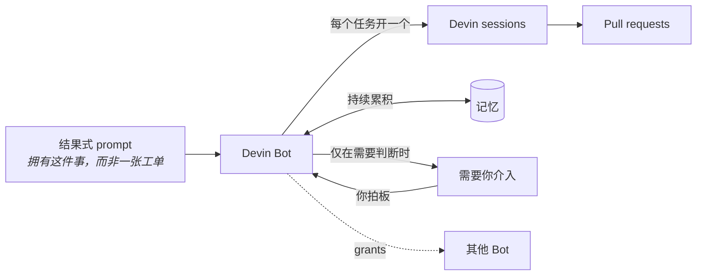

<picture>
  <source media="(prefers-color-scheme: dark)" srcset="assets/cover-dark.svg">
  
</picture>

 

维护者 [@darega0mae](https://x.com/darega0mae) · 姊妹教程库：[build-with-devin](https://github.com/Till3005/build-with-devin) · [收录你的项目](CONTRIBUTING.md)

**13** 个有据可查的 Bot 部署 · **35** 个企业案例 · **6** 个已发布产品 · **29** 个工具与集成 · **24** 篇实战报告

[English](README.md) · 简体中文 · [日本語](README.ja.md) · [Português](README.pt.md)

> *非官方社区项目 —— 与 Cognition AI 无关联、未获其背书或赞助。"Devin" 是 Cognition AI 的商标。品牌素材依照 [devin.ai/brand](https://devin.ai/brand) 官方品牌包使用。官方文档：[docs.devin.ai](https://docs.devin.ai)。*

**Built with Devin** 是一个*经过核实*的登记表：每一条目都链接到实名部署、真实代码仓库或已发布的记述 —— 不收空谈，不收营销转述。收录标准见 [CONTRIBUTING.md](CONTRIBUTING.md)。

## 目录

- [Devin Bots —— 官方产品](#devin-bots----官方产品) —— 部署实录、可复用模式、官方数据、16 个官方模板
- [用 Devin 做出的产品](#用-devin-做出的产品) —— 代码由 Devin 撰写的已发布软件
- [企业级部署](#企业级部署) —— 带硬指标的公开客户案例
- [Bots 与接入面](#bots-与接入面) —— 把 Devin 接进 Discord、Telegram、Slack 等产品
- [SDK 与 API 工具](#sdk-与-api-工具)
- [围绕 Devin 的工具](#围绕-devin-的工具) —— 社区*为* Devin 造的东西
- [模式与实战文章](#模式与实战文章) —— 有据可查的真实用法
- [社区媒体](#社区媒体)
- [官方资源](#官方资源)

## Devin Bots —— 官方产品

发布于 **2026 年 11 月 17 日**（[官方公告](https://devin.ai/blog/introducing-devin-bots) · [文档](https://docs.devin.ai/work-with-devin/bots) · [Fortune 独家报道](https://fortune.com/2026/11/17/exclusive-cognition-bets-on-devin-bots-coding-agents-in-challenge-to-anthropics-duet-and-openais-dots/)）。Bot 是一个对*结果*负责的持久 agent：它规划工作、为每件事开一个 Devin session、跨周保留记忆，只把需要你判断的决策送到你面前。Bot 栖身在 Slack 和 iMessage 里，按日程或事件触发运行，并通过 grants 把工作交给其他 Bot。Bots 融合了 Cognition 于 2026 年 7 月收购的 Interaction Company（Poke）的技术。

### 有据可查的部署

| Bot | 属主 | 负责什么 | 公开数据 |
| --- | --- | --- | --- |
| **Android Bot** | Cognition | Devin 的安卓 App，端到端 | 2026 年 9 月 28 日收到 prompt *"your job is to product manage the android app"* —— 自己开工单、每单开一个 Devin session，**44 天**上线 Google Play 公测：合并 1,134 个 PR、344,651 行 Kotlin、2,841 个截图测试。人类全程只发了 **183 条消息** —— 其中 22 天零干预 —— **88% 的 PR 由它自己合并**。现在负责 Android/iOS 功能对齐。 |
| **Layout Bot** | Cognition | Devin web app 的布局偏移回归 | 每 3 小时构建生产 `main`，模拟首次/重复/延迟请求访问，把回归追溯到引入它的 PR，开出带前后对比视频的修复。**3 周 159 个 PR；卡顿 −70%。** |
| **Super Jenny** | Jenny Xu（社区） | 一整个手游工作室 | ~20 个 Bot（dev、Unity、发布、UI、iOS、Android、真机测试）由一个编排 Bot 统领；唯一的人类每天用**表情**回 4 次汇总 Slack 帖。约 50 → **每周 1,900 个 PR**，工作室营收 6 倍，周更发布。已上架为社区模板 **SuperJennyStack**。她随后又做了 **BotSpeak** —— 省 token 的 bot 间简语（ASD-STE100、ACK 代号、emoji 回执；完整语句只留给人类）：6 天内 bot 自主决策 **12×**。（[Jenny 的推文](https://x.com/xujennyc)、[BotSpeak 帖](https://x.com/xujennyc/status/2123111543105868166)） |
| **dabit3 的舰队** | Nader Dabit（Cognition DevRel） | 个人 5-Bot 组织 + 一个游戏工作室 | **CTO** bot：管全部会话/仓库，VIP iMessage 通道可短信直达每个 bot。**Auto(mation)Bot**：跑他的个人自动化，汇报延迟与效率建议。**DevCommunityBot**：在 Sheets/Notion 上运营大使计划，搭小型数据可视化应用。**DevRelBot**：文档 + 教程视频 —— *它有自己的电脑、自己的 Devin/GitHub/Linear 账号和 ElevenLabs 声纹克隆*，自己开浏览器录真实 UI。外加 **Windfable**：iPhone Duo 上的 Unity iOS RPG，~10 个 SuperJennyStack Bot 每人配专属 macOS+Xcode+Unity，测试折叠/展开双态并附前后截图 + 实机视频。（[入门长文](https://x.com/dabit3/status/2122755275182469515)） |
| **Onboarding QA Bot** | Cognition（Walden Yan） | 30+ 条 onboarding 流程的 24/7 QA | 自维护 Playwright 脚本、agent 任务队列，以及它自己搭的实时看板 —— "找到的 bug 远超我有耐心去挖的数量"。（[@walden_yan](https://x.com/walden_yan)） |
| **"Phil"** | Harvey | 协作式 Word 兼容编辑器引擎 | ~30 个 agent 用 **3 周、零人类工程师** 写出 100 万+ 行 Rust + TypeScript —— 全程对照真实 Microsoft Word 行为和模拟律师谈判验证；人类通过记忆 + 决策日志掌舵。（[Gabe Pereyra](https://x.com/gabepereyra)） |
| **共享 Bot 舰队** | Decagon | on-call、DevEx 优化、讨论串路由 | beta 期间 Slack 里跑了 50+ 个共享 Bot；一个 Chief of Staff Bot 决定何时、如何开新讨论串。（[@tylerxdev 的推文](https://x.com/tylerxdev/status/2122743518712287400)） |
| **AutoResearch 回路** | Decagon | 一个推理研究实验室 | 一个 Devin 当编排者；子 agent 并行追逐相互竞争的假设；每个想法都在 Modal GPU 上用回放的生产流量验证 —— **每 GPU 吞吐最高 2.5×**（[完整长文](https://x.com/DecagonAI/article/2115511110120120437)、[@devindevelopers](https://x.com/devindevelopers/status/2115601107581821172)）。 |
| **Frankie 的组织** | Mark Fenner（社区） | 个人 agent 舰队 | 四个分工各异的 Bot，由 "Frankie, my Chief Agent" 协调并把汇总上报回来（[演示](https://x.com/markfenner/status/2122740244328145211)）。 |
| **tigsbot** | @0xtigs（社区） | 个人多项目舰队 | 每个项目占一个 Slack 频道、由一个 Bot 运营；一个 Chief-of-Staff Bot 回答 "所有项目最新进展？" 并在*他自己*成为瓶颈时戳他；专职 Bot 管理单许可证或复杂安装的软件（[配置](https://x.com/0xtigs/status/2122742784176034056)）。 |
| **奖励制 Chief-of-Staff** | Avinash（Cognition，MENA） | 个人 bot 舰队的每日站会 + 奖励 | 借鉴 SuperJennyStack 的汇总模式：一个 Bot 每天评审其他所有 Bot 并"奖励"干得好的，让舰队自我改进——他建议新手把这个作为第一个部署。（[报道](https://news.sulat.com/2026/11/18/devin-bots/)） |
| **Electra** | Basis | 内部工具 + 代码，自主导向 | 一个有名字的 Devin 队友（Bots 之前）：自己决定该做什么、写码并测试、给内部工具推更新、反过来推动团队 —— Basis 给每个税务 agent 跑一条 20 天的长线程（[帖子](https://x.com/trybasis/status/2113307030203089189)、[20 天线程](https://x.com/trybasis/status/2120658137766100992)）。 |
| **个人数据 Bot** | Bryan Johnson | 健康数据综合 + 给家人汇报 | 一个 Bot 把多年的生物指标和脑扫描数据综合成单一读数；另一个每天给他母亲发一条他的近况短信。（[帖子](https://x.com/bryan_johnson/status/2122814114976383406)、[发布视频](https://vimeo.com/1247688199)） |

### 有据可查的模式

- **结果式 prompt** —— *"You own the Android app now. Keep it at feature parity with iOS."* 给 Bot 一个目标，而不是一个待办清单。
- **Bot 间交接** —— grants 让 QA Bot 发现 bug 后拉 Developer Bot 来修，在 staging 复测，再由 PM Bot 向频道汇报状态。
- **定时巡检** —— 按 cron 盯着告警频道的 Bot，拥有这个检查项，回归时自己开修复（Layout Bot 模式）。
- **汇总上报** —— 一个监督 Bot 把每个下级 Bot 待决策的事收集进一条讨论串（SuperJennyStack 模式）。
- **Bots × Apps** —— Bot 维护 Devin Apps：自动建新页面/功能并适配变化；Bots 和 Apps 钉在同一侧导航栏（[@dabit3](https://x.com/dabit3)）。
- **Living evals** —— 定时 Devin 读生产 trace，按行为分组，在系统完整副本（绝不 mock）里回放失败，并把每个失败冻结成 eval PR —— 资产是 skill 文件，不是 eval 本身（Rox：覆盖率 72% vs 手写 43–57%）。
- **Bots 反过来调 Devin** —— Walden 的 bot 盯用户反馈、回放 prompt、跑实验、造 eval 集，并调 Devin 自己的主动性/自主度参数 —— Bots 造 Bots（[推文](https://x.com/walden_yan/status/2122740852091216274)）。
- **有自己账号的 Bots** —— DevRelBot 能自己录教程视频，是因为它像员工一样被开了全套账号：自己的电脑、自己的 Devin/GitHub/Linear 账号、自己的 ElevenLabs 声纹 —— 它登录 Devin 录的是真实 UI。
- **Bot 间通信协议（BotSpeak）** —— 20+ 个 Bot 每天产生 700+ 条消息；Jenny 用一套 bot 间简语（ACK 码、简化英语、emoji 回执）解决了收件箱崩溃，只有对人才用完整句子 —— 6 天内 bot 自主决策提升 12 倍。
- **基准锚定的 swarm** —— Harvey 的教训：当工作能对照可靠基准验证时（真实 Word 行为），小团队可以安全地指挥大规模 swarm。

### 公开结果

发布前几周有 **1,000+ beta 测试者**。测试者每条消息合并的 PR 数提升 **4.5×**；Cognition 每周合并 2,000+ PR，合并吞吐提升 40 倍，并实现了**单一自主目标产出 1,000+ PR**。早期客户包括 **Decagon、Fireworks AI、Reducto**，上线两周内用量增长 10 倍（[Fortune](https://fortune.com/2026/11/17/exclusive-cognition-bets-on-devin-bots-coding-agents-in-challenge-to-anthropics-duet-and-openais-dots/)）。

其他有据可查的用法：**Manim** 的 issue 预检、固件开发、bot 团队打造的**前沿推理引擎**、网球数据分析、财务自动化（trybasis：20 小时 → 30 分钟）、swyx 的一周试用（AEO、QA、跨平台移植、个人事务、视频剪辑 —— [他的总结](https://x.com/swyx/status/2122746401482592549)）、大使 **Chris Wozniczek** 用 Slack 运营自己的建站工作室（冷邮件外联、客户预览）、**Nick White**（Helionova）的早期 Bots 测试，以及 Cognition 研究团队把"数周压成数天"（[@silasalberti](https://x.com/silasalberti)）。完整记述见[复现指南](docs/reproducing-devin-bots.md#reported-usage-beyond-cognition)。

### 官方模板库

[公开模板市场](https://devin.ai/bots/templates)上 16 个现成 Bot，外加 **SuperJennyStack** 等社区模板：

| 模板 | 职责 |
| --- | --- |
| Software Factory | 在指定产品区域里找 bug、打磨点、性能和重构机会；每次开一个小 PR 并附可运行证明 |
| Product Engineer | 把工单或需求做成经过测试的 PR 并走完评审 |
| QA Engineer | 在真实浏览器里测每个 PR，回传通过/失败的录屏 |
| Anomaly Watcher | 每天两次扫描产品 + 业务数据，找监控覆盖不到的问题 |
| Code Reaper | 每周清理死代码，一次一个安全 PR |
| Chief of Staff | 盯频道、发进展、把工作派给团队并跟到完成 |
| Migration Engineer | 把一次大迁移拆成可追踪的小 PR，附进度看板 |
| Latency Optimizer | 找最慢的端点/任务/查询；每周一个带前后对比的提速 PR |
| iOS Engineer | SwiftUI 功能 → PR + TestFlight 构建 |
| Android Engineer | Kotlin 功能 → PR + 内测构建 |
| Internal Tools Engineer | 在你的技术栈上搭管理后台和内部工具 |
| Data Analyst | 回答数据问题，附图和背后的查询 |
| Devin Coach | 用你自己的使用数据教团队用好 Devin |
| Code Health Engineer | 过期 flag、老旧依赖、CVE → 安全小 PR |
| Technical Writer | 合并后让 repo wiki 和图跟上 `main` |
| Compliance Engineer | 从代码里收集合规证据，控制项失效时告警 |

**[→ 复现指南：如何重建每一个有据可查的 Bot](docs/reproducing-devin-bots.md)** —— 扩展教程版在姊妹库 **[build-with-devin](https://github.com/Till3005/build-with-devin)**

站点：**[till3005.github.io/built-with-devin](https://till3005.github.io/built-with-devin/)**（Devin 风格的注册页）· 深度文档：**[Devin Bot 解剖](docs/devin-bots-anatomy.md)**（六个有据可查的机制 + 数字真正说明了什么）· **[Devin 经济学](docs/economics.md)**（所有已发表的成本/回报数字汇一册 —— 另有[可筛选页面](docs/economics.html)）

<a href="#readme">back to top</a>

---

## 用 Devin 做出的产品

真实软件，Devin 写的代码 —— 不是演示，是已发布的产品。

- **[Eon 的 Era](https://devin.ai/customers/eon)** —— 用于训练和评估 AI agent 的仿真企业（74 套忠实还原的厂商系统：Salesforce、Slack、Zendesk、Jira……）。**98% 的合并 PR 由 Devin 撰写**，300+ 个全天的 session，2,720 个 session 由其他 session 发起。
- **[Courtyard 的 Quick](https://courtyard.io/blog/post/from-a-slack-link-to-production-in-under-48-hours-cloning-shopifys-quick-with-devin)** —— Courtyard 复刻了 Shopify 内部静态站点部署器 "Quick"：从一条 Slack 链接到生产服务（Go、Cloud Run、Bazel、Terraform、SSO、git 后端）只用了 **~21 小时**，全部由 Devin 撰写。
- **[Frontierfood](https://samyok.com/frontierfood)** —— Cognition 工程师 Samyok Nepal 用 Devin Voice 爬 Google 评论，按位置画出美食的帕累托前沿（[帖子](https://x.com/samyok/status/2098155977199743367)）。
- **Flappy Asher** —— Russell Kaplan（Cognition 总裁）让 Mac VM 上的 Devin 把婴儿照片做成游戏素材并发布了成品 —— 已上架 TestFlight（[帖子](https://x.com/russelljkaplan/status/2100280085999919555)）。
- **[Try Devin vending machine](https://github.com/dabit3/vending-machine)** —— dabit3 的活动发码机（Next.js + Convex + Clerk）：参会者在活动页输邮箱领 Devin 额度码。`devin-ai-integration[bot]` 是仓库头号贡献者（266 commits）；线上 [trydevin.ai](https://www.trydevin.ai/)。
- **[GymClass](https://seed.horacioh.com/writing/how-i-built-a-full-booking-system-as-a-side-project-with-devin-as-my-engineering-partner)** —— Horacio Herrera 给真实武术馆做的订课与学员管理系统（TS/Bun/React/Hono/tRPC，Cloudflare）：一个月功能量，全部在手机上会议间隙指挥 Devin 完成——含订课架构重写和 Vitest→Bun 迁移。

*知道有 Devin 做出的已发布产品？[收录它](CONTRIBUTING.md)。*

### 有趣的小作品

小而美的构建 —— 证明同一台机器也能做好玩的事。

- **[iPhone Duo 上的手游](https://x.com/xujennyc/status/2121625134029209929)** —— Jenny Xu 和 Nader Dabit 在折叠机上折腾 Devin 做的手游；Devin [自己就能构建和测试 Duo app](https://x.com/DevinAI/status/2111161066403123653)，还能规模化（[dabit3](https://x.com/dabit3/status/2112939574133760190)）。
- **Devin 的自画像** —— Bryan Johnson 让 Devin 画出它眼中的他（[帖子](https://x.com/bryan_johnson/status/2122818486800191842)）。
- **岗位被 Bot 顶掉的 CoS** —— Cognition 一位新任 chief-of-staff 第一周：醒来发现新的 Chief of Staff Bot 已经在干他的活（[帖子](https://x.com/arirbrown/status/2122789909731872882)）。

<a href="#readme">back to top</a>

---

## 企业级部署

带硬指标的公开客户案例（[完整索引](https://devin.ai/customers)）：

| 公司 | 部署方式 | 公开结果 |
| --- | --- | --- |
| [Nubank](https://devin.ai/customers/nubank) | 数百万行、8 年历史的 ETL 单体 → 子模块 | 工程效率 8–12×，成本省 20×；微调过的 Devin 把 ~40 分钟/任务压到 ~10 |
| [Wayfair](https://devin.ai/customers/wayfair) | 全组织云端 agent | 1,600+ 工程师全员投入 |
| [The Access Group](https://devin.ai/customers/access-group) | 250 个产品、2,000+ 工程师的 Devin | 工程产出 5× |
| [EBANX](https://devin.ai/customers/ebanx) | Devin 当主要作者 | **92% 的合并 PR 出自 Devin** |
| [Gumroad](https://devin.ai/customers/gumroad) | 核心仓库上的 Devin | Devin 是该仓库的**头号贡献者**：1,500+ 合并 PR |
| [Finch](https://devin.ai/customers/finch) | 功能 + 维护工作 | 合并 3,000 个 PR，省约 20 个工程师月 |
| [Comarch](https://devin.ai/customers/comarch) | 20 年、千万行 ERP 重建 | 全系统现代化进行中 |
| [AngelList](https://devin.ai/customers/angellist) | 事故分诊 + 数据迁移 | 70% 的事故由 Devin 先于工程师定位根因；Redshift→Snowflake 快 5.2× |
| [Modal](https://devin.ai/customers/modal) | 事故响应 | 80% 的事故在工程师打开线程前已完成初查 |
| [Reducto](https://devin.ai/customers/reducto) | Devin Oncall 当一线响应 | 工程师几乎不再被 page |
| [Eight Sleep](https://devin.ai/customers/eight-sleep) | 全公司 Devin | 交付量 8× |
| [Exa](https://devin.ai/customers/exa) | 端到端交付 | 工程师本地不拉代码也能上生产 |
| [RV Tech](https://devin.ai/customers/rvtech) | Rivian × VW 合资，软件定义汽车 | 测试速度 10× |
| [Melius](https://devin.ai/customers/melius) | 高吞吐小团队 | ~100 PR/天 |
| [Hamming](https://devin.ai/customers/hamming) | 代码库上的 Devin | 占总代码量 25% |
| [Airbyte](https://devin.ai/customers/airbyte) | 连接器维护 | 维持 700+ 连接器运行 |
| [Litera](https://devin.ai/customers/litera) | 回归测试 | 回归周期缩短 90% |
| [Ramp](https://devin.ai/customers/ramp) | 技术债清理 | **每周 80 个合并 PR，省 10,000+ 工程师小时**；由一个小而熟 Devin 的团队运营 |
| [Linktree](https://devin.ai/customers/linktree) | 功能 + 客户 bug 流水线 | 上月 ~300 个 PR 撰写 / ~100 合并；团队的条件反射变成了 "can I just Devin it?" |
| [Bilt](https://devin.ai/customers/bilt) | 全组织铺开 | 2 月以来 800+ 合并 PR，周均 ~117；发布后**其 Devin Bots 单周合并 ~1,600 PR**——工程 VP Will Laughlin（[Bots 评价](https://devin.ai/bots)）|
| [Rohlik Group](https://devin.ai/customers/rohlikgroup) | agent 驱动的杂货零售 | 工程吞吐 2×；含仓储机器人在内的自动化上线快 4×；50+ MCP 集成 |
| [Crosby](https://devin.ai/customers/crosby) | AI 原生律所 | 每天 20–40 个 bug 报告/告警拿到 first pass，平均 ~5 分钟；12 名工程师服务 50+ 律师 |
| [Endava](https://devin.ai/customers/endava) | 企业级全员配置 | 2,000+ 员工上平台；四个月 3×；PR 合并率 78% |
| [Tavrn](https://devin.ai/customers/tavrn) | HIPAA 约束下的舰队 | 8 人队打出 50 人的交付；**6 周 1,800+ PR**，产出 6× |
| [Itaú](https://medium.com/itautech/devin-no-ita%C3%BA-como-escalamos-o-uso-de-agentes-na-engenharia-de-software-b636bedebc5a) | 巴西最大银行的治理优先落地 | 从试点扩到 17,000 人技术组织，满足安全要求（葡语） |
| **Rox** | Living Evals —— 每周 Devin 读生产 trace，在完整副本中回放失败，开 eval PR | 评测集覆盖**真实用量的 72%**（手写只有 43–57%）（[全文](https://www.rox.com/articles/living-evals-an-eval-suite-that-grows-from-production)、[推文](https://x.com/rox_ai/status/2110779380666617997)） |
| [Evinova](https://devin.ai/customers/evinova) | GxP 合规交付 | GxP 文档快 8×；迁移快 3×；66% 边界清晰的 bug 被自主修复 |
| [Compiled Health](https://devin.ai/customers/compiledhealth) | 临床基准构建 | 2 名研究员 2 个月 = 5–6 名工程师的活；~430 工程师小时、~$17/小时 ≈ 给 4 人队添 4 名工程师 |
| [Común](https://devin.ai/customers/comun) | 13 人金融科技团队 | 产出 3×；后端周 PR 50 → 170（四周） |
| [AHEAD](https://devin.ai/customers/ahead) | 8 个生产工作负载 | 相对人工基线**省时 8–40×**；两个工作日内完全上手 |
| [The Citation Group](https://devin.ai/customers/thecitationgroup) | 量化 ROI 的铺开 | 3 个月合并 271 个 PR（80%）；工程效率 +50%；遗留应用刷新成本降 85% |
| [Latent Health](https://devin.ai/customers/latent) | 药房运营 | 人均 PR 比单用 Claude Code 多 30%；50 个在跑的 automations |
| [Crossmint](https://devin.ai/customers/crossmint) | GOAT 开源项目规模化 | 试用期内 Devin 成为仓库头号贡献者 |
| [FE fundinfo](https://devin.ai/customers/fefundinfo) | 1,800 仓库自动化 | 靠测试生成 + 安全修复立刻多出 10% 产能 |
| [GE Aerospace](https://devin.ai/customers/geaerospace) | 受限团队的 story 吞吐 | 三个月内 user-story 产出 ~2× |

其他公开记录的：Citi（40,000 名开发者铺开，技术供应商支出降 30%）、Mercor、Hippo、Mercedes-Benz、Cognizant 和 Infosys 合作 —— 见[客户索引](https://devin.ai/customers)。

<a href="#readme">back to top</a>

---

## Bots 与接入面

把 Devin 装进其他产品和频道。

- **[devin-discord-bot](https://github.com/wgtechlabs/devin-discord-bot)** —— 自托管 TypeScript bot，把 Devin 带进 Discord：@ 一下就开 session，进度流回频道。
- **[devin-telegram-bot](https://github.com/wgtechlabs/devin-telegram-bot)** —— 同一作者的 Telegram 桥，接 Devin API。
- **[Buzz for Devin](https://github.com/fenner888/BuzzforDevin)** —— Block 的 Buzz 社区 fork，把官方 Devin CLI（`devin acp`）加为原生 runtime，让每个人带着自己已认证的 Devin 进共享 agent 社区。
- **[devin-sse-proxy](https://github.com/sotayamashita/devin-sse-proxy)** —— 极简 MCP server，让 Claude Desktop 在带 Personal API Key 的情况下与 Devin 的 SSE transport 对话。
- **[devin-flow](https://github.com/xlm/devin-flow)** —— Automations API 上的事件驱动 Devin 工作流可视化编辑器，带 session 追踪（FastAPI + Vue 3）。

<a href="#readme">back to top</a>

---

## SDK 与 API 工具

- **[go-devin](https://github.com/gassara-kys/go-devin)** —— Devin API 的 Go SDK。
- **[llm-devin](https://github.com/ftnext/llm-devin)** —— Simon Willison 的 `llm` CLI 插件，用来调 Devin API。

<a href="#readme">back to top</a>

---

## 围绕 Devin 的工具

社区*为* Devin 造的东西（而不是用它造的）。

- **[DevinX / Devinmaxxing](https://x.com/markfenner)** —— Mark Fenner 给 Devin Desktop session 做的本地模型选择器：经 ACP 接本地权重、自适应成本平衡、推理强度控制。
- **[awesome-devin](https://github.com/Icaro0310/awesome-devin)** —— `devin-*` 开源工具生态：session 搜索、历史导出、知识图谱、eval 框架、备份、fan-out 规划。
- **[devin-judge](https://github.com/Icaro0310/devin-judge)** —— 校准过的本地优先决策层，Devin ACP 后端；无需 API key。
- **[devin-fusion-byok](https://github.com/kuobibulaien/devin-fusion-byok)** —— Devin 扩展（VSIX），把自有模型 API 接进 Devin 的模型选择器并组成 Fusion Lead+Sidekick 预设 —— 不改动应用本体。
- **[devin.cursorrules](https://github.com/grapeot/devin.cursorrules)** —— 5k★ 规则集，把 Cursor/Windsurf 调成 "90% 的 Devin" —— 衡量 Devin 级 agent 行为的参照物。
- **[nix-devin-cli](https://github.com/broady/nix-devin-cli)** —— Devin CLI 的 Nix 打包，macOS 和 Linux 每晚自动更新。
- **[QuotaView](https://github.com/Duoasa/QuotaView)** —— macOS "灵动岛"式 agent 监控：与 Claude/Codex/Grok 并列追踪 Devin Desktop 和 Devin CLI 的 session、审批和额度。
- **[Mako](https://github.com/Verbiflow/mako)** —— 全 agent 本地工作台；经 ACP 接管 Devin 会话 —— 运行、跟随、恢复、跨机迁移。
- **[ax](https://zenn.dev/kuwashima/articles/ax-cross-agent-session-picker)** —— fzf session 选择器，能把 Devin 和其他 18 个 agent CLI 一起恢复（日文）。
- **[Kiro Crew 的 Devin CLI 补丁](https://zenn.dev/dario_okazaki/articles/e5eda2aca4fdd2)** —— 非官方补丁，把 Devin CLI 加进 Kiro Crew 托管 bot 舰队，带逐 bot 权限处理（日文）。
- **[Devin for VS Code](https://github.com/shayanline/devin-vscode)** —— VS Code 内的完整 Devin CLI 聊天面板：`@` 引用工作区上下文、Keep/Undo diff 评审、按工作区恢复会话、CLI 的 instructions/skills/plugins/MCP/hooks 内置设置编辑器。
- **[Devin Switch](https://github.com/ansuman-shukla/devin-switch)** —— 原生 macOS 应用 + CLI，管理多个 Devin CLI 登录：隔离的账号配置、共享本地会话历史、用量/重置时间显示、并发启动。
- **[Devin Token Monitor](https://github.com/TH-Chou/devin-usage-monitor)** —— 原生 macOS 菜单栏应用（附 VSIX），把 CLI 本地 SQLite 指标变成实时成本仪表盘 —— token 趋势、模型占比、逐请求 TTFT/速度、预算告警、CSV 导出、六种语言。
- **[devin-desktop-zh](https://github.com/cby122/devin-desktop-zh)** —— 手工打造的 Devin Desktop 简体中文本地化：33,457 条字符串字典 + 注入/重签名流水线，产出独立的 `Devin 中文版.app` —— 以 Agent Skill 形式发布，整个流程可复现。
- **[devin-tui](https://github.com/fenner888/devin-tui)** —— Mark Fenner 基于 `devin acp` 的全屏终端 UI：React + Ink，工具调用、内联 diff、计划视图、按 session 计费。
- **[Devin Remote](https://github.com/zouhall/devin-remote)** —— Devin CLI 会话的浏览器控制台 —— 从任何浏览器（包括手机）驱动本地 Devin：流式聊天、权限、模式、模型、用量统计。
- **[Devin Pocket](https://github.com/BOTOOM/devin-pocket)** —— 移动优先的 ACP Devin CLI 客户端；跑在 Android/Termux、Linux 和 macOS 上。
- **[devin-control](https://github.com/Icaro0310/devin-control)** —— 策略门控的 ACP 客户端：allow/deny/ask 规则下隔离运行 Devin 会话。
- **[devin-subagents](https://github.com/Duro02/devin-subagents)** —— 把 `devin acp` 会话暴露为 MCP 上可生命周期管理的子 agent：并行派发、阻塞 `wait`、中途调向、权限裁决。
- **[Devin Session Exporter](https://github.com/marktwainme/devin-session-exporter)** —— Devin Desktop 扩展，把本地 ACP 会话库导出为 Markdown/JSON/HTML，带筛选和批量导出。
- **[devin-acp-shim](https://github.com/wibus-wee/devin-acp-shim)** —— 透明 stdio 代理，修复 Devin CLI 的会话级 MCP 能力协商 —— 虽小，但为所有 ACP host 解锁了 MCP server。
- **[hindsight-devin-desktop](https://pypi.org/project/hindsight-devin-desktop/)** —— Vectorize 的 MCP 桥：一条命令给 Devin Desktop 接上持久长期记忆 + 常驻 recall/retain 规则。

<a href="#readme">back to top</a>

---

## 模式与实战文章

有据可查的真实用法。

- **[SAST 自动修复流水线](https://github.com/Cognition-Partner-Workshops/uc-cve-remediation-regulatory-compliance/pull/16)** —— GitHub Actions 工作流：用 OWASP Dependency-Check 扫 PR，CVSS ≥ 7.0 时派发 Devin session 修复，带验证扫描和熔断升级。
- **[把 Devin 的 PR 归因到发起人](https://tech.enechange.co.jp/entry/2025/06/22/165504)** —— ENECHANGE 的 GitHub Actions 方案：记录哪位工程师指示了 Devin，解决所有 PR 都显示 `devin-ai-integration[bot]` 时的绩效计量缺口（日文）。
- **[修复过期邮箱告警](https://agentsinuse.com/use-cases/devin-to-clear-mailbox-alarm/)** —— Devin 把一个 Cloudflare Workers 测试 flake 追到过期 continuation alarm 并补上回归覆盖（via Agents In Use）。
- **[在 Devin 里设计 Spraycash UI](https://dev.to/ibrahimpima/designing-the-spraycash-ui-with-kimi-k3-in-devin-4l2f)** —— 一个金融科技落地页全程在 Devin 对话里做美术指导：生成图像、云层动画、SVG 描边动画、三字体体系 —— 每个 prompt 都公开了。
- **[rakko_inc 的 Devin 自动代码评审](https://zenn.dev/rakko_inc/articles/00cc5a5a679971)** —— Playbooks + GitHub Actions + Devin API 预消化每个 PR；月评审 PR 从 65 → 184（日文）。
- **[Skillnote 的 QA 测试设计自动化](https://zenn.dev/skillnote/articles/5ba429ca249801)** —— PR 触发 Devin 起草带理由的测试用例；每 10 例省 ~35 分钟（日文）。
- **[事件驱动的 Devin 自动化](https://zenn.dev/arufian/articles/f80a62f5217cee)** —— Serverless GitHub Actions 流水线，含优先级×复杂度策略表和 plan-first 审批流（日文）。
- **[Leverages 的组织级铺开](https://zenn.dev/levtech/articles/9c869303820844)** —— 14 个团队、177 个合并 PR，以及诚实的 ACU-vs-工资 ROI 公式（日文）。
- **[用 Devin 快速开发](https://blog.scottlogic.com/2025/10/20/rapid-development-with-devin.html)** —— Scott Logic 的实操记述，包括 prompt 迭代教训。
- **[Scott Wu 谈 Cognition 内部用法](https://www.lennysnewsletter.com/p/how-devin-replaces-your-junior-engineers)** —— Cognition 自己怎么委派：异步初级工程师工作流、任务类型前五、崩溃分析第一道防线。
- **[用 Signadot 端到端测试 Devin 的改动](https://dev.to/signadot/test-devins-changes-end-to-end-with-signadot-a0)** —— Devin + Signadot MCP：在 VM 里跑改动后的微服务，对照真实集群流量做沙箱，跑 Playwright 套件 —— 补上多服务系统里 Devin 自己收不了的尾。
- **[用 Devin Automations 做漏洞影响面分析](https://zenn.dev/rescuenow/articles/2ee1c4b66ecec8)** —— rescuenow 的定时 Automation 在 CVE 发布时自动调查爆炸半径（日文）。
- **[分类 700 条客服工单](https://zenn.dev/canly/articles/9c19bb123e208c)** —— canly 让 Devin 翻工单历史，查清 "原因未特定" 到底是什么 —— Devin 当数据分析师而非码农（日文）。
- **[Datadog CCM × Devin 周度降本](https://zenn.dev/hubble/articles/091e29a0c86ec3)** 和 **[Dependabot PR 先过 Devin](https://zenn.dev/hubble/articles/88429bd24db476)** —— hubble 的两个常驻循环：每周云成本削减，以及每个依赖升级先由 Devin 调查（日文）。
- **[Dynatrace MCP 把 Devin 变成性能分析 agent](https://medium.com/lets-code-future/how-i-turned-devin-into-a-performance-analysis-agent-with-dynatrace-mcp-753d3f4790a2)** —— 把 Devin 接上实时可观测数据，让它自己诊断延迟，而不只是看代码（Medium）。
- **[Devin：从 bug 报告到 PR](https://medium.com/@winter.inc/devin-from-bug-report-to-pull-request-25-days-of-ai-day-18-b158daa20f23)** —— 25 天 AI 系列的第 18 天：真实代码库上完整的 ticket→PR 闭环（Medium）。
- **[角色分工的 bot 开发队 + 轻量 PR 自动合并](https://zenn.dev/kyto64/articles/ai-bot-dev-env)** —— kyto64 的个人开发环境：专职 AI bot 加 Devin，低风险 PR 自动合并（日文）。
- **[Devin CLI 上下文上限实战](https://qiita.com/ishizakahiroshi/items/cee2a8ea2be18f2ccee3)** —— 把 AGENTS.md 和审批规则塞进 16KB/32KB 上限的工作笔记（日文）。
- **[NOT A HOTEL 的首次 Devin 试用](https://zenn.dev/notahotel/articles/d401a1046d6076)** —— 从配置到首个合并 PR 不到一小时的 mob 实战记录——含 Devin 对仓库接入分类项的要求（日文）。
- **[Hello World… Meet Devin](https://jamesin.substack.com/p/hello-world-meet-devin)** —— Jamesin Seidel 上线初期实录：第一次看 Devin 把代码提交进自己仓库，做了个邮件分拣助手（Substack）。
- **[Devin Bots 想做的是你的 agent 经理，不是你的 AI 员工](https://daily.dev/posts/devin-bots-want-to-be-your-agent-manager-not-your-ai-employee-hhpjo94uh)** —— daily.dev 的发布分析与评论区情绪统计（55% 正面 / 30% 混杂 / 15% 怀疑）：实质质疑集中在三点——谁来审一个负责审查的 Bot、凭证安全、管理一支舰队是否真比管理人省事。
- **[发布文没说的那些](https://aiholics.com/devin-bots-cognition-persistent-agents-goals/)** —— 最犀利的一篇批判性阅读：没有公开定价/档位细节、数字未经核实，以及两个没人回答的问题——Bot 几周后怎么不偏离目标、两个协调中的 Bot 意见不一致时怎么办。
- **[把 Grok Bots 组织移植到 Devin Bots](https://www.rickblalock.dev/scratch-notes/learnings-from-moving-my-grok-bots-to-devin-bots/)** —— 第一份独立的 beta 实测报告：把一个现成的 Grok-bot 组织移植过去花了约 $300 一次性用量和一个晚上；工程编排"令人愉悦"，但业务侧工作又被搬回了 Grok，最终落成 Grok Bot ↔ Devin Bot 混合架构。诚实的摩擦日志：bot 带给他的决策太多且不总是对的——"把我当 VP，别当实习生。"
- **[免费 SWE-2 上的多 AI 编排](https://qiita.com/ishizakahiroshi/items/72ab801a5f2a8c941b61)** —— 利用 Devin CLI 永久免费的 SWE-2 档在多个 agent 间路由工作的设计（日文）。

<a href="#readme">back to top</a>

---

## 社区媒体

- **[Devin Central](https://devincentral.com)** —— Trevor Lowing 的非官方 Devin 新闻与教程站。
- **[Voices —— 大使名录](https://devincentral.com/voices)** —— 全球 ~190 位 Devin 大使的非官方地图。
- **[devin-cli.github.io](https://devin-cli.github.io)** —— 社区文档：Devin API、Slack、Linear 接入面的覆盖范围与自动化方式。
- **[Agents In Use](https://agentsinuse.com)** —— 真实 agent 用例目录，含 Devin 条目。
- **[BitsExplorer —— Built with Devin](https://bitsexplorer.com/built-with/devin)** —— 340+ 个由 Devin commit trailer 实证的公开项目（证据，而非自述）。
- **[Vibe Coded Projects](https://vibedprojects.com/ai-tools/devin)** —— 373 个用 Devin vibe-code 出的应用、工具和站点。
- **[Devin 日本 2 周年 meetup](https://aid.connpass.com/event/412875/)** —— 大使主办的社区活动，纪念 Devin 公开两周年（[公告](https://x.com/kinopee_ai/status/2123019189325848847)）。
- **[Devin's Dinner](https://x.com/MattSchrage/status/2121016484155548124)** —— Matt Schrage 在纽约的邀请制晚宴系列，面向用 Devin 的创始人和工程师。

<a href="#readme">back to top</a>

---

## 官方资源

- [Devin Community](https://devin.ai/community) —— 活动、大使申请、活动支持
- [docs.devin.ai](https://docs.devin.ai) —— 文档：[Bots](https://docs.devin.ai/work-with-devin/bots)、[Automations](https://docs.devin.ai/product-guides/automations)、[Devin CLI](https://docs.devin.ai/cli/index.md)
- [Use-case gallery](https://docs.devin.ai/use-cases/gallery/index.md) —— 40+ 个带可复制 prompt 的文档化工作流；[切片最佳实践](https://docs.devin.ai/use-cases/best-practices.md)
- [devin.ai/brand](https://devin.ai/brand) —— 官方品牌包
- [Devin Discord](https://devin.ai/community) 和 [r/DevinAI](https://www.reddit.com/r/DevinAI/) —— 官方社区
- [CognitionAI/qa-devin](https://github.com/CognitionAI/qa-devin) —— Cognition 自家的 "Devin 做 QA" 参考仓库
- [CognitionAI/devin-vuln-fixes](https://github.com/cognitionai/devin-vuln-fixes) —— 官方 agent 技能，修复真实 CVE（GitLab CVSS 10.0、PHP/Node RCE）：只读盘点 → 审批门 → 确认目标 → 前后测试 → 每仓库一个聚焦 PR
- [用 Devin 在 Modal 上训练并部署自定义模型](https://gist.github.com/dabit3/866caaab49a4a5371ae01655fecad34b) —— Cognition 工程师 Nader Dabit 的可运行模板
- [Devin for Startups](https://devin.ai/startups) —— 合格团队最高 $65k credits；[Devin for Gaming](https://talofagames.com/devin-for-gaming/) —— Talofa × Cognition 三周工作室 cohort，含线下工作坊和 credit 奖励；**[poke.com/bots](https://poke.com/bots)** —— 限时实验（11/18 起）：给 Poke 发短信说出你想建的东西、说明为什么值这些 credits，就能拿一个免费 Devin Bot —— 共 10,000 个账号、每席最高 $10,000（Nader Dabit 称总额 ~$1 亿），绕过 $200/月的 Max 门槛（[公告](https://x.com/walden_yan)、[报道](https://news.sulat.com/2026/11/19/devin-bots-giveaway/)）
- [Devin Automations QuickStart](https://www.youtube.com/watch?v=6xxKtIpgOyE) —— 官方视频：事件/定时触发 agent 配置，Bots 的底层机制
- [SWE-2 Flash](https://cognition.com/blog/swe-2-flash) —— Cognition 的快速编码模型：主流评测超过所有美国开源权重模型，速度为 SWE-2 的 3×、价格 1/5
- [Devin Apps](https://devin.ai/blog/devin-apps) —— Devin 在自己机器上构建并以稳定 URL 提供的 live web 应用（内部工具、看板、staging 副本）

<a href="#readme">back to top</a>

---

## 贡献

用 Devin 做了什么，或知道遗漏的部署？见 [CONTRIBUTING.md](CONTRIBUTING.md) —— 一行描述、链接先行、不要营销文案。

## 许可证

[CC0-1.0](LICENSE) —— 贡献给公共领域。各条目归属其所有者。
